# خارطة الطريق الرئيسية لتطوير نظام إدارة محل موبايل — Mobile Shop Management System (Windows LAN ERP)

> **نوع المستند:** Blueprint تقني ووظيفي رسمي — تحليل وتخطيط فقط (Analysis & Planning Only)
> **الحالة:** مسودة معتمدة للتخطيط — **لم يُكتب أي كود تطبيقي، ولم يُعدّل أي ملف مصدر، ولم يُنفَّذ أي سكربت قاعدة بيانات**
> **تاريخ الإصدار:** 2026-11-07
> **الفرع:** `arena/2a3f5cb6-projectz` — **commit الأساس:** `8e964a9ff953fee794e911e7748d64740f3fc612`
> **نطاق التدقيق:** شجرة العمل المُختبَرَة (working tree) عند commit الأساس أعلاه، مع توثيق انحراف `origin/main` اللاحق في B.11
> **اللغة:** عربية فنية؛ أسماء الكيانات والفئات وواجهات API والتقنيات تُترك بالإنجليزية كما هي في المصدر

---

## دليل القراءة والمنهجية

| الرمز | المعنى |
|---|---|
| `P00` … `P19` | مراحل التطوير (20 مرحلة) في القسم F |
| `R-XXX-NN` | معرّف متطلب فريد؛ يظهر في **القسم D** (جرد المتطلبات) وفي **القسم Q** (مصفوفة التتبع) بنفس المعرّف |
| `AT-XXX-NN` | معرّف اختبار قبول مرتبط بالمتطلب واحد لواحد |
| `OD-XXX-NN` | **قرار مفتوح** (Open Decision) — قاعدة تجارية أو معمارية لم تُحسم بعد؛ لا يُبتدع لها حكم نهائي في هذه الوثيقة |
| `RISK-NN` | بند في سجل المخاطر (القسم M) |
| `TN-NN` | بند دين تقني / مشكلة معروفة (القسم B.10) |
| `ENT-NN` | كيان قاعدة بيانات مقترح (القسم E) |

**قواعد ملزمة في هذه الوثيقة**

1. لا تُعتبر أي ميزة «منفذة» إلا بوجود دليل من ملف مصدر مُسمّى وسطر مُحدّد في القسم B.
2. لا تُستبدل التقنية الحالية (C# / .NET 10 / WPF / SQL Server)؛ أي تطوير مقترح هو **إضافة تدريجية داخل نفس الحل**.
3. نظام الدخول العامل **محمي بالكامل**؛ يُوثّق ويُؤمَّن ولا يُعاد بناؤه.
4. لا يُبتدع أي معادلة مالية؛ جميع المسائل غير المحسومة مُسجّلة كقرارات مفتوحة في القسم H.
5. لا يصل أي عميل (desktop client) إلى SQL Server مباشرة في البنية الهدف.

---

# القسم A — الملخص التنفيذي

## A.1 النظام والهدف التجاري

نظام **Mobile Shop Management System** هو ERP تجاري يومي لمحل بيع وصيانة الهواتف المحمولة، يعمل بالكامل داخل شبكة LAN محلية بلا اعتماد على الإنترنت. يدير دورة العمل كاملة: استقبال البضاعة من الموردين → تسعير وتخزين → بيع عبر نقطة بيع سريعة → تحصيل متعدد الوسائل → مرتجعات ومبادلات → صيانة أجهزة العملاء → تحويلات مالية (Vodafone Cash / InstaPay) → ديون العملاء والموردين → تقارير مالية وإدارية → طباعة فواتير وباركود. الهدف ليس «شاشات منفصلة» بل **كيان محاسبي واحد متسق**: كل عملية تجارية تُنتج حركة مخزنية وحركة مالية وسجل تدقيق داخل حد معاملة واحد (transaction boundary).

## A.2 الفئات المستهدفة

| الدور | العمليات اليومية | متطلبات الصلاحية |
|---|---|---|
| Cashier / كاشير | POS، فواتير متعددة، تحصيل، طباعة | إنشاء فاتورة، منع تغيير السعر والخصم |
| Store Manager / مدير المحل | لوحة التحكم، المخزون، المشتريات، المرتجعات، التقارير | approvals، تعديل الأسعار، إلغاء فواتير |
| Technician / فني | استقبال أجهزة، تشخيص، قطع غيار، تسليم | صلاحيات الصيانة فقط |
| Accountant / محاسب | الديون، المصروفات، التقارير المالية، الإقفال | عرض الأرباح، تعديل الأرصدة بأثر تدقيق |
| System Admin | المستخدمون، الأدوار، الإعدادات، النسخ الاحتياطي | إدارة كاملة + AuditLogs |

## A.3 نموذج النشر

- **Windows فقط**، عدد صغير من الأجهزة (سيرفر رئيسي + عدة عملاء).
- الجهاز الرئيسي يستضيف: قاعدة البيانات المركزية + **Backend API** كـ Windows Service + النسخ الاحتياطي + السجلات.
- أجهزة العملاء تشغّل تطبيق WPF فقط، وتتخاطب مع الـ API عبر HTTPS على LAN؛ **لا SQL Server ولا connection string ولا أسرار قاعدة بيانات على العميل**.
- قاعدة بيانات واحدة مركزية، مستخدمون متزامنون، لا حاجة إلى الإنترنت للتشغيل الداخلي.

## A.4 الحقيقة الحالية (ملخص التدقيق)

المستودع عند commit الأساس **ليس نظام ERP**؛ هو تطبيق **WPF لتسجيل الدخول والخروج فقط** (40 ملفًا، جدول واحد `dbo.Users`)، باتصال `Microsoft.Data.SqlClient` **مباشر من كل عميل إلى SQL Server**، بلا API وبلا طبقة صلاحيات وبلا أي وحدة أعمال. نظام الدخول يعمل فعليًا (PBKDF2-SQL parameterized query-جلسة في الذاكرة) وهو **الأصل الوحيد القابل للبناء عليه**. التفاصيل والدلائل في القسم B.

## A.5 القرار المعماري الحاكم

**الاحتفاظ بالتقنية**: C# / .NET 10 / WPF / XAML / SQL Server 2016 SP1 Express (compatibility 130) / `Microsoft.Data.SqlClient 6.1.3` / MVVM hand-written.
**الإضافة المبررة**: مشروع `FitohPhone.Api` (ASP.NET Core Web API) داخل `FitohPhone.sln` يُستضاف كـ Windows Service على الجهاز الرئيسي، ومشروع `FitohPhone.Shared` للعقود (DTO). هذه **إضافة طبقة ناقصة وليست استبدالًا**: التوصيل المباشر الحالي لا يلبي متطلب « Never allow desktop clients to bypass the backend » ولا يسمح بفرض الصلاحيات مركزيًا ولا بضبط التزامن ولا بإخفاء أسرار الاتصال. مسار الانتقال تدريجي (Strangler) موصوف في C.7.

## A.6 حجم الخطة

| البند | القيمة |
|---|---|
| مراحل التطوير | **20 مرحلة (P00 – P19)** |
| وحدات وظيفية | **14 وحدة (M01 – M14)** + متطلبات cross-cutting |
| السمات (Themes) | **8 سمات مستقلة** |
| المتطلبات المتتبَّعة | انظر القسم Q (مصفوفة إلزامية بعدد مُحصى آليًا) |
| القرارات المفتوحة | انظر القسم H والملحق |
| إجمالي الجهد التقديري | انظر القسم P (أيام مطور مقابل مدة تقويمية) |

---

# القسم B — تدقيق المشروع الحالي (Existing Project Audit)

## B.1 منهج التدقيق والأدلة

تمت مراجعة **كل ملف** في الشجرة (40 ملفًا متتبّعًا)، وقراءة المصدر سطرًا بسطر، ومراجعة `git log`، و`gh pr list`، و`git ls-remote`، و`gh run list`، و`FETCH_HEAD` لمقارنة `origin/main`. لا توجد افتراضات حول «مشروع فارغ» أو «مشروع ERP جاهز».

| الأداة / الأمر | الغرض |
|---|---|
| `git ls-tree -r -l HEAD` | حصر كامل الملفات وأحجامها |
| `cat -n` لكل `*.cs`, `*.xaml`, `*.sql`, `*.json`, `*.yml`, `*.md`, `*.py` | قراءة المصدر بالأرقام |
| `git status -sb`, `git log --oneline`, `git ls-remote origin` | تحديد commit الأساس وانحراف الفروع |
| `gh pr list --state all`, `gh pr view 34 --json files` | تاريخ الـ PRs والعمل اللاحق على main |
| `gh run list` | حالة CI على Windows |
| `python3 tools/static_checks.py` (قراءة فقط، لم يُنفَّذ تغيير) | فهم الفحوص البنيوية الحالية |

## B.2 اللغات والأطر والحزم

| العنصر | القيمة الفعلية | الدليل |
|---|---|---|
| اللغة | C# (file-scoped namespaces، primary constructors، nullable enabled) | `App.xaml.cs`, `AuthenticationService.cs` |
| الإطار | `net10.0-windows` مع `UseWPF=true`, `OutputType=WinExe` | `src/FitohPhone/FitohPhone.csproj` |
| SDK | `10.0.100` / `rollForward: latestFeature` | `global.json` |
| تقنية الواجهة | WPF + XAML، MVVM يدوي بلا Framework خارجي | `Views/`, `ViewModels/`, `Helpers/ObservableObject.cs` |
| قاعدة البيانات | SQL Server 2016 SP1 Express، `COMPATIBILITY_LEVEL = 130` | `sql/01_CreateDatabase.sql:9`, `docs/SERVER.md:3` |
| برنامج تشغيل DB | `Microsoft.Data.SqlClient` **6.1.3** (SqlConnection / SqlCommand / SqlDataReader / SqlParameter) | `FitohPhone.csproj`, `Data/UserRepository.cs` |
| ORM / Migrations | **لا يوجد** (لا EF، لا Dapper، لا FluentMigrator، لا DbUp) | الشجرة كاملة |
| Backend / API | **لا يوجد** (لا ASP.NET، لا Kestrel، لا Controllers، لا gRPC، لا WebSocket) | الشجرة كاملة، `README.md:3` |
| المصادقة | PBKDF2-HMAC-SHA256 / 600,000 دورة / salt 16 بايت / hash 32 بايت / `FixedTimeEquals` | `Services/PasswordHasher.cs:10-34` |
| الإعدادات | ملف JSON خارجي `connectionsettings.json` بجوار EXE، `CopyToOutputDirectory=Always` | `FitohPhone.csproj`, `Services/ConnectionSettingsProvider.cs:22` |
| CI | GitHub Actions `windows-2022`, .NET 10.x: security tests → build → publish self-contained win-x64 → artifact | `.github/workflows/windows-build.yml` |
| الاختبارات | مشروع console واحد `tests/FitohPhone.Security.Tests` يربط `PasswordHasher.cs` فقط | `tests/*` |
| فحوص بنيوية | `tools/static_checks.py`: XML/JSON parsability + تطابق hash البذرة + جدول واحد + مستوى 130 + ضبط الإغلاق | `tools/static_checks.py`, `docs/STATIC-CHECKS.txt` |
| النشر | `dotnet publish` يدوي + نسخ مجلد `publish/win-x64`؛ لا MSI/MSIX/ClickOnce/Installer | `README.md:28-34`, `docs/CLIENTS.md:11` |

## B.3 بنية المشروع الفعلية

```
FitohPhone.sln                          # حل واحد: مشروع WPF + مشروع اختبار console
├── global.json                         # SDK 10.0.100
├── .github/workflows/windows-build.yml # CI على windows-2022
├── sql/
│   ├── 01_CreateDatabase.sql           # CREATE DATABASE + dbo.Users فقط
│   ├── 02_SeedAdmin.sql                # admin / PBKDF2 hash (idempotent)
│   └── 03_VerifyEnvironment.sql        # استعلامات تحقق للقراءة فقط
├── src/FitohPhone/
│   ├── App.xaml / App.xaml.cs          # دورة حياة النوافذ + الإغلاق
│   ├── Models/                         # ConnectionSettings.cs, UserSession.cs
│   ├── Data/UserRepository.cs          # SELECT واحد parameterized
│   ├── Services/                       # AuthenticationService, ConnectionSettingsProvider, PasswordHasher
│   ├── ViewModels/                     # LoginViewModel, MainViewModel
│   ├── Views/                          # LoginWindow.xaml(.cs), MainWindow.xaml(.cs)
│   ├── Helpers/                        # AsyncCommand, RelayCommand, ObservableObject
│   ├── Resources/Theme.xaml            # ResourceDictionary واحد (سمة واحدة فقط)
│   ├── Properties/PublishProfiles/     # FolderProfile.pubxml, FolderProfile1.pubxml
│   ├── connectionsettings.json
│   └── app.manifest                    # asInvoker, supportedOS واحدة
├── tests/FitohPhone.Security.Tests/    # اختبارات PasswordHasher فقط (غير WPF)
├── tools/static_checks.py
└── docs/                               # README, ACCEPTANCE, SERVER, CLIENTS, STATIC-CHECKS
```

**عدد الملفات المتتبَّعة:** 40 ملفًا. **عدد جداول قاعدة البيانات:** 1. **عدد شاشات WPF:** 2 (Login + Main). **عدد نوافذ الحوار:** 0. **عدد نقاط API:** 0.

## B.4 الميزات المنفذة فعليًا (بدليل مصدر)

| # | الميزة | الدليل |
|---|---|---|
| 1 | شاشة دخول عربية RTL بحقل اسم مستخدم وPasswordBox وزر ورسالة خطأ | `Views/LoginWindow.xaml:1-23`, `Resources/Theme.xaml:3` |
| 2 | ربط MVVM و`AsyncCommand` يمنع الضغط المزدوج أثناء التنفيذ | `ViewModels/LoginViewModel.cs:18-23`, `Helpers/AsyncCommand.cs:3-15` |
| 3 | قراءة كلمة المرور من `PasswordBox` ومسحها فورًا دون تخزينها في ViewModel | `LoginViewModel.cs:26-27,63`, `LoginWindow.xaml.cs:14-15` |
| 4 | تحقق من طول الاسم ≤100 وكلمة المرور 1..1024 قبل أي I/O | `LoginViewModel.cs:28-31` |
| 5 | استعلام SQL مُعامل `WHERE Username = @Username` بـ `NVARCHAR(100)` | `Data/UserRepository.cs:16-20` |
| 6 | PBKDF2-HMAC-SHA256 بـ 600,000 دورة، salt عشوائي 16B، ناتج 32B، مقارنة ثابتة الزمن | `Services/PasswordHasher.cs:14-34` |
| 7 | دعم صيغة legacy `PBKDF2SHA256` بحد أدنى 100,000 دورة ورفض الصيغ المخالفة | `PasswordHasher.cs:7,26-36` |
| 8 | `DummyHash` لتقليل تمييز «المستخدم غير موجود» زمنيًا | `Services/AuthenticationService.cs:6,9-12` |
| 9 | رفض الحساب غير النشط `IsActive` ورسالة خطأ موحّدة | `AuthenticationService.cs:12`, `LoginViewModel.cs:38` |
| 10 | جلسة `UserSession(Id, Username, DisplayName)` في الذاكرة فقط، تُمسح عند الخروج | `Models/UserSession.cs:2`, `App.xaml.cs:49,64` |
| 11 | نافذة رئيسية تعرض الترحيب والاسم وزر تسجيل خروج يعيد نافذة دخول جديدة | `MainWindow.xaml:1-8`, `ViewModels/MainViewModel.cs`, `App.xaml.cs:61-68` |
| 12 | إلغاء محاولة الدخول الجارية عند إغلاق النافذة، ومنع فتح نافذة بعد الإغلاق | `App.xaml.cs:32-47,70-118` |
| 13 | إغلاق نظيف للعملية: `ShutdownMode="OnLastWindowClose"` + `Shutdown()` مرة واحدة | `App.xaml:1`, `App.xaml.cs:82-93` |
| 14 | قراءة وتحقق `connectionsettings.json`: Server/Database/Timeout 1..60/UserId عند SQL Auth | `Services/ConnectionSettingsProvider.cs:20-63` |
| 15 | `SqlConnectionStringBuilder` مع `ApplicationName=FitohPhone`, `PersistSecurityInfo=false`, `Encrypt=true` | `ConnectionSettingsProvider.cs:67-85` |
| 16 | تشخيص عربي لأخطاء SQL (26, 10061, 4060, 18452, 18456, 208, 229, TLS, SSPI, timeout) دون كشف الاستثناء | `LoginViewModel.cs:69-99` |
| 17 | قاعدة بيانات بجدول واحد `dbo.Users` بمستوى توافق 130 و`XACT_ABORT` وبذرة admin idempotent | `sql/01_CreateDatabase.sql`, `sql/02_SeedAdmin.sql` |
| 18 | CI يبني WPF على Windows وينشر single-file self-contained ويؤكد وجود الإعدادات الخارجية | `.github/workflows/windows-build.yml` |
| 19 | فحوص بنيوية محلية + سجل قبول صريح يقرّ بعدم اختبار WPF/SQL فعليًا | `tools/static_checks.py`, `docs/ACCEPTANCE.md:3,13-33` |

## B.5 الميزات الجزئية / ناقصة الاتساق

| الميزة | الحالة الفعلية | القيد |
|---|---|---|
| RTL | نمط `Window` يضبط `FlowDirection=RightToLeft` و`Language=ar-EG`، لكن حقول الإدخال تُعكس يدويًا `LeftToRight` | لا توجد إستراتيجية RTL شاملة للجداول والأرقام والتقارير والطباعة (`Theme.xaml:3`, `LoginWindow.xaml:9,11`) |
| نظام السمات | `ResourceDictionary` واحد بقيم ثابتة (`Accent #147D92`) لأنواع `Window/TextBox/PasswordBox/Button` فقط | لا توجد سمة داكنة، ولا 8 سمات، ولا حفظ اختيار، ولا أنماط للجداول/الحوار/الإشعارات (`Theme.xaml`) |
| إعدادات الاتصال | ملف خارجي واحد بقيم مسطّحة؛ `Server=192.168.1.4`, `IntegratedSecurity=true` | لا يوجد عنوان API، لا يوجد TLS موثوق (`TrustServerCertificate=true`)، لا إدارة أسرار (`connectionsettings.json`) |
| اختبارات | 12 فحصًا لـ `PasswordHasher` فقط | لا اختبارات WPF، لا API، لا DB، لا تكامل، لا تزامن (`tests/Program.cs`) |
| سجل القبول | 17 اختبارًا موثقًا | كلها «لم يُختبر»؛ لا توجد بيئة Windows/SQL فعلية (`docs/ACCEPTANCE.md`) |
| النشر | profileـان: `FolderProfile.pubxml` self-contained و`FolderProfile1.pubxml` عادي غير self-contained | ازدواج بلا سياسة إصدار/تحديث؛ لا installer (`Properties/PublishProfiles/*`) |
| دورة حياة النافذة | مُصلحة في PR #33 | لا تزال بلا `SessionEnding` ولا استعادة بعد crash ولا حالة offline |

## B.6 الميزات المفقودة كليًا

| الوحدة | المطلوب | الحالة في المستودع | الدليل على الغياب |
|---|---|---|---|
| M01 Dashboard | مؤشرات، رسوم، إشعارات، أرصدة | **غائبة**؛ `MainWindow` تعرض ترحيبًا وزر خروج فقط | `MainWindow.xaml` |
| M02 POS | فواتير متعددة، باركود، دفع مختلط | **غائبة** | لا ملفات `Pos*` |
| M03 Products | كيان المنتج/الفئات/الأسعار | **غائبة**؛ لا `Product` ولا `Category` | `Models/` يحتوي ملفين فقط |
| M04 Inventory | مخزون، حركات، هالك | **غائبة**؛ لا `InventoryMovements` | `sql/` فيه جدول واحد |
| M05 Purchases | فواتير شراء، موردون | **غائبة** | لا `Supplier*` |
| M06 Invoice Register | سجل فواتير موحّد | **غائبة** | لا `Invoice*` |
| M07 Returns | مرتجعات/مبادلات | **غائبة** | لا `Return*` |
| M08 Customers/Suppliers | ملفات عملاء وموردين وكشوف حساب | **غائبة** | لا `Customer*` |
| M09 Transfers | فودافون كاش/InstaPay، حدود | **غائبة** | لا `Wallet*` / `Transfer*` |
| M10 Repairs | استقبال، باركود إصلاح، قطع، تسليم | **غائبة** | لا `Repair*` |
| M11 Permissions | أدوار/صلاحيات/تدقيق | **شبه غائبة**: `IsActive` فقط، بلا `Roles` بلا `Permissions` بلا `AuditLogs` | `sql/01_CreateDatabase.sql:19-25` |
| M12 Settings | معلومات المحل/8 سمات/إعدادات عامة | **غائبة** | لا `Settings*` |
| M13 Reports | تقارير مبيعات/مشترى/مخزون/صيانة/تحويلات/مالية | **غائبة** | لا `Report*` |
| M14 Printing | طباعة، معاينة، باركود، طابعات | **غائبة** | لا `Print*`, لا `System.Printing` |
| Cross-cutting | Ledger مالي، معاملات، تزامن، idempotency | **غائبة** | لا `Transaction` ولا `BeginTransaction` في الكود |
| LAN | API مركزي، Windows Service، نسخ احتياطي، تحديثات | **غائبة**؛ الاتصال SQL مباشر من كل عميل | `README.md:3`, `docs/SERVER.md:45-47` |

## B.7 نظام الدخول العامل — التحليل والحفاظ عليه (متطلب صريح 2.2)

### B.7.1 سير العمل الحالي

```mermaid
sequenceDiagram
    autonumber
    actor U as المستخدم
    participant App as App.xaml.cs
    participant LW as LoginWindow
    participant VM as LoginViewModel
    participant AS as AuthenticationService
    participant UR as UserRepository
    participant CS as ConnectionSettingsProvider
    participant DB as SQL Server (dbo.Users)
    U->>LW: اسم مستخدم + كلمة مرور + Enter
    LW->>VM: LoginCommand.Execute
    VM->>VM: readPassword() ثم ClearPassword() والتحقق من الأطوال
    VM->>AS: SignInAsync(username, password, CancellationToken)
    AS->>UR: FindAsync(username, token)
    UR->>CS: GetConnectionString()
    CS-->>UR: SqlConnectionStringBuilder (Encrypt, TrustServerCertificate...)
    UR->>DB: SELECT Id, Username, DisplayName, PasswordHash, IsActive WHERE Username=@Username
    DB-->>UR: صف واحد أو لا شيء
    AS->>AS: Task.Run(PasswordHasher.Verify(password, row?.Hash ?? DummyHash))
    AS-->>VM: UserSession أو null (يتحقق IsActive)
    alt نجاح
        VM->>App: signedIn(user)
        App->>App: MainWindow = MainWindow; Show() ثم إغلاق LoginWindow
        App-->>U: MainWindow (Welcome + Username + Logout)
    else فشل
        VM-->>U: رسالة عربية موحّدة أو تشخيص SQL مُترجم
    end
    Note over App: إغلاق آخر نافذة ⇒ Cancel(logins) ⇒ Shutdown() ⇒ OnExit() ⇒ Dispose(CTS)
```

### B.7.2 قرار الحفاظ (Preservation Decision)

| العنصر | القرار | التبرير التقني |
|---|---|---|
| `PasswordHasher` وصيغة `PBKDF2-SHA256$iterations$salt$hash` | **يُحفظ كما هو** وينتقل إلى `FitohPhone.Shared` ثم يُستخدم داخل الـ API | يعمل، مُختبر، يدعم legacy، لا داعي لإعادة hash المستخدمين (`docs/SERVER.md:10`) |
| `dbo.Users` وأعمدته و`IsActive` | **يُحفظ ويُوسّع** بإضافة جداول `Roles`, `Permissions`, `UserRoles`, `RolePermissions` | لا حاجة لإعادة بناء؛ التوسّع additive فقط |
| `UserRepository.FindAsync` parameterized SELECT | **يُحفظ كمنطق استعلام** وينتقل إلى طبقة Data داخل الـ API | حقن SQL ممنوع بالفعل؛ يُعاد استخدامه مع `PermissionRepository` |
| `LoginWindow` / `LoginViewModel` / `AsyncCommand` / تشخيص أخطاء SQL | **يُحفظ كواجهة**؛ يتغيّر موفر البيانات فقط من SqlClient مباشر إلى `IAuthenticationApiClient` | «عدم إعادة التصميم بلا مبرر»؛ التغيير الوحيد المبرر هو إزالة الاتصال المباشر |
| `ConnectionSettingsProvider` | **يُحوّل تدريجيًا** إلى `ApiClientSettingsProvider` (عنوان API + شهادة LAN) مع bcompat للملف القديم | العميل يجب ألا يحمل أسرار DB (`C.6`) |
| جلسة `UserSession` في الذاكرة | **تُحفظ ثم تُستبدل بـ token/server session** في P04 فقط بعد موافقة القرار `OD-SEC-03` | الجلسة المحلية لا تصلح لتعدد المستخدمين والصلاحيات المركزية |

### B.7.3 تحسينات أمنية مطلوبة على الدخول (إضافة لا استبدال)

1. نقل التحقق من كلمة المرور إلى الـ API حتى لا يصل العميل إلى `PasswordHash` إطلاقًا (اليوم كل عميل يملك `SELECT` على الأعمدة كلها — `docs/SERVER.md:47`).
2. إصدار session token موقّع مع انتهاء صلاحية وتدوير refresh token، مع إبطال من الخادم عند تعطيل المستخدم.
3. Rate limiting / lockout لمحاولات الدخول الفاشلة + تسجيلها في `AuditLogs` (غير موجود اليوم).
4. سياسة كلمة مرور، تغيير كلمة مرور ذاتية، وإلزام تغيير `Admin@123` الافتراضي عند أول تشغيل (`docs/SERVER.md:10` يقرّ بغياب شاشة التغيير).
5. `TrustServerCertificate=false` بعد تثبيت شهادة CA داخلية؛ اليوم `true` بسبب شهادة Express ذاتية التوقيع (`docs/SERVER.md:41-43`).
6. إزالة أي سر من ملفات الإعدادات المودعة في Git (انظر B.11 وTN-01).
7. فرض الصلاحيات على الخادم لا في الواجهة (`C.4`, `K.3`).

## B.8 قاعدة البيانات الحالية والاتصال

### B.8.1 المخطط الفعلي

| الجدول | العمود | النوع | القيد |
|---|---|---|---|
| `dbo.Users` | `Id` | `INT IDENTITY(1,1)` | `PK_Users` |
| | `Username` | `NVARCHAR(100) NOT NULL` | `UQ_Users_Username` |
| | `PasswordHash` | `NVARCHAR(500) NOT NULL` | — |
| | `DisplayName` | `NVARCHAR(150) NOT NULL` | — |
| | `IsActive` | `BIT NOT NULL` | `DEFAULT (1)` |
| | `CreatedAt` | `DATETIME2(7) NOT NULL` | `DEFAULT (SYSUTCDATETIME())` |

- **لا توجد جداول أخرى** (`sql/03_VerifyEnvironment.sql:9` يتوقع جدولًا واحدًا؛ `tools/static_checks.py:28` يفرض `CREATE TABLE` واحدًا).
- `sql/01` ينشئ القاعدة إن لم توجد ويضبط `COMPATIBILITY_LEVEL=130` داخل `XACT_ABORT ON` + `BEGIN TRANSACTION`.
- `sql/02` يضيف `admin` بشرط عدم الوجود مع `UPDLOCK, HOLDLOCK`، ولا يعيد تعيين كلمة مرور موجودة.
- `sql/03` استعلامات قراءة فقط للتحقق من الإصدار والمستوى والأعمدة والمستخدمين.
- **لا توجد migrations / version table / seed framework**؛ السكربتات تُشغّل يدويًا من SSMS وتستخدم `GO` (غير قابلة للتنفيذ عبر `SqlCommand` — `docs/SERVER.md:7`).
- قيود المنصة المستهدفة: SQL Server 2016 SP1 Express، حد قاعدة 10GB، ذاكرة 1GB، توافق 130 → تجنّب `STRING_AGG` و`TRIM` وبناء الجمل الأحدث؛ استخدم `FOR XML PATH` إن لزم.

### B.8.2 الاتصال الحالي

| الخاصية | القيمة عند commit الأساس | المصدر |
|---|---|---|
| `Server` | `192.168.1.4` | `src/FitohPhone/connectionsettings.json` |
| `Database` | `FitohPhone` | نفسه |
| `IntegratedSecurity` | `true` | نفسه |
| `Encrypt` / `TrustServerCertificate` | `true` / `true` | نفسه |
| `ConnectTimeoutSeconds` | `15` (مسموح 1..60) | نفسه + `ConnectionSettingsProvider.cs:53` |
| `ApplicationName` | `FitohPhone` | `ConnectionSettingsProvider.cs:75` |
| نمط الوصول | **كل عميل ينشئ `SqlConnection` خاصًا به إلى الخادم** | `UserRepository.cs:14`, `docs/SERVER.md:45-47` |
| الصلاحية الممنوحة | `SELECT` على `dbo.Users` لحساب مشترك | `docs/SERVER.md:23-37` |

## B.9 القدرات الخلفية والـ API والنشر

| البند | الواقع |
|---|---|
| API endpoints | **0** — لا Controllers، لا Minimal APIs، لا Swagger، لا مصادقة HTTP |
| طبقة خدمات أعمال | `AuthenticationService` و`ConnectionSettingsProvider` و`PasswordHasher` فقط؛ كلها داخل عملية العميل |
| سجلات | لا serilog ولا ILogger ولا ملفات logs؛ رسائل عربية للمستخدم فقط |
| تدقيق | لا `AuditLogs`، لا تتبع من نفّذ ماذا |
| معاملات DB | `sql/01`,`sql/02` فقط؛ **لا `BeginTransaction` في كود التطبيق** |
| تزامن | لا أقفال، لا `rowversion`، لا optimistic concurrency، لا idempotency |
| نسخ احتياطي | **لا يوجد** أي سكربت أو مهمة مجدولة؛ `docs/` يوصي بالنسخ فقط |
| خدمة Windows | **لا يوجد**؛ البرنامج WinExe يعمل بجلسة مستخدم interactive |
| تحديثات | نسخ مجلد publish يدويًا؛ لا version check ولا rollback (`docs/CLIENTS.md:11`) |
| CI | بناء ناجح على Windows (آخر تشغيل main success)؛ ينتج artifact `FitohPhone-win-x64` |
| حالة الاعتماد | `docs/ACCEPTANCE.md` صريح: لا Windows ولا SQL Server فعلي في بيئة التطوير؛ 17 اختبارًا كلها «لم يُختبر» |

## B.10 الديون التقنية والمشاكل المعروفة

| ID | المشكلة | الدليل | الخطورة | الأثر على الخطة |
|---|---|---|---|---|
| TN-01 | أسرار اتصال / كلمات مرور قد تُودَع في `connectionsettings.json` داخل Git؛ النسخة الأحدث على main تحتوي كلمة مرور SQL بنص صريح | `docs/CLIENTS.md:40-47` تحذير + `origin/main` بعد PR #34 | **حرجة** | P01/P19: نقل الأسرار للسيرفر وحده + تدويرها |
| TN-02 | وصول مباشر من العملاء إلى SQL Server؛ العميل يقرأ `PasswordHash` ويستطيع تعديل سلوكه محليًا | `README.md:3`, `docs/SERVER.md:45-47` | **حرجة** | C.2/P01 إلزامي |
| TN-03 | `TrustServerCertificate=true` مع شهادة ذاتية التوقيع → خطر MITM على LAN | `docs/SERVER.md:39-43` | عالية | P17/P18 تثبيت CA داخلي |
| TN-04 | لا صلاحيات/أدوار/تدقيق: `IsActive` فقط | `sql/01:23` | عالية | P04 |
| TN-05 | لا معاملات على مستوى الأعمال → لا ضمان اتساق مخزون/مال | لا `BeginTransaction` في `src/` | **حرجة** | P03/P13 |
| TN-06 | لا migrations ولا versioning للمخطط؛ `GO` يعيق الأتمتة | `docs/SERVER.md:7-8` | عالية | P03 |
| TN-07 | لا نسخ احتياطي آلي ولا استعادة مُختبرة | لا ملفات backup | **حرجة** | P19/L |
| TN-08 | جلسة محلية في الذاكرة بلا مشاركة بين الأجهزة | `docs/CLIENTS.md:64` | عالية | P04/P17 |
| TN-09 | لا معالجة انقطاع الشبكة بعد الدخول؛ لا إعادة محاولة بمعرف idempotency | `docs/CLIENTS.md:64` | عالية | P17 |
| TN-10 | اختبار واحد فقط (hashing)، لا اختبارات WPF/API/DB/تزامن | `tests/` | متوسطة | P18/L |
| TN-11 | سمة واحدة ثابتة، ازدواج publish profiles، لا installer | `Theme.xaml`, `PublishProfiles/` | متوسطة | P02/P16/P19 |
| TN-12 | كلمة `Admin@123` افتراضية معلومة ولا شاشة تغيير كلمة مرور | `docs/SERVER.md:10` | عالية | P04 |
| TN-13 | تاريخ PRs #9–#31 (12 شاشة ERP + 24 جدولًا) **غير موجود في الشجرة الحالية** بعد rollback | `gh pr list`, `git ls-tree` | متوسطة | B.11 / P00: لا يُفترض وجوده، يُراجع كمرجع فقط |
| TN-14 | `AsyncCommand` بـ `async void` بدون معالجة استثناء مركزية / structured logging | `Helpers/AsyncCommand.cs:8` | متوسطة | P01/P18 |
| TN-15 | `MainWindow` الحالية نافذة ترحيب فقط بلا shell/sidebar/navigation | `MainWindow.xaml` | منخفضة | P02 |
| TN-16 | قيود SQL Express (10GB/1GB RAM/4 cores) مع توقع نمو حركات مالية كثيفة | `docs/SERVER.md`, spec | متوسطة | E.6/P17 قرار `OD-ARC-09` |
| TN-17 | انحراف `origin/main` عن commit الأساس (PR #34) → تعارض محتمل عند الدمج | `git ls-remote` | متوسطة | A/B.11/P00: rebase ومراجعة قبل أي تنفيذ |

## B.11 تاريخ المستودع والانحراف عن الفرع

| النطاق | الملخص |
|---|---|
| PR #1 – #8 | تأسيس WPF Login، إصلاحات XAML/الاتصال/TLS، إعداد LAN SQL Auth وself-contained publish |
| PR #9 – #31 | **مرحلة ERP سابقة**: 12 شاشة + 4 حوارات + 8 سمات + «24 جدولًا عبر 12 وحدة» + ربط شاشات بالبيانات + إصلاحات بناء + RTL. هذه التغييرات **مدمجة تاريخيًا لكنها غير موجودة في الشجرة الحالية** (انظر أدناه) |
| PR #32 | `Rollback: revert PR #8` — أعاد الإعدادات إلى Windows Authentication/نشر عادي |
| PR #33 | إصلاح بقاء العملية بعد إغلاق النافذة (commit `1b23e61`) |
| **commit الأساس** | `8e964a9` = دمج PR #33 → **الشجرة المُدقَّقة في هذا المستند** (40 ملفًا، جدول واحد) |
| PR #34 (لاحق على `origin/main` = `35f6043`) | «تشغيل البرنامج على عدة أجهزة LAN»: `Default`/`Machines` في `connectionsettings.json`، `ConnectionProfile.cs`، شريط تشخيص، مشروع `FitohPhone.Configuration.Tests`، `docs/LAN-SETUP.md`. **معماريته صريحة: عميل ← LAN ← SQL Server مباشر، بلا وسيط ولا مزامنة** |

> **ملاحظة تدقيق ملزمة:** هذا المستند مبني على **الشجرة المُختبَرَة عند `8e964a9`** لأنها أساس الفرع الحالي. PR #34 موثّق كعمل لاحق على `main` ويجب دمجه/مراجعته في P00 قبل بدء التنفيذ؛ وجوده **لا يغيّر** حقيقة أن البنية الحالية اتصال مباشر، بل يؤكدها صراحة. أي ملفات أو جداول من PR #9–#31 تُعامل كـ **مرجع تاريخي غير مُعتمد** ولا تُعتبر منفذة.

## B.12 فجوات الامتثال لمتطلبات LAN (§3 من الطلب)

| # | المتطلب | الحالة الحالية | المرحلة المعالجة |
|---|---|---|---|
| 1 | وصول مركزي لقاعدة البيانات | كل عميل يتصل مباشرة | P01, P03 |
| 2 | تواصل API بين الأجهزة | لا API | P01, P17 |
| 3 | مصادقة وتفويض | تحقق محلي فقط، بلا أدوار | P04 |
| 4 | معاملات متزامنة | لا توجد | P03, P13, P17 |
| 5 | تحديثات مخزون متزامنة | لا يوجد مخزون أصلًا | P06, P08, P17 |
| 6 | فواتير متزامنة | لا توجد فواتير | P08, P09, P17 |
| 7 | انقطاع الشبكة | رسالة خطأ فقط، بلا استعادة حالة | P17 |
| 8 | توفر السيرفر | لا health check ولا service | P17, P19 |
| 9 | بدء تلقائي للخدمة | لا Windows Service | P19 |
| 10 | نسخ احتياطي/استعادة | لا يوجد | P19 |
| 11 | تحديث التطبيق | نسخ يدوي | P19 |
| 12 | إعداد العميل | ملف SQL connection string على العميل | P01, P19 |
| 13 | Firewall | قواعد SQL TCP موثقة يدويًا فقط | P17, P19 |
| 14 | اتصال آمن داخل LAN | شهادة غير موثوقة مقبولة | P17, P18 |

---

# القسم C — البنية النهائية الموصى بها

## C.1 المبادئ الحاكمة

1. **لا استبدال للتقنية**: نفس `FitohPhone.sln`، نفس C#/.NET 10/WPF/XAML/SQL Server؛ تُضاف مشاريع لا تُستبدل.
2. **الحفاظ على الدخول**: `PasswordHasher`, `dbo.Users`, `LoginWindow`, `LoginViewModel` تبقى؛ يتغيّر *مصدر البيانات* فقط (C.7).
3. **Backend-enforced**: كل قاعدة عمل وصلاحية تُنفَّذ على السيرفر؛ الواجهة تعرض/تخفي فقط.
4. **Ledger-first**: لا أرصدة قابلة للتحرير المستقل؛ الأرصدة مشتقة من حركات غير قابلة للتعديل.
5. **Transaction boundary واحدة** لكل عملية تجارية.
6. **Idempotency** لكل أمر كتابة قادم من عميل.
7. **العميل بلا أسرار وبلا SQL**.

## C.2 البنية الحالية مقابل البنية الهدف

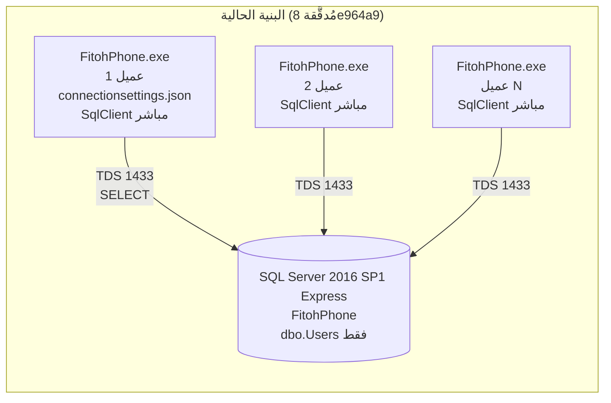

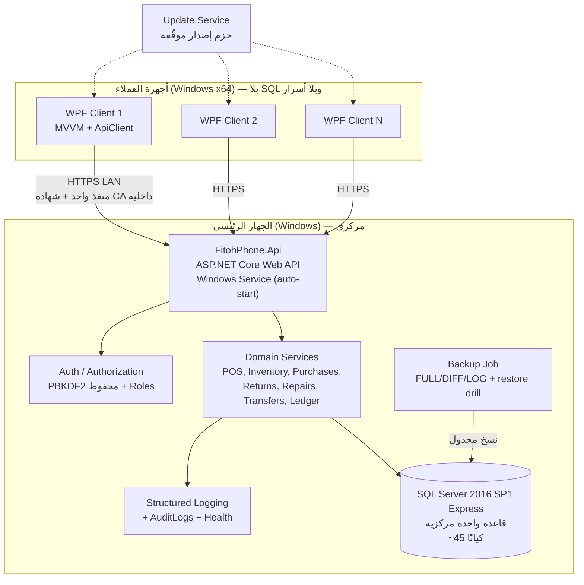

| وجه المقارنة | الحالي | الهدف | المبرر التقني |
|---|---|---|---|
| طبقة الوصول للبيانات | داخل كل عميل | داخل الـ API فقط | منع تجاوز الصلاحيات، إخفاء أسرار DB، توحيد القواعد |
| منفذ الشبكة | SQL TDS 1433 مفتوح لكل عميل | HTTPS واحد فقط + SQL محلي `localhost` | تقليل سطح الهجوم |
| الصلاحيات | `IsActive` + `SELECT` مشترك | Roles/Permissions مركزيًا | متطلب M11 و«backend enforcement» |
| التزامن | بلا حماية | معاملات + أقفال/rowversion + idempotency | منع oversell وازدواج الفواتير |
| الجلسة | ذاكرة العميل | token موقّع + server session | تعدد المستخدمين والإبطال المركزي |
| السجلات | رسائل للمستخدم فقط | Structured logging + AuditLogs | تدقيق مالي وتشخيص |
| النسخ الاحتياطي | يدوي غير موثق | مهمة مجدولة + اختبار استعادة | استمرارية العمل |
| التحديث | نسخ مجلد | حزم موقّعة + version check | اتساق إصدارات العملاء مع المخطط |
| التقنية | C#/.NET10/WPF/SQL | **نفسها** + ASP.NET Core داخل الحل | امتثال صريح لـ «لا تستبدل التقنية» |

## C.3 الطبقات والمشاريع المقترحة داخل `FitohPhone.sln`

| المشروع | النوع | المحتوى | ملاحظة الحفاظ |
|---|---|---|---|
| `src/FitohPhone` (**موجود**) | WPF `WinExe` | Views/ViewModels/Helpers/Resources/Theme + `ApiClient` جديد | `LoginWindow`, `LoginViewModel`, `PasswordHasher` محفوظة |
| `src/FitohPhone.Shared` (**جديد**) | class library | DTOs, Contracts, Enums, `PasswordHasher` منقول كما هو، PermissionNames | نسخ الكود لا إعادة كتابته |
| `src/FitohPhone.Api` (**جديد**) | ASP.NET Core Web API | Controllers, Domain Services, Repositories, `UnitOfWork`, Middleware | يستضيف نفسه كـ Windows Service |
| `src/FitohPhone.Infrastructure` (**جديد**) | class library | `Microsoft.Data.SqlClient` (نفس 6.1.3)، Migrations runner، Backup، Printing | لا ORM جديد قبل `OD-ARC-04` |
| `tests/*` (**موسّع**) | xUnit + integration + WPF UI tests | انظر القسم L | الاختبار الحالي محفوظ |
| `installer/*` (**جديد**) | WiX/MSIX/ClickOnce | Server MSI + Client MSI | P19 |

**قرار مفتوح `OD-ARC-04`**: هل يُعتمد EF Core أم يبقى الوصول عبر `Microsoft.Data.SqlClient` مع repository يدوي؟ التوصية الأولية: **البقاء على SqlClient** (لا استبدال، تحكم كامل في المعاملات والتوافق 130) مع إمكانية إدخال EF Core لاحقًا لقراءات التقارير فقط. لا يُبتّ في هذا القرار داخل هذه الوثيقة.

## C.4 المصادقة والتفويض في البنية الهدف

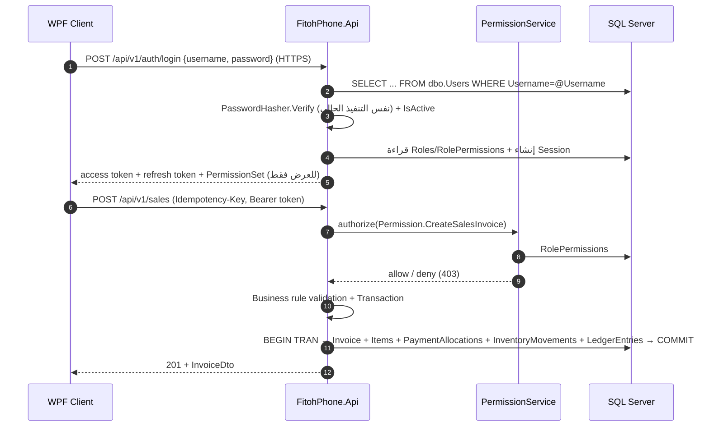

- كل Endpoint يمر عبر `AuthorizationMiddleware` + Policy محسوبة من `PermissionNames`؛ **الواجهة لا تُعدّ مصدرًا للصلاحية**.
- كلمة المرور لا تخرج من العميل إلا عبر HTTPS، ولا يُعاد أي hash للعميل.
- `dbo.Users` يحتفظ بصيغة hash الحالية؛ لا rehash إجباري، مع ترقية تدريجية عند تغيير الكلمة (`OD-SEC-02`).

## C.5 التزامن وسلامة المعاملات

| الخطر | الآلية المقترحة |
|---|---|
| بيع صنف آخر وحدة من جهازين | `BEGIN TRAN` + `SELECT ... WITH (UPDLOCK, HOLDLOCK)` على صف `Inventory` أو `rowversion` للتفاؤل + إعادة المحاولة؛ التحقق داخل نفس المعاملة |
| تكرار إرسال فاتورة بعد انقطاع الشبكة | `IdempotencyKeys` بـ unique key لكل أمر + إعادة نفس النتيجة دون تنفيذ ثانٍ |
| رقم فاتورة مكرر | `InvoiceSequences` مع `UPDLOCK` + `SERIALIZABLE`، أو `SEQUENCE` مع توافق 130 بعد تحقق |
| حركتان ماليتان غير متوازنتين | كل `FinancialTransaction` يُنتج `LedgerEntries` داخل معاملة واحدة مع CHECK على مجموع المدين/الدائن (القواعد نفسها `OD-FIN-*`) |
| تعديل فاتورة مُرحّلة | منع `UPDATE`؛ إلغاء بعكس الحركات (reversal) + `AuditLogs` |
| قراءات طويلة تحجب الكتابة | `READ_COMMITTED_SNAPSHOT` بعد تقييم أثره على Express (`OD-ARC-08`) |

## C.6 الشبكة، الإقلاع، النسخ، التحديثات، التهيئة

| البند | التوصية |
|---|---|
| وصول DB مركزي | SQL Server يستمع على `127.0.0.1` فقط للسيرفر؛ الـ API وحده يتصل به |
| التواصل | HTTPS/Kestrel بمنفذ واحد (مثال `5443`)، شهادة CA داخلية مُثبّتة على العملاء، `TLS 1.2+` |
| Firewall | inbound: HTTPS فقط من نطاق LAN؛ SQL 1433 **مغلق للشبكة**؛ UDP 1434 مغلق عند منفذ ثابت |
| بدء تلقائي | `FitohPhone.Api` كـ Windows Service (`sc create` / `WindowsServiceLifetime`) مع `Recovery=restart` و`DelayedAutoStart` |
| الانقطاع | العميل يعرض حالة Offline ويُعطّل الكتابة؛ إعادة المحاولة بـ `Idempotency-Key`؛ لا كتابة محلية ولا «قاعدة محلية» (ممنوعة صراحة) |
| التوفر | `/health/live`, `/health/ready`، مراقبة من Windows Service، تنبيه عند توقف SQL/Backup |
| النسخ | FULL يومي + DIFF + LOG حسب نموذج الاستعادة (`OD-DEP-03`)؛ نسخة خارج الجهاز؛ **اختبار استعادة ربع سنوي موثّق** |
| التحديث | Server package + Client package بنفس `ApiVersion`؛ رفض عميل بإصدار غير متوافق؛ rollback إلى الإصدار السابق |
| إعداد العميل | `appsettings.client.json`: `ApiBaseUrl`, `ClientId`, مسار الشهادة، ثيم افتراضي — **بلا connection string**؛ شاشة «اختبار الاتصال» |
| الأسرار | secret store على السيرفر (DPAPI / Windows Credential Manager)؛ تدوير دوري؛ لا أسرار في Git (`TN-01`) |
| السجلات | Serilog/ILogger → ملفات دوّارة + Event Log؛ حقول: CorrelationId, UserId, Operation, IdempotencyKey |

## C.7 مسار الانتقال التدريجي (Strangler) — بلا إعادة بناء

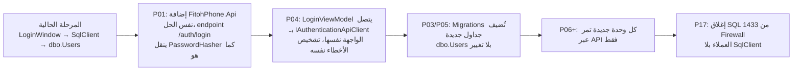

**قاعدة انتقال ملزمة:** في أي نقطة زمنية يظل الدخول يعمل. لا تُحذف `ConnectionSettingsProvider` قبل نجاح اختبارات P04/P17 على جهازين فعليين، وتُبقى قراءة الملف القديم كـ fallback انتقالي فقط.

## C.8 تدفق عملية بيع واحدة (مرجع للاعتماديات)

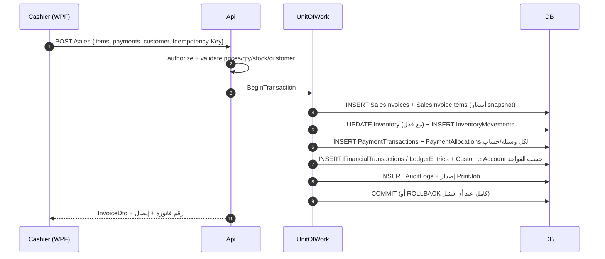

---

# القسم D — جرد المتطلبات الوظيفية الكامل (Complete Functional Module Inventory)

## D.0 قواعد الجرد والتتبع

- كل سطر أدناه يحمل معرّفًا فريدًا `R-XXX-NN`؛ **نفس المعرّف** يظهر في مصفوفة التتبع بالقسم Q مع المرحلة وكيانات قاعدة البيانات ومكونات الـ backend والشاشات واختبار القبول.
- لا تُحذف ولا تُدمج ولا تُبسّط أي متطلب: البنود التي تضم عدة عناصر (مثل حقول المنتج أو قوائم التقارير) **تُعدد عناصرها صراحة داخل نص البند**.
- علامة `[ ]` تعني «لم يُنفَّذ بعد» — وهو صادق لكل البنود عدا بنود التدقيق الموصوفة في B.4 (المحمية).
- «المرحلة» تشير إلى مرحلة التنفيذ في القسم F؛ البنود التي تحتاج تحليلًا إضافيًا مُعلّمة بقرار مفتوح `OD-*`.
- **إجمالي المتطلبات المتتبَّعة: 419 متطلبًا** (مُحصى آليًا من مصدر البيانات الوحيد المستخدم لتوليد القسم D والقسم Q).

| الوحدة | المجال | المرحلة المحورية |
|---|---|---|
| M01 | Main Dashboard | P14 (+P13 للحسابات) |
| M02 | Point of Sale | P08 |
| M03 | Product Management | P05 |
| M04 | Inventory Management | P06 |
| M05 | Purchase Invoices | P07 |
| M06 | Invoice Register | P09 |
| M07 | Returns & Exchanges | P10 |
| M08 | Customers & Suppliers | P05 (+P13 للديون) |
| M09 | Money Transfers | P11 |
| M10 | Phone Repair | P12 |
| M11 | Users & Permissions | P04 |
| M12 | Settings + 8 Themes | P16 |
| M13 | Reports | P14 |
| M14 | Printing & Barcode | P15 |
| XBR | Cross-Module Business Rules | P13 |
| ARC / DB / UI / SEC / DEP / TST / FIN | متطلبات معمارية وأمنية ونشر واختبار وقرارات مالية | P00–P19 |

## D.1 – D.22 قوائم المتطلبات التفصيلية

#### D.1 — لوحة التحكم الرئيسية (Main Dashboard)

- [ ] **R-M01-01** — إجمالي دخل المبيعات (مؤشر عرض فقط) — المرحلة `P14`
- [ ] **R-M01-02** — إجمالي دخل الصيانة (مؤشر عرض فقط) — المرحلة `P14`
- [ ] **R-M01-03** — إجمالي دخل التحويلات (مؤشر عرض فقط) — المرحلة `P14`
- [ ] **R-M01-04** — إجمالي المصروفات (مؤشر عرض فقط) — المرحلة `P14`
- [ ] **R-M01-05** — إجمالي المرتجعات (مؤشر عرض فقط) — المرحلة `P14`
- [ ] **R-M01-06** — إجمالي الأرباح (مؤشر عرض فقط) — المرحلة `P14`
- [ ] **R-M01-07** — صافي نتيجة اليوم (مؤشر عرض فقط) — المرحلة `P14`
- [ ] **R-M01-08** — مرحلة مخصصة لتعريف وتنفيذ منطق الحسابات المالية الصحيحة، بلا اختراع معادلات الآن — المرحلة `P13`
- [ ] **R-M01-09** — الأجهزة قيد الصيانة حاليًا — المرحلة `P14`
- [ ] **R-M01-10** — الأجهزة الجاهزة لتسليم العميل — المرحلة `P14`
- [ ] **R-M01-11** — التنقل من مؤشرات الصيانة إلى سجلات الإصلاح ذات الصلة — المرحلة `P14`
- [ ] **R-M01-12** — إشعارات المنتجات التي بلغت الحد الأدنى للمخزون — المرحلة `P14`
- [ ] **R-M01-13** — التنقل إلى قائمة نوافص المخزون — المرحلة `P14`
- [ ] **R-M01-14** — الرصيد الحالي للصندوق النقدي (Cash) — المرحلة `P14`
- [ ] **R-M01-15** — الأرصدة الحالية لحسابات Vodafone Cash — المرحلة `P14`
- [ ] **R-M01-16** — الأرصدة الحالية لحسابات InstaPay — المرحلة `P14`
- [ ] **R-M01-17** — دعم تعدد الحسابات وتعدد أرقام الهواتف لكل خدمة — المرحلة `P14`
- [ ] **R-M01-18** — البيانات الأولية النموذجية 01012345678=3000 و01098765432=5000 و01100032165=10000 و012985411111=1000 كسجلات بيانات لا إعدادات ثابتة — المرحلة `P11`
- [ ] **R-M01-19** — إدارة الحسابات والأرصدة ديناميكيًا عبر النظام لا عبر ثوابت الكود — المرحلة `P11`
- [ ] **R-M01-20** — إجمالي عدد العملاء — المرحلة `P14`
- [ ] **R-M01-21** — إجمالي عدد المنتجات — المرحلة `P14`
- [ ] **R-M01-22** — إجمالي عدد الفواتير — المرحلة `P14`
- [ ] **R-M01-23** — بطاقات معلومات حديثة (Information Cards) — المرحلة `P14`
- [ ] **R-M01-24** — الرسوم البيانية والإحصاءات (Charts) — المرحلة `P14`
- [ ] **R-M01-25** — مركز الإشعارات (Notifications) — المرحلة `P14`
- [ ] **R-M01-26** — الإجراءات السريعة (Quick Actions) — المرحلة `P14`
- [ ] **R-M01-27** — مرشحات التاريخ (Date Filters) — المرحلة `P14`
- [ ] **R-M01-28** — التنقل إلى التقارير التفصيلية — المرحلة `P14`
- [ ] **R-M01-29** — دعم الوضع الفاتح والوضع الداكن — المرحلة `P16`

#### D.2 — نقطة البيع (POS)

- [ ] **R-M02-01** — فتح عدة فواتير بيع في وقت واحد — المرحلة `P08`
- [ ] **R-M02-02** — التبديل بين الفواتير النشطة — المرحلة `P08`
- [ ] **R-M02-03** — إنشاء فاتورة جديدة أثناء وجود فواتير مفتوحة — المرحلة `P08`
- [ ] **R-M02-04** — حفظ الفواتير كمسودات (Drafts) رهن قرار سير العمل OD-FIN-14 — المرحلة `P08`
- [ ] **R-M02-05** — إتمام الفاتورة أو إلغاؤها وفق الصلاحيات — المرحلة `P08`
- [ ] **R-M02-06** — منع الازدواج عند الإتمام أو الإلغاء بIdempotency-Key — المرحلة `P09`
- [ ] **R-M02-07** — اختيار المنتج بمسح الباركود — المرحلة `P08`
- [ ] **R-M02-08** — البحث باسم المنتج — المرحلة `P08`
- [ ] **R-M02-09** — البحث بكود المنتج — المرحلة `P08`
- [ ] **R-M02-10** — اختيار سريع للمنتجات المتكررة — المرحلة `P08`
- [ ] **R-M02-11** — تعديل كميات الأصناف داخل الفاتورة — المرحلة `P08`
- [ ] **R-M02-12** — إزالة أصناف من الفاتورة الحالية — المرحلة `P08`
- [ ] **R-M02-13** — دعم ماسحات الباركود كأجهزة إدخال لوحة مفاتيح (Keyboard Wedge) — المرحلة `P08`
- [ ] **R-M02-14** — اختيار عميل موجود — المرحلة `P08`
- [ ] **R-M02-15** — البحث عن العميل بالاسم أو رقم الهاتف — المرحلة `P08`
- [ ] **R-M02-16** — إضافة عميل جديد دون مغادرة شاشة POS — المرحلة `P05`
- [ ] **R-M02-17** — نافذة/حوار منفصل لإضافة العميل مع العودة التلقائية للفاتورة واختيار العميل الجديد — المرحلة `P05`
- [ ] **R-M02-18** — الدفع نقدًا (Cash) — المرحلة `P08`
- [ ] **R-M02-19** — الدفع عبر Vodafone Cash — المرحلة `P08`
- [ ] **R-M02-20** — الدفع عبر InstaPay — المرحلة `P08`
- [ ] **R-M02-21** — الدفع المختلط داخل نفس الفاتورة (مثال 500 نقدًا + 300 فودافون + 200 إنستاباي) — المرحلة `P08`
- [ ] **R-M02-22** — التحقق من مجموع توزيعات الدفع مقابل مبلغ الفاتورة والرصيد المتبقي المسموح — المرحلة `P08`
- [ ] **R-M02-23** — حفظ تفاصيل كل وسيلة دفع وكل حساب بشكل منفصل في PaymentAllocations — المرحلة `P13`
- [ ] **R-M02-24** — سعر الجملة (Wholesale) لكل منتج — المرحلة `P08`
- [ ] **R-M02-25** — السعر الخاص بالعميل (Special Customer Price) — المرحلة `P08`
- [ ] **R-M02-26** — سعر التجزئة (Retail) — المرحلة `P08`
- [ ] **R-M02-27** — اختيار مستوى السعر للصنف من مستخدم مصرح له فقط — المرحلة `P08`
- [ ] **R-M02-28** — خصم أو تسعير على مستوى الفاتورة حيث ينطبق — المرحلة `P08`
- [ ] **R-M02-29** — تعريف تفاعل خصم الفاتورة مع أسعار الأصناف كقرار مفتوح OD-FIN-08 لا قاعدة مُبتدعة — المرحلة `P13`
- [ ] **R-M02-30** — خصم الفاتورة — المرحلة `P08`
- [ ] **R-M02-31** — التحقق من صحة الكميات — المرحلة `P08`
- [ ] **R-M02-32** — التحقق من توفر المخزون قبل الإتمام — المرحلة `P08`
- [ ] **R-M02-33** — حساب إجمالي الفاتورة — المرحلة `P08`
- [ ] **R-M02-34** — حساب إجمالي المدفوعات — المرحلة `P08`
- [ ] **R-M02-35** — حساب الرصيد المتبقي — المرحلة `P08`
- [ ] **R-M02-36** — إنشاء دين على العميل عند السماح بذلك وفق قرار OD-FIN-06 — المرحلة `P13`
- [ ] **R-M02-37** — طباعة فاتورة البيع — المرحلة `P15`
- [ ] **R-M02-38** — إلغاء الفاتورة مع تتبع تدقيق كامل — المرحلة `P09`
- [ ] **R-M02-39** — سجل تاريخ معاملات البيع — المرحلة `P09`
- [ ] **R-M02-40** — منع تغيير الأسعار أو تجاوز الخصومات دون صلاحية (فرض من الـ backend) — المرحلة `P04`

#### D.3 — إدارة المنتجات (Product Management)

- [ ] **R-M03-01** — حقول تعريف المنتج: الاسم، الكود الفريد، الباركود، الفئة، العلامة التجارية، الموديل، الوصف — المرحلة `P05`
- [ ] **R-M03-02** — حقول التسعير: سعر الشراء، سعر الجملة، السعر الخاص، سعر التجزئة — المرحلة `P05`
- [ ] **R-M03-03** — حقول المخزون والحالة: الحد الأدنى للكمية، الكمية الحالية، وحدة القياس، حالة المنتج، تاريخ الإنشاء — المرحلة `P05`
- [ ] **R-M03-04** — سمات إضافية قابلة للتوسعة حسب الحاجة دون تعديل المخطط لكل سمة — المرحلة `P05`
- [ ] **R-M03-05** — فئات المنتجات: هواتف محمولة، إكسسوارات، شواحن، سماعات، شاشات، بطاريات، قطع غيار، وفئات أخرى قابلة للضبط — المرحلة `P05`
- [ ] **R-M03-06** — تحليل ومستند قرار تتبع IMEI والأرقام التسلسلية للهواتف OD-FIN-17/OD-ARC-11 — المرحلة `P00`
- [ ] **R-M03-07** — إضافة منتج بصلاحية مناسبة — المرحلة `P04`
- [ ] **R-M03-08** — تعديل منتج بصلاحية مناسبة — المرحلة `P04`
- [ ] **R-M03-09** — عرض تفاصيل المنتج — المرحلة `P05`
- [ ] **R-M03-10** — إدارة باركودات المنتجات — المرحلة `P05`
- [ ] **R-M03-11** — إدارة فئات المنتجات — المرحلة `P05`
- [ ] **R-M03-12** — عرض سجل حركات المخزون للمنتج — المرحلة `P06`
- [ ] **R-M03-13** — عرض سجل مشتريات المنتج — المرحلة `P07`
- [ ] **R-M03-14** — عرض سجل مبيعات المنتج — المرحلة `P08`
- [ ] **R-M03-15** — عرض معلومات ربحية المنتج بعد اعتماد قاعدة التكلفة OD-FIN-02 — المرحلة `P14`

#### D.4 — إدارة المخزون (Inventory)

- [ ] **R-M04-01** — عرض كل المنتجات مع المعلومات والباركود والفئة والكمية المتاحة وسعر الشراء وأسعار البيع وحالة المخزون — المرحلة `P06`
- [ ] **R-M04-02** — إضافة وتعديل وعرض المنتجات من شاشة المخزون مع فرض الصلاحيات — المرحلة `P04`
- [ ] **R-M04-03** — الحذف أو الإيقاف (Deactivate) بدل الحذف الفعلي حيث يلزم حفظ التاريخ — المرحلة `P06`
- [ ] **R-M04-04** — البحث والتصفية والفرز والتصدير حيث ينطبق — المرحلة `P06`
- [ ] **R-M04-05** — سجل حركات المخزون الناتجة عن المشتريات — المرحلة `P06`
- [ ] **R-M04-06** — سجل الحركات الناتجة عن المبيعات — المرحلة `P06`
- [ ] **R-M04-07** — سجل الحركات الناتجة عن المرتجعات — المرحلة `P06`
- [ ] **R-M04-08** — سجل الحركات الناتجة عن المبادلات — المرحلة `P06`
- [ ] **R-M04-09** — سجل الحركات الناتجة عن البضاعة التالفة — المرحلة `P06`
- [ ] **R-M04-10** — سجل التسويات اليدوية المصرح بها — المرحلة `P06`
- [ ] **R-M04-11** — سجل استهلاك قطع غيار الصيانة — المرحلة `P12`
- [ ] **R-M04-12** — سجل أي عمليات مخزنية أخرى مصرح بها — المرحلة `P06`
- [ ] **R-M04-13** — حقول كل حركة: المنتج، الكمية، نوع الحركة، التاريخ والوقت، الفاتورة/العملية المرتبطة، المستخدم المسؤول، الملاحظات — المرحلة `P06`
- [ ] **R-M04-14** — قسم مستقل للمخزون التالف: تسجيل المنتجات والكميات التالفة — المرحلة `P06`
- [ ] **R-M04-15** — تسجيل أسباب التلف والتواريخ والمستخدم المسؤول — المرحلة `P06`
- [ ] **R-M04-16** — سجل تاريخ المخزون التالف — المرحلة `P06`
- [ ] **R-M04-17** — تسجيل عمليات التصرف/الإعدام (Disposal/Write-off) بأثر تدقيق — المرحلة `P06`
- [ ] **R-M04-18** — استبعاد الأصناف التالفة من الكمية المتاحة للبيع — المرحلة `P06`

#### D.5 — فواتير الشراء (Purchase Invoices)

- [ ] **R-M05-01** — إنشاء فاتورة شراء تحتوي عدة أصناف — المرحلة `P07`
- [ ] **R-M05-02** — اختيار منتج موجود لكل سطر فاتورة — المرحلة `P07`
- [ ] **R-M05-03** — لكل سطر: الكمية وسعر الشراء للوحدة وإجمالي السطر وملاحظات إضافية — المرحلة `P07`
- [ ] **R-M05-04** — اختيار المورد — المرحلة `P07`
- [ ] **R-M05-05** — إنشاء مورد جديد عند الحاجة دون مغادرة الفاتورة — المرحلة `P05`
- [ ] **R-M05-06** — الدفع الجزئي نقدًا — المرحلة `P07`
- [ ] **R-M05-07** — الدفع الجزئي عبر Vodafone Cash — المرحلة `P07`
- [ ] **R-M05-08** — الدفع الجزئي عبر InstaPay — المرحلة `P07`
- [ ] **R-M05-09** — الدفع المختلط: فاتورة 10000 = 3000 نقد + 2000 فودافون + 1000 إنستاباي والباقي 4000 — المرحلة `P07`
- [ ] **R-M05-10** — إظهار الرصيد المتبقي في حساب المورد الدائن (Accounts Payable) — المرحلة `P13`
- [ ] **R-M05-11** — سجل فواتير الشراء وتفاصيلها — المرحلة `P07`
- [ ] **R-M05-12** — سجل المورد وسجل المدفوعات والأرصدة المتبقية — المرحلة `P07`
- [ ] **R-M05-13** — طباعة فاتورة الشراء — المرحلة `P15`
- [ ] **R-M05-14** — التعديل والإلغاء المصرح به مع تحديث المخزون وأرصدة الموردين وفق قاعدة OD-FIN-11 — المرحلة `P09`

#### D.6 — سجل الفواتير (Invoice Register)

- [ ] **R-M06-01** — سجل موحّد يضم فواتير البيع والشراء والمرتجعات والمبادلات وسجلات الدفع المرتبطة — المرحلة `P09`
- [ ] **R-M06-02** — تفاصيل الفاتورة: الرقم، التاريخ والوقت، العميل أو المورد، الأصناف، الكميات — المرحلة `P09`
- [ ] **R-M06-03** — تفاصيل الأسعار والخصومات والمدفوعات والرصيد المتبقي والمستخدم المسؤول والعمليات المرتبطة — المرحلة `P09`
- [ ] **R-M06-04** — بحث وتصفية شاملان بالتاريخ والرقم والطرف والمنتج والحالة — المرحلة `P09`
- [ ] **R-M06-05** — قواعد صارمة للتعديل والإلغاء وفق الصلاحيات — المرحلة `P04`
- [ ] **R-M06-06** — الفواتير المرحّلة ماليًا لا تُعدّل صامتًا ويُحفظ تاريخها كاملًا — المرحلة `P13`
- [ ] **R-M06-07** — ربط المرتجعات والمبادلات بالفاتورة الأصلية — المرحلة `P10`
- [ ] **R-M06-08** — تدقيق كل تعديل أو إلغاء في AuditLogs — المرحلة `P04`
- [ ] **R-M06-09** — طباعة/تصدير تفاصيل الفاتورة وسجلها — المرحلة `P15`
- [ ] **R-M06-10** — منع التعديل الصامت لأي فاتورة مُرحّلة — المرحلة `P09`

#### D.7 — المرتجعات والمبادلات (Returns & Exchanges)

- [ ] **R-M07-01** — البحث في الفواتير باسم العميل — المرحلة `P10`
- [ ] **R-M07-02** — البحث برقم هاتف العميل — المرحلة `P10`
- [ ] **R-M07-03** — البحث برقم الفاتورة — المرحلة `P10`
- [ ] **R-M07-04** — البحث بتاريخ الفاتورة ومرشح «اليوم» — المرحلة `P10`
- [ ] **R-M07-05** — البحث بمدى زمني (Date Range) — المرحلة `P10`
- [ ] **R-M07-06** — البحث بمعلومات المنتج ومرشحات مفيدة أخرى — المرحلة `P10`
- [ ] **R-M07-07** — عرض الفاتورة الأصلية كاملة: الأصناف والكميات والأسعار والخصومات والمدفوعات وبيانات العميل والتفاصيل والتعديلات السابقة والمرتجعات والمبادلات المرتبطة — المرحلة `P10`
- [ ] **R-M07-08** — إرجاع صنف واحد أو أكثر من فاتورة بيع أصلية — المرحلة `P10`
- [ ] **R-M07-09** — تحديد حالة الصنف المرتجع: سليم وصالح للعودة للمخزون العادي — المرحلة `P10`
- [ ] **R-M07-10** — تحديد حالة الصنف المرتجع: تالف ويُحوّل إلى المخزون التالف — المرحلة `P10`
- [ ] **R-M07-11** — تسجيل أسباب الإرجاع — المرحلة `P10`
- [ ] **R-M07-12** — استبدال أصناف مباعة بأصناف أخرى — المرحلة `P10`
- [ ] **R-M07-13** — حساب قيمة المنتج الأصلي وقيمة المنتج البديل — المرحلة `P10`
- [ ] **R-M07-14** — حساب الفرق المستحق تحصيله من العميل — المرحلة `P10`
- [ ] **R-M07-15** — حساب الفرق الواجب ردّه للعميل ووسيلة الدفع الإضافية — المرحلة `P10`
- [ ] **R-M07-16** — تحديث المخزون والمخزون التالف وأرصدة العملاء والصندوق النقدي وحسابات فودافون كاش وInstaPay وتقارير المبيعات وتقارير الأرباح — المرحلة `P10`
- [ ] **R-M07-17** — ربط كل أثر مالي ومخزني بالفاتورة الأصلية مع سجل تدقيق قابل للتتبع — المرحلة `P13`

#### D.8 — العملاء والموردون (Customers & Suppliers)

- [ ] **R-M08-01** — سجل العميل: الاسم وأرقام الهواتف والعنوان والملاحظات وتاريخ التسجيل ومعلومات إضافية — المرحلة `P05`
- [ ] **R-M08-02** — سجل المورد: الاسم وأرقام الهواتف والعنوان ومعلومات الشركة والملاحظات وتاريخ التسجيل — المرحلة `P05`
- [ ] **R-M08-03** — ملف الحساب: فواتير البيع وفواتير الشراء وأجهزة الصيانة ومدفوعات الصيانة والتحويلات — المرحلة `P05`
- [ ] **R-M08-04** — ملف الحساب: المرتجعات والمبادلات والمدفوعات والإيصالات والديون والأرصدة الدائنة والأرصدة المستحقة — المرحلة `P05`
- [ ] **R-M08-05** — كشوف حساب كاملة بمرشحات تاريخ — المرحلة `P05`
- [ ] **R-M08-06** — المبالغ المستحقة على العملاء (Customer Debts) — المرحلة `P13`
- [ ] **R-M08-07** — المبالغ المستحقة للموردين (Supplier Debts) — المرحلة `P13`
- [ ] **R-M08-08** — الدفع الجزئي وسجل المدفوعات — المرحلة `P13`
- [ ] **R-M08-09** — تعديل الأرصدة بإذن مناسب مع أثر تدقيق — المرحلة `P13`
- [ ] **R-M08-10** — القوائم المالية وكشوف الحساب الرسمية — المرحلة `P14`
- [ ] **R-M08-11** — سجل مالي قابل للتتبع لكل تغيير في رصيد العميل أو المورد — المرحلة `P13`

#### D.9 — التحويلات المالية (Money Transfers)

- [ ] **R-M09-01** — تسجيل عدة حسابات وأرقام هواتف لخدمتي Vodafone Cash وInstaPay — المرحلة `P11`
- [ ] **R-M09-02** — حقول الحساب: نوع الخدمة، رقم الهاتف/المعرّف، اسم الحساب، الرصيد الافتتاحي، الرصيد الحالي، الحد اليومي، الحد الشهري، الحالة، ملاحظات — المرحلة `P11`
- [ ] **R-M09-03** — إضافة وتعديل وتفعيل/إيقاف الحسابات وتعديل الحدود وعرض التفاصيل بصلاحيات — المرحلة `P04`
- [ ] **R-M09-04** — تحويل من حساب المحل إلى حساب العميل — المرحلة `P11`
- [ ] **R-M09-05** — تحويل من حساب العميل إلى حساب المحل — المرحلة `P11`
- [ ] **R-M09-06** — حقول العملية: الحساب المصدر، الحساب الوجهة، المبلغ، نوع الخدمة، التاريخ والوقت، بيانات العميل، مرجع العملية، الرسوم/العمولة، المستخدم المسؤول، الحالة، الملاحظات — المرحلة `P11`
- [ ] **R-M09-07** — حدود معاملات يومية وشهرية قابلة للضبط لكل حساب على حدة — المرحلة `P11`
- [ ] **R-M09-08** — التحقق من الحدود قبل تأكيد العملية — المرحلة `P11`
- [ ] **R-M09-09** — تعريف حساب الحدود: الفترة التقويمية، عكس العمليات، والعمليات الفاشلة كقرار مفتوح OD-FIN-12 — المرحلة `P13`
- [ ] **R-M09-10** — سجل كامل لكل حساب مع البحث والتصفية بالتاريخ — المرحلة `P11`
- [ ] **R-M09-11** — عرض الوارد والصادر وتفاصيل العمليات والإجماليات اليومية والشهرية وتاريخ الرصيد واستخدام الحدود — المرحلة `P11`
- [ ] **R-M09-12** — تحديث أرصدة الحسابات وسجلات العمليات باتساق داخل معاملة واحدة — المرحلة `P13`
- [ ] **R-M09-13** — عدم اعتبار السجل الداخلي إثباتًا لنجاح تحويل بنكي/محفظة خارجي — المرحلة `P13`
- [ ] **R-M09-14** — سير تأكيد مناسب للتحقق الخارجي من التحويل قبل الاعتماد المالي — المرحلة `P13`

#### D.10 — صيانة الهواتف (Phone Repair)

- [ ] **R-M10-01** — استقبال الجهاز: العميل ورقم الهاتف ونوع الجهاز والعلامة والموديل وIMEI/الرقم التسلسلي والحالة والأضرار الظاهرة والمشكلة المبلّغة والملحقات المستلمة وتاريخ/وقت الاستقبال وتاريخ التسليم المتوقع والملاحظات الأولية والفني المُسند — المرحلة `P12`
- [ ] **R-M10-02** — توليد باركود فريد لكل أمر إصلاح واسترجاع سريع للأمر بمسحه — المرحلة `P15`
- [ ] **R-M10-03** — طباعة إيصال استقبال يتضمن معلومات المحل ورقم الإصلاح والباركود وبيانات العميل والجهاز والمشكلة وتاريخ الاستقبال وتاريخ التسليم المتوقع — المرحلة `P15`
- [ ] **R-M10-04** — حالات الإصلاح: Received، Under inspection، Awaiting customer approval، Waiting for spare parts، Under repair، Ready for delivery، Delivered، Cancelled — المرحلة `P12`
- [ ] **R-M10-05** — تحديث حالة الإصلاح من موظف مصرح له فقط — المرحلة `P04`
- [ ] **R-M10-06** — سجل كامل لتاريخ تغيير الحالات — المرحلة `P12`
- [ ] **R-M10-07** — تفاصيل الإصلاح: التشخيص الفني والعمل المنفذ والإصلاحات المكتملة وقطع الغيار المستخدمة وأجرة العمل وتكلفة القطع وإجمالي التكلفة وسعر البيع للعميل والفني وملاحظات الإصلاح — المرحلة `P12`
- [ ] **R-M10-08** — دعم إضافة عدة قطع غيار لأمر الإصلاح الواحد — المرحلة `P12`
- [ ] **R-M10-09** — استهلاك قطع الغيار يُحدّث المخزون بحركة مخزنية مرتبطة بأمر الإصلاح — المرحلة `P06`
- [ ] **R-M10-10** — دفع جزئي وكامل للإصلاح بوسائل الدفع المدعومة — المرحلة `P13`
- [ ] **R-M10-11** — تتبع إجمالي مبلغ الإصلاح والمدفوع والمتبقي ووسيلة الدفع والحساب وسجل المدفوعات — المرحلة `P13`
- [ ] **R-M10-12** — التسليم: تسجيل تاريخ التسليم والموظف المسؤول وتأكيد المدفوعات المتبقية وطباعة إيصال تسليم وتغيير الحالة إلى Delivered — المرحلة `P12`
- [ ] **R-M10-13** — سجل صيانة كامل لكل عميل: الأجهزة المستلمة والتواريخ وتفاصيل الجهاز والمشاكل والإصلاحات وقطع الغيار والتكاليف والمدفوعات وتواريخ التسليم وسجل الحالات — المرحلة `P05`
- [ ] **R-M10-14** — البحث في سجلات الصيانة بالباركود ورقم الإصلاح واسم العميل وهاتف العميل وIMEI وموديل الجهاز والتاريخ — المرحلة `P12`

#### D.11 — المستخدمون والصلاحيات (Users & Permissions)

- [ ] **R-M11-01** — إضافة المستخدمين وتعديلهم وإيقافهم — المرحلة `P04`
- [ ] **R-M11-02** — إدارة الأدوار (Roles) — المرحلة `P04`
- [ ] **R-M11-03** — إدارة الصلاحيات (Permissions) — المرحلة `P04`
- [ ] **R-M11-04** — إعادة تعيين كلمات المرور — المرحلة `P04`
- [ ] **R-M11-05** — تتبع نشاط المستخدمين — المرحلة `P04`
- [ ] **R-M11-06** — صلاحية View dashboard / View sales / Create sales invoices / Edit sales invoices / Cancel sales invoices — المرحلة `P04`
- [ ] **R-M11-07** — صلاحية Change product prices / Apply discounts / Manage inventory / Record purchases / Approve returns — المرحلة `P04`
- [ ] **R-M11-08** — صلاحية Manage transfers / Modify account limits / Manage repairs / View financial reports / View profits — المرحلة `P04`
- [ ] **R-M11-09** — صلاحية Manage customers / Manage suppliers / Manage users / Modify settings — المرحلة `P04`
- [ ] **R-M11-10** — فرض الصلاحيات في الـ backend لا في واجهة المستخدم فقط، ورفض استدعاء API مباشر غير مصرح — المرحلة `P18`
- [ ] **R-M11-11** — تدقيق (Audit Logging) للعمليات الحساسة — المرحلة `P04`

#### D.12 — الإعدادات (Settings)

- [ ] **R-M12-01** — اسم المحل قابل للضبط وغير مُثبّت في الكود — المرحلة `P16`
- [ ] **R-M12-02** — الشعار (Logo) قابل للضبط — المرحلة `P16`
- [ ] **R-M12-03** — رقم الهاتف والعنوان قابلان للضبط — المرحلة `P16`
- [ ] **R-M12-04** — المعلومات التجارية وتذييل الفاتورة والعملة الافتراضية وتفاصيل العمل الأخرى قابلة للضبط — المرحلة `P16`
- [ ] **R-M12-05** — السمة 1: Glassmorphism — زجاج شفاف (سمة مستقلة ب tokens خاصة) — المرحلة `P16`
- [ ] **R-M12-06** — السمة 2: Liquid Glass — لغة بصرية زجاجية سائلة (سمة مستقلة) — المرحلة `P16`
- [ ] **R-M12-07** — السمة 3: Dark Glass — زجاج داكن (سمة مستقلة) — المرحلة `P16`
- [ ] **R-M12-08** — السمة 4: Aurora UI — تدرجات وإضاءة شفقية (سمة مستقلة) — المرحلة `P16`
- [ ] **R-M12-09** — السمة 5: Holographic UI — تصميم هولوغرافي (سمة مستقلة) — المرحلة `P16`
- [ ] **R-M12-10** — السمة 6: FUI / HUD — واجهة خيال علمي مستقبلية (سمة مستقلة) — المرحلة `P16`
- [ ] **R-M12-11** — السمة 7: Chrome / Liquid Metal — معدن وكروم (سمة مستقلة) — المرحلة `P16`
- [ ] **R-M12-12** — السمة 8: Fluent Design — لغة Microsoft Fluent (سمة مستقلة) — المرحلة `P16`
- [ ] **R-M12-13** — لكل سمة: لوحة الألوان والخلفية ومظهر الأسطح والبطاقات والحدود والظلال والطباعة والأزرار وحقول الإدخال والجداول والتنقل والحوار والإشعارات وحالات التحديد/التمرير — المرحلة `P16`
- [ ] **R-M12-14** — نظام مكونات وتصميم مشترك واحد لكل السمات مع نفس الوظيفة — المرحلة `P02`
- [ ] **R-M12-15** — حفظ السمة المختارة واستعادتها بعد إعادة تشغيل التطبيق — المرحلة `P16`
- [ ] **R-M12-16** — إعدادات الباركود — المرحلة `P16`
- [ ] **R-M12-17** — إعدادات ترقيم الفواتير — المرحلة `P09`
- [ ] **R-M12-18** — إعدادات الطباعة — المرحلة `P15`
- [ ] **R-M12-19** — تنسيق العملة وتنسيق التاريخ — المرحلة `P16`
- [ ] **R-M12-20** — تفضيلات التطبيق وإعدادات النسخ الاحتياطي — المرحلة `P16`
- [ ] **R-M12-21** — إعدادات أخرى خاصة بالمحل قابلة للضبط — المرحلة `P19`

#### D.13 — التقارير (Reports)

- [ ] **R-M13-01** — تقرير المبيعات اليومية — المرحلة `P14`
- [ ] **R-M13-02** — تقرير المبيعات الشهرية — المرحلة `P14`
- [ ] **R-M13-03** — تقرير المبيعات بمدى تاريخ — المرحلة `P14`
- [ ] **R-M13-04** — تقرير المبيعات حسب الموظف — المرحلة `P14`
- [ ] **R-M13-05** — تقرير المبيعات حسب المنتج — المرحلة `P14`
- [ ] **R-M13-06** — تقرير المبيعات حسب الفئة — المرحلة `P14`
- [ ] **R-M13-07** — تقرير المبيعات حسب العميل — المرحلة `P14`
- [ ] **R-M13-08** — تقرير توزيع وسائل الدفع — المرحلة `P14`
- [ ] **R-M13-09** — تقرير المشتريات اليومية — المرحلة `P14`
- [ ] **R-M13-10** — تقرير المشتريات الشهرية — المرحلة `P14`
- [ ] **R-M13-11** — تقرير المشتريات حسب المورد — المرحلة `P14`
- [ ] **R-M13-12** — تقرير سجل مشتريات المنتج — المرحلة `P14`
- [ ] **R-M13-13** — تقرير أرصدة الموردين المستحقة — المرحلة `P14`
- [ ] **R-M13-14** — تقرير المخزون الحالي — المرحلة `P14`
- [ ] **R-M13-15** — تقرير نوافص المخزون — المرحلة `P14`
- [ ] **R-M13-16** — تقرير تقييم المخزون — المرحلة `P14`
- [ ] **R-M13-17** — تقرير تاريخ حركات المخزون — المرحلة `P14`
- [ ] **R-M13-18** — تقرير المخزون التالف — المرحلة `P14`
- [ ] **R-M13-19** — تقرير ربحية المنتج — المرحلة `P14`
- [ ] **R-M13-20** — تقرير أجهزة الصيانة المستلمة — المرحلة `P14`
- [ ] **R-M13-21** — تقرير الأجهزة قيد الصيانة — المرحلة `P14`
- [ ] **R-M13-22** — تقرير الأجهزة الجاهزة للتسليم — المرحلة `P14`
- [ ] **R-M13-23** — تقرير الأجهزة المُسلَّمة — المرحلة `P14`
- [ ] **R-M13-24** — تقرير دخل الصيانة — المرحلة `P14`
- [ ] **R-M13-25** — تقرير استهلاك قطع الغيار — المرحلة `P14`
- [ ] **R-M13-26** — تقرير أداء الفنيين — المرحلة `P14`
- [ ] **R-M13-27** — تقرير Vodafone Cash — المرحلة `P14`
- [ ] **R-M13-28** — تقرير InstaPay — المرحلة `P14`
- [ ] **R-M13-29** — تقرير التحويلات الواردة — المرحلة `P14`
- [ ] **R-M13-30** — تقرير التحويلات الصادرة — المرحلة `P14`
- [ ] **R-M13-31** — تقرير كشف حساب لكل حساب تحويل — المرحلة `P14`
- [ ] **R-M13-32** — تقرير استخدام الحدود اليومية والشهرية — المرحلة `P14`
- [ ] **R-M13-33** — تقرير حركات الصندوق النقدي — المرحلة `P14`
- [ ] **R-M13-34** — تقرير أرصدة المحافظ — المرحلة `P14`
- [ ] **R-M13-35** — تقرير أرصدة الحسابات — المرحلة `P14`
- [ ] **R-M13-36** — تقرير ديون العملاء — المرحلة `P14`
- [ ] **R-M13-37** — تقرير ديون الموردين — المرحلة `P14`
- [ ] **R-M13-38** — تقرير المصروفات — المرحلة `P14`
- [ ] **R-M13-39** — تقرير الإيرادات — المرحلة `P14`
- [ ] **R-M13-40** — تقرير الأرباح — المرحلة `P14`
- [ ] **R-M13-41** — تقرير الوضع المالي الصافي — المرحلة `P14`
- [ ] **R-M13-42** — كل التقارير المالية تستخدم قواعد حساب مُعرّفة رسميًا ومعتمدة في مرحلة مالية مخصصة لا مُبتدعة هنا — المرحلة `P13`

#### D.14 — الطباعة والباركود (Printing & Barcode)

- [ ] **R-M14-01** — طباعة فواتير البيع — المرحلة `P15`
- [ ] **R-M14-02** — طباعة فواتير الشراء — المرحلة `P15`
- [ ] **R-M14-03** — طباعة إيصالات المرتجعات — المرحلة `P15`
- [ ] **R-M14-04** — طباعة إيصالات المبادلات — المرحلة `P15`
- [ ] **R-M14-05** — طباعة إيصالات استقبال الصيانة — المرحلة `P15`
- [ ] **R-M14-06** — طباعة إيصالات تسليم الصيانة — المرحلة `P15`
- [ ] **R-M14-07** — طباعة كشوف حساب العملاء — المرحلة `P15`
- [ ] **R-M14-08** — طباعة كشوف حساب الموردين — المرحلة `P15`
- [ ] **R-M14-09** — طباعة إيصالات التحويلات — المرحلة `P15`
- [ ] **R-M14-10** — طباعة التقارير — المرحلة `P15`
- [ ] **R-M14-11** — دعم طابعات A4 — المرحلة `P15`
- [ ] **R-M14-12** — دعم الطابعات الحرارية (Thermal Receipt) — المرحلة `P15`
- [ ] **R-M14-13** — دعم طابعات ملصقات الباركود — المرحلة `P15`
- [ ] **R-M14-14** — أحجام ورق قابلة للضبط ومعاينة قبل الطباعة واختيار الطابعة — المرحلة `P15`
- [ ] **R-M14-15** — النص العربي وتخطيط RTL في كل القوالب مع شعار المحل ومعلوماته — المرحلة `P15`
- [ ] **R-M14-16** — تحديد صيغ الباركود المناسبة (Code 128 / EAN-13 / QR لأوامر الإصلاح) ومتطلبات الطباعة — المرحلة `P15`

#### D.15 — القواعد العابرة للوحدات (Cross-Module Business Rules)

- [ ] **R-XBR-01** — البيع المكتمل يؤثر على المخزون وسجلات البيع وسجلات الدفع وأرصدة النقد/المحافظ ورصيد العميل والتقارير المالية — المرحلة `P08`
- [ ] **R-XBR-02** — الشراء المكتمل يؤثر على المخزون وحساب المورد وسجل الشراء وسجلات الدفع وأرصدة النقد/المحافظ — المرحلة `P07`
- [ ] **R-XBR-03** — المرتجع يؤثر على الفاتورة الأصلية والمخزون أو المخزون التالف وأرصدة العملاء وسجلات الدفع/الرد والتقارير المالية — المرحلة `P10`
- [ ] **R-XBR-04** — الصيانة تؤثر على سجل العميل وسجل الإصلاح والمخزون عند استخدام قطع الغيار ومدفوعات الإصلاح والسجلات المالية — المرحلة `P12`
- [ ] **R-XBR-05** — التحويل يؤثر على الحساب المصدر والحساب الوجهة والأرصدة والحدود اليومية/الشهرية وسجل التحويلات — المرحلة `P11`
- [ ] **R-XBR-06** — معمارية معاملات مالية مركزية Ledger-first بدل أرصدة قابلة للتعديل المستقل — المرحلة `P13`
- [ ] **R-XBR-07** — كل معاملة مالية: معرّف فريد، النوع، المبلغ، الحساب المصدر والوجهة، التاريخ والوقت، المستخدم المسؤول، مرجع العملية الأصلية، تاريخ العكس/الإلغاء — المرحلة `P13`
- [ ] **R-XBR-08** — تحديد حدود المعاملة (Transaction Boundaries) ومتطلبات اتساق قاعدة البيانات — المرحلة `P13`
- [ ] **R-XBR-09** — منع الإرسال المكرر والمعالجة المزدوجة العرضية — المرحلة `P13`
- [ ] **R-XBR-10** — الحفاظ على المعلومات التاريخية للفواتير والعمليات وعدم تعديل الأسعار بعد الترحيل — المرحلة `P13`
- [ ] **R-XBR-11** — قابلية تتبع كل حركة مخزنية إلى فاتورة أو عملية أصلية — المرحلة `P13`
- [ ] **R-XBR-12** — منع بيع صنف بأكثر من المتاح عند تزامن عميلين (No Oversell) — المرحلة `P17`
- [ ] **R-XBR-13** — منع ازدواج أرقام الفواتير عند التزامن — المرحلة `P09`

#### D.16 — المعمارية ونشر LAN (Architecture & LAN)

- [ ] **R-ARC-01** — وصول مركزي واحد لقاعدة البيانات عبر الـ API فقط — المرحلة `P01`
- [ ] **R-ARC-02** — قناة API بين أجهزة العملاء والجهاز الرئيسي — المرحلة `P01`
- [ ] **R-ARC-03** — المصادقة والتفويض المركزيان — المرحلة `P04`
- [ ] **R-ARC-04** — دعم المعاملات المتزامنة من عدة مستخدمين — المرحلة `P17`
- [ ] **R-ARC-05** — التحديثات المتزامنة للمخزون — المرحلة `P06`
- [ ] **R-ARC-06** — عمليات الفواتير المتزامنة — المرحلة `P08`
- [ ] **R-ARC-07** — معالجة انقطاع الشبكة مع منع الكتابة المحلية — المرحلة `P17`
- [ ] **R-ARC-08** — توفر السيرفر وhealth checks — المرحلة `P17`
- [ ] **R-ARC-09** — بدء تلقائي للخدمة كـ Windows Service — المرحلة `P19`
- [ ] **R-ARC-10** — النسخ الاحتياطي والاستعادة — المرحلة `P19`
- [ ] **R-ARC-11** — تحديثات التطبيق وإدارة الإصدارات — المرحلة `P19`
- [ ] **R-ARC-12** — إعداد العميل بعنوان API فقط بلا connection string — المرحلة `P19`
- [ ] **R-ARC-13** — قواعد Windows Firewall لمنفذ HTTPS واحد فقط — المرحلة `P17`
- [ ] **R-ARC-14** — اتصال آمن داخل LAN بشهادة CA داخلية وTLS — المرحلة `P18`
- [ ] **R-ARC-15** — منع تجاوز العملاء للـ backend والوصول المباشر لقاعدة البيانات — المرحلة `P01`
- [ ] **R-ARC-16** — توثيق البنية الموجودة والبنية الهدف بشكل منفصل — المرحلة `P01`

#### D.17 — كيانات قاعدة البيانات (Database Entities)

- [ ] **R-DB-01** — Users — حسابات الدخول (موجود فعليًا ويُحفظ ويُوسّع) — المرحلة `P03`
- [ ] **R-DB-02** — Roles — تجميع الصلاحيات — المرحلة `P04`
- [ ] **R-DB-03** — Permissions — تعريف الصلاحيات التفصيلية — المرحلة `P04`
- [ ] **R-DB-04** — UserRoles — ربط المستخدمين بالأدوار — المرحلة `P04`
- [ ] **R-DB-05** — RolePermissions — ربط الأدوار بالصلاحيات — المرحلة `P04`
- [ ] **R-DB-06** — Customers — بيانات العملاء — المرحلة `P05`
- [ ] **R-DB-07** — Suppliers — بيانات الموردين — المرحلة `P05`
- [ ] **R-DB-08** — Products — تعريف المنتجات والأسعار والحد الأدنى — المرحلة `P05`
- [ ] **R-DB-09** — Categories — شجرة فئات المنتجات — المرحلة `P05`
- [ ] **R-DB-10** — ProductBarcodes — باركودات متعددة للمنتج — المرحلة `P05`
- [ ] **R-DB-11** — ProductSerialNumbers / IMEI — تتبع الأجهزة الفردية (رهن OD-ARC-11) — المرحلة `P05`
- [ ] **R-DB-12** — Warehouses — المخازن إن لزم (قرار OD-ARC-10) — المرحلة `P06`
- [ ] **R-DB-13** — Inventory — الكمية المتاحة لكل منتج/مخزن مع rowversion — المرحلة `P06`
- [ ] **R-DB-14** — InventoryMovements — سجل كل حركة مخزنية — المرحلة `P06`
- [ ] **R-DB-15** — DamagedInventory — المخزون التالف وأسبابه والتصرف فيه — المرحلة `P06`
- [ ] **R-DB-16** — SalesInvoices — رأس فاتورة البيع — المرحلة `P08`
- [ ] **R-DB-17** — SalesInvoiceItems — أصناف فاتورة البيع بأسعار snapshot — المرحلة `P08`
- [ ] **R-DB-18** — PurchaseInvoices — رأس فاتورة الشراء — المرحلة `P07`
- [ ] **R-DB-19** — PurchaseInvoiceItems — أصناف فاتورة الشراء — المرحلة `P07`
- [ ] **R-DB-20** — Returns — رأس المرتجع — المرحلة `P10`
- [ ] **R-DB-21** — ReturnItems — أصناف المرتجع وحالتها سليم/تالف — المرحلة `P10`
- [ ] **R-DB-22** — Exchanges — رأس المبادلة — المرحلة `P10`
- [ ] **R-DB-23** — ExchangeItems — أصناف المبادلة والفروق — المرحلة `P10`
- [ ] **R-DB-24** — RepairOrders — أوامر الصيانة والباركود والتكاليف — المرحلة `P12`
- [ ] **R-DB-25** — RepairStatusHistory — تاريخ حالات الإصلاح — المرحلة `P12`
- [ ] **R-DB-26** — RepairParts — قطع الغيار المستهلكة في الإصلاح — المرحلة `P12`
- [ ] **R-DB-27** — RepairPayments — مدفوعات الإصلاح — المرحلة `P12`
- [ ] **R-DB-28** — PaymentTransactions — رأس عملية الدفع/التحصيل — المرحلة `P13`
- [ ] **R-DB-29** — PaymentAllocations — توزيع المبلغ على وسائل الدفع والحسابات — المرحلة `P13`
- [ ] **R-DB-30** — CashAccounts — الصناديق النقدية — المرحلة `P13`
- [ ] **R-DB-31** — WalletAccounts — حسابات Vodafone Cash وInstaPay — المرحلة `P11`
- [ ] **R-DB-32** — TransferTransactions — عمليات التحويل ومراجعها الخارجية — المرحلة `P11`
- [ ] **R-DB-33** — AccountLimits — الحدود اليومية والشهرية لكل حساب — المرحلة `P11`
- [ ] **R-DB-34** — WalletLimitUsage — استخدام الحدود محسوبًا من الحركات — المرحلة `P11`
- [ ] **R-DB-35** — CustomerAccounts — حركات مدين/دائن للعملاء — المرحلة `P13`
- [ ] **R-DB-36** — SupplierAccounts — حركات مدين/دائن للموردين — المرحلة `P13`
- [ ] **R-DB-37** — Expenses — المصروفات وتصنيفها — المرحلة `P13`
- [ ] **R-DB-38** — FinancialTransactions — رأس المعاملة المالية — المرحلة `P13`
- [ ] **R-DB-39** — LedgerEntries — طرفا القيد المالي (قواعدها OD-FIN-*) — المرحلة `P13`
- [ ] **R-DB-40** — AuditLogs — سجل التدقيق للعمليات الحساسة — المرحلة `P04`
- [ ] **R-DB-41** — ShopSettings — معلومات المحل والعملة والتذييل — المرحلة `P16`
- [ ] **R-DB-42** — ThemeSettings — السمة المختارة وtokens — المرحلة `P16`
- [ ] **R-DB-43** — ApplicationSettings — الترقيم والتنسيق والتفضيلات — المرحلة `P16`
- [ ] **R-DB-44** — InvoiceSequences — توليد أرقام الفواتير بأمان تزامني — المرحلة `P03`
- [ ] **R-DB-45** — IdempotencyKeys — منع المعالجة المزدوجة — المرحلة `P03`
- [ ] **R-DB-46** — Sessions — الجلسات المركزية والإبطال — المرحلة `P03`
- [ ] **R-DB-47** — SchemaVersions — سجل ترحيلات المخطط — المرحلة `P03`
- [ ] **R-DB-48** — PrintTemplates / PrintJobs / BarcodeLabels — قوالب ومهام الطباعة والملصقات — المرحلة `P15`
- [ ] **R-DB-49** — StockReservations — حجز مؤقت لأصناف فواتير POS المفتوحة — المرحلة `P03`
- [ ] **R-DB-50** — NotificationEvents — أحداث التنبيهات ونوافص المخزون — المرحلة `P03`
- [ ] **R-DB-51** — BackupJobs / AppVersions — النسخ الاحتياطي وإصدارات العملاء — المرحلة `P19`
- [ ] **R-DB-52** — ExpenseCategories / PriceTiers — تصنيف المصروفات ومستويات الأسعار — المرحلة `P03`

#### D.18 — واجهة المستخدم وتجربة الاستخدام (UI/UX)

- [ ] **R-UI-01** — هيكل التطبيق الرئيسي AppShell مع Sidebar وTopBar — المرحلة `P02`
- [ ] **R-UI-02** — التنقل الجانبي والعلوي لكل الوحدات — المرحلة `P02`
- [ ] **R-UI-03** — مكتبة مكونات قابلة لإعادة الاستخدام (DataGrid، بحث، تصفية متقدمة، حوارات، Toast، تأكيد) — المرحلة `P02`
- [ ] **R-UI-04** — حالات التحميل والفراغ والخطأ وحالات التأكيد — المرحلة `P02`
- [ ] **R-UI-05** — اختصارات لوحة المفاتيح وسير عمل مسح الباركود — المرحلة `P02`
- [ ] **R-UI-06** — تخطيطات سطح مكتب متجاوبة مع DPI وأحجام نوافذ — المرحلة `P02`
- [ ] **R-UI-07** — دعم اللغة العربية وتخطيط RTL الشامل للجداول والأرقام والتقارير — المرحلة `P02`
- [ ] **R-UI-08** — تبديل السمات دون تغيير الوظيفة — المرحلة `P16`
- [ ] **R-UI-09** — واجهة POS تُعطي الأولوية للإنتاجية وسرعة العمليات اليومية على المؤثرات البصرية — المرحلة `P08`

#### D.19 — الأمن وسلامة البيانات (Security & Integrity)

- [ ] **R-SEC-01** — مصادقة آمنة مع الحفاظ على PBKDF2 الحالي — المرحلة `P04`
- [ ] **R-SEC-02** — تجزئة كلمات المرور وسياساتها وتغيير الكلمة الافتراضية — المرحلة `P04`
- [ ] **R-SEC-03** — التفويض والتحقق من الصلاحيات في الـ backend — المرحلة `P04`
- [ ] **R-SEC-04** — إدارة الجلسات والإبطال المركزي — المرحلة `P04`
- [ ] **R-SEC-05** — تدقيق العمليات الحساسة AuditLogs — المرحلة `P04`
- [ ] **R-SEC-06** — إعداد API آمن (HTTPS، CORS/Host filtering، rate limiting) — المرحلة `P01`
- [ ] **R-SEC-07** — تأمين اتصال LAN بشهادة داخلية — المرحلة `P17`
- [ ] **R-SEC-08** — تأمين الوصول لقاعدة البيانات بأقل صلاحية وحساب خدمة واحد — المرحلة `P01`
- [ ] **R-SEC-09** — التحقق من المدخلات ومنع SQL injection بالاستعلامات المُعامَلة — المرحلة `P01`
- [ ] **R-SEC-10** — معالجة الأخطاء دون كشف أسرار + Structured Logging — المرحلة `P18`
- [ ] **R-SEC-11** — النسخ الاحتياطي والاستعادة المُختبرة — المرحلة `P19`
- [ ] **R-SEC-12** — معاملات قاعدة البيانات وضبط التزامن — المرحلة `P03`
- [ ] **R-SEC-13** — منع العمليات المكررة بIdempotency-Key — المرحلة `P13`
- [ ] **R-SEC-14** — سلامة البيانات وقيود FK/CHECK/UNIQUE — المرحلة `P03`
- [ ] **R-SEC-15** — استعادة التطبيق بعد الأعطال Crash Recovery — المرحلة `P18`
- [ ] **R-SEC-16** — بدء وإيقاف الخدمة بشكل آمن — المرحلة `P19`
- [ ] **R-SEC-17** — معالجة أعطال الشبكة وإعادة المحاولة الآمنة — المرحلة `P17`
- [ ] **R-SEC-18** — اختبار مستخدمين متزامنين ينشئون فواتير ويحدّثون المخزون — المرحلة `P17`

#### D.20 — التثبيت والنشر الإنتاجي (Installation & Deployment)

- [ ] **R-DEP-01** — تثبيت السيرفر: API + قاعدة البيانات + الخدمات + النسخ + السجلات + الشبكة — المرحلة `P19`
- [ ] **R-DEP-02** — تشغيل الـ API كـ Windows Service ببدء تلقائي — المرحلة `P19`
- [ ] **R-DEP-03** — تثبيت العميل: تطبيق WPF + التبعيات + عنوان السيرفر + اختبار الاتصال الأولي — المرحلة `P19`
- [ ] **R-DEP-04** — عدم طلب SQL Server على أجهزة العملاء — المرحلة `P19`
- [ ] **R-DEP-05** — إعداد السيرفر وإعداد العميل وإدارة الإعدادات — المرحلة `P19`
- [ ] **R-DEP-06** — قواعد Firewall وفتح منفذ HTTPS فقط — المرحلة `P17`
- [ ] **R-DEP-07** — تهيئة قاعدة البيانات وترحيلاتها وإدارة الإصدارات — المرحلة `P03`
- [ ] **R-DEP-08** — إدارة التحديثات والرجوع لإصدار سابق — المرحلة `P19`
- [ ] **R-DEP-09** — إجراءات النسخ الاحتياطي والاستعادة الموثقة — المرحلة `P19`
- [ ] **R-DEP-10** — حزم تثبيت (Installer) للنمطين مع توثيق النشر — المرحلة `P19`

#### D.21 — استراتيجية الاختبار (Testing Strategy)

- [ ] **R-TST-01** — اختبارات الوحدة Unit Testing — المرحلة `P18`
- [ ] **R-TST-02** — اختبارات التكامل Integration Testing — المرحلة `P18`
- [ ] **R-TST-03** — اختبارات API — المرحلة `P18`
- [ ] **R-TST-04** — اختبارات قاعدة البيانات — المرحلة `P18`
- [ ] **R-TST-05** — اختبارات واجهة المستخدم UI — المرحلة `P18`
- [ ] **R-TST-06** — اختبارات الحسابات المالية Financial Calculation Testing — المرحلة `P18`
- [ ] **R-TST-07** — اختبارات تعدد المستخدمين Multi-User Testing — المرحلة `P17`
- [ ] **R-TST-08** — اختبارات انقطاع الشبكة Network Interruption Testing — المرحلة `P17`
- [ ] **R-TST-09** — اختبارات النسخ الاحتياطي والاستعادة — المرحلة `P19`
- [ ] **R-TST-10** — اختبارات الطباعة — المرحلة `P15`

#### D.22 — القواعد المالية غير المحسومة (Financial Open Decisions)

- [ ] **R-FIN-01** — تعريف الإيراد Revenue ووقت الاعتراف به (قرار مفتوح OD-FIN-01) — المرحلة `P13`
- [ ] **R-FIN-02** — تعريف الربح Profit وطريقة التكلفة (قرار مفتوح OD-FIN-02) — المرحلة `P13`
- [ ] **R-FIN-03** — تعريف صافي النتيجة Net Result (قرار مفتوح OD-FIN-03) — المرحلة `P13`
- [ ] **R-FIN-04** — تصنيف المصروفات Expenses (قرار مفتوح OD-FIN-04) — المرحلة `P13`
- [ ] **R-FIN-05** — ديون العملاء Customer Debts وآلية السداد الجزئي (OD-FIN-06) — المرحلة `P13`
- [ ] **R-FIN-06** — ديون الموردين Supplier Debts وآلية السداد (OD-FIN-07) — المرحلة `P13`
- [ ] **R-FIN-07** — أرصدة الصندوق النقدي Cash Balances (OD-FIN-09) — المرحلة `P13`
- [ ] **R-FIN-08** — أرصدة المحافظ Wallet Balances (OD-FIN-10) — المرحلة `P13`
- [ ] **R-FIN-09** — توزيعات الدفع Payment Allocations والدفع المختلط (OD-FIN-05) — المرحلة `P13`
- [ ] **R-FIN-10** — المرتجعات والمردودات Refunds وقيمتها (OD-FIN-13) — المرحلة `P13`
- [ ] **R-FIN-11** — عمولات التحويلات Transfer Commissions: دخل أم تمرير؟ (OD-FIN-15) — المرحلة `P13`
- [ ] **R-FIN-12** — تسوية الفروق في المبادلات (OD-FIN-16) — المرحلة `P13`
- [ ] **R-FIN-13** — معالجة الهالك Write-off محاسبيًا (OD-FIN-18) — المرحلة `P13`
- [ ] **R-FIN-14** — الإقفال اليومي/الشهري وقفل الفترات (OD-FIN-19) — المرحلة `P13`
- [ ] **R-FIN-15** — الأرصدة الافتتاحية وترحيلها (OD-FIN-20) — المرحلة `P13`
- [ ] **R-FIN-16** — التقريب والعملة والضريبة إن طُبّقت (OD-FIN-21) — المرحلة `P13`
- [ ] **R-FIN-17** — الاعتراف بدخل الصيانة عند التسليم أم عند الدفع (OD-FIN-22) — المرحلة `P13`
- [ ] **R-FIN-18** — سياسة عكس القيود Reversals وتصحيح الأخطاء (OD-FIN-23) — المرحلة `P13`
- [ ] **R-FIN-19** — مرحلة مخصصة لتعريف واعتماد كل القواعد قبل كتابة أي معادلة — المرحلة `P13`

> **تحقق التغطية:** 14 وحدة وظيفية (M01–M14) + 8 نطاقات cross-cutting؛ 8 سمات مستقلة (R-M12-05 … R-M12-12)؛ جميع وسائل الدفع الثلاث والدفع المختلط (R-M02-21 … R-M02-26)؛ ديون العملاء والموردين (R-M08-06 … R-M08-11، R-FIN-05 … R-FIN-07)؛ باركود الصيانة وسجل العميل (R-M10-02، R-M10-15)؛ الطباعة (R-M14-*)؛ التقارير (R-M13-*)؛ التثبيت والنشر (R-DEP-*، R-ARC-*). لا يوجد متطلب بلا معرّف أو بلا مرحلة.

---

# القسم E — تصميم قاعدة البيانات المقترح (Proposed Database Architecture)

> **تنبيه ملزم:** هذا **تصميم مقترح على الورق فقط**. لم يُنشأ أي جدول، ولم يُعدّل `dbo.Users`، ولم يُشغَّل أي سكربت. القائمة الواردة في طلب التحليل ليست نهائية (E.5 يضيف كيانات مكتشفة). كل التصاميم مقيدة بـ **SQL Server 2016 SP1 Express / compatibility 130 / حد 10GB**.

## E.1 المبادئ

| المبدأ | التطبيق |
|---|---|
| التطبيع | 3NF للكيانات الأساسية؛ تكرار مقصود محدود فقط في `SalesInvoiceItems` (snapshot للسعر والاسم) لحفظ تاريخ الفاتورة |
| التاريخية | الفواتير المرحّلة وحركات المخزون والقيود المالية **لا تُعدّل ولا تُحذف**؛ التصحيح بعكس (reversal) + `AuditLogs` |
| المال | لا يوجد عمود «رصيد قابل للتحرير»؛ الرصيد = دالة الحركات (`FinancialTransactions` + `LedgerEntries`) مع لقطة مُجمّعة اختيارية مُشتقة لا تُحرّر يدويًا |
| التتبع | كل كيان مالي/مخزني يحمل `CreatedAt`, `CreatedByUserId`, `SourceOperationId`, `CorrelationId` |
| التزامن | `rowversion` على `Inventory`, `WalletAccounts`, `CustomerAccounts`, `SupplierAccounts`؛ أقفال `UPDLOCK, HOLDLOCK` داخل المعاملات |
| Idempotency | `IdempotencyKeys(Key UNIQUE, OperationType, ResultPayload, CreatedAt)` عند كل أمر كتابة |
| المفاتيح | `BIGINT IDENTITY` للجداول كثيرة الحركات؛ `UNIQUEIDENTIFIER` فقط لـ CorrelationId؛ `NVARCHAR` للنصوص العربية؛ `DECIMAL(18,2)` للمبالغ (قرار العملة `OD-FIN-21`) |
| التوافق | تجنّب `STRING_AGG` و`TRIM` و`JSON` المدعومة بعد 2016؛ استخدم `FOR XML PATH` و`CONCAT`؛ كل استعلام مُعامل `SqlParameter` |

## E.2 فهرس الكيانات (Entity Catalog)

### E.2.1 الهوية والصلاحيات والجلسات

| الكيان | الغرض | أهم الحقول | PK | FK | قيود مهمة | فهارس |
|---|---|---|---|---|---|---|
| `Users` (**موجود**) | حسابات الدخول | `Id, Username, PasswordHash, DisplayName, IsActive, CreatedAt` + `MustChangePassword` | `Id` | — | `UQ(Username)`؛ صيغة PBKDF2 الحالية محفوظة؛ لا كلمة مرور بنص صريح | `IX_Users_IsActive` |
| `Roles` | تجميع الصلاحيات | `RoleId, Name, Description, IsSystem` | `RoleId` | — | `UQ(Name)` | `UQ(Name)` |
| `Permissions` | تعريف صلاحية | `PermissionId, PermissionKey, Description` | `PermissionId` | — | `UQ(PermissionKey)`؛ القيم من `PermissionNames` | `UQ` |
| `UserRoles` | ربط N:M | `UserId, RoleId` | `(UserId,RoleId)` | `Users`, `Roles` | `ON DELETE RESTRICT` | `IX_UserRoles_RoleId` |
| `RolePermissions` | ربط N:M | `RoleId, PermissionId` | `(RoleId,PermissionId)` | `Roles`, `Permissions` | لا حذف لأدوار النظام | `IX_RP_PermissionId` |
| `Sessions` | جلسة مركزية قابلة للإبطال | `SessionId, UserId, RefreshTokenHash, IssuedAt, ExpiresAt, RevokedAt, ClientId` | `SessionId` | `Users` | `UQ(RefreshTokenHash)`؛ تنظيف دوري | `IX_Sessions_UserId_ExpiresAt` |
| `AuditLogs` | تدقيق حساس | `AuditId, UserId, PermissionKey, Entity, EntityId, Action, BeforeJson, AfterJson, CorrelationId, CreatedAt` | `AuditId` | `Users` | append-only؛ بلا UPDATE/DELETE | `IX_Audit_Entity_EntityId`, `IX_Audit_CreatedAt` |
| `IdempotencyKeys` | منع الازدواج | `Key, OperationType, RequestHash, ResultPayload, Status, CreatedAt` | `Key` | — | `UQ(Key)` + `UQ(RequestHash)` | `UQ` |
| `SchemaVersions` | ترحيلات المخطط | `Version, AppliedAt, Checksum, ScriptName` | `Version` | — | monotonically increasing | `PK` |

### E.2.2 البيانات الرئيسية (Master Data)

| الكيان | الغرض | أهم الحقول | PK | FK | قيود مهمة | فهارس |
|---|---|---|---|---|---|---|
| `Customers` | ملف العميل | `CustomerId, Name, Phone1, Phone2, Address, Notes, CreatedAt, IsActive` | `CustomerId` | — | `UQ` جزئي على الهاتف إن طُلب؛ تحقق أطوال | `IX_Customers_Phone`, `IX_Customers_Name` |
| `Suppliers` | ملف المورد | `SupplierId, Name, Phone1, Phone2, Address, CompanyInfo, Notes, CreatedAt` | `SupplierId` | — | `UQ(Name)` مقترح | `IX_Suppliers_Name` |
| `Categories` | شجرة الفئات | `CategoryId, ParentCategoryId, Name, Code, IsActive` | `CategoryId` | `Categories` (self) | منع الدورات؛ الفئات الثمانية الافتراضية بيانات لا ثوابت كود | `IX_Categories_Parent` |
| `Products` | تعريف المنتج | `ProductId, Code, Name, CategoryId, Brand, Model, Description, PurchasePrice, WholesalePrice, SpecialPrice, RetailPrice, MinStockQty, UnitOfMeasure, Status, CreatedAt, rowversion` | `ProductId` | `Categories` | `UQ(Code)`؛ `CHECK(price>=0)`؛ `CHECK(MinStockQty>=0)` | `UQ(Code)`, `IX_Products_Category`, `IX_Products_Name` |
| `ProductBarcodes` | باركودات متعددة | `BarcodeId, ProductId, Barcode, BarcodeType, IsPrimary` | `BarcodeId` | `Products` | `UQ(Barcode)` | `UQ(Barcode)` |
| `ProductSerialNumbers` | IMEI / Serial | `SerialId, ProductId, IMEI1, IMEI2, SerialNo, Status, SalesInvoiceItemId, RepairOrderId` | `SerialId` | `Products`, `SalesInvoiceItems`, `RepairOrders` | `UQ(IMEI1)` عند التفعيل؛ رهن `OD-ARC-11` | `UQ(IMEI1)`, `IX_Serial_Product` |
| `ProductPrices` | مستويات/قوائم أسعار | `PriceId, ProductId, PriceTier, CustomerId?, Price, EffectiveFrom, EffectiveTo` | `PriceId` | `Products`, `Customers` | تداخل الفترات ممنوع؛ سعر خاص لعميل | `IX_PP_Product_Tier_Effective` |
| `Warehouses` | المخازن (إن اعتُمدت) | `WarehouseId, Name, IsDefault` | `WarehouseId` | — | مخزن افتراضي واحد على الأقل | `UQ(Name)` |

### E.2.3 المخزون والحركات

| الكيان | الغرض | أهم الحقول | PK | FK | قيود مهمة | فهارس |
|---|---|---|---|---|---|---|
| `Inventory` | الكمية المتاحة | `InventoryId, ProductId, WarehouseId, QuantityAvailable, QuantityDamaged, rowversion` | `InventoryId` | `Products`, `Warehouses` | `UQ(ProductId,WarehouseId)`؛ `CHECK(QuantityAvailable>=0)` **يمنع oversell** | `UQ`, `IX_Inventory_LowStock` |
| `InventoryMovements` | سجل كل حركة | `MovementId, ProductId, WarehouseId, QuantityDelta, MovementType, RelatedOperationType, RelatedOperationId, UserId, Notes, CreatedAt` | `MovementId` | `Products`, `Warehouses`, `Users` | append-only؛ `CHECK(QuantityDelta<>0)`؛ إلزام مرجع العملية | `IX_IM_Product_CreatedAt`, `IX_IM_RelatedOperation` |
| `DamagedInventory` | الهالك | `DamagedId, ProductId, Quantity, Reason, ReportedByUserId, ReportedAt, DisposalDate, DisposalUserId, Status` | `DamagedId` | `Products`, `Users` | لا يُحتسب ضمن `QuantityAvailable` | `IX_Damaged_Product_Status` |
| `StockReservations` | حجز فواتير POS المفتوحة | `ReservationId, ProductId, DraftInvoiceId, Quantity, ExpiresAt` | `ReservationId` | `Products`, `SalesInvoices` | حجز مؤقت فقط؛ لا يُخصم فعليًا قبل الإتمام | `IX_Res_Product_Expires` |
| `NotificationEvents` | تنبيهات نوافص المخزون | `NotificationId, Type, ProductId, Payload, CreatedAt, ReadByUserId` | `NotificationId` | `Products`, `Users` | يُشتق من `MinStockQty` عند كل حركة | `IX_Notif_CreatedAt` |

### E.2.4 المبيعات والمشتريات والمرتجعات

| الكيان | الغرض | أهم الحقول | PK | FK | قيود مهمة | فهارس |
|---|---|---|---|---|---|---|
| `SalesInvoices` | رأس فاتورة بيع/مسودة | `SalesInvoiceId, InvoiceNumber, InvoiceDate, CustomerId, UserId, Status, SubTotal, DiscountAmount, TotalAmount, PaidAmount, RemainingAmount, PriceTierApplied, CancelledBy, CreatedAt` | `SalesInvoiceId` | `Customers`, `Users` | `UQ(InvoiceNumber)`؛ الحالات `Draft/Posted/Cancelled`؛ **منع UPDATE بعد Posted** | `UQ(Number)`, `IX_SI_Date`, `IX_SI_Customer_Status` |
| `SalesInvoiceItems` | أصناف الفاتورة | `ItemId, SalesInvoiceId, ProductId, ProductNameSnapshot, Quantity, UnitPriceSnapshot, PriceTier, LineDiscount, LineTotal, SerialId?` | `ItemId` | `SalesInvoices`, `Products`, `ProductSerialNumbers` | `CHECK(Quantity>0)`؛ snapshot إلزامي | `IX_SII_Invoice`, `IX_SII_Product` |
| `PurchaseInvoices` | رأس فاتورة شراء | `PurchaseInvoiceId, InvoiceNumber, SupplierId, InvoiceDate, UserId, Status, TotalAmount, PaidAmount, RemainingAmount, CreatedAt` | `PurchaseInvoiceId` | `Suppliers`, `Users` | `UQ(InvoiceNumber)`؛ نفس قواعد الترحيل | `IX_PI_Date`, `IX_PI_Supplier` |
| `PurchaseInvoiceItems` | أصناف الشراء | `ItemId, PurchaseInvoiceId, ProductId, Quantity, UnitCost, LineTotal, Notes` | `ItemId` | `PurchaseInvoices`, `Products` | `CHECK(Quantity>0)` | `IX_PII_Invoice` |
| `Returns` | رأس المرتجع | `ReturnId, ReturnNumber, OriginalSalesInvoiceId, CustomerId, UserId, Reason, Status, TotalRefund, CreatedAt` | `ReturnId` | `SalesInvoices`, `Customers`, `Users` | مرتبط بالأصل إلزاميًا؛ لا تعديل بعد الترحيل | `IX_Returns_Original`, `IX_Returns_Date` |
| `ReturnItems` | أصناف المرتجع | `ReturnItemId, ReturnId, OriginalItemId, ProductId, Quantity, Condition, RefundAmount` | `ReturnItemId` | `Returns`, `SalesInvoiceItems`, `Products` | `Condition IN ('Sellable','Damaged')` | `IX_RI_Return` |
| `Exchanges` | رأس المبادلة | `ExchangeId, ExchangeNumber, OriginalSalesInvoiceId, CustomerId, DifferenceAmount, DifferenceDirection, PaymentMethod, CreatedAt` | `ExchangeId` | `SalesInvoices`, `Customers` | الفرق Calculated بعد `OD-FIN-16` | `IX_Ex_Original` |
| `ExchangeItems` | أصناف المبادلة | `ExchangeItemId, ExchangeId, ReturnedProductId, ReplacementProductId, Quantity, ValueOriginal, ValueReplacement` | `ExchangeItemId` | `Exchanges`, `Products` | قيم snapshot | `IX_EI_Exchange` |
| `InvoiceSequences` | ترقيم آمن | `SequenceKey, NextValue, Prefix, Format` | `SequenceKey` | — | قراءة بـ `UPDLOCK, SERIALIZABLE` | `PK` |
| `InvoiceRelations` | ربط العمليات | `RelationId, SourceType, SourceId, TargetType, TargetId, RelationType` | `RelationId` | — | تتبع return/exchange/payment للفاتورة الأصلية | `IX_Rel_Source`, `IX_Rel_Target` |

### E.2.5 الصيانة والتحويلات

| الكيان | الغرض | أهم الحقول | PK | FK | قيود مهمة | فهارس |
|---|---|---|---|---|---|---|
| `RepairOrders` | أمر الإصلاح | `RepairOrderId, RepairNumber, RepairBarcode, CustomerId, CustomerPhone, DeviceType, Brand, Model, IMEI, DeviceCondition, VisibleDamage, ReportedProblem, AccessoriesReceived, ReceivedAt, ExpectedDeliveryAt, AssignedTechnicianId, Diagnosis, WorkPerformed, LaborCost, PartsCost, TotalCost, CustomerPrice, Status, DeliveredAt, DeliveredByUserId, Notes` | `RepairOrderId` | `Customers`, `Users` | `UQ(RepairNumber)`, `UQ(RepairBarcode)`؛ الحالات الثمانية | `UQ(Barcode)`, `IX_RO_Status`, `IX_RO_Customer`, `IX_RO_IMEI` |
| `RepairStatusHistory` | تاريخ الحالات | `HistoryId, RepairOrderId, FromStatus, ToStatus, ChangedByUserId, ChangedAt, Notes` | `HistoryId` | `RepairOrders`, `Users` | append-only | `IX_RSH_Order_ChangedAt` |
| `RepairParts` | قطع الغيار | `RepairPartId, RepairOrderId, ProductId, Quantity, UnitCost, CreatedAt` | `RepairPartId` | `RepairOrders`, `Products` | كل سطر يُنتج `InventoryMovements` | `IX_RP_Order` |
| `RepairPayments` | مدفوعات الإصلاح | `RepairPaymentId, RepairOrderId, PaymentTransactionId, Amount, CreatedAt` | `RepairPaymentId` | `RepairOrders`, `PaymentTransactions` | المجموع ≤ المستحق حسب `OD-FIN-22` | `IX_RPay_Order` |
| `WalletAccounts` | حسابات المحافظ | `WalletAccountId, ServiceType, PhoneOrIdentifier, AccountName, OpeningBalance, CurrentBalance, IsActive, Notes, rowversion` | `WalletAccountId` | — | `UQ(ServiceType, PhoneOrIdentifier)`؛ `CurrentBalance` مُشتق من الحركات لا مُحرّر | `UQ`, `IX_WA_Service_Active` |
| `TransferTransactions` | عمليات التحويل | `TransferId, SourceAccountId, DestinationAccountId, Amount, ServiceType, Direction, CustomerId, ExternalReference, FeeAmount, Status, UserId, CreatedAt, ConfirmedAt, Notes` | `TransferId` | `WalletAccounts`, `Customers`, `Users` | `CHECK(Amount>0)`؛ `Status` يتطلب تأكيد خارجي (`R-M09-14`) | `IX_TT_Account_CreatedAt`, `IX_TT_Status` |
| `AccountLimits` | الحدود | `LimitId, WalletAccountId, DailyLimit, MonthlyLimit, EffectiveFrom` | `LimitId` | `WalletAccounts` | لكل حساب على حدة | `IX_AL_Account_Effective` |
| `WalletLimitUsage` | استخدام الحدود | `UsageId, WalletAccountId, PeriodType, PeriodKey, UsedAmount, ReversedAmount` | `UsageId` | `WalletAccounts` | `UQ(Account,PeriodType,PeriodKey)`؛ يُحسب من الحركات | `UQ` |

### E.2.6 المالية والإعدادات والطباعة والتشغيل

| الكيان | الغرض | أهم الحقول | PK | FK | قيود مهمة | فهارس |
|---|---|---|---|---|---|---|
| `CashAccounts` | الصناديق النقدية | `CashAccountId, Name, OpeningBalance, CurrentBalance, IsDefault` | `CashAccountId` | — | رصيد مُشتق | `UQ(Name)` |
| `PaymentTransactions` | رأس الدفع/التحصيل | `PaymentTransactionId, Direction, OperationType, OperationId, TotalAmount, UserId, CreatedAt, IdempotencyKey` | `PaymentTransactionId` | `Users`, `IdempotencyKeys` | `UQ(IdempotencyKey)` | `IX_PT_Operation`, `IX_PT_CreatedAt` |
| `PaymentAllocations` | توزيع الدفع المختلط | `AllocationId, PaymentTransactionId, Method, AccountId, Amount, Reference` | `AllocationId` | `PaymentTransactions`, `CashAccounts`, `WalletAccounts` | `CHECK(Amount>0)`؛ مجموع التوزيعات = المبلغ (يُتحقق في المعاملة) | `IX_PA_Transaction`, `IX_PA_Account` |
| `CustomerAccounts` | حركات ذمم العملاء | `EntryId, CustomerId, Debit, Credit, OperationType, OperationId, CreatedAt` | `EntryId` | `Customers` | append-only؛ رصيد مُشتق | `IX_CA_Customer_CreatedAt` |
| `SupplierAccounts` | حركات ذمم الموردين | `EntryId, SupplierId, Debit, Credit, OperationType, OperationId, CreatedAt` | `EntryId` | `Suppliers` | append-only | `IX_SA_Supplier_CreatedAt` |
| `ExpenseCategories` | تصنيف المصروفات | `CategoryId, Name, IsActive` | `CategoryId` | — | `UQ(Name)` | `UQ` |
| `Expenses` | المصروفات | `ExpenseId, CategoryId, Amount, PaymentAllocationId, Description, UserId, CreatedAt` | `ExpenseId` | `ExpenseCategories`, `PaymentAllocations`, `Users` | قاعدة التصنيف `OD-FIN-04` | `IX_Exp_CreatedAt` |
| `FinancialTransactions` | رأس المعاملة المالية | `FinancialTransactionId, TxType, Amount, SourceAccount, DestinationAccount, UserId, SourceOperationType, SourceOperationId, CorrelationId, CreatedAt, ReversalOfId, Status` | `FinancialTransactionId` | `Users`, `FinancialTransactions` (self) | `UQ(CorrelationId)`؛ لا UPDATE بعد Posted | `IX_FT_Operation`, `IX_FT_CreatedAt` |
| `LedgerEntries` | طرفا القيد | `LedgerEntryId, FinancialTransactionId, AccountRef, DebitAmount, CreditAmount, Currency, CreatedAt` | `LedgerEntryId` | `FinancialTransactions` | قواعد التوازن والاتجاه `OD-FIN-*` (لا تُبتدع هنا) | `IX_LE_Transaction`, `IX_LE_Account_CreatedAt` |
| `ShopSettings` | معلومات المحل | `SettingId, ShopName, LogoPath, Phone, Address, CommercialInfo, InvoiceFooter, DefaultCurrency, ...` | `SettingId` | — | صف واحد active؛ قيم قابلة للضبط لا hardcoded | `PK` |
| `ThemeSettings` | السمة المحفوظة | `ThemeSettingId, UserId?, ThemeKey, IsDarkVariant, UpdatedAt` | `ThemeSettingId` | `Users` | يستمر بعد إعادة التشغيل | `UQ(UserId)` |
| `ApplicationSettings` | التفضيلات | `SettingKey, SettingValue, DataType, UpdatedByUserId, UpdatedAt` | `SettingKey` | `Users` | ترقيم، تنسيق العملة/التاريخ، نسخ احتياطي | `PK` |
| `PrintTemplates` | قوالب الطباعة | `TemplateId, TemplateKey, PaperSize, PrinterType, XamlOrRdlcRef, IsRTL` | `TemplateId` | — | 10 أنواع مستندات | `UQ(TemplateKey)` |
| `PrintJobs` | مهام الطباعة | `PrintJobId, TemplateId, OperationId, PayloadSnapshot, PrinterName, Status, CreatedAt` | `PrintJobId` | `PrintTemplates` | إعادة الطباعة من snapshot | `IX_PJ_CreatedAt` |
| `BarcodeLabels` | ملصقات الباركود | `LabelId, BarcodeType, Payload, ProductId?, RepairOrderId?, CreatedAt` | `LabelId` | `Products`, `RepairOrders` | Code 128 / EAN-13 / QR | `IX_BL_Payload` |
| `ReportDefinitions` | تعريفات التقارير | `ReportId, ReportKey, Category, QueryRef, ParametersJson, RequiredPermission` | `ReportId` | — | 41 تقريرًا + قواعد الحساب | `UQ(ReportKey)` |
| `BackupJobs` | النسخ الاحتياطي | `BackupId, BackupType, FilePath, StartedAt, FinishedAt, Status, Checksum` | `BackupId` | — | اختبار استعادة موثّق | `IX_Backup_StartedAt` |
| `AppVersions` | إصدارات العملاء | `VersionId, ApiVersion, ClientVersion, ReleasedAt, IsSupported, PackageHash` | `VersionId` | — | رفض عميل غير متوافق | `UQ(ApiVersion,ClientVersion)` |

## E.3 مخططات العلاقات (Mermaid ER)

### E.3.1 الهوية والصلاحيات

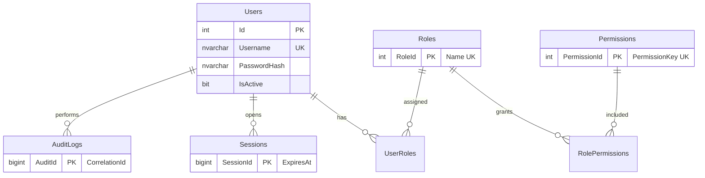

### E.3.2 البيانات الرئيسية والمخزون والفواتير

```mermaid
erDiagram
    Categories ||--o{ Products : classifies
    Products ||--o{ ProductBarcodes : has
    Products ||--o{ ProductPrices : priced_by
    Products ||--o{ ProductSerialNumbers : tracked_by
    Products ||--|| Inventory : stocked_as
    Inventory ||--o{ InventoryMovements : logs
    Products ||--o{ DamagedInventory : damaged
    Customers ||--o{ SalesInvoices : buys
    SalesInvoices ||--o{ SalesInvoiceItems : contains
    SalesInvoices ||--o{ Returns : returned_via
    SalesInvoices ||--o{ Exchanges : exchanged_via
    Suppliers ||--o{ PurchaseInvoices : supplies
    PurchaseInvoices ||--o{ PurchaseInvoiceItems : contains
    SalesInvoices ||--o{ PaymentTransactions : paid_by
    PurchaseInvoices ||--o{ PaymentTransactions : paid_by
    PaymentTransactions ||--o{ PaymentAllocations : split_into
    Products {
        bigint ProductId PK
        nvarchar Code UK
        decimal RetailPrice
        int MinStockQty
    }
    Inventory { bigint InventoryId PK "QuantityAvailable CHECK >= 0" "rowversion" }
    SalesInvoices { bigint SalesInvoiceId PK "InvoiceNumber UK" "Status" }
```

### E.3.3 المالية (Ledger-first)

```mermaid
erDiagram
    FinancialTransactions ||--o{ LedgerEntries : posts
    FinancialTransactions ||--o| FinancialTransactions : reverses
    PaymentTransactions ||--o{ PaymentAllocations : allocates
    CashAccounts ||--o{ PaymentAllocations : receives
    WalletAccounts ||--o{ PaymentAllocations : receives
    WalletAccounts ||--o{ TransferTransactions : source_or_destination
    WalletAccounts ||--o{ AccountLimits : limited_by
    WalletAccounts ||--o{ WalletLimitUsage : uses
    Customers ||--o{ CustomerAccounts : debtor
    Suppliers ||--o{ SupplierAccounts : creditor
    Expenses ||--o{ PaymentAllocations : paid_from
    FinancialTransactions {
        bigint FinancialTransactionId PK
        nvarchar TxType
        decimal Amount
        uniqueidentifier CorrelationId UK
    }
    LedgerEntries { bigint LedgerEntryId PK "DebitAmount" "CreditAmount" }
```

### E.3.4 الصيانة

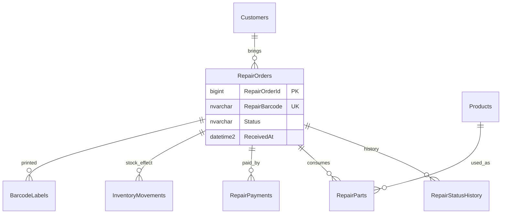

## E.4 البنية المالية (Ledger) وحدود المعاملات

| البند | التصميم المقترح (بدون اختراع معادلات) |
|---|---|
| وحدة الكتابة | `UnitOfWork` واحدة لكل أمر: `BEGIN TRAN` → كل الإدراجات → `COMMIT`؛ أي استثناء ⇒ `ROLLBACK` كامل |
| الرصيد | لا يُخزّن كقيمة قابلة للتحرير؛ `CurrentBalance` في `WalletAccounts`/`CashAccounts` لقطة مُعاد حسابها من `LedgerEntries` داخل معاملة، مع `rowversion` لمنع التضارب |
| المعرّف | `FinancialTransactionId` + `CorrelationId` + `SourceOperationType/Id` + `UserId` + `CreatedAt` + `ReversalOfId` |
| العكس | إلغاء/تصحيح = قيد عكس جديد مرتبط بـ `ReversalOfId`، لا تعديل للقيد الأصلي؛ سياسة العكس `OD-FIN-23` |
| التوزيع | `PaymentAllocations` صف لكل وسيلة/حساب؛ التحقق `SUM(allocations) = PaymentTransaction.TotalAmount` و`SUM(payments) ≤ Invoice.TotalAmount + allowedRemaining` داخل المعاملة |
| منع الازدواج | `IdempotencyKeys` يُفحص في بداية المعاملة؛ إعادة نفس الطلب تُعيد نفس النتيجة بلا كتابة ثانية |
| لقطة الأسعار | `SalesInvoiceItems.UnitPriceSnapshot` و`ProductNameSnapshot` يحفظان السعر وقت البيع، فلا يتأثر تاريخ الفاتورة بتغيير سعر المنتج لاحقًا |
| الفواتير المرحّلة | `Status='Posted'` ⇒ قفل منطقي + منع UPDATE/DELETE + تدقيق كل محاولة |
| الفترات | الإقفال اليومي/الشهري وقفل الفترات قرارات `OD-FIN-19`؛ لا تُطبّق قاعدة قبل اعتمادها |

## E.5 الكيانات المكتشفة أثناء التحليل (غير واردة في القائمة الأصلية)

`ExchangeItems`, `RepairPayments`, `ProductPrices`, `InvoiceSequences`, `InvoiceRelations`, `IdempotencyKeys`, `StockReservations`, `NotificationEvents`, `Sessions`, `SchemaVersions`, `PrintTemplates`, `PrintJobs`, `BarcodeLabels`, `ReportDefinitions`, `BackupJobs`, `AppVersions`, `WalletLimitUsage`, `ExpenseCategories`.

**سبب كل إضافة (مختصر):** `InvoiceSequences` لمنع تكرار الأرقام مع تزامن العملاء؛ `IdempotencyKeys` لمنع المعالجة المزدوجة عند إعادة الإرسال بعد انقطاع LAN؛ `StockReservations` لفواتير POS المفتوحة دون خصم فعلي؛ `ProductPrices` لفصل مستويات الأسعار/أسعار العملاء عن `Products`؛ `Sessions` للإبطال المركزي؛ `SchemaVersions` لأن المشروع بلا migrations اليوم؛ `PrintJobs` لإعادة طباعة فاتورة بنفس البيانات التاريخية؛ `WalletLimitUsage` لحساب الحدود من الحركات لا من عدّاد قابل للتعديل؛ `ReportDefinitions` لـ 41 تقريرًا دون تعديل كود لكل تقرير؛ `BackupJobs`/`AppVersions` لمتطلبات P19.

## E.6 الفهرسة والتزامن والاحتفاظ والنسخ

1. **فهارس مركّبة ساخنة:** `(ProductId, CreatedAt)` على `InventoryMovements`؛ `(AccountRef, CreatedAt)` على `LedgerEntries`؛ `(CreatedAt, Status)` على `SalesInvoices`؛ `(RepairBarcode)` unique.
2. **منع oversell:** `UPDATE Inventory SET QuantityAvailable = QuantityAvailable - @Qty WHERE ProductId=@P AND QuantityAvailable >= @Qty` داخل `UPDLOCK, HOLDLOCK`؛ `@@ROWCOUNT=0` ⇒ rollback ورسالة «الكمية غير متاحة». يُمنع أي `UPDATE` خارج `UnitOfWork`.
3. **الاحتفاظ:** حركة مخزون/قيد مالي/تدقيق = append-only؛ أرشفة بعد فترة تقويمية يحددها `OD-DEP-05`؛ لا حذف فعلي للفواتير.
4. **النسخ:** FULL يومي + DIFF + LOG بحسب `RPO/RPO` في `OD-DEP-03`؛ ملفات النسخ خارج جهاز السيرفر؛ اختبار استعادة فعلي موثّق في L.
5. **حدود Express:** 10GB لكل قاعدة و1GB ذاكرة و4 أنوية؛ مراقبة حجم `InventoryMovements`/`LedgerEntries`/`AuditLogs`؛ التصوير الحجمي وضغط الفهارس ضمن P17، وقرار الترقية `OD-ARC-09`.
6. **التوافق 130:** لا `STRING_AGG` ولا `DROP IF EXISTS` ولا `JSON_OBJECT`؛ السكربتات الحالية تستخدم `GO` وتُشغّل من SSMS، لذا يحتاج P03 أداة ترحيل تفصل الدفعات أو سكربتات خالية من `GO` (`TN-06`).

---

# القسم F — مراحل التطوير التفصيلية (Detailed Development Phases)

> **تنسيق موحد:** كل مرحلة تحتوي **15 بندًا إلزاميًا** بالترتيب المطلوب: (1) الرقم والاسم، (2) الهدف التجاري، (3) الهدف التقني، (4) المهام التفصيلية، (5) الشاشات، (6) مكونات الـ Backend، (7) كيانات/تغييرات DB، (8) الاعتماديات، (9) الأمان، (10) القواعد التجارية، (11) المخاطر، (12) سيناريوهات الاختبار، (13) معايير القبول القابلة للقياس، (14) المخرجات، (15) Definition of Done. لا توصف أي مرحلة بعبارة عامة مثل «تنفيذ وحدة المخزون».

## F.1 المراحل P00 – P04

### PHASE 00 — Existing Project Audit

| # | البند | التفصيل |
|---|---|---|
| 1 | رقم المرحلة والاسم | `P00` — تدقيق المشروع الحالي وتثبيت الأساس |
| 2 | الهدف التجاري | تحديد نقطة البداية الحقيقية قبل أي استثمار، وحماية ميزة الدخول العاملة التي يعتمد عليها المستخدمون اليوم |
| 3 | الهدف التقني | إنتاج سجل أدلة ملف:/سطر لكل ميزة، وحصر الديون، وتأسيس سجل القرارات المفتوحة وخطة بيئة اختبار Windows/SQL |
| 4 | المهام التفصيلية | 1) حصر الـ 40 ملفًا وقراءتها 2) توثيق البنية الحالية عميل←SQL مباشر 3) توثيق سير الدخول بالكامل 4) جرد `dbo.Users` والسكربتات 5) جرد الحزم والـ CI والفحوص البنيوية 6) مراجعة تاريخ PRs #1–#34 والـ rollback وحالة `origin/main` 7) توثيق انحراف PR #34 وخطة الدمج 8) كتابة سجل `TN-*` و`OD-*` 9) تثبيت baseline للـ CI و`static_checks.py` 10) تأكيد عدم وجود ERP سابق في الشجرة الحالية |
| 5 | الشاشات المطلوب تطويرها | **لا شاشات جديدة**؛ تُدرَس `LoginWindow` و`MainWindow` كما هما، وتُسجَّل قيودهما |
| 6 | مكونات الـ Backend | **لا يوجد backend حاليًا**؛ يُوثّق `AuthenticationService`, `ConnectionSettingsProvider`, `UserRepository`, `PasswordHasher` كأصول قابلة للنقل |
| 7 | كيانات / تغييرات DB | **صفر تغيير**؛ قراءة `dbo.Users` فقط؛ يُمنع أي DDL/DML |
| 8 | الاعتماديات | لا شيء (مرحلة أولى)؛ تُقرأ وثيقة الطلب والـ acceptance الحالي |
| 9 | متطلبات الأمان | لا أسرار في المستند؛ لا بيانات عملاء حقيقية؛ عدم لمس `connectionsettings.json`؛ توثيق `TN-01` دون إعادة نشر قيم سرية |
| 10 | القواعد التجارية | تجميد سلوك الدخول الحالي؛ كل قاعدة غير محسومة تُسجّل `OD-*` ولا يُبتدع لها حكم؛ `Admin@123` يُعتبر دينًا لا يُصحّح هنا |
| 11 | المخاطر التقنية | افتراض وجود شاشات ERP من PR #9–#31 (`TN-13`)؛ انحراف `origin/main` (`TN-17`)؛ غياب بيئة Windows/SQL يمنع التحقق الفعلي (`TN-10`) |
| 12 | سيناريوهات الاختبار | إعادة إنتاج الجرد بـ `git ls-tree`؛ تشغيل `python3 tools/static_checks.py`؛ تأكيد نجاح CI على Windows؛ smoke test للدخول على جهاز Windows عند توفره؛ مقارنة الشجرة بـ `FETCH_HEAD` |
| 13 | معايير القبول | 1) كل ملف من الـ 40 مذكور بالاسم 2) كل ميزة «منفذة» بدليل `file:line` 3) صفر تعديل على ملفات المصدر 4) سجل `OD-*` و`TN-*` موجود 5) تقرير صريح بوجود/غياب ERP سابق |
| 14 | المخرجات | القسم B من هذا المستند + سجل أدلة + سجل قرارات مفتوحة + سجل مخاطر أولي + خطة بيئة اختبار |
| 15 | Definition of Done | اعتماد التدقيق من صاحب القرار، تطابق `git status` مع الأساس، CI أخضر، وعدم وجود افتراض غير موثق |

### PHASE 01 — Architecture and Technical Foundation

| # | البند | التفصيل |
|---|---|---|
| 1 | رقم المرحلة والاسم | `P01` — المعمارية والأساس التقني (إضافة API داخل نفس الحل) |
| 2 | الهدف التجاري | تمكين عدة أجهزة من العمل على قاعدة واحدة بوسيط مركزي دون تغيير تجربة المستخدم أو إيقاف الدخول |
| 3 | الهدف التقني | إضافة `FitohPhone.Api`, `FitohPhone.Shared`, `FitohPhone.Infrastructure` إلى `FitohPhone.sln`؛ عقود DTO، ApiClient، معايير الكود، logging، أخطاء موحّدة، CorrelationId، Health، Idempotency، versioning، دمج PR #34 |
| 4 | المهام التفصيلية | 1) إنشاء المشاريع الثلاثة وربطها بالحل 2) نقل `PasswordHasher` كما هو إلى Shared 3) تعريف `IApiClient`, `ApiError`, `PagedResult`, `PermissionNames` 4) `Program.cs` + Kestrel + WindowsServiceLifetime 5) Middleware: CorrelationId, ExceptionMapping, Idempotency, HostFiltering, RateLimiter 6) Serilog إلى ملف دوّار + Event Log 7) `/health/live` و`/health/ready` 8) `ApiVersion` handshake 9) نقل الأسرار إلى السيرفر وتدويرها 10) تحديث workflow لبناء المشاريع الجديدة 11) دمج/مراجعة `origin/main` (PR #34) وحسم تعارض `connectionsettings.json` 12) كتابة ADR لكل قرار معماري |
| 5 | الشاشات المطلوب تطويرها | `ConnectionTestView` (اختبار اتصال أولي)، `ServerStatusView`، وتعديل `App.xaml.cs` لتهيئة `ApiClient` فقط؛ **لا تغيير في `LoginWindow.xaml`** |
| 6 | مكونات الـ Backend | `Program`, `AuthController` (هيكل), `CorrelationIdMiddleware`, `IdempotencyMiddleware`, `ExceptionMappingMiddleware`, `AuthorizationMiddleware` (هيكل), `UnitOfWork`, `RepositoryBase`, `HealthChecks`, `SecretStore`, `BackupService` (هيكل), `UpdateService` (هيكل) |
| 7 | كيانات / تغييرات DB | `IdempotencyKeys`, `SchemaVersions`, `AppVersions` (جداول بنية تحتية فقط)؛ **لا مساس بـ `dbo.Users`** |
| 8 | الاعتماديات | `P00` (التدقيق والقرارات)؛ قرار `OD-ARC-01` (منفذ HTTPS) و`OD-ARC-04` (ORM أم SqlClient) |
| 9 | متطلبات الأمان | لا connection string ولا أسرار DB في العميل؛ TLS 1.2+؛ host filtering؛ rate limiting؛ تدوير سر `TN-01`؛ حساب خدمة SQL بأقل صلاحية؛ عدم كشف استثناءات للمستخدم |
| 10 | القواعد التجارية | الـ API هو الكاتب الوحيد في DB؛ العميل لا يتجاوزه؛ كل طلب كتابة يحمل `Idempotency-Key`؛ رفض عميل بإصدار API غير متوافق |
| 11 | المخاطر التقنية | كسر الدخول أثناء النقل؛ ازدواج مسار الوصول (مباشر + API) مؤقتًا؛ قيود Express؛ تعارض دمج PR #34؛ ثغرات التهيئة الافتراضية لـ Kestrel |
| 12 | سيناريوهات الاختبار | بناء الحل كاملًا على windows-2022؛ تشغيل الخدمة محليًا؛ `/health` من جهاز ثانٍ؛ رفض طلب بلا `Idempotency-Key`؛ إعادة نفس المفتاح تُعيد نفس النتيجة؛ محاولة وصول عميل لـ SQL 1433 تفشل بعد إغلاق المنفذ؛ الدخول القديم ما زال يعمل |
| 13 | معايير القبول | 1) `dotnet build FitohPhone.sln` أخضر 2) `/health/ready` يعيد 200 3) صفر أسرار في ملفات العميل 4) تسجيل الدخول الحالي ينجح دون تغيير واجهة 5) طلب مكرر لا يُنفّذ مرتين |
| 14 | المخرجات | 3 مشاريع جديدة، ADRs، عقود API، قالب إعداد عميل بلا أسرار، CI محدّث، مخطط C.2 |
| 15 | Definition of Done | مراجعة معمارية معتمدة، CI أخضر على Windows، اختبار جهازين للاتصال، توثيق خطة الإقلاع كخدمة، صفر regression في الدخول |

### PHASE 02 — Modern UI Design System

| # | البند | التفصيل |
|---|---|---|
| 1 | رقم المرحلة والاسم | `P02` — نظام التصميم الحديث وهيكل التطبيق |
| 2 | الهدف التجاري | توفير ق shell إنتاجي سريع يخدم الكاشير والمدير والفني، ويستوعب 14 وحدة لاحقًا دون إعادة بناء الواجهة |
| 3 | الهدف التقني | بناء `AppShell` + Sidebar/TopBar + مكتبة مكونات + عقد `ThemeTokens` مشترك + تنقل + حالات UI + RTL شامل + دعم DPI + اختصارات |
| 4 | المهام التفصيلية | 1) `AppShell` مع منطقة محتوى وSidebar وTopBar 2) `NavigationService` وخريطة تنقل لكل الوحدات 3) مكونات: `DataGridEx`, `SearchBox`, `FilterPanel`, `DialogHost`, `ToastHost`, `LoadingOverlay`, `EmptyState`, `ErrorState`, `ConfirmDialog` 4) `ThemeTokens.xaml` كعقد واحد مشترك 5) آلية تبديل `ResourceDictionary` في وقت التشغيل 6) إستراتيجية RTL للجداول والأرقام والتواريخ 7) اختصارات لوحة مفاتيح وFocus management للباركود 8) تخطيطات متجاوبة وDPI 100–200% 9) فصل منطق الأعمال عن Views 10) معرض مكونات للمراجعة |
| 5 | الشاشات المطلوب تطويرها | `AppShell`, `Sidebar`, `TopBar`, `DashboardView` (هيكل), `ComponentGallery`, `LoginWindow` (إعادة تنسيق فقط مع الحفاظ على السلوك), `ConnectionTestView` |
| 6 | مكونات الـ Backend | `ThemeService`, `NavigationService`, `ApiClientErrorMapper`, `PermissionVisibilityService` (عرض فقط لا فرض) |
| 7 | كيانات / تغييرات DB | `ThemeSettings`, `ApplicationSettings` |
| 8 | الاعتماديات | `P01` (عقود API)؛ `P00` (قرارات التصميم) |
| 9 | متطلبات الأمان | إخفاء عناصر القائمة حسب الصلاحية للعرض فقط؛ منع تسجيل البيانات الحساسة في logs الواجهة؛ عدم تخزين token في XAML أو ملفات مؤقتة |
| 10 | القواعد التجارية | **الإنتاجية قبل المؤثرات البصرية**؛ السمات الثمان لاحقًا تستخدم نفس المكونات ونفس الوظيفة؛ لا منطق مالي في ViewModels |
| 11 | المخاطر التقنية | انكسار تخطيط الدخول؛ RTL داخل `DataGrid`؛ تكلفة تبديل dictionaries؛ تضخم `Theme.xaml` الحالي أحادي السمة |
| 12 | سيناريوهات الاختبار | DPI 100/125/150/200%؛ RTL كامل؛ Tab/Enter؛ تبديل سمة دون إعادة تشغيل؛ حالات فراغ/خطأ/تحميل؛ مسح باركود كـ keyboard wedge؛ الدخول والخروج 5 مرات |
| 13 | معايير القبول | 1) كل مكونات القائمة موجودة ومُختبرة 2) الدخول يعمل بعد إعادة التنسيق 3) تبديل السمة لا يغيّر أي وظيفة 4) لا نافذة يتيمة عند الخروج 5) `FlowDirection` صحيح للجداول والأرقام |
| 14 | المخرجات | مكتبة مكونات، `ThemeTokens.xaml`، خريطة تنقل، دليل أنماط، معرض مكونات |
| 15 | Definition of Done | مراجعة UI/UX معتمدة، اختبارات DPI/RTL خضراء، صفر منطق أعمال في Code-behind، توثيق عقد السمات |

### PHASE 03 — Database Foundation

| # | البند | التفصيل |
|---|---|---|
| 1 | رقم المرحلة والاسم | `P03` — أساس قاعدة البيانات والترحيلات |
| 2 | الهدف التجاري | حفظ كل العمليات التجارية والمالية تاريخيًا وباتساق، مع إمكانية الاستعادة بعد أي عطل |
| 3 | الهدف التقني | إنشاء المخطط الموصوف في E، أداة ترحيل مُرقّمة، قيود/فهارس، تسلسل فواتير آمن، idempotency، وحدة معاملات، نسخ احتياطي قابل للاستعادة |
| 4 | المهام التفصيلية | 1) `SchemaMigrationService` مع `SchemaVersions` 2) سكربتات خالية من `GO` قابلة للتنفيذ البرمجي أو تقسيم دفعات 3) إنشاء الجداول الـ 57 4) كل FK/CHECK/UNIQUE/default 5) `rowversion` على الجداول المتزامنة 6) الفهارس المركّبة 7) `InvoiceSequences` و`IdempotencyKeys` 8) بيانات مرجعية (فئات، أدوار، صلاحيات، حسابات نقدية) 9) `UnitOfWork` مع `BEGIN/COMMIT/ROLLBACK` 10) سكربتات rollback وبيانات اختبار 11) التحقق على SQL 2016 SP1 بمستوى 130 12) إستراتيجية FULL/DIFF/LOG |
| 5 | الشاشات المطلوب تطويرها | لا شاشات مستخدم جديدة؛ شاشة إدارة `SchemaVersions` للمسؤول ضمن `SettingsView` لاحقًا |
| 6 | مكونات الـ Backend | `SchemaMigrationService`, `RepositoryBase`, `UnitOfWork`, `ConcurrencyGuard`, `SchemaTests`, `BackupService`, `SeedService` |
| 7 | كيانات / تغييرات DB | كامل E.2؛ `dbo.Users` يبقى كما هو مع أعمدة additive فقط بعد موافقة P04؛ `SchemaVersions`, `InvoiceSequences`, `IdempotencyKeys`, `StockReservations`, `NotificationEvents`, `BackupJobs`, `AppVersions` |
| 8 | الاعتماديات | `P01`؛ `P00` (قرار `OD-ARC-04`, `OD-ARC-08`, `OD-ARC-09`, `OD-ARC-10`, `OD-ARC-11`) |
| 9 | متطلبات الأمان | استعلامات مُعامَلة 100%؛ حساب خدمة واحد بأقل صلاحية؛ لا أسرار في السكربتات؛ تشفير ملفات النسخ؛ تدقيق تغيير المخطط |
| 10 | القواعد التجارية | جداول الحركات append-only؛ منع الحذف الفعلي للفواتير؛ snapshot للأسعار؛ لا migration هدّام؛ كل ترحيل قابل للرجوع |
| 11 | المخاطر التقنية | `GO` في السكربتات الحالية (`TN-06`)؛ حد 10GB لـ Express؛ تعارض `READ_COMMITTED_SNAPSHOT` مع Express؛ ترحيل فاشل يترك مخططًا جزئيًا |
| 12 | سيناريوهات الاختبار | إنشاء قاعدة نظيفة؛ إعادة تشغيل الترحيل مرتين بلا تغيير؛ اختبار كل CHECK (كمية سالبة، مبلغ سالب)؛ اختبار FK؛ قياس زمن الفهارس الساخنة؛ استعادة نسخة على instance ثانٍ؛ rollback ترحيل |
| 13 | معايير القبول | 1) قاعدة نظيفة تحتوي كل الكيانات 2) إعادة التشغيل idempotent 3) `sql/03_VerifyEnvironment.sql` لا يزال يعمل 4) استعادة نسخة ناجحة موثّقة 5) صفر تعديل على بيانات `dbo.Users` القائمة |
| 14 | المخرجات | سكربتات مرقّمة، data dictionary، ER diagrams، سكربتات rollback، تقرير اختبار استعادة |
| 15 | Definition of Done | ترحيل مُعاد إنتاجه على SQL 2016 SP1 فعلي، اختبارات المخطط خضراء، نسخة استعادة مُثبتة، مراجعة DBA معتمدة |

### PHASE 04 — Authentication and Authorization

| # | البند | التفصيل |
|---|---|---|
| 1 | رقم المرحلة والاسم | `P04` — استكمال وتأمين نظام الدخول والصلاحيات (الحفاظ على القائم) |
| 2 | الهدف التجاري | السماح بتشغيل عدة موظفين بصلاحيات مختلفة مع منع أي تلاعب بالأسعار أو الإلغاء أو التقارير المالية |
| 3 | الهدف التقني | نقل التحقق إلى الـ API مع **نفس `PasswordHasher` ونفس `dbo.Users`**؛ RBAC؛ جلسات مركزية؛ password reset؛ lockout؛ AuditLogs؛ فرض الصلاحيات خادميًا |
| 4 | المهام التفصيلية | 1) `/api/v1/auth/login` يستخدم `UserRepository` المنقول 2) session token + refresh token + `Sessions` 3) `PermissionNames` للصلاحيات الـ 19 المطلوبة 4) `AuthorizationMiddleware` وPolicy لكل endpoint 5) نقل `LoginViewModel` إلى `IAuthenticationApiClient` مع الإبقاء على تشخيص الأخطاء 6) `UsersView`, `RolesView`, `PermissionMatrixView`, `PasswordResetDialog`, `AuditLogView` 7) إلزام تغيير `Admin@123` 8) سياسة كلمة مرور + lockout + rate limiting 9) تدقيق كل عملية حساسة 10) تعطيل المستخدم يبطل جلسته 11) اختبار منع تجاوز الواجهة باستدعاء API مباشر |
| 5 | الشاشات المطلوب تطويرها | `LoginWindow` (نفس الشكل)، `UsersView`, `UserEditorView`, `RolesView`, `PermissionMatrixView`, `PasswordResetDialog`, `AuditLogView` |
| 6 | مكونات الـ Backend | `AuthController`, `TokenService`, `AuthorizationMiddleware`, `PermissionService`, `UserAdminService`, `RoleService`, `AuditService`, `LoginRateLimiter`, `SessionRevocationService` |
| 7 | كيانات / تغييرات DB | `Users` (أعمدة additive فقط: `MustChangePassword`, `FailedAttempts`, `LockedUntil`), `Roles`, `Permissions`, `UserRoles`, `RolePermissions`, `Sessions`, `AuditLogs` |
| 8 | الاعتماديات | `P01`, `P02`, `P03` |
| 9 | متطلبات الأمان | PBKDF2 الحالي محفوظ؛ لا hash للعميل؛ token موقّع وانتهاء صلاحية؛ فرض الصلاحية على الخادم؛ تدوير الأسرار؛ `TrustServerCertificate=false` بعد CA داخلية (`OD-SEC-01`) |
| 10 | القواعد التجارية | `IsActive` يُحترم؛ لا يمنح المستخدم صلاحية لنفسه؛ كل تعديل صلاحية مُدقّق؛ الدخول الخاطئ لا يكشف وجود المستخدم؛ `OD-SEC-02/03` مفتوحة |
| 11 | المخاطر التقنية | عدم توافق hash قديم؛ ازدواج الجلسة المحلية والمركزية مؤقتًا؛ تعطيل حساب أثناء جلسة نشطة؛ نسيان policy على endpoint جديد |
| 12 | سيناريوهات الاختبار | الدخول بـ `admin` الحالي عبر API؛ كلمة خاطئة؛ مستخدم معطل؛ مستخدم بلا صلاحية يستدعي `POST /sales` مباشرة ⇒ 403؛ انتهاء token؛ تدوير refresh؛ قفل بعد N محاولات؛ تدقيق تغيير دور؛ جهازان بنفس الحساب |
| 13 | معايير القبول | 1) الدخول ينجح ببيانات `dbo.Users` الحالية دون rehash 2) استدعاء مباشر غير مصرح يُرفض 403 3) كل صلاحية من الـ 19 مُطبّقة خادميًا 4) `AuditLogs` يسجّل الحساسات 5) كلمة الافتراضية مُجبرة على التغيير |
| 14 | المخرجات | Auth API، RBAC UI، permission catalog، سياسة كلمات المرور، تقرير اختبار الاختراق الداخلي |
| 15 | Definition of Done | مراجعة أمنية معتمدة، صفر صلاحية تعتمد على الواجهة، اختبارات 403 خضراء، توثيق انتقال العميل من SqlClient إلى ApiClient |


## F.2 المراحل P05 – P09

### PHASE 05 — Master Data Management

| # | البند | التفصيل |
|---|---|---|
| 1 | رقم المرحلة والاسم | `P05` — إدارة البيانات الرئيسية (Products, Categories, Customers, Suppliers, Accounts) |
| 2 | الهدف التجاري | تسجيل كل ما يُباع ويُشترى ويُصلَح وأطراف التعامل قبل أول عملية بيع أو شراء |
| 3 | الهدف التقني | CRUD كامل عبر API مع بحث/تصفية/فرز، باركودات متعددة، 3 مستويات أسعار + سعر عميل خاص، حد أدنى، فئات قابلة للضبط، وملفات عملاء/موردين |
| 4 | المهام التفصيلية | 1) `Products` بكل الحقول الـ 16 2) `Categories` بالفئات الثمانية كبيانات 3) `ProductBarcodes` متعددة + توليد 4) `ProductPrices` لمستويات الجملة/الخاص/التجزئة 5) قرار/تصميم `ProductSerialNumbers` لـ IMEI (`OD-ARC-11`) 6) `Customers` و`Suppliers` بالحقول المطلوبة 7) `CashAccounts` و`WalletAccounts` بالأرصدة الافتتاحية كبيانات أولية 8) `CustomerQuickAddDialog` قابل للاستخدام من POS والصيانة 9) بحث بالاسم/الهاتف/الكود/الباركود 10) تصدير القوائم 11) ربط كل كيان بصلاحيات P04 |
| 5 | الشاشات المطلوب تطويرها | `ProductsListView`, `ProductEditorView`, `ProductDetailsView`, `CategoryManagerView`, `BarcodeManagerView`, `CustomersView`, `CustomerEditorView`, `CustomerQuickAddDialog`, `SuppliersView`, `SupplierEditorView`, `WalletAccountsView` (الأساس), `AccountStatementView` (هيكل) |
| 6 | مكونات الـ Backend | `ProductService`, `CategoryService`, `BarcodeService`, `CustomerService`, `SupplierService`, `AccountOpeningService`, `SearchService`, `ExportService` |
| 7 | كيانات / تغييرات DB | `Products`, `Categories`, `ProductBarcodes`, `ProductSerialNumbers`, `ProductPrices`, `Customers`, `Suppliers`, `CashAccounts`, `WalletAccounts`, `PriceTiers` |
| 8 | الاعتماديات | `P03` (المخطط), `P04` (الصلاحيات), `P02` (المكونات) |
| 9 | متطلبات الأمان | صلاحيات `Manage customers`, `Manage suppliers`, `Change product prices`؛ التحقق من المدخلات وأطوالها؛ منع تكرار `Code`/`Barcode`؛ تدقيق تعديل الأسعار |
| 10 | القواعد التجارية | كود المنتج فريد؛ الفئات بيانات لا ثوابت؛ الأرصدة الافتتاحية للخدمات النموذجية بيانات لا Hardcode؛ السعر الخاص مرتبط بعميل؛ `OD-FIN-20` للأرصدة الافتتاحية |
| 11 | المخاطر التقنية | تضارب باركودات بين منتجات؛ تعدد الأسعار وتداخل فتراتها؛ إدخال IMEI مزدوج؛ بحث بطيء بلا فهارس |
| 12 | سيناريوهات الاختبار | إنشاء/تعديل/إيقاف منتج؛ رفض كود مكرر؛ رفض سعر سالب؛ إضافة عميل من POS والعودة للفاتورة؛ بحث عربي وإنجليزي؛ تصدير CSV؛ فئات متداخلة |
| 13 | معايير القبول | 1) كل حقول المنتج الـ 16 محفوظة 2) 8 فئات افتراضية قابلة للتعديل 3) 3 مستويات سعر + سعر خاص 4) عميل جديد يُضاف من POS ويُنتقى تلقائيًا 5) الأرصدة النموذجية الأربعة تُقرأ من DB لا من الكود |
| 14 | المخرجات | وحدات CRUD، شاشات البحث، معرض بيانات أولية، وثيقة قرار IMEI |
| 15 | Definition of Done | اختبارات CRUD خضراء، بحث مُفهرس، مراجعة صلاحيات، بيانات أولية مُحمّلة عبر migration لا عبر ثوابت |

### PHASE 06 — Inventory Management

| # | البند | التفصيل |
|---|---|---|
| 1 | رقم المرحلة والاسم | `P06` — المخزون والحركات والمخزون التالف ونوافص المخزون |
| 2 | الهدف التجاري | معرفة الكمية المتاحة لحظيًا ومنع بيع غير المتاح، مع سجل كامل لكل حركة وتلف |
| 3 | الهدف التقني | `Inventory` مع `rowversion` وأقفال، `InventoryMovements` append-only لأنواع الحركات الثمانية، `DamagedInventory` مستقل، تنبيهات الحد الأدنى، تسويات مصرح بها |
| 4 | المهام التفصيلية | 1) عرض المخزون بالأعمدة السبعة 2) إضافة/تعديل/عرض/إيقاف/بحث/تصفية/فرز/تصدير 3) أنواع الحركة: شراء، بيع، مرتجع، مبادلة، تالف، تسوية يدوية، قطع صيانة، أخرى 4) حقول الحركة السبعة 5) `DamagedInventory`: تسجيل، أسباب، تواريخ، مستخدم، سجل، write-off 6) استبعاد التالف من المتاح 7) `LowStockService` و`NotificationEvents` 8) `StockReservations` لفواتير POS المفتوحة 9) تصدير وطباعة جرد 10) منع oversell داخل `UnitOfWork` |
| 5 | الشاشات المطلوب تطويرها | `InventoryView`, `StockMovementHistoryView`, `DamagedStockView`, `StockAdjustmentDialog`, `LowStockView`, `InventoryPrintPreview` |
| 6 | مكونات الـ Backend | `InventoryService`, `StockMovementService`, `DamagedStockService`, `LowStockService`, `ConcurrencyGuard`, `StockAdjustmentApprovalService` |
| 7 | كيانات / تغييرات DB | `Inventory`, `InventoryMovements`, `DamagedInventory`, `StockReservations`, `NotificationEvents`, `Warehouses` (إن اعتُمد `OD-ARC-10`) |
| 8 | الاعتماديات | `P05` (المنتجات), `P03` (المعاملات), `P04` (الصلاحيات) |
| 9 | متطلبات الأمان | كل تسوية يدوية بصلاحية + تدقيق + سبب إلزامي؛ منع التعديل المباشر لـ `QuantityAvailable` من العميل؛ حماية من الكتابة المتزامنة |
| 10 | القواعد التجارية | التالف لا يُباع؛ كل حركة مرتبطة بعملية أصلية؛ لا حركة بلا مستخدم؛ الكمية المتاحة ≥ 0 دائمًا؛ `OD-FIN-18` للمعالجة المحاسبية للهالك |
| 11 | المخاطر التقنية | فقدان حركة عند فشل جزئي؛ Deadlock بين فاتورتين؛ تراكم الحركات في Express؛ حجز POS دون انتهاء صلاحية |
| 12 | سيناريوهات الاختبار | بيع آخر وحدة من جهازين ⇒ واحدة تنجح والأخرى تُرفض؛ تسوية يدوية بصلاحية وبدونها؛ تسجيل تالف ثم محاولة بيعه؛ نفاد المخزون يُطلق تنبيهًا؛ كل حركة تُطابق مرجعها |
| 13 | معايير القبول | 1) لا يمكن أن تصبح `QuantityAvailable` سالبة 2) لكل حركة مرجع ومستخدم وتاريخ 3) التالف مستبعد من المتاح 4) التنبيه عند بلوغ `MinStockQty` 5) استهلاك قطع صيانة يُنتج حركة (يُختبر كاملًا في P12) |
| 14 | المخرجات | وحدة المخزون، سجل الحركات، شاشة الهالك، خدمة التنبيهات، تقرير جرد |
| 15 | Definition of Done | اختبار تزامن 10 عملاء خالٍ من oversell، مراجعة سلامة الحركات، فهارس مُقاسة، توثيق قواعد الأقفال |

### PHASE 07 — Purchasing System

| # | البند | التفصيل |
|---|---|---|
| 1 | رقم المرحلة والاسم | `P07` — فواتير الشراء والموردون والاستلام والدفع الجزئي |
| 2 | الهدف التجاري | إدخال البضاعة للمخزون وتسجيل ما يُدفع للمورد وما يبقى دينًا عليه بدقة |
| 3 | الهدف التقني | فاتورة متعددة الأصناف، دفع مختلط جزئي، حساب المورد الدائن، تحديث المخزون داخل معاملة واحدة، قواعد التعديل/الإلغاء |
| 4 | المهام التفصيلية | 1) `PurchaseInvoiceEditorView` بأسطر متعددة 2) اختيار منتج/كمية/سعر وحدة/إجمالي سطر/ملاحظات 3) اختيار مورد أو إنشاؤه سريعًا 4) توزيع الدفع: 3000 نقد + 2000 فودافون + 1000 إنستاباي من أصل 10000 ⇒ 4000 مستحق 5) `PaymentAllocations` و`SupplierAccounts` 6) استلام البضاعة ⇒ `InventoryMovements` نوع Purchase 7) سجل الفواتير/المورد/المدفوعات 8) طباعة الفاتورة (P15 يستكمل القوالب) 9) التعديل/الإلغاء المصرح وأثره العكسي 10) تدقيق كل تغيير |
| 5 | الشاشات المطلوب تطويرها | `PurchaseInvoiceEditorView`, `PurchaseHistoryView`, `PurchaseDetailsView`, `SupplierPaymentsView`, `SupplierQuickAddDialog`, `PurchasePrintPreview` |
| 6 | مكونات الـ Backend | `PurchaseService`, `GoodsReceiptService`, `PurchasePaymentService`, `SupplierBalanceService`, `PurchaseCancellationService`, `PostingService` |
| 7 | كيانات / تغييرات DB | `PurchaseInvoices`, `PurchaseInvoiceItems`, `Suppliers`, `PaymentTransactions`, `PaymentAllocations`, `SupplierAccounts`, `InventoryMovements`, `FinancialTransactions`, `LedgerEntries`, `AuditLogs` |
| 8 | الاعتماديات | `P05`, `P06`, `P13` (القواعد المالية الأساسية قبل الترحيل) — تبعية جزئية: P07 يستخدم واجهة `PostingService` المُعرّفة في P13 مبكرًا |
| 9 | متطلبات الأمان | صلاحية `Record purchases`؛ تعديل/إلغاء بصلاحية أعلى؛ منع تعديل فاتورة مرحّلة؛ تدقيق الأسعار؛ منع إدخال سعر سالب |
| 10 | القواعد التجارية | الرصيد المتبقي = إجمالي الفاتورة − مجموع التوزيعات (القاعدة النهائية `OD-FIN-07`)؛ أثر التعديل/الإلغاء على المخزون ورصيد المورد `OD-FIN-11`؛ لا استلام بلا فاتورة |
| 11 | المخاطر التقنية | ازدواج الاستلام عند إعادة الإرسال؛ تعارض بين تحديث المخزون والدفع؛ عكس فاتورة بعد بيع أصنافها |
| 12 | سيناريوهات الاختبار | فاتورة 10000 بالتوزيع المذكور ⇒ رصيد مورد 4000؛ دفع لاحق يخفض الرصيد؛ إلغاء فاتورة ⇒ عكس المخزون والدين؛ محاولة إلغاء بعد بيع الصنف؛ فاتورتان متزامنتان |
| 13 | معايير القبول | 1) الاستلام يزيد المخزون **مرة واحدة بالضبط** 2) مجموع التوزيعات يطابق المدفوع 3) رصيد المورد يعكس المشتريات والمدفوعات 4) الإلغاء يعكس كل الأثر مع تدقيق 5) لا فاتورة بلا Idempotency-Key |
| 14 | المخرجات | وحدة المشتريات، شاشات الدفع، كشف حساب المورد، سكربتات اختبار الأثر المزدوج |
| 15 | Definition of Done | اختبارات التكامل خضراء، مراجعة محاسبية لقاعدة الرصيد، توثيق أثر الإلغاء، صفر ازدواج استلام |

### PHASE 08 — Point of Sale

| # | البند | التفصيل |
|---|---|---|
| 1 | رقم المرحلة والاسم | `P08` — نقطة البيع متعددة الفواتير والباركود والأسعار والدفع المختلط |
| 2 | الهدف التجاري | إتمام بيع سريع وصحيح ماليًا ومخزنيًا في ذروة العمل دون أخطاء أو تجاوز صلاحيات |
| 3 | الهدف التقني | فواتير متزامنة مفتوحة، بحث/مسح باركود، 3 مستويات أسعار، عميل سريع، دفع مختلط، تحقق كميات/مخزون، حجز مؤقت، ترحيل ذري |
| 4 | المهام التفصيلية | 1) `InvoiceTabStrip` لعدة فواتير مع تبديل وإنشاء جديد 2) مسودات رهن `OD-FIN-14` 3) `ProductPicker` بالباركود/الاسم/الكود/الاختيار السريع/keyboard-wedge 4) تعديل وحذف الكميات 5) `CustomerQuickAddDialog` مع العودة والاختيار التلقائي 6) اختيار مستوى السعر بصلاحية 7) خصم على مستوى الفاتورة مع قاعدة التفاعل `OD-FIN-08` 8) لوحة دفع بثلاث وسائل + حسابات + تحقق المجموع مقابل الإجمالي/المتبقي 9) `PaymentAllocations` منفصلة 10) إجمالي/مدفوع/متبقي/دين عميل وفق `OD-FIN-06` 11) تحقق المخزون + `StockReservations` 12) طباعة وإلغاء وسجل المعاملات 13) حظر تغيير السعر/الخصم دون صلاحية من الـ backend |
| 5 | الشاشات المطلوب تطويرها | `PosView`, `InvoiceTabStrip`, `ProductPicker`, `CustomerQuickAddDialog`, `PaymentPanel`, `PriceTierSelector`, `DiscountDialog`, `InvoicePrintPreview`, `SalesHistoryView` |
| 6 | مكونات الـ Backend | `PosService`, `PricingService`, `StockReservationService`, `InvoicePostingService`, `CustomerQuickAddService`, `DiscountPolicyService`, `IdempotencyService` |
| 7 | كيانات / تغييرات DB | `SalesInvoices`, `SalesInvoiceItems`, `PaymentTransactions`, `PaymentAllocations`, `StockReservations`, `Inventory`, `InventoryMovements`, `CustomerAccounts`, `FinancialTransactions`, `LedgerEntries`, `PrintJobs`, `AuditLogs` |
| 8 | الاعتماديات | `P05`, `P06`, `P04`, `P13` (واجهة الترحيل), `P15` (قالب الطباعة) |
| 9 | متطلبات الأمان | صلاحيات `Create sales invoices`, `Change product prices`, `Apply discounts` مُفرضة خادميًا؛ حد أقصى للخصم حسب الدور؛ منع التلاعب بسعر العميل عبر تعديل الطلب؛ تدقيق الإلغاء |
| 10 | القواعد التجارية | لا بيع بكمية ≤ 0؛ لا بيع بلا مخزون؛ مجموع التوزيعات مقابل الإجمالي/المتبقي المسموح؛ السعر يُسجّل كـ snapshot؛ الدفع المختلط 500/300/200 مثال اختبار؛ تفاعل الخصم مع الأسعار `OD-FIN-08` |
| 11 | المخاطر التقنية | فاتورة عالقة بحجز منتهٍ؛ تضارب خصم الفاتورة مع سعر خاص؛ ماسح باركود يرسل Enter داخل حقل خطأ؛ بطء PBKDF2 لا يدخل هنا (الدخول فقط) |
| 12 | سيناريوهات الاختبار | فاتورتان مفتوحتان بالتبديل؛ مسح باركود؛ إضافة عميل والعودة؛ دفع 500+300+200 على فاتورة 1000؛ دفع ناقص ⇒ دين؛ محاولة خصم بلا صلاحية ⇒ 403؛ بيع آخر وحدة من جهازين؛ إعادة إرسال نفس `Idempotency-Key` |
| 13 | معايير القبول | 1) **الفاتورة المكتملة تُحدّث المخزون مرة واحدة بالضبط** 2) توزيعات الدفع تتطابق مع الإجمالي 3) إرجاع سليم/تالف يُعالج في P10 4) لا تجاوز سعر بلا صلاحية 5) لا oversell تحت التزامن |
| 14 | المخرجات | وحدة POS كاملة، سياسة التسعير/الخصم، اختبارات التزامن، دليل اختصارات الكاشير |
| 15 | Definition of Done | اختبار 50 فاتورة متزامنة ناجح، مراجعة مالية للتوزيعات، قياس زمن إتمام الفاتورة، توثيق سير المسح |

### PHASE 09 — Invoice Management

| # | البند | التفصيل |
|---|---|---|
| 1 | رقم المرحلة والاسم | `P09` — سجل الفواتير الموحّد والتفاصيل والتعديل/الإلغاء والتدقيق |
| 2 | الهدف التجاري | مرجع واحد موثوق لكل فاتورة بيع/شراء/مرتجع/مبادلة وكل ما ارتبط بها من دفع وتعديل |
| 3 | الهدف التقني | استعلام موحّد، بحث/تصفية متقدمة، عرض تفاصيل كاملة، منع التعديل الصامت للمرحّل، إلغاء بعكس، تدقيق شامل، ترقيم آمن |
| 4 | المهام التفصيلية | 1) `InvoiceRegistryService` يوحّد 5 أنواع 2) عرض الرقم/التاريخ/الطرف/الأصناف/الكميات/الأسعار/الخصومات/المدفوعات/المتبقي/المستخدم/العمليات المرتبطة 3) `InvoiceFilterPanel` بالتاريخ والرقم والطرف والمنتج والحالة 4) `InvoiceRelations` لربط المرتجعات والمبادلات والمدفوعات 5) قواعد `Posted` للمنع 6) `InvoiceCancellationService` بعكس كامل 7) `InvoiceSequences` مع قفل 8) `InvoiceAuditView` 9) تصدير/طباعة 10) اختبار منع التعديل الصامت |
| 5 | الشاشات المطلوب تطويرها | `InvoiceRegisterView`, `InvoiceDetailsView`, `InvoiceFilterPanel`, `InvoiceAuditView`, `InvoiceCancellationDialog`, `InvoicePrintPreview` |
| 6 | مكونات الـ Backend | `InvoiceRegistryService`, `InvoiceQueryService`, `InvoiceCancellationService`, `InvoiceSequenceService`, `InvoiceRelationService`, `AuditService` |
| 7 | كيانات / تغييرات DB | `SalesInvoices`, `PurchaseInvoices`, `Returns`, `Exchanges`, `PaymentTransactions`, `InvoiceRelations`, `InvoiceSequences`, `AuditLogs` |
| 8 | الاعتماديات | `P07`, `P08` (وجود فواتير فعلية), `P04`, `P03` |
| 9 | متطلبات الأمان | صلاحيات `Edit sales invoices`, `Cancel sales invoices`؛ كل إلغاء سبب + مستخدم + تدقيق؛ منع حذف فعلي؛ منع تعديل الأسعار بعد الترحيل |
| 10 | القواعد التجارية | الفاتورة المرحّلة ماليًا لا تُعدّل صامتًا؛ التصحيح بعكس مرتبط بالأصل؛ رقم الفاتورة فريد وغير قابل لإعادة الاستخدام؛ كل المرتجعات مرتبطة بالأصل |
| 11 | المخاطر التقنية | بطء الاستعلام الموحّد مع نمو البيانات؛ تكرار الأرقام عند التزامن؛ عكس ناقص يترك أرصدة خاطئة |
| 12 | سيناريوهات الاختبار | بحث بـ 6 معايير؛ عرض فاتورة بعد تغيير سعر المنتج ⇒ السعر التاريخي محفوظ؛ محاولة `UPDATE` لفاتورة Posted ⇒ رفض؛ إلغاء ⇒ كل الأثر معكوس؛ إصدار 100 فاتورة متزامنة ⇒ أرقام فريدة |
| 13 | معايير القبول | 1) لا رقم مكرر تحت التزامن 2) تفاصيل الفاتورة تحفظ الأسعار لحظة البيع 3) تعديل مرحّل مستحيل 4) كل إلغاء له سطر تدقيق 5) المرتجع يظهر مرتبطًا بالأصل |
| 14 | المخرجات | سجل موحّد، سياسة الإلغاء/العكس، شاشة تدقيق، تقرير أداء الاستعلام |
| 15 | Definition of Done | اختبارات الترقيم المتزامن خضراء، مراجعة محاسبية لسياسة العكس، زمن استعلام مقبول على 100 ألف صف، توثيق القواعد |


## F.3 المراحل P10 – P14

### PHASE 10 — Returns and Exchanges

| # | البند | التفصيل |
|---|---|---|
| 1 | رقم المرحلة والاسم | `P10` — المرتجعات والمبادلات مع التكامل المالي والمخزني |
| 2 | الهدف التجاري | استرداد أو استبدال أصناف مباعة مع تصحيح المخزون والأرصدة والتقارير دون فقدان أثر الفاتورة الأصلية |
| 3 | الهدف التقني | بحث الفواتير، عرض الأصل كاملًا، حالة الصنف سليم/تالف، حساب فروق المبادلة، عكس مالي/مخزني ذري مرتبط بالأصل |
| 4 | المهام التفصيلية | 1) بحث بالاسم/الهاتف/رقم الفاتورة/التاريخ/اليوم/مدى/المنتج 2) `OriginalInvoiceView` بالأصناف والكميات والأسعار والخصومات والمدفوعات والعميل والتعديلات السابقة والمرتجعات السابقة 3) إرجاع صنف أو أكثر 4) `Condition = Sellable` ⇒ حركة مخزون عادية 5) `Condition = Damaged` ⇒ `DamagedInventory` 6) أسباب الإرجاع 7) مبادلة بمنتجات أخرى 8) حساب قيمة الأصل/البديل/الفرق المستحق/المُرد/وسيلة الدفع الإضافية 9) تحديث أرصدة العميل والنقد والمحافظ وتقارير المبيعات والأرباح 10) ربط كل أثر بـ `InvoiceRelations` و`AuditLogs` |
| 5 | الشاشات المطلوب تطويرها | `ReturnSearchView`, `OriginalInvoiceView`, `ReturnDialog`, `ExchangeDialog`, `ReturnPrintPreview`, `ExchangePrintPreview` |
| 6 | مكونات الـ Backend | `ReturnService`, `ExchangeService`, `RefundService`, `OriginalInvoiceLookupService`, `PostingService`, `InvoiceRelationService` |
| 7 | كيانات / تغييرات DB | `Returns`, `ReturnItems`, `Exchanges`, `ExchangeItems`, `Inventory`, `DamagedInventory`, `InventoryMovements`, `CustomerAccounts`, `PaymentTransactions`, `PaymentAllocations`, `FinancialTransactions`, `LedgerEntries`, `InvoiceRelations`, `AuditLogs` |
| 8 | الاعتماديات | `P08`, `P09`, `P06`, `P13` (قواعد `OD-FIN-13`, `OD-FIN-16`) |
| 9 | متطلبات الأمان | صلاحية `Approve returns`؛ منع المرتجع الوهمي لفاتورة غير موجودة؛ منع إرجاع كمية أكبر من المباعة؛ تدقيق كل رد مالي؛ حد للخصم/الرد حسب الدور |
| 10 | القواعد التجارية | كل مرتجع مرتبط بفاتورة أصلية؛ السليم يعود للمتاح والتالف يذهب للهالك؛ لا تعديل للفاتورة الأصلية؛ قيمة الرد `OD-FIN-13`؛ فروق المبادلة `OD-FIN-16`؛ `OD-FIN-23` للعكس |
| 11 | المخاطر التقنية | إرجاع مزدوج لنفس الصنف؛ عكس جزئي؛ خلط بين المرتجع النقدي ودين العميل؛ أثر خاطئ على تقرير الربح |
| 12 | سيناريوهات الاختبار | إرجاع سليم ⇒ زيادة المتاح؛ إرجاع تالف ⇒ زيادة الهالك فقط؛ إرجاع كمية أكبر ⇒ رفض؛ مبادلة بفرق مستحق للعميل؛ مبادلة بفرق محصّل؛ مرتجع بعد إغلاق الفترة (`OD-FIN-19`)؛ مرتجعان متزامنان |
| 13 | معايير القبول | 1) **إرجاع صنف سليم يعيده للمخزون القابل للبيع** 2) **إرجاع تالف يزيد المخزون التالف لا المتاح** 3) أرصدة العميل والنقد والمحافظ مصححة 4) كل أثر مرتبط بالفاتورة الأصلية 5) لا تعديل للفاتورة الأصلية |
| 14 | المخرجات | وحدة المرتجعات/المبادلات، قواعد التقييم المعتمدة، اختبارات العكس، قوالب إيصالات |
| 15 | Definition of Done | مراجعة محاسبية للأثر المزدوج، اختبارات التزامن خضراء، تقارير المبيعات/الأرباح متطابقة مع الحركات |

### PHASE 11 — Money Transfers

| # | البند | التفصيل |
|---|---|---|
| 1 | رقم المرحلة والاسم | `P11` — Vodafone Cash وInstaPay: الحسابات والحدود والتاريخ والتأكيد الخارجي |
| 2 | الهدف التجاري | إدارة تحويلات المحل والعملاء بأرصدة وحدود موثقة، دون اعتبار سجل داخلي إثباتًا لتحويل خارجي ناجح |
| 3 | الهدف التقني | حسابات متعددة لكل خدمة، حدود يومية/شهرية لكل حساب، تحقق قبل التأكيد، سجل كامل، استخدام حدود مشتق من الحركات، workflow تأكيد خارجي |
| 4 | المهام التفصيلية | 1) `WalletAccounts` بالحقول التسعة 2) إضافة/تعديل/تفعيل/إيقاف/تعديل الحدود بصلاحية 3) تحويل من المحل للعميل والعكس 4) تسجيل الحقول الـ 11 للعملية بما فيها المرجع والرسوم والحالة 5) `AccountLimits` + `WalletLimitUsage` 6) التحقق من الحد اليومي/الشهري قبل التأكيد 7) سجل بالبحث/التاريخ/وارد/صادر/إجماليات/تاريخ الرصيد/استخدام الحد 8) `ExternalConfirmationService` يحفظ المرجع الخارجي ويطلب تأكيدًا 9) تحديث الأرصدة داخل معاملة واحدة 10) تقارير الحدود |
| 5 | الشاشات المطلوب تطويرها | `WalletAccountsView`, `WalletAccountEditorView`, `TransferDialog`, `TransferHistoryView`, `LimitUsageView`, `ExternalConfirmationDialog`, `TransferReceiptPrint` |
| 6 | مكونات الـ Backend | `WalletAccountService`, `TransferService`, `LimitValidationService`, `ExternalConfirmationService`, `WalletBalanceService` |
| 7 | كيانات / تغييرات DB | `WalletAccounts`, `TransferTransactions`, `AccountLimits`, `WalletLimitUsage`, `FinancialTransactions`, `LedgerEntries`, `PaymentAllocations`, `AuditLogs` |
| 8 | الاعتماديات | `P05` (الحسابات كبيانات رئيسية), `P13` (Ledger), `P04` (صلاحية `Modify account limits`) |
| 9 | متطلبات الأمان | صلاحية `Manage transfers` و`Modify account limits`؛ منع تغيير حد أثناء عملية جارية؛ تشفير/إخفاء المعرفات الحساسة؛ تدقيق أي تعديل رصيد/حد؛ التحقق من المبلغ > 0 |
| 10 | القواعد التجارية | لكل حساب حدان منفصلان؛ التحقق **قبل** التأكيد؛ تعريف الفترة والعكس والعمليات الفاشلة `OD-FIN-12`؛ عمولة التحويل `OD-FIN-15`؛ **السجل الداخلي ليس إثبات تحويل خارجي**؛ تأكيد خارجي إلزامي قبل الاعتماد |
| 11 | المخاطر التقنية | خلط بين رصيد المحفظة والصندوق؛ حساب خاطئ لاستخدام الحد عند العكس؛ تحويلات فاشلة تُحتسب؛ تعدد الحسابات بنفس الرقم |
| 12 | سيناريوهات الاختبار | تسجيل 4 حسابات بالقيم النموذجية؛ تحويل يتجاوز الحد اليومي ⇒ رفض؛ تحويل ناجح ثم عكسه ⇒ الحد يعود وفق `OD-FIN-12`؛ عملية فاشلة لا تُحتسب؛ تحويل بلا تأكيد خارجي يبقى Pending؛ Daily/Monthly totals مطابقة |
| 13 | معايير القبول | 1) **الحدود تُفحص قبل تأكيد العمليات المؤهلة** 2) الأرصدة والسجل متسقان داخل معاملة 3) الأرصدة النموذجية الأربعة بيانات لا ثوابت 4) لا اعتماد مالي بلا تأكيد خارجي 5) تاريخ الرصيد قابل لإعادة البناء |
| 14 | المخرجات | وحدة التحويلات، محرك الحدود، سجل التأكيد الخارجي، تقارير الحسابات |
| 15 | Definition of Done | اختبارات الحدود/العكس خضراء، مراجعة مالية للتأكيد الخارجي، توثيق سياسة العمولة بعد `OD-FIN-15` |

### PHASE 12 — Phone Repair Management

| # | البند | التفصيل |
|---|---|---|
| 1 | رقم المرحلة والاسم | `P12` — استقبال وصيانة وتسليم أجهزة العملاء (وحدة أعمال مستقلة) |
| 2 | الهدف التجاري | تتبع جهاز العميل من الاستقبال حتى التسليم مع باركود فريد وتكاليف وقطع ومدفوعات وسجل كامل |
| 3 | الهدف التقني | إنشاء كيان `RepairOrder` بباركود فريد، 8 حالات + تاريخ، قطع متعددة تؤثر على المخزون، دفع جزئي، إيصالات استقبال/تسليم، بحث متعدد |
| 4 | المهام التفصيلية | 1) استقبال بكل الحقول الـ 14 2) توليد `RepairBarcode` فريد وطباعة إيصال الاستقبال بالمحتويات المطلوبة 3) الحالات الثمانية + تحديث مصرح + `RepairStatusHistory` 4) التشخيص/العمل/الإصلاحات/القطع/الأجرة/تكلفة القطع/الإجمالي/سعر العميل/الفني/الملاحظات 5) `RepairParts` متعددة تُنتج `InventoryMovements` 6) دفع جزئي/كامل بكل الوسائل + المتبقي 7) التسليم: التاريخ/الموظف/تأكيد المتبقي/إيصال/الحالة Delivered 8) سجل صيانة العميل الكامل 9) البحث بالباركود/الرقم/العميل/الهاتف/IMEI/الموديل/التاريخ 10) ربط بملف العميل في P08 |
| 5 | الشاشات المطلوب تطويرها | `RepairReceptionView`, `RepairBoardView`, `RepairDetailsView`, `RepairDeliveryView`, `RepairSearchView`, `RepairStatusDialog`, `RepairPaymentDialog`, `RepairReceiptPrint`, `RepairDeliveryReceiptPrint` |
| 6 | مكونات الـ Backend | `RepairService`, `RepairBarcodeService`, `RepairStatusService`, `RepairPartConsumptionService`, `RepairPaymentService`, `RepairDeliveryService`, `RepairSearchService` |
| 7 | كيانات / تغييرات DB | `RepairOrders`, `RepairStatusHistory`, `RepairParts`, `RepairPayments`, `ProductSerialNumbers`, `Inventory`, `InventoryMovements`, `Customers`, `PaymentTransactions`, `FinancialTransactions`, `BarcodeLabels`, `PrintJobs`, `AuditLogs` |
| 8 | الاعتماديات | `P05`, `P06`, `P08` (ملف العميل), `P13` (مدفوعات), `P15` (الباركود والطباعة) |
| 9 | متطلبات الأمان | صلاحية `Manage repairs`؛ تحديث الحالة لمصرح له فقط؛ منع تعديل سجل الحالات؛ حماية بيانات IMEI؛ تدقيق تغيير التكاليف |
| 10 | القواعد التجارية | باركود فريد لكل أمر؛ **استهلاك قطعة يخصم المخزون مرة واحدة**؛ لا تسليم قبل تأكيد المتبقي وفق السياسة؛ أمر مُسلَّم يحتفظ بكامل تاريخه؛ `OD-FIN-22` للاعتراف بدخل الصيانة |
| 11 | المخاطر التقنية | استهلاك قطع مرتين عند إعادة الإرسال؛ فقدان سجل الحالات؛ تعارض باركود منتج مع باركود إصلاح؛ بطء البحث بـ IMEI |
| 12 | سيناريوهات الاختبار | استقبال ⇐ طباعة إيصال بالباركود؛ مسح الباركود يسترجع الأمر؛ تغيير 5 حالات ⇒ 5 سطور تاريخ؛ إضافة 3 قطع ⇒ 3 حركات مخزون؛ دفع جزئي ثم الباقي عند التسليم؛ بحث بـ IMEI؛ تسليم أمر يحتفظ بتاريخه |
| 13 | معايير القبول | 1) **استهلاك قطع الغيار يُحدّث المخزون** 2) **أمر مُسلَّم يحتفظ بكامل تاريخه** 3) باركود فريد قابل للمسح 4) سجل العميل يعرض كل أجهزته 5) لا حركة مخزون مزدوجة |
| 14 | المخرجات | وحدة الصيانة، قوالب الإيصالات، محرك الحالات، تقرير أداء الفنيين (يستكمل في P14) |
| 15 | Definition of Done | اختبارات دورة الحياة كاملة خضراء، مراجعة تكامل المخزون، طباعة فعلية على طابعة اختبار، توثيق ترميز الباركود |

### PHASE 13 — Financial Management

| # | البند | التفصيل |
|---|---|---|
| 1 | رقم المرحلة والاسم | `P13` — الإدارة المالية: Cash، ديون، مصروفات، إيرادات، Ledger |
| 2 | الهدف التجاري | أن تكون كل الأرصدة والتقارير المالية نتيجة حركات موثقة لا قيمًا قابلة للتحرير المستقل |
| 3 | الهدف التقني | **مرحلة مخصصة لتعريف واعتماد كل القواعد المالية قبل كتابة أي معادلة**، ثم محرك ترحيل موحّد لكل الوحدات، وعكس، وإقفال، وتسوية |
| 4 | المهام التفصيلية | 1) ورشة قرارات `OD-FIN-01 … OD-FIN-23` وتوثيقها مع صاحب العمل 2) `LedgerService` و`FinancialTransactions`/`LedgerEntries` 3) `PaymentAllocations` النهائية 4) `CustomerAccounts` و`SupplierAccounts` 5) `Expenses` وتصنيفها 6) `CashAccounts` 7) ربط كل وحدة (P05–P12) بـ `PostingService` 8) عكس القيود `ReversalOfId` 9) الإقفال اليومي/الشهري `OD-FIN-19` 10) الأرصدة الافتتاحية `OD-FIN-20` 11) منع الازدواج والتسوية 12) اختبارات حساب لكل قاعدة معتمدة |
| 5 | الشاشات المطلوب تطويرها | `CashManagementView`, `CustomerDebtsView`, `SupplierDebtsView`, `ExpensesView`, `LedgerExplorerView`, `PeriodClosingView`, `FinancialRulesAdminView` (عرض القواعد المعتمدة) |
| 6 | مكونات الـ Backend | `FinancialCalculationService`, `LedgerService`, `PostingService`, `TransactionBoundaryService`, `IdempotencyService`, `PeriodClosingService`, `BalanceReconciliationService` |
| 7 | كيانات / تغييرات DB | `FinancialTransactions`, `LedgerEntries`, `CashAccounts`, `CustomerAccounts`, `SupplierAccounts`, `Expenses`, `ExpenseCategories`, `PaymentTransactions`, `PaymentAllocations`, `IdempotencyKeys`, `AuditLogs` |
| 8 | الاعتماديات | `P03` (المعاملات), `P04`, و**عقود `PostingService` تُعرّف contract-first في P01 لتستخدمها P07/P08/P10/P11/P12 قبل اكتمال التنفيذ هنا** |
| 9 | متطلبات الأمان | صلاحية `View profits` و`View financial reports`؛ كل تعديل رصيد بإذن وتدقيق؛ منع تعديل قيد مرحّل؛ فصل مهام الاعتماد عن الإدخال |
| 10 | القواعد التجارية | **لا تُبتدع معادلة**: الإيراد `OD-FIN-01`، الربح وطريقة التكلفة `OD-FIN-02`، صافي النتيجة `OD-FIN-03`، المصروفات `OD-FIN-04`، الديون `OD-FIN-06/07`، الأرصدة `OD-FIN-09/10`، المردودات `OD-FIN-13`، العمولة `OD-FIN-15`، الهالك `OD-FIN-18`، العكس `OD-FIN-23`؛ كل معاملة بمعرّف ونوع ومبلغ ومصدر/وجهة وتاريخ ومستخدم ومرجع |
| 11 | المخاطر التقنية | ترحيل مزدوج؛ قيد غير متوازن؛ اختلاف تقريب العملة؛ إقفال فترة أثناء عمليات جارية؛ بطء إعادة بناء الأرصدة |
| 12 | سيناريوهات الاختبار | بيع ⇒ قيود متوازنة؛ شراء ⇒ دين مورد؛ دفع جزئي ⇒ تخفيض الدين؛ مرتجع ⇒ عكس؛ إعادة نفس Idempotency-Key ⇒ لا قيد ثانٍ؛ فشل في منتصف المعاملة ⇒ rollback كامل؛ إقفال يوم ⇒ منع كتابة retroactive |
| 13 | معايير القبول | 1) كل معاملة مالية لها معرّف/نوع/مبلغ/طرفان/تاريخ/مستخدم/مرجع 2) ديون العملاء والموردين تعكس المبيعات/المشتريات والمدفوعات 3) لا رصيد قابل للتحرير المستقل 4) **منع الإرسال المكرر** 5) القوالب الخمسون للمؤشرات لا تُحسب قبل اعتماد القواعد |
| 14 | المخرجات | وثيقة القواعد المالية المعتمدة، محرك الترحيل، شاشات الديون/المصروفات/الإقفال، حزمة اختبارات الحساب |
| 15 | Definition of Done | توقيع صاحب العمل على كل `OD-FIN-*`، اختبارات Ledger خضراء 100%، تسوية يومية ناجحة على بيانات اختبار، مراجعة محاسبية خارجية إن توفرت |

### PHASE 14 — Reports and Dashboard

| # | البند | التفصيل |
|---|---|---|
| 1 | رقم المرحلة والاسم | `P14` — لوحة التحكم بحسابات حقيقية وكل التقارير الـ 41 |
| 2 | الهدف التجاري | تمكين المدير والمحاسب من قراءة أداء المحل يوميًا وشهريًا بمؤشرات موثوقة ومرشحات وتنقل للتفاصيل |
| 3 | الهدف التقني | تنفيذ المؤشرات السبعة بعد اعتماد P13، بطاقات/رسوم/إشعارات/إجراءات سريعة، 41 تقريرًا، كشوف حساب، تصدير |
| 4 | المهام التفصيلية | 1) المؤشرات: مبيعات/صيانة/تحويلات/مصروفات/مرتجعات/أرباح/صافي اليوم — **بقواعد P13 فقط** 2) أجهزة قيد الصيانة والجاهزة مع تنقل 3) نوافص المخزون مع تنقل 4) أرصدة النقد وفودافون وInstaPay متعددة الحسابات 5) إحصاءات العملاء/المنتجات/الفواتير 6) بطاقات/Charts/Notifications/Quick Actions/Date Filters/تنقل للتقارير 7) فاتح/داكن (P16) 8) 8 تقارير مبيعات + 5 مشتريات + 6 مخزون + 7 صيانة + 6 تحويلات + 9 مالية 9) `ReportDefinitions` ومعلمات موحّدة 10) تصدير وطباعة 11) أداء الاستعلامات والـ caching المقيد باتساق اللحظة |
| 5 | الشاشات المطلوب تطويرها | `DashboardView`, `KpiCard`, `RepairStatusWidget`, `LowStockWidget`, `BalanceWidget`, `NotificationCenter`, `ReportsHubView`, `ReportParametersView`, `ReportViewerView`, `ReportExportView`, `AccountStatementView` |
| 6 | مكونات الـ Backend | `DashboardService`, `KpiQueryService`, `ReportingService`, `ReportDefinitionService`, `ReportExportService`, `FinancialCalculationService` (من P13) |
| 7 | كيانات / تغييرات DB | `ReportDefinitions`, `FinancialTransactions`, `LedgerEntries`, `Inventory`, `RepairOrders`, `TransferTransactions`, كل جداول الفواتير + `MaterializedKpiSnapshots` اختياري (مُشتق لا مُحرّر) |
| 8 | الاعتماديات | **P13 إلزاميًا**؛ P06/P08/P10/P11/P12 لتغذية البيانات؛ P02 للمكونات |
| 9 | متطلبات الأمان | صلاحية `View dashboard`, `View financial reports`, `View profits`؛ إخفاء أرباح عن غير المصرح حتى في API؛ منع تصدير بيانات حساسة بلا صلاحية؛ تدقيق التصدير |
| 10 | القواعد التجارية | لا مؤشر بلا قاعدة معتمدة؛ نفس مرشح التاريخ يُطبّق على كل البطاقات؛ التنقل يفتح السجل الدقيق؛ التقارير المالية تستخدم القواعد الرسمية فقط |
| 11 | المخاطر التقنية | مؤشرات متناقضة بين شاشة وتقرير؛ استعلامات ثقيلة على Express؛ caching يُظهر أرصدة قديمة؛ أخطاء تقريب |
| 12 | سيناريوهات الاختبار | يوم ببيع+شراء+مرتجع+تحويل+صيانة ⇒ تطابق المؤشرات مع Ledger؛ تغيير مرشح التاريخ؛ تنقل من بطاقة لتقرير؛ مستخدم بلا `View profits` ⇒ 403؛ 100 ألف حركة ⇒ زمن مقبول |
| 13 | معايير القبول | 1) المؤشرات السبعة محسوبة بالقواعد المعتمدة لا المُبتدعة 2) كل تقرير من الـ 41 متاح ومُختبر 3) التنقل من البطاقة يصل للسجل الصحيح 4) التقارير المالية متطابقة مع Ledger 5) صلاحية الأرباح مفروضة خادميًا |
| 14 | المخرجات | لوحة تحكم، مكتبة التقارير، كاشوف الحساب، دليل تعريفات المؤشرات |
| 15 | Definition of Done | تسوية يدوية بين Dashboard وLedger على يوم اختبار كامل، مراجعة أداء، موافقة صاحب العمل على تعريف كل مؤشر |


## F.4 المراحل P15 – P19

### PHASE 15 — Printing and Barcode System

| # | البند | التفصيل |
|---|---|---|
| 1 | رقم المرحلة والاسم | `P15` — نظام الطباعة والباركود المركزي |
| 2 | الهدف التجاري | إنتاج فواتير وإيصالات وكشوف وملصقات صحيحة عربية RTL على أجهزة الطباعة الفعلية في المحل |
| 3 | الهدف التقني | 10 قوالب موحّدة، معاينة، اختيار طابعة، أحجام ورق، دعم A4/حراري/ملصقات، صيغ باركود، طابورة طباعة من snapshot تاريخي |
| 4 | المهام التفصيلية | 1) `PrintTemplates` لـ: فاتورة بيع، فاتورة شراء، إيصال مرتجع، إيصال مبادلة، إيصال استقبال صيانة، إيصال تسليم صيانة، كشف عميل، كشف مورد، إيصال تحويل، التقارير 2) `PrintPreviewService` بـ XAML/FlowDocument أو RDLC 3) `PrinterProfileService` لـ A4 وThermal وBarcode label 4) مقاسات ورق قابلة للضبط 5) RTL عربي صحيح وأرقام وخطوط 6) شعار ومعلومات المحل من `ShopSettings` 7) باركود Code 128 لمنتجات/أوامر الإصلاح وEAN-13 للأصناف وQR للاسترجاع السريع 8) `BarcodeLabels` و`LabelDesignerView` 9) `PrintJobs` يحفظ payload لحظة الطباعة لإعادة الطباعة 10) اختبار على طابعات فعلية |
| 5 | الشاشات المطلوب تطويرها | `PrintPreviewView`, `PrinterSettingsView`, `LabelDesignerView`, `PrintQueueView`, كل شاشات الطباعة من الوحدات السابقة |
| 6 | مكونات الـ Backend | `PrintingService`, `PrintPreviewService`, `BarcodeLabelService`, `PrinterProfileService`, `TemplateRenderer`, `PrintJobService` |
| 7 | كيانات / تغييرات DB | `PrintTemplates`, `PrintJobs`, `BarcodeLabels`, `ShopSettings`, `RepairOrders` (RepairBarcode) |
| 8 | الاعتماديات | `P07`, `P08`, `P10`, `P11`, `P12`, `P14` (التقارير), `P16` (إعدادات المحل والطباعة) |
| 9 | متطلبات الأمان | منع حقن محتوى في القالب؛ صلاحية الطباعة/إعادة الطباعة؛ تدقيق إعادة طباعة الفواتير؛ عدم طباعة أسرار مثل connection string أو كلمات مرور |
| 10 | القواعد التجارية | إعادة الطباعة تُعيد نفس بيانات اللحظة الأصلية لا بيانات معدّلة؛ كل إيصال يحمل رقم العملية واسم المحل؛ RTL إلزامي في القوالب العشرة |
| 11 | المخاطر التقنية | اختلاف تعريفات الطابعات الحرارية؛ انكسار العربية في RTL؛ عدم توفر خطوط؛ فشل الطباعة بعد ترحيل الفاتورة؛ QR غير قابل للمسح |
| 12 | سيناريوهات الاختبار | طباعة كل نوع من الـ 10 على A4 وحراري؛ معاينة قبل الطباعة؛ اختيار طابعة؛ ملصق Code 128 يُمسح؛ QR أمر إصلاح يسترجع الأمر؛ إعادة طباعة فاتورة قديمة بنفس البيانات؛ قطع ورق أثناء الطباعة |
| 13 | معايير القبول | 1) **كل قوالب الطباعة تدعم العربية وRTL** 2) 10 أنواع مستندات مطبوعة فعلًا 3) A4/Thermal/Label مدعومة 4) باركود الإصلاح يُمسح ويسترجع الأمر 5) إعادة الطباعة مطابقة للأصل |
| 14 | المخرجات | مكتبة القوالب، خدمة الطباعة، دليل صيغ الباركود، تقرير اختبار الطابعات |
| 15 | Definition of Done | اختبار فيزيائي على 3 أنواع طابعات، مراجعة RTL بصرية، توثيق إعدادات كل طابعة، صفر طباعة خاطئة بعد الترحيل |

### PHASE 16 — Themes and Settings

| # | البند | التفصيل |
|---|---|---|
| 1 | رقم المرحلة والاسم | `P16` — السمات الثمان والإعدادات القابلة للضبط |
| 2 | الهدف التجاري | هوية بصرية قابلة للاختيار لكل محل ومستخدم مع معلومات محل غير مُثبّتة في الكود |
| 3 | الهدف التقني | 8 `ResourceDictionary` مستقلة فوق عقد `ThemeTokens` واحد، حفظ الاختيار بعد إعادة التشغيل، إعدادات المحل/الباركود/الترقيم/الطباعة/التنسيق/النسخ |
| 4 | المهام التفصيلية | 1) السمات الثمان: Glassmorphism، Liquid Glass، Dark Glass، Aurora UI، Holographic UI، FUI/HUD، Chrome/Liquid Metal، Fluent Design — **كل واحدة بملف tokens مستقل** 2) لكل سمة تحديد: palette، background، surface، cards، borders، shadows، typography، buttons، inputs، tables، navigation، dialogs، notifications، selected/hover 3) مشاركة نفس المكونات ونفس الوظيفة 4) `ThemeGalleryView` للمعاينة 5) `ThemeSettings` حفظ لكل مستخدم أو للمحل مع استعادة قبل ظهور نافذة الدخول 6) `ShopSettings` بالاسم/الشعار/الهاتف/العنوان/المعلومات التجارية/التذييل/العملة 7) إعدادات الباركود والترقيم والطباعة والعملة/التاريخ والتفضيلات والنسخ 8) منع القيم hardcoded 9) الوضع الفاتح/الداكن |
| 5 | الشاشات المطلوب تطويرها | `ThemeGalleryView`, `SettingsView`, `ShopProfileView`, `BarcodeSettingsView`, `PrintingSettingsView`, `ApplicationPreferencesView`, `BackupSettingsView` |
| 6 | مكونات الـ Backend | `ThemeService`, `SettingsService`, `SequenceService`, `BarcodeSettingsService`, `CurrencyFormatService`, `BackupSettingsService` |
| 7 | كيانات / تغييرات DB | `ShopSettings`, `ThemeSettings`, `ApplicationSettings`, `InvoiceSequences`, `PrintTemplates`, `BackupJobs` |
| 8 | الاعتماديات | `P02` (عقد التصميم), `P01` (الإعدادات المركزية), `P15` (قوالب الطباعة) |
| 9 | متطلبات الأمان | صلاحية `Modify settings`؛ رفع الشعار بنوع/حجم محدودين؛ منع حقن XAML؛ تدقيق تغيير الإعدادات المالية والترقيم؛ حفظ السمة لا يحمل بيانات حساسة |
| 10 | القواعد التجارية | السمات الثمان متمايزة فعلًا لا أسماء لسمة واحدة؛ تبديل السمة لا يغيّر وظيفة؛ اختيار السمة يستمر بعد إعادة التشغيل؛ معلومات المحل تُقرأ من DB في كل طباعة |
| 11 | المخاطر التقنية | انحراف سمة عن عقد المكونات؛ تباين نص/خلفية غير مقروء؛ تكلفة Glass effects على أجهزة ضعيفة؛ تحميل Dictionary خاطئ قبل الدخول |
| 12 | سيناريوهات الاختبار | تطبيق كل سمة على 14 شاشة؛ قياس تباين النص؛ إعادة تشغيل ⇒ نفس السمة؛ تغيير شعار ⇒ يظهر في الفاتورة؛ مستخدم بلا صلاحية ⇒ 403؛ فاتح/داكن؛ DPI عالٍ مع تأثيرات الزجاج |
| 13 | معايير القبول | 1) **الثمان سمات موجودة ومنفصلة بصريًا** 2) **السمة المختارة محفوظة بعد إعادة التشغيل** 3) كل سمة تُعرّف الصفات الـ 13 4) نفس الشاشة تعمل تحت كل السمات 5) لا معلومات محل hardcoded |
| 14 | المخرجات | 8 حزم سمات، عقد tokens، شاشات الإعدادات، دليل التصميم، اختبارات تباين |
| 15 | Definition of Done | مراجعة تصميم لكل سمة على حدة، اختبارات الاستمرارية خضراء، صفر منطق مشروط بالسمة في ViewModels |

### PHASE 17 — LAN Integration and Multi-User Testing

| # | البند | التفصيل |
|---|---|---|
| 1 | رقم المرحلة والاسم | `P17` — تكامل LAN واختبار تعدد المستخدمين |
| 2 | الهدف التجاري | إثبات أن عدة كاشيرات يعملون في وقت واحد على قاعدة واحدة دون بيع زائد أو فواتير مكررة أو توقف عند انقطاع قصير |
| 3 | الهدف التقني | Windows Service، HTTPS/CA، Firewall، health، إعادة محاولة idempotent، معالجة Offline، توفر السيرفر، إغلاق منفذ SQL، قياس التزامن |
| 4 | المهام التفصيلية | 1) نشر `FitohPhone.Api` كـ Windows Service مع `DelayedAutoStart` وRecovery 2) شهادة CA داخلية على السيرفر وتثبيتها على العملاء، `TrustServerCertificate=false` 3) Firewall: HTTPS من نطاق LAN فقط وإغلاق TCP 1433 للشبكة 4) `/health` ومراقبة 5) `ApiClient` بنمط Offline وتعطيل الكتابة وإعادة المحاولة بنفس `Idempotency-Key` 6) اختبار جهازين حتى N أجهزة 7) سيناريوهات بيع/شراء/مرتجع/تحويل/صيانة متزامنة 8) انقطاع كابل أثناء الترحيل ثم الاستعادة 9) إعادة تشغيل السيرفر أثناء جلسات مفتوحة 10) قياس زمن الاستجابة وDeadlock 11) تحديث إعدادات العميل واختبار الاتصال 12) تدقيق سجلات الخدمة |
| 5 | الشاشات المطلوب تطويرها | `ConnectionTestView`, `ServerStatusView`, `OfflineBanner`, `ClientConfigDialog`, `UpdatePromptView` |
| 6 | مكونات الـ Backend | `WindowsServiceHost`, `HealthChecks`, `ApiClientRetryPolicy`, `UpdateService`, `BackupService`, `StructuredLogging`, `ConcurrencyGuard` |
| 7 | كيانات / تغييرات DB | `Sessions`, `IdempotencyKeys`, `AuditLogs`, `AppVersions`, `BackupJobs`, كل جداول الفواتير/المخزون/القيود |
| 8 | الاعتماديات | كل المراحل P04–P16؛ `OD-ARC-08`, `OD-DEP-01/02` |
| 9 | متطلبات الأمان | TLS بشهادة موثوقة؛ منع الوصول المباشر لـ SQL؛ rate limiting على مستوى السيرفر؛ تدوير الشهادات؛ عدم تخزين token في سجلات العميل؛ اختبار رفض عميل بإصدار غير متوافق |
| 10 | القواعد التجارية | لا كتابة محلية ولا «قاعدة محلية»؛ إعادة المحاولة لا تُكرّر العملية؛ عند انقطاع مؤكد تُعرض حالة واضحة ولا تُحفظ فاتورة نصف مكتملة |
| 11 | المخاطر التقنية | Deadlocks عند ذروة التزامن؛ انتهاء صلاحية الشهادة؛ توقف الخدمة بعد تحديث Windows؛ ازدواج عند إعادة المحاولة؛ اختلاف إصدارات العملاء عن المخطط |
| 12 | سيناريوهات الاختبار | عميلان يبيعان آخر وحدة ⇒ واحدة فقط تنجح؛ 10 فواتير متزامنة ⇒ أرقام فريدة؛ قطع الشبكة بعد الإرسال وقبل الرد؛ إعادة تشغيل الخدمة؛ عميل بلا شهادة ⇒ رفض؛ عميل بإصدار قديم ⇒ رفض؛ مراقبة Deadlock عبر `sys.dm_tran_locks` |
| 13 | معايير القبول | 1) **معاملات متزامنة لا تُفسد المخزون أو الأرصدة** 2) **لا وصول مباشر من العملاء إلى قاعدة البيانات** 3) إعادة المحاولة لا تُنشئ فاتورتين 4) الخدمة تعود تلقائيًا بعد إعادة تشغيل السيرفر 5) منفذ SQL مغلق للشبكة |
| 14 | المخرجات | تقرير اختبار متعدد الأجهزة، سكربتات Firewall/CA/Service، سياسة Offline، سجلات أداء |
| 15 | Definition of Done | اختبار على جهازين فعليين على الأقل موثّق بالصور/السجلات، صفر Deadlock غير مُعالج، صفر ازدواج، مراجعة أمنية للشبكة |

### PHASE 18 — Final Security and Quality Assurance

| # | البند | التفصيل |
|---|---|---|
| 1 | رقم المرحلة والاسم | `P18` — الأمن النهائي وضمان الجودة الشامل |
| 2 | الهدف التجاري | اعتماد النظام للاستخدام التجاري اليومي بثقة في الأرقام والصلاحيات والاستعادة بعد الأعطال |
| 3 | الهدف التقني | اختبارات وحدة/تكامل/API/DB/UI/مالية/تعدد مستخدمين/شبكة/نسخ/طباعة + مراجعة أمنية + أداء + Crash Recovery |
| 4 | المهام التفصيلية | 1) Unit tests لكل service 2) Integration tests لكل سير عمل 3) API contract/security tests 4) DB constraints/transaction tests 5) UI automation للشاشات الحرجة 6) اختبارات الحسابات المالية المعتمدة 7) اختبارات التزامن 8) اختبارات انقطاع الشبكة 9) اختبار استعادة نسخة على instance نظيف 10) اختبارات طباعة 11) مراجعة SQL injection/permission bypass/XAML injection 12) Structured logging وError handling 13) اختبار Crash Recovery للخدمة والعميل 14) قياس أداء 50 عملية متزامنة 15) إغلاق كل `TN-*` و`RISK-*` |
| 5 | الشاشات المطلوب تطويرها | لا شاشات جديدة؛ تُختبر كل شاشات P02–P16 |
| 6 | مكونات الـ Backend | حزمة اختبارات، `TestHarness`, `ConcurrencyTestHarness`, `ApiSecurityTestFixture`, `BackupRestoreTest`, `LoggingAudit` |
| 7 | كيانات / تغييرات DB | قاعدة اختبار معزولة + بيانات أولية + `SchemaVersions`؛ لا تغيير على إنتاج |
| 8 | الاعتماديات | كل المراحل السابقة؛ القسم L يحدّد الأنواع العشرة |
| 9 | متطلبات الأمان | اختبار 403 لكل صلاحية؛ فحص أسرار في المستودع؛ فحص TLS؛ تدقيق كامل؛ اختبار Rate limiting؛ تدوير كلمة السيرفر؛ منع كشف الاستثناءات |
| 10 | القواعد التجارية | لا يُعتمد أي تقرير مالي إلا بعد مطابقته مع Ledger؛ لا يُقبل إصدار فيه اختبار فاشل حرج؛ كل قرار `OD-*` مغلق أو مُرحّل رسميًا |
| 11 | المخاطر التقنية | تغطية اختبار ناقصة للوحدات القديمة؛ بيانات اختبار غير واقعية؛ اختبار استعادة شكلي بلا تنفيذ فعلي؛ regression في الدخول |
| 12 | سيناريوهات الاختبار | كل `AT-*` في مصفوفة القسم Q + اختبارات القسم L + إعادة تشغيل كامل السيناريو اليومي على نسخة مستعادة |
| 13 | معايير القبول | 1) **الصلاحيات لا تُتجاوز باستدعاء API مباشر** 2) اختبارات Ledger خضراء 100% 3) استعادة نسخة ناجحة 4) صفر أسرار في Git 5) صفر خطأ حرج مفتوح 6) الدخول ما زال يعمل |
| 14 | المخرجات | تقرير QA، تقرير أمني، تقرير أداء، تقرير استعادة، قائمة مخاطر متبقية |
| 15 | Definition of Done | توقيع QA وصاحب العمل، CI إلزامي أخضر، وثائق الاختبارات مؤرشفة، كل معايير القبول مُقاسة |

### PHASE 19 — Installation and Production Deployment

| # | البند | التفصيل |
|---|---|---|
| 1 | رقم المرحلة والاسم | `P19` — حزم التثبيت والنشر الإنتاجي |
| 2 | الهدف التجاري | تثبيت السيرفر مرة واحدة والعملاء بسرعة دون SQL Server على العميل، مع تحديثات ونسخ واستعادة موثقة |
| 3 | الهدف التقني | Server installer وClient installer، تهيئة DB/migrations، Windows Service، Firewall، إدارة الإصدارات، تحديثات وrollback، نسخ مجدول، توثيق |
| 4 | المهام التفصيلية | 1) Server MSI: API كخدمة + SQL Express إن لزم + تهيئة القاعدة + حساب الخدمة + الشهادة + مجلد النسخ + السجلات + Firewall 2) Client MSI/MSIX: WPF + التبعيات + `appsettings.client.json` بعنوان API فقط + اختبار اتصال أولي 3) إغلاق منفذ SQL للشبكة 4) `SchemaMigrationService` أثناء التثبيت 5) `AppVersions` ورفض التعارض 6) Update channel موقّع + rollback 7) Backup Job مجدول + نسخة خارج الجهاز + دليل استعادة 8) إقلاع/إيقاف آمن للخدمة 9) دليل السيرفر ودليل العميل ودليل الاستعادة 10) تدريب المستخدمين وتسليم كلمات المرور بأمان 11) خطة go-live وخطة رجوع |
| 5 | الشاشات المطلوب تطويرها | `ServerSetupWizard`, `ClientSetupWizard`, `ConnectionTestView`, `BackupSettingsView`, `UpdatePromptView`, `RestoreWizard` |
| 6 | مكونات الـ Backend | `WindowsServiceHost`, `BackupService`, `UpdateService`, `RestoreService`, `SchemaMigrationService`, `HealthChecks` |
| 7 | كيانات / تغييرات DB | `SchemaVersions`, `BackupJobs`, `AppVersions`, `ShopSettings`, كامل المخطط على بيئة الإنتاج |
| 8 | الاعتماديات | `P17`, `P18`؛ قرارات `OD-DEP-01 … OD-DEP-05` |
| 9 | متطلبات الأمان | لا أسرار في حزم العميل؛ توقيع الحزم؛ ACL على مجلد النسخ؛ تدوير كلمة admin الافتراضية قبل go-live؛ تدقيق التثبيت؛ أقل صلاحية لحساب الخدمة |
| 10 | القواعد التجارية | العميل لا يحتاج SQL Server ولا SDK/Runtime؛ نفس إصدار API والعميل؛ التحديث لا يُتلف البيانات القائمة؛ النسخة قبل كل تحديث؛ استعادة مُختبرة |
| 11 | المخاطر التقنية | فشل تثبيت الخدمة بصلاحيات ناقصة؛ تعارض إصدار عميل مع مخطط؛ نسخة غير قابلة للاستعادة؛ توقف الخدمة بعد تحديث Windows؛ انقطاع أثناء التحديث |
| 12 | سيناريوهات الاختبار | تثبيت نظيف للسيرفر؛ تثبيت 3 عملاء بلا SQL؛ اختبار اتصال أولي؛ ترقية إصدار مع بيانات قائمة؛ rollback إصدار؛ استعادة نسخة كاملة؛ إعادة تشغيل السيرفر ⇒ الخدمة تعود؛ حذف شهادة عميل ⇒ رفض متوقع |
| 13 | معايير القبول | 1) **أجهزة العملاء تعمل عبر السيرفر بلا وصول مباشر لقاعدة البيانات** 2) لا SQL Server على العميل 3) الخدمة تبدأ تلقائيًا 4) نسخة مُستعادة بنجاح 5) تحديث وrollback ناجحان 6) توثيق النشر كامل |
| 14 | المخرجات | حزمتا تثبيت، سكربتات Firewall/CA/Service/Backup، أدلة التثبيت والاستعادة، خطة go-live |
| 15 | Definition of Done | تثبيت فعلي على سيرفر + عميلين، توقيع استلام، جدول نسخ مُفعّل، تدريب موثّق، خطة رجوع جاهزة |

---

# القسم G — الاعتماديات بين الوحدات (Cross-Module Dependencies)

> **المبدأ الحاكم:** لا تُخطَّط الوحدات كشاشات معزولة. كل عملية تجارية = **أمر واحد** إلى `FitohPhone.Api` يُنفّذ داخل `UnitOfWork` ويُنتج أثره الكامل أو لا يُنتج شيئًا.

## G.1 مصفوفة الأثر (Effect Matrix)

| العملية | Inventory | DamagedInventory | CustomerAccounts | SupplierAccounts | CashAccounts | WalletAccounts | LedgerEntries | التاريخ/التدقيق | التقارير |
|---|---|---|---|---|---|---|---|---|---|
| بيع مكتمل (P08) | خصم مرة واحدة + حركة Sale | — | دين عند المتبقي | — | زيادة بالتوزيع النقدي | زيادة بتوزيع المحافظ | قيود معتمدة | فاتورة + حركات + Audit | مبيعات/أرباح/نقد |
| شراء مكتمل (P07) | إضافة مرة واحدة + حركة Purchase | — | — | دين بالمتبقي | نقصان بالتوزيع النقدي | نقصان بتوزيع المحافظ | قيود معتمدة | فاتورة + حركات + Audit | مشتريات/موردين/مخزون |
| مرتجع سليم (P10) | إضافة للم × الكمية + حركة Return | — | تخفيض الدين أو رد | — | رد نقدي | رد على محفظة | قيد عكس | مرتجع مرتبط بالأصل | مبيعات/أرباح مصححة |
| مرتجع تالف (P10) | **لا تغيير في المتاح** | زيادة الكمية + سبب | تخفيض الدين أو رد | — | رد نقدي | رد على محفظة | قيد عكس + `OD-FIN-18` | مرتجع + سجل هالك | تقارير الهالك/الأرباح |
| مبادلة (P10) | خروج البديل + دخول الأصل إن سليم | إن تالف | فرق مدين/دائن | — | فرق محصّل/مردود | فرق محصّل/مردود | قيود `OD-FIN-16` | تبادل مرتبط بالأصل | مبيعات/مخزون |
| صيانة: استهلاك قطعة (P12) | خصم + حركة RepairPart | — | — | — | — | — | تكلفة `OD-FIN-22` | RepairParts + حركة | صيانة/مخزون |
| صيانة: دفع/تسليم (P12) | — | — | متبقي الإصلاح | — | زيادة نقدية | زيادة محفظة | قيود معتمدة | حالة Delivered + تاريخ | دخل الصيانة/أداء الفني |
| تحويل (P11) | — | — | إن مرتبط بعميل | — | — | خصم من المصدر + إضافة للوجهة | قيود + عمولة `OD-FIN-15` | سجل + تأكيد خارجي | تحويلات/حدود |
| مصروف (P13) | — | — | — | — | نقصان | نقصان إن دفع بمحفظة | قيد مصروف | Expense + Audit | المصروفات/الوضع المالي |
| إلغاء/عكس (P09/P13) | عكس الحركة | عكس إن لزم | عكس الدين | عكس الدين | عكس | عكس | قيد عكس `ReversalOfId` | تدقيق إلزامي | كل التقارير المترابطة |

## G.2 مخططات الاعتمادية

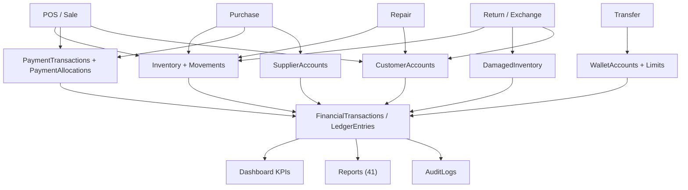

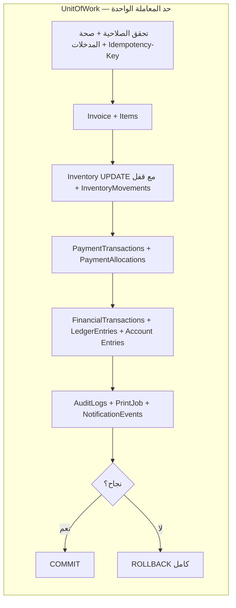

## G.3 قواعد الحدود والاتساق

| القاعدة | التنفيذ |
|---|---|
| حد المعاملة | `UnitOfWork` واحدة لكل أمر؛ لا يُسمح بـ COMMIT جزئي بين المخزون والمال |
| ترتيب الكتابة | تحقق ⇒ فاتورة ⇒ مخزون ⇒ دفع ⇒ قيود ⇒ تدقيق/طباعة (كما في C.8) |
| الفشل | أي استثناء ⇒ ROLLBACK + رسالة عربية موحّدة + `CorrelationId` في السجل دون كشف الاستثناء |
| التكرار | `IdempotencyKeys` يُفحص قبل بدء المعاملة؛ النتيجة المحفوظة تُعاد كما هي |
| التتبع | كل حركة تحمل `SourceOperationType + SourceOperationId`؛ `InvoiceRelations` يربط المرتجع/المبادلة/الدفع بالأصل |
| التاريخ | `SalesInvoiceItems` و`PurchaseInvoiceItems` و`PrintJobs` تحفظ snapshot؛ لا يُعاد حساب فاتورة قديمة من أسعار اليوم |
| العكس | قيد جديد بـ `ReversalOfId`؛ لا UPDATE/DELETE للقيد الأصلي؛ سياسة `OD-FIN-23` |
| التزامن | أقفال `UPDLOCK, HOLDLOCK` أو `rowversion` + إعادة محاولة محدودة؛ منع oversell وازدواج أرقام الفواتير |
| الاتساق عبر الأجهزة | لا حالة محلية للكتابة؛ كل عميل يقرأ عبر API؛ لا «قاعدة بيانات محلية» ولا Offline-write |

---

# القسم H — القواعد والحسابات المالية (Financial Rules & Open Decisions)

## H.1 مبدأ عدم اختراع المعادلات

المؤشرات السبعة المطلوبة في M01 (إجمالي دخل المبيعات، دخل الصيانة، دخل التحويلات، المصروفات، المرتجعات، الأرباح، صافي نتيجة اليوم) **مطلوبة كعرض في لوحة التحكم**، لكن **منطق حسابها يُعرَّف ويُعتمد في P13 ثم يُنفَّذ في P14**. لا تضع هذه الوثيقة أي معادلة نهائية، ولا تُحوّل الأمثلة الرقمية الواردة في الطلب إلى قواعد. أي بند غير محسوم مُسجّل أدناه كـ **قرار مفتوح (Open Decision)** مع صاحب القرار والمرحلة المتأثرة.

## H.2 التمييز بين المفاهيم (بدون تعريف نهائي)

| المفهوم | ما الذي يجب حسمه | لماذا لا يُبتدع هنا |
|---|---|---|
| Revenue / الإيراد | وقت الاعتراف: عند البيع أم التحصيل؟ هل يُحتسب دخل التحويلات كإيراد أم كعمولة فقط؟ | يغيّر كل تقارير M13 ولوحة M01؛ لا توجد سياسة محاسبية في المستودع الحالي |
| Profit / الربح | طريقة التكلفة (FIFO / متوسط مرجّح / آخر سعر شراء)، وهل تُخصم المرتجعات والهالك وأجرة الصيانة | لا يوجد كيان تكلفة ولا `Inventory` اليوم؛ `OD-FIN-02` |
| Net Result / صافي النتيجة | هل = إيرادات − مصروفات − مرتجعات ± فروق؟ وأي فترة؟ | يعتمد على القرارات السابقة؛ `OD-FIN-03` |
| Expenses / المصروفات | التصنيف، وهل مشتريات البضاعة مصروف أم أصل مخزون | `OD-FIN-04` |
| Customer Debts | متى يُنشأ الدين، وكيف يُسدّد جزئيًا، وهل يُقفل عند المرتجع | `OD-FIN-06` |
| Supplier Debts | نفس السؤال على الطرف الدائن وتأثير الإلغاء | `OD-FIN-07`, `OD-FIN-11` |
| Cash / Wallet Balances | هل الرصيد لقطة مُشتقة أم مُجمّع؟ متى تُحدَّث؟ | H.1 + E.4 (Ledger-first) |
| Payment Allocations | قاعدة مطابقة المجموع مع الإجمالي/المتبقي، وترتيب التوزيع عند نقص التحصيل | `OD-FIN-05` |
| Refunds | قيمة الصنف المرتجع: سعر البيع الفعلي بعد الخصم أم السعر الأصلي؟ | `OD-FIN-13` |
| Transfer Commissions | هل العمولة دخل أم تمرير؟ وهل تُحتسب ضمن «دخل التحويلات» في M01؟ | `OD-FIN-15` |
| Exchange Differences | جهة الفرق ووسيلته وتسجيله | `OD-FIN-16` |
| Damaged / Write-off | الأثر المحاسبي للهالك | `OD-FIN-18` |
| Reversals | هل يُحذف القيد أم يُعكس؟ من يعتمد العكس؟ | `OD-FIN-23` |

## H.3 سجل القرارات المفتوحة (Open Decisions Register)

> **الحالة الموحدة لكل بند: «مفتوح — يحتاج قرار صاحب العمل / المحاسب قبل التنفيذ».** لا يُغلّق أي بند ضمن مهمة التحليل هذه.

| ID | السؤال | صاحب القرار | المرحلة المتأثرة |
|---|---|---|---|
| `OD-FIN-01` | تعريف الإيراد ووقت الاعتراف به | صاحب العمل + محاسب | P13, P14 |
| `OD-FIN-02` | تعريف الربح وطريقة احتساب التكلفة | محاسب | P13, P14, M13 |
| `OD-FIN-03` | تعريف صافي نتيجة اليوم والفترة المحسوبة | محاسب | P14 |
| `OD-FIN-04` | تصنيف المصروفات ومعاملة مشتريات البضاعة | محاسب | P13 |
| `OD-FIN-05` | قاعدة توزيعات الدفع والمتبقي المسموح | صاحب العمل | P08, P13 |
| `OD-FIN-06` | إنشاء دين العميل والسداد الجزئي | صاحب العمل | P08, P13 |
| `OD-FIN-07` | ديون الموردين والسداد | صاحب العمل | P07, P13 |
| `OD-FIN-08` | تفاعل خصم الفاتورة مع أسعار الأصناف/السعر الخاص | صاحب العمل | P08 |
| `OD-FIN-09` | أرصدة الصندوق النقدي وتعدد الصناديق | محاسب | P13 |
| `OD-FIN-10` | أرصدة المحافظ وعلاقتها بالتحويلات الخارجية | محاسب | P11, P13 |
| `OD-FIN-11` | أثر تعديل/إلغاء فاتورة الشراء على المخزون ورصيد المورد | محاسب | P07, P09 |
| `OD-FIN-12` | حساب الحدود: الفترة التقويمية، العكس، والعمليات الفاشلة | صاحب العمل | P11 |
| `OD-FIN-13` | قيمة المردودات وعلاقتها بالخصم الأصلي | محاسب | P10 |
| `OD-FIN-14` | هل يُسمح بحفظ فواتير POS كمسودات؟ ومدة بقائها | صاحب العمل | P08 |
| `OD-FIN-15` | عمولات التحويلات: دخل أم تمرير، واحتسابها في مؤشر M01 | محاسب | P11, P14 |
| `OD-FIN-16` | فروق المبادلات ووسيلة تسويتها | صاحب العمل | P10 |
| `OD-FIN-17` | هل تُباع الأجهزة بـ IMEI فردي أم كمية؟ (مرتبط بـ `OD-ARC-11`) | صاحب العمل | P03, P05, P08 |
| `OD-FIN-18` | المعالجة المحاسبية للهالك/Write-off | محاسب | P06, P13 |
| `OD-FIN-19` | الإقفال اليومي/الشهري وقفل الفترات | محاسب | P13, P14 |
| `OD-FIN-20` | الأرصدة الافتتاحية وترحيل البيانات الحالية | محاسب | P03, P13 |
| `OD-FIN-21` | التقريب والعملة والضريبة إن طُبّقت | محاسب | P13, P15, P16 |
| `OD-FIN-22` | الاعتراف بدخل الصيانة: عند التسليم أم عند الدفع | محاسب | P12, P14 |
| `OD-FIN-23` | سياسة عكس القيود وتصحيح الأخطاء ومن يعتمدها | محاسب | P09, P10, P13 |
| `OD-ARC-01` | منفذ HTTPS وشكل أسماء الأجهزة/الشهادات | مسؤول الشبكة | P01, P17 |
| `OD-ARC-04` | هل يُضاف EF Core أم يبقى `Microsoft.Data.SqlClient` | مهندس معماري | P01, P03 |
| `OD-ARC-08` | تفعيل `READ_COMMITTED_SNAPSHOT` على Express | DBA | P03, P17 |
| `OD-ARC-09` | البقاء على SQL Express أم الترقية مع نمو البيانات | صاحب العمل | P17, P19 |
| `OD-ARC-10` | هل يلزم تعدد المخازن `Warehouses` أم مخزن واحد | صاحب العمل | P03, P06 |
| `OD-ARC-11` | تفعيل تتبع IMEI/الرقم التسلسلي ومدى إلزاميته | صاحب العمل | P03, P05, P12 |
| `OD-SEC-01` | شهادة CA داخلية وسياسة تدويرها | مسؤول الشبكة | P04, P17 |
| `OD-SEC-02` | ترقية صيغة hash تدريجيًا أم الإبقاء على الحالية | مهندس أمن | P04 |
| `OD-SEC-03` | شكل الجلسة المركزية ومدة الصلاحية | مهندس أمن | P04 |
| `OD-DEP-01` | نمط التثبيت (MSI أم MSIX أم ClickOnce) | مسؤول النشر | P19 |
| `OD-DEP-02` | آلية التحديث والرجوع للإصدار السابق | مسؤول النشر | P19 |
| `OD-DEP-03` | RPO/RTO وجدول FULL/DIFF/LOG | صاحب العمل | P03, P19 |
| `OD-DEP-04` | هل يُثبَّت SQL Express ضمن حزمة السيرفر أم يُفترض موجودًا | مسؤول النشر | P19 |
| `OD-DEP-05` | سياسة الاحتفاظ/Archiving للحركات القديمة | محاسب + DBA | P03, P19 |

## H.4 قاعدة التنفيذ

لا يُكتب أي كود حساب مالي قبل إغلاق `OD-FIN-01 … OD-FIN-23` وتوقيعها. خلال P07–P12 تُستخدم **واجهة `PostingService` بعقود ثابتة** دون قواعد نهائية، وتُبقى المؤشرات في M01 كعناصر عرض Placeholder صريحة. هذا هو «المرحلة المخصصة لتعريف وتنفيذ الحسابات» المطلوبة في M01.A وM13.

---

# القسم I — خطة واجهة المستخدم وتجربة الاستخدام (UI/UX Implementation Plan)

## I.1 هيكل التطبيق (Application Shell)

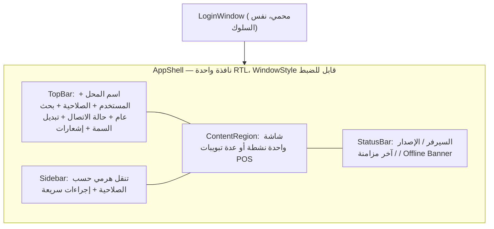

- القائمة تُبنى من صلاحيات المستخدم للعرض فقط؛ **الفرض الحقيقي في الـ backend** (P04/K).
- شاشة الدخول تبقى نافذة مستقلة قبل الـ shell، كما في `App.xaml.cs` اليوم، مع الحفاظ على سلوك الإغلاق المُصلح في PR #33.

## I.2 شجرة التنقل (Navigation Structure)

```
AppShell
├── Dashboard (M01)
├── Point of Sale (M02) — تبويبات فواتير متعددة
├── Master Data
│   ├── Products (M03) ├── Categories ├── Barcodes ├── Customers (M08) ├── Suppliers (M08)
├── Inventory (M04) ├── Stock Movements ├── Damaged Stock ├── Low Stock
├── Purchases (M05) ├── New Purchase Invoice ├── Purchase History ├── Supplier Payments
├── Invoices (M06) ├── All Invoices ├── Invoice Details ├── Cancellations & Audit
├── Returns & Exchanges (M07) ├── Invoice Search ├── Return ├── Exchange
├── Money Transfers (M09) ├── Accounts ├── New Transfer ├── History ├── Limits Usage
├── Repairs (M10) ├── Reception ├── Repair Board ├── Repair Details ├── Delivery ├── Search
├── Finance (P13) ├── Cash ├── Customer Debts ├── Supplier Debts ├── Expenses ├── Ledger ├── Period Closing
├── Reports (M13) ├── Sales ├── Purchases ├── Inventory ├── Repairs ├── Transfers ├── Financial
├── Printing (M14) ├── Print Queue ├── Templates ├── Printers ├── Label Designer
├── Users & Permissions (M11) ├── Users ├── Roles ├── Permission Matrix ├── Audit Logs
└── Settings (M12) ├── Shop Profile ├── Theme Gallery ├── Barcode/Numbering/Printing ├── Preferences ├── Backup
```

## I.3 جرد الشاشات حسب الوحدة

| الوحدة | الشاشات / الحوارات |
|---|---|
| الدخول (محمي) | `LoginWindow`, `MainWindow` (تُستبدل بـ `AppShell`) |
| M01 | `DashboardView`, `KpiCard`, `RepairStatusWidget`, `LowStockWidget`, `BalanceWidget`, `NotificationCenter` |
| M02 | `PosView`, `InvoiceTabStrip`, `ProductPicker`, `CustomerQuickAddDialog`, `PaymentPanel`, `PriceTierSelector`, `DiscountDialog`, `SalesHistoryView` |
| M03/M08 | `ProductsListView`, `ProductEditorView`, `ProductDetailsView`, `CategoryManagerView`, `BarcodeManagerView`, `CustomersView`, `SuppliersView`, `AccountStatementView` |
| M04 | `InventoryView`, `StockMovementHistoryView`, `DamagedStockView`, `StockAdjustmentDialog`, `LowStockView` |
| M05 | `PurchaseInvoiceEditorView`, `PurchaseHistoryView`, `SupplierPaymentsView`, `SupplierQuickAddDialog` |
| M06 | `InvoiceRegisterView`, `InvoiceDetailsView`, `InvoiceFilterPanel`, `InvoiceAuditView`, `InvoiceCancellationDialog` |
| M07 | `ReturnSearchView`, `OriginalInvoiceView`, `ReturnDialog`, `ExchangeDialog` |
| M09 | `WalletAccountsView`, `WalletAccountEditorView`, `TransferDialog`, `TransferHistoryView`, `LimitUsageView`, `ExternalConfirmationDialog` |
| M10 | `RepairReceptionView`, `RepairBoardView`, `RepairDetailsView`, `RepairDeliveryView`, `RepairSearchView`, `RepairStatusDialog`, `RepairPaymentDialog` |
| M11 | `UsersView`, `UserEditorView`, `RolesView`, `PermissionMatrixView`, `PasswordResetDialog`, `AuditLogView` |
| M12 | `SettingsView`, `ShopProfileView`, `ThemeGalleryView`, `BarcodeSettingsView`, `PrintingSettingsView`, `BackupSettingsView` |
| M13 | `ReportsHubView`, `ReportParametersView`, `ReportViewerView`, `ReportExportView` |
| M14 | `PrintPreviewView`, `PrinterSettingsView`, `LabelDesignerView`, `PrintQueueView` |
| P13/P17/P19 | `CashManagementView`, `CustomerDebtsView`, `SupplierDebtsView`, `ExpensesView`, `LedgerExplorerView`, `PeriodClosingView`, `ConnectionTestView`, `ServerStatusView`, `OfflineBanner`, `ClientConfigDialog`, `ServerSetupWizard`, `ClientSetupWizard`, `RestoreWizard`, `UpdatePromptView` |

## I.4 مكتبة المكونات القابلة لإعادة الاستخدام

| المكون | السلوك الموحد |
|---|---|
| `DataGridEx` | ترقيم صفوف، فرز، تصفية أعمدة، RTL، تصدير، تحميل تدريجي (paging)، اختيار متعدد |
| `SearchBox` | بحث عربي/إنجليزي، debounce، دعم مسح الباركود، Focus تلقائي |
| `FilterPanel` | تاريخ من/إلى، اليوم، حالة، طرف، منتج، حساب، مستخدم؛ حفظ مرشحات الجلسة |
| `DialogHost` + `ConfirmDialog` | حوارات معيارية، تأكيد للعمليات الحساسة، منع الإغلاق العرضي |
| `ToastHost` | نجاح/تحذير/خطأ مع `CorrelationId` عند الخطأ دون كشف الاستثناء |
| `LoadingOverlay`, `EmptyState`, `ErrorState` | حالات موحّدة لكل شاشة بيانات |
| `KpiCard`, `ChartHost` | بطاقات المؤشرات والرسوم مع نفس مرشح التاريخ |
| `MoneyInput`, `QuantityInput` | تحقق العملة/التقريب/الكمية، منع القيم السالبة |
| `PermissionGate` | إخفاء للعرض فقط، مع تذكير مطوّر أن الفرض على الخادم |
| `ThemeTokens` | عقد الألوان/الخطوط/الظلال المشترك بين السمات الثمان |

## I.5 الإنتاجية والاختصارات والباركود وRTL

| البند | الخطة |
|---|---|
| اختصارات | `F2` فاتورة جديدة، `F3` للتركيز على حقل البحث، `Ctrl+S` حفظ/إتمام، `F5` تحديث، `Ctrl+P` طباعة، `Esc` إغلاق حوار، `Enter` تأكيد الصنف، `+/-` تعديل الكمية |
| مسح الباركود | الماسح كـ keyboard wedge: استقبال النص + `Enter` في `SearchBox`؛ تمييز بادئة باركود الإصلاح عن باركود المنتج؛ منع إدخال المسح داخل حقل كلمة المرور |
| RTL شامل | `FlowDirection=RightToLeft` على مستوى `AppShell`، مع `LeftToRight` انتقائي للأرقام/IMEI/الباركود/العملة؛ اختبار الجداول والطباعة والتقارير؛ `Language=ar-EG` |
| الاستجابة | تخطيطات Grid مرنة، `MinWidth/MinHeight` مدروسة، DPI 100–200%، دعم شاشتين، لا اعتماد على إحداثيات ثابتة |
| Arabic | خطوط تدعم العربية، أرقام واضحة، رسائل خطأ موحّدة (إرث `LoginViewModel.DescribeSqlError`) |
| الإنتاجية أولًا | تقليل النقرات في POS، قوائم اختصار، حفظ آخر مرشحات، عدم حجب الواجهة أثناء I/O (إرث `AsyncCommand`) |
| الحالات | تحميل/فراغ/خطأ/تأكيد/Offline لكل شاشة؛ لا شاشة بيضاء عند انقطاع السيرفر |

## I.6 نظام التصميم المشترك (Shared Design System)

- **عقد واحد** `ThemeTokens.xaml`: `Accent`, `Surface`, `Background`, `CardBackground`, `Border`, `Shadow`, `TextPrimary`, `TextSecondary`, `Success/Warning/Danger`, `FontFamily`, `FontSize`, `CornerRadius`, `Hover`, `Selected`, `Focus`.
- **السمات الثمان تستهلك العقد ولا تُعرّف منطقًا**: لا `if (Theme == ...)` داخل ViewModels أو الخدمات؛ الاختلاف بصري فقط.
- كل مكون في I.4 يستخدم الـ tokens حصرًا؛ أي لون hardcoded يُرفض في مراجعة الكود.
- الثيم يُحمّل **قبل** ظهور نافذة الدخول، ويُقرأ من `ThemeSettings` عبر API مع قيمة افتراضية محلية عند انقطاع الاتصال.

## I.7 السمات الثمان — تعريفات مستقلة (Eight Distinct Themes)

> السمات الثمان **ليست ثمانية أسماء لسمة واحدة**. لكل سمة ملف `ResourceDictionary` مستقل وهوية بصرية مختلفة موثّقة أدناه.

1. **Glassmorphism** — زجاج شفاف بضبابية خلفية (`Blur`), طبقات شفافة على تدرّج هادئ، حدود بيضاء نصف شفافة وظلال ناعمة؛ الإحساس «لوح زجاجي فوق خلفية».
2. **Liquid Glass** — لغة زجاجية **سائلة**: انحناءات عضوية، حواف متدرجة الانحناء، لمعان متحرك خفيف، إضاءة تتبع المؤشر؛ يختلف عن Glassmorphism بالحركة والسيولة لا بالشفافية وحدها.
3. **Dark Glass** — زجاج **داكن**: خلفية قريبة من الأسود، أسطح رمادية مزرّقة شفافة، تباين عالٍ للنص، توهّج خفيف عند التركيز؛ ليس مجرد وضع داكن للسمة الأولى بل منظومة ألوان وظلال مستقلة.
4. **Aurora UI** — تدرّجات **شفقية** متعددة الألوان (أخضر/بنفسجي/أزرق) مع إضاءة خلفية متحركة بطيئة وبطاقات شبه شفافة؛ الهوية من الضوء لا من الزجاج.
5. **Holographic UI** — **هولوغرافي**: ألوان طيفية متغيرة، خطوط مسح ضوئية، حواف نيون رفيعة، انعكاسات قزحية؛ واجهة «إسقاط ضوئي».
6. **FUI / HUD** — واجهة **خيال علمي**: شبكة دقيقة، مؤشرات HUD، إطارات زوايا، أرقام أحادية المسافة، عناصر تحكم سداسية/مقطعة، تدرّج أزرق-سماوي عالي التباين.
7. **Chrome / Liquid Metal** — **معدني**: انعكاسات كروم، تدرّجات رمادية معدنية، حواف لامعة، ظلال حادة، إبرازات فضية؛ ملمس معدن مصقول لا زجاج ولا ضوء.
8. **Fluent Design** — **Microsoft Fluent**: Acrylic/Mica معتدل، ألوان نظام Windows، Reveal/Focus مستوحى من Fluent، أنماط أدوات قياسية وأولوية للوضوح وإمكانية الوصول.

### I.7.1 الأساس البصري لكل سمة

| السمة | لوحة الألوان | الخلفية | الأسطح | البطاقات | الحدود | الظلال | الطباعة |
|---|---|---|---|---|---|---|---|
| 1 Glassmorphism | تدرّج أزرق/بنفسجي فاتح + أبيض شفاف | تدرّج ناعم مع أشكال ضبابية | زجاج `opacity ~0.18` + Blur | زجاج بحدود بيضاء | أبيض نصف شفاف 1px | ناعمة منتشرة | Segoe UI، عناوين خفيفة |
| 2 Liquid Glass | أزرق سماوي + لمعان متدرّج | تدرّج سائل مع حركة بطيئة | أشكال منحنية `opacity ~0.22` | حواف دائرية كبيرة ولمعان | متدرّج لامع | ظل + توهّج داخلي | Segoe UI مع تباعد أوسع |
| 3 Dark Glass | `#0B1220` + `#1E293B` + توهّج سماوي | داكن جدًا شبه ثابت | رمادي مزرّق شفاف | داكنة بحدود باردة | `#334155` رفيع | ظل عميق + توهّج تركيز | Segoe UI، وزن متوسط للتباين |
| 4 Aurora UI | أخضر/بنفسجي/أزرق شفقي | تدرّجات Aurora متحركة | شبه شفافة محايدة | بطاقات بحدود ضوئية | تدرّج شفقي رفيع | ناعمة ملوّنة | Segoe UI Variable إن توفر |
| 5 Holographic | طيف قزحي + نيون سماوي | داكن مع خطوط مسح | شرائح طيفية شفافة | حواف نيون متعددة | نيون 1–2px | توهّج نيون | خط هندسي واضح + أرقام أحادية |
| 6 FUI / HUD | أزرق/سماوي + أصفر تحذيري | شبكة دقيقة داكنة | لوحات HUD بإطارات زوايا | مستطيلات مقطعة الزوايا | خطوط زوايا سماوية | شبه معدومة + توهّج | أحادية المسافة للأرقام، عناوين عريضة |
| 7 Chrome / Liquid Metal | رمادي/فضي/كروم | تدرّج معدني ثابت | انعكاس كروم خطي | بطاقات بلمعة حافة | فضي لامع | حادة قصيرة | Segoe UI بوزن واضح |
| 8 Fluent Design | ألوان Windows Accent + Mica | Mica/Acrylic خفيف | أسطح نظام قياسية | بطاقات بيضاء/داكنة حسب النظام | `#E5E7EB` رفيع | ظل Fluent قياسي | Segoe UI Variable + مقاسات Accessibility |

### I.7.2 المكونات والحالات لكل سمة

| السمة | الأزرار | الحقول | الجداول | التنقل | الحوارات | الإشعارات | التحديد / التمرير |
|---|---|---|---|---|---|---|---|
| 1 Glassmorphism | زجاجي بحدود بيضاء | حقل شفاف بحدود ناعمة | صفوف شفافة بفواصل بيضاء | شريط زجاجي | لوح زجاجي معتم قليلًا | Toast شفاف | توهّج أبيض + رفع خفيف |
| 2 Liquid Glass | لمعان متحرك عند التمرير | حواف منحنية سائلة | رؤوس مستديرة بلمعان | عناصر منحنية | حوار بحدود متدرجة | فقاعة لامعة | تموج لمعان + تكبير 1.02 |
| 3 Dark Glass | داكن بتوهّج سماوي | حقل `#111827` بحدود باردة | صفوف داكنة متناوبة | Sidebar داكن | حوار داكن عالي التباين | Toast داكن بشريط لوني | إطار سماوي + إضاءة Focus |
| 4 Aurora UI | تدرّج شفقي | حقل بحدود متدرجة | رأس بتدرّج خفيف | شريط بتدرّج Aurora | حوار بإضاءة خلفية | Toast بتدرّج لوني | خط ضوئي + تدرّج Hover |
| 5 Holographic | نيون بإطار مزدوج | حقل بإطار طيفي | خطوط مسح بين الصفوف | علامات نيون | حوار بإسقاط ضوئي | شريط نيون وامض خفيف | توهّج قزحي + تمييز طيفي |
| 6 FUI / HUD | أزرار مقطعة الزوايا | حقول بإطار HUD | أعمدة أحادية المسافة + شبكة | قائمة بمؤشرات HUD | حوار بإطارات زوايا | تنبيه HUD بلون تحذيري | إطار زوايا سماوي + وميض حدود |
| 7 Chrome | زر معدني بانعكاس خطي | حقل بلمعة حافة | رؤوس كروم وصفوف محايدة | شريط معدني | حوار بإطار لامع | Toast فضي | لمعة حافة + ظل حاد |
| 8 Fluent | أزرار Accent مع Reveal | حقول Fluent قياسية | جدول بنمط Windows | NavigationView قياسي | ContentDialog | Toast/InfoBar | Reveal + Focus rectangle نظامي |

### I.7.3 الحفظ والاتساق

| القاعدة | التنفيذ |
|---|---|
| استمرار الاختيار | `ThemeSettings` عبر API + نسخة محلية cached؛ يُطبّق في `App.OnStartup` قبل إنشاء أي نافذة؛ اختبار إعادة تشغيل إلزامي (`R-M12-17`, `AT-M12-17`) |
| فاتح/داكن | متغير صريح لكل سمة عند الحاجة؛ Dark Glass هي سمة مستقلة وليست «وضع داكن» عامًا |
| نفس الوظيفة | اختبار أتمتة واحد يُشغّل نفس سيناريو بيع/مرتجع/صيانة تحت السمات الثمان دون تعديل منطق |
| إمكانية الوصول | تباين ≥ 4.5:1 للنص، Focus مرئي، لا اعتماد على اللون وحده، تقليل الحركة لمن يطلبه |
| الأداء | قياس تكلفة Blur/التوهّج على أجهزة العملاء الضعيفة؛ تعطيل المؤثرات الثقيلة تلقائيًا عند ضعف GPU |

---

# القسم J — خطة النشر على الشبكة المحلية (LAN Deployment Plan)

## J.1 طوبولوجيا النشر

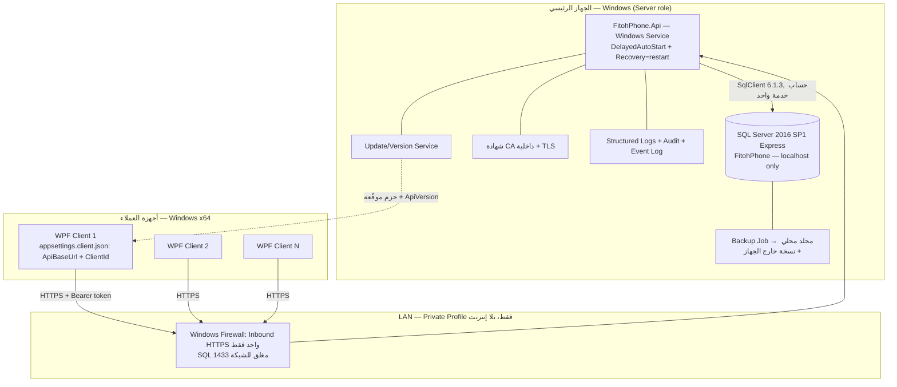

## J.2 تغطية متطلبات §3 من الطلب (14 بندًا)

| # | المتطلب | الحل في البنية الهدف | المرحلة |
|---|---|---|---|
| 1 | الوصول المركزي لقاعدة البيانات | الـ API وحده يتصل بـ SQL على `localhost`؛ `dbo.Users` والجداول الجديدة خلف طبقة Repositories | P01, P03 |
| 2 | تواصل API بين الأجهزة | ASP.NET Core Web API + عقود DTO + `ApiClient` في WPF | P01 |
| 3 | المصادقة والتفويض | `/auth/login` يحافظ على PBKDF2 + Roles/Permissions مركزيًا | P04 |
| 4 | المعاملات المتزامنة | `UnitOfWork` + Isolation + Idempotency | P03, P13, P17 |
| 5 | تحديثات المخزون المتزامنة | `UPDLOCK/HOLDLOCK` أو `rowversion` + `CHECK(QuantityAvailable>=0)` | P06, P17 |
| 6 | الفواتير المتزامنة | `InvoiceSequences` + Idempotency + أرقام فريدة | P08, P09, P17 |
| 7 | انقطاع الشبكة | `OfflineBanner` + تعطيل الكتابة + إعادة محاولة بنفس المفتاح + **لا قاعدة محلية** | P17 |
| 8 | توفر السيرفر | Health checks + مراقبة الخدمة + Recovery تلقائي + تنبيه | P17, P19 |
| 9 | بدء تلقائي | Windows Service بـ `DelayedAutoStart` وسياسة إعادة التشغيل | P19 |
| 10 | النسخ والاستعادة | FULL/DIFF/LOG + نسخة خارج الجهاز + اختبار استعادة مُوثّق | P19 |
| 11 | تحديثات التطبيق | حزم موقّعة + `AppVersions` + رفض تعارض الإصدار + rollback | P19 |
| 12 | إعداد العميل | `ApiBaseUrl` + `ClientId` + مسار الشهادة + شاشة اختبار اتصال؛ **بلا connection string** | P01, P19 |
| 13 | Windows Firewall | inbound HTTPS من نطاق LAN فقط؛ إغلاق SQL 1433 وUDP 1434 للشبكة | P17, P19 |
| 14 | اتصال آمن داخل LAN | TLS 1.2+ بشهادة CA داخلية، `TrustServerCertificate=false`، تدوير الشهادات | P17, P18 |

## J.3 تثبيت الجهاز الرئيسي (Server Installation)

1. تثبيت/التحقق من SQL Server 2016 SP1 Express بمستوى توافق 130؛ تشغيل `sql/01`, `sql/02` ثم ترحيلات `SchemaVersions`.
2. إنشاء حساب خدمة Windows مخصص وحساب SQL بأقل صلاحية (لا `sa` ولا `db_owner`)؛ الأسرار فيCredential Manager/DPAPI لا في Git (`TN-01`).
3. تثبيت `FitohPhone.Api` كخدمة Windows: `sc create FitohPhoneApi binPath=... start= delayed-auto` + `sc failure ... actions= restart/...`.
4. إصدار شهادة CA داخلية مطابقة لـ SAN اسم السيرفر، تثبيتها على السيرفر وكل عميل؛ ضبط Kestrel على HTTPS فقط.
5. Firewall (مثال، يُعدّل حسب عنوان LAN الحقيقي):
   `New-NetFirewallRule -DisplayName "FitohPhone API LAN" -Direction Inbound -Protocol TCP -LocalPort 5443 -Action Allow -Profile Private -RemoteAddress 192.168.1.0/24` مع **قاعدة رفض/غلق لـ TCP 1433 من الشبكة**.
6. تهيئة مجلد السجلات بدوران (rotation) وحجم أقصى، ومجلد النسخ بـ ACL للمسؤول فقط.
7. جدولة Backup Job وتسجيل `BackupJobs`، واختبار استعادة على instance نظيف قبل go-live.
8. ضبط `/health/live` و`/health/ready` ومراقبة توقف الخدمة/امتلاء القرص/فشل النسخ.
9. تثبيت حزمة التحديثات وتسجيل `AppVersions` و`ApiVersion`.
10. توثيق كل خطوة في `docs/SERVER.md` المُحدَّث مع تدوير كلمة `Admin@123` قبل أول تشغيل إنتاجي.

## J.4 تثبيت أجهزة العملاء (Client Installation)

1. حزمة MSI/MSIX/ClickOnce تحمل `FitohPhone.exe` self-contained win-x64 + `appsettings.client.json` + شهادة CA.
2. **لا SQL Server ولا .NET Runtime ولا SDK ولا connection string على العميل** (يُثبت ذلك بفحص الحزمة).
3. معالج التثبيت يطلب `ApiBaseUrl` ويُنفّذ `ConnectionTestView` (`GET /health/ready` + `ApiVersion` handshake).
4. تخزين الإعداد محليًا بصلاحيات المستخدم فقط؛ لا أسرار DB.
5. التحقق من تطابق `ClientVersion ↔ ApiVersion`؛ رفض التشغيل مع رسالة واضحة عند عدم التوافق.
6. التحديثات: تنزيل حزمة موقّعة، التحقق من `PackageHash`، نسخة احتياطية للإصدار السابق، rollback عند الفشل.
7. حالة Offline: شعار واضح، تعطيل أزرار الحفظ،الإبقاء على الفاتورة المفتوحة في الذاكرة فقط، إعادة المحاولة بـ `Idempotency-Key` نفسه.

## J.5 التعافي والاستمرارية

| السيناريو | السلوك المطلوب | الاختبار |
|---|---|---|
| إعادة تشغيل السيرفر | الخدمة تعود تلقائيًا؛ العملاء يعيدون الاتصال ويُحدّثون token | P17/L |
| توقف SQL | `/health/ready` يفشل؛ العميل يعرض Offline ولا يكتب | P17 |
| انقطاع أثناء ترحيل فاتورة | rollback كامل؛ إعادة المحاولة لا تُكرّر الفاتورة | P17/G |
| تلف قاعدة البيانات | استعادة آخر نسخة + LOG ضمن RPO المعتمد `OD-DEP-03` | P19/L |
| تحديث فاشل | العودة للإصدار السابق دون فقدان بيانات | P19/L |
| انتهاء الشهادة | تنبيه مسبق + تدوير دون توقف الخدمة | P17/P18 |
| امتلاء قرص النسخ | تنبيه + فشل مُسجّل + نسخة بديلة خارج الجهاز | P19 |

---

# القسم K — الأمن وسلامة البيانات (Security & Data Integrity)

## K.1 المصادقة وكلمات المرور

| البند | القرار |
|---|---|
| `PasswordHasher` الحالي | **يُحفظ كما هو**: PBKDF2-HMAC-SHA256/600,000/salt 16B/32B/`FixedTimeEquals`، ودعم legacy؛ ينقل إلى Shared ثم يُستخدم داخل API |
| `dbo.Users` | **يُحفظ**؛ أعمدة additive فقط؛ لا rehash إجباري (`OD-SEC-02`) |
| كلمة المرور | لا تُرسل للـ DB؛ لا تُخزّن في ViewModel؛ لا تُسجّل في logs؛ لا تُعرض في أخطاء؛ إلزام تغيير الافتراضية |
| الجلسة | token موقّع + refresh + `Sessions` قابل للإبطال؛ الجلسة المحلية الحالية تُستبدل تدريجيًا في P04 (`OD-SEC-03`) |
| محاولات الدخول | Rate limiting + lockout + AuditLogs؛ رسالة موحّدة لا تكشف وجود الحساب (إرث `DummyHash`) |
| الشهادة | CA داخلية، `TrustServerCertificate=false`، TLS 1.2+ (`OD-SEC-01`)، تدوير موثّق |

## K.2 التفويض (Backend-enforced)

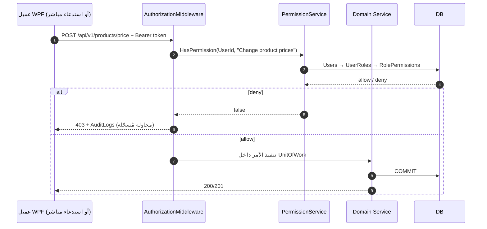

- **الواجهة تعرض/تخفي فقط**؛ لا يُعتبر إخفاء زر حماية.
- الصلاحيات الـ 19 المطلوبة في M11 مُعرّفة في `PermissionNames` ومُطبّقة على كل endpoint.
- اختبار إلزامي: استدعاء API مباشر (بدون واجهة) من مستخدم غير مصرح ⇒ **403** (`AT-SEC-11`, P18).

## K.3 سلامة المدخلات والبيانات

| الخطر | الإجراء |
|---|---|
| SQL Injection | استعلامات مُعامَلة 100% عبر `SqlParameter` (إرث `UserRepository`)؛ مراجعة آلية للنصوص الديناميكية؛ لا string concatenation |
| XAML/قالب حقن | قوالب طباعة مُقيّدة؛ رفع الشعار بنوع/حجم محدود؛ لا استقبال XAML من إدخال المستخدم |
| صحة المدخلات | تحقق الطول/النطاق/العملة/الكمية على العميل **و** الخادم؛ رفض كمية ≤ 0 ومبلغ ≤ 0 |
| سلامة مرجعية | FK + CHECK + UNIQUE لكل الكيانات؛ `CHECK(QuantityAvailable>=0)`؛ منع الحذف الفعلي للفواتير |
| معالجة الأخطاء | `ExceptionMappingMiddleware` ⇒ رسالة عربية موحّدة + `CorrelationId`؛ لا connection string ولا StackTrace للمستخدم |
| Structured Logging | Serilog: CorrelationId, UserId, Operation, IdempotencyKey, Duration, Outcome؛ دوران الملفات وACL |
| التدقيق | `AuditLogs` append-only للعمليات الحساسة: أسعار، خصومات، إلغاء، تعديل أرصدة، حدود، صلاحيات، طباعة فواتير |
| الأسرار | على السيرفر فقط؛ تدوير دوري؛ فحص Git قبل كل إصدار (`TN-01`); لا أسرار في artifact العميل |

## K.4 التزامن ومنع الازدواج وسلامة المعاملات

| المطلب | الآلية | معيار القبول |
|---|---|---|
| لا oversell | `UPDATE Inventory ... WHERE QuantityAvailable >= @Qty` داخل `UPDLOCK, HOLDLOCK`؛ rollback عند `@@ROWCOUNT=0` | عميلان + وحدة واحدة ⇒ بيع واحد فقط |
| لا فاتورة مكررة | `IdempotencyKeys` unique + `InvoiceSequences` بقفل | إعادة إرسال ⇒ نفس النتيجة بلا إدراج ثانٍ |
| لا قيد ناقص | كل `FinancialTransaction` يُنتج `LedgerEntries` داخل نفس المعاملة | فشل جزئي ⇒ صفر أثر |
| لا تعديل مُرحّل | `Status='Posted'` + منع UPDATE + عكس بالقيد | محاولة تعديل ⇒ رفض + تدقيق |
| Crash Recovery | معاملات SQL Atomية + استئناف `PrintJobs`/`NotificationEvents` من الحالة + سجلات الخدمة | إعادة تشغيل أثناء عملية ⇒ لا حالة نصف مكتملة |
| النسخ | FULL/DIFF/LOG + استعادة مُختبرة | RPO/RTO حسب `OD-DEP-03` |

---

# القسم L — استراتيجية الاختبار (Testing Strategy)

| # | النوع | النطاق | الأدوات / البيئة | أمثلة اختبارات | معيار النجاح |
|---|---|---|---|---|---|
| 1 | Unit Testing | كل Domain Service و`PasswordHasher` وسياسات التسعير/الحدود | xUnit على `net10.0`، CI | PBKDF2 الحالي، رفض hash مخالف، حساب إجمالي سطر، رفض كمية سالبة | 100% من الخدمات الحرجة، CI أخضر |
| 2 | Integration Testing | سير عمل كامل عبر UnitOfWork مع قاعدة اختبار | xUnit + SQL Server 2016 SP1 instance | بيع ⇒ مخزون + دفع + قيود + تدقيق في معاملة واحدة | صفر أثر جزئي عند الفشل |
| 3 | API Testing | كل endpoint: عقد، Status codes، 401/403، Idempotency | `WebApplicationFactory`, Postman/REST collection | استدعاء مباشر بلا صلاحية ⇒ 403؛ مفتاح مكرر ⇒ نفس النتيجة | كل endpoint مُختبر بما فيه مسارات الرفض |
| 4 | Database Testing | القيود، الفهارس، الترحيلات، الاستعادة | sqlcmd + سكربتات SchemaTests | إعادة ترحيل idempotent، CHECK كمية، FK، استعادة نسخة | ترحيل نظيف مُعاد إنتاجه واستعادة ناجحة |
| 5 | UI Testing | الشاشات الحرجة، RTL، DPI، حالات التحميل/الفراغ/الخطأ | WPF UI Automation / FlaUI على Windows | الدخول، POS، مرتجع، صيانة، 8 سمات، DPI 200% | نفس السيناريو ينجح تحت كل السمات |
| 6 | Financial Calculation Testing | كل قاعدة `OD-FIN-*` بعد اعتمادها | مجموعة اختبارات ذهبية بأرقام معلومة | بيع/شراء/مرتجع/مبادلة/تحويل/مصروف ⇒Ledger متوازن | مطابقة كاملة بين التقارير والـ Ledger |
| 7 | Multi-User Testing | جهازان فأكثر، عمليات متزامنة | `ConcurrencyTestHarness` + سجلات `sys.dm_tran_locks` | آخر وحدة، 10 فواتير، تحديث حدود متزامن | لا oversell ولا أرقام مكررة ولا Deadlock غير مُعالج |
| 8 | Network Interruption Testing | قطع LAN أثناء الطلب، إعادة المحاولة، Offline | سكربتات قطع/استعادة + Idempotency | قطع بعد الإرسال قبل الرد ⇒ لا فاتورتان | لا كتابة محلية ولا ازدواج |
| 9 | Backup & Restore Testing | نسخ FULL/DIFF/LOG واستعادة على instance نظيف | BackupRestoreTest + `docs/` | استعادة ثم تشغيل سيناريو يوم كامل | RPO/RTO محقق وموثّق |
| 10 | Printing Testing | 10 قوالب × A4/حراري/ملصقات + RTL + مسح باركود | طابعات فعلية + ماسح | إيصال صيانة QR يسترجع الأمر؛ إعادة طباعة فاتورة قديمة | كل القوالب عربية RTL والباركود قابل للمسح |

## L.1 حزم الاختبارات المقترحة داخل الحل

`tests/FitohPhone.Security.Tests` (**موجود ويُحفظ**)، `tests/FitohPhone.Configuration.Tests` (من PR #34 عند الدمج)، `tests/FitohPhone.Domain.Tests`, `tests/FitohPhone.Api.IntegrationTests`, `tests/FitohPhone.Database.Tests`, `tests/FitohPhone.Concurrency.Tests`, `tests/FitohPhone.UI.Tests`. كل اختبار قبول `AT-XXX-NN` في مصفوفة القسم Q يجب أن يُربط بحالة اختبار قابلة للتتبع في CI أو في سجل قبول يدوي موثّق.

## L.2 سياسة الاعتماد

لا يُعلن اكتمال أي مرحلة دون: اختباراتها خضراء في CI على Windows، سجل نتائج مؤرشف، ومراجعة أن الدخول ما زال يعمل (Regression Guard ثابت في كل مرحلة، إرث `docs/ACCEPTANCE.md` الذي يقرّ بعدم اختبار WPF/SQL فعليًا حتى الآن).

---

# القسم M — سجل المخاطر (Risk Register)

> التقييم: الخطورة = `حرجة / عالية / متوسطة / منخفضة`؛ الاحتمال = `عالي / متوسط / منخفض`. كل بند له إجراء تخفيف ومرحلة مالك.

| ID | الفئة | الخطر | الخطورة | الاحتمال | الأثر | التخفيف | المرحلة |
|---|---|---|---|---|---|---|---|
| `RISK-01` | أمني | بقاء أسرار اتصال/كلمات مرور في Git (`TN-01`) | حرجة | عالي | تسريب صلاحية قاعدة البيانات | نقل الأسرار للسيرفر، تدويرها، فحص Git آلي قبل كل إصدار | P01/P19 |
| `RISK-02` | معماري | استمرار وصول العملاء مباشرة لـ SQL خلال الانتقال (`TN-02`) | حرجة | متوسط | تجاوز الصلاحيات وتضارب البيانات | Strangler + إغلاق 1433 في P17 + اختبار رفض | P01/P17 |
| `RISK-03` | مالي | غياب قواعد حساب معتمدة قبل بناء التقارير | حرجة | عالي | أرقام خاطئة تُستخدم في قرارات تجارية | ورشة `OD-FIN-*` في P13؛ مؤشرات Placeholder حتى الاعتماد | P13/P14 |
| `RISK-04` | بيانات | بيع صنف بلا مخزون بسبب التزامن | حرجة | متوسط | عجز مخزوني وخلاف مع العملاء | أقفال/rowversion + CHECK + اختبار جهازين | P06/P17 |
| `RISK-05` | بيانات | معالجة مزدوجة عند إعادة الإرسال بعد انقطاع LAN | حرجة | متوسط | فاتورة/قيد مكرر | `IdempotencyKeys` + إعادة نفس النتيجة | P01/P13/P17 |
| `RISK-06` | تشغيلي | لا نسخ احتياطي آلي ولا استعادة مُختبرة (`TN-07`) | حرجة | متوسط | فقدان بيانات المحل | Backup Job + نسخة خارج الجهاز + اختبار استعادة ربع سنوي | P19 |
| `RISK-07` | أمني | `TrustServerCertificate=true` وشهادة ذاتية التوقيع (`TN-03`) | عالية | متوسط | MITM على LAN | CA داخلية + TLS + تدوير الشهادات | P17/P18 |
| `RISK-08` | أمني | كلمة `Admin@123` افتراضية بلا شاشة تغيير (`TN-12`) | عالية | عالي | دخول غير مصرح | إلزام التغيير + سياسة + lockout + تدقيق | P04 |
| `RISK-09` | وظيفي | كسر نظام الدخول أثناء النقل إلى API | عالية | متوسط | توقف كل العمل | الحفاظ على `PasswordHasher` و`LoginWindow`، Regression Guard في كل مرحلة | P01–P19 |
| `RISK-10` | تقني | قيود SQL Server Express (10GB/1GB/4 cores) مع نمو الحركات | عالية | متوسط | بطء التقارير وامتلاء القاعدة | فهارس، أرشفة `OD-DEP-05`، مراقبة، قرار ترقية `OD-ARC-09` | P03/P17 |
| `RISK-11` | تقني | `GO` في السكربتات الحالية يعيق أتمتة الترحيل (`TN-06`) | عالية | عالي | ترحيل فاشل أو جزئي | أداة ترحيل تفصل الدفعات + `SchemaVersions` + rollback | P03 |
| `RISK-12` | تقني | Deadlocks عند ذروة التزامن | عالية | متوسط | فشل فواتير وSlowdown | ترتيب ثابت للوصول للجداول + إعادة محاولة محدودة + مراقبة | P17 |
| `RISK-13` | تشغيلي | انقطاع الشبكة مع محاولة كتابة محلية | عالية | متوسط | تضارب عند العودة | منع Offline-write + OfflineBanner + إعادة محاولة idempotent | P17 |
| `RISK-14` | مالي | عكس ناقص للمرتجع/الإلغاء | عالية | متوسط | أرصدة وتقارير خاطئة | قيد عكس موحّد + اختبارات أثر مزدوج + مراجعة محاسبية | P10/P13 |
| `RISK-15` | مالي | اعتبار سجل تحويل داخلي إثبات نجاح تحويل خارجي | عالية | متوسط | أرصدة وهمية | `ExternalConfirmationService` + حالة Pending + مرجع خارجي | P11 |
| `RISK-16` | واجهة | الثمان سمات تتحول إلى سمة واحدة بأسماء مختلفة | متوسطة | متوسط | عدم تحقيق متطلب صريح | ملف tokens مستقل لكل سمة + تعريفات I.7 + مراجعة بصرية منفصلة | P16 |
| `RISK-17` | واجهة | انكسار RTL/العربية في الجداول والطباعة | متوسطة | عالي | فواتير غير مقروءة | إستراتيجية RTL + اختبار 10 قوالب + خطوط مثبتة | P02/P15 |
| `RISK-18` | تقني | ازدواج أدوات النشر profileـان بلا سياسة إصدار (`TN-11`) | متوسطة | عالي | عملاء بإصدارات مختلفة عن المخطط | `AppVersions` + رفض التعارض + حزمة واحدة موقّعة | P19 |
| `RISK-19` | تشغيلي | توقف Windows Service بعد تحديث Windows | متوسطة | متوسط | توقف المحل | `DelayedAutoStart` + Recovery + Health تنبيه | P19 |
| `RISK-20` | جودة | تغطية اختبارات ناقصة (اليوم اختبار hashing فقط، `TN-10`) | عالية | عالي | أخطاء تصل للإنتاج | 7 مشاريع اختبار + بوابة CI إلزامية + القسم L | P18 |
| `RISK-21` | مشروع | افتراض وجود شاشات/جداول ERP من PR #9–#31 (`TN-13`) | متوسطة | متوسط | تقديرات خاطئة وتكرار عمل | التدقيق P00 يثبت الشجرة الحالية؛ المرجع التاريخي غير مُعتمد | P00 |
| `RISK-22` | مشروع | انحراف `origin/main` (PR #34) عن commit الأساس (`TN-17`) | متوسطة | عالي | تعارض دمج وفقدان إعدادات LAN | دمج/مراجعة PR #34 في P01 قبل أي تعديل هيكلي | P00/P01 |
| `RISK-23` | تشغيلي | غياب بيئة Windows/SQL فعلية للتحقق (`docs/ACCEPTANCE.md`) | عالية | عالي | ادعاءات غير مُختبرة | خطة بيئة اختبار من P00 + CI على windows-2022 + سجل قبول يدوي موقع | P00/P18 |
| `RISK-24` | واجهة | إهمال الإنتاجية لصالح المؤثرات البصرية | متوسطة | متوسط | بطء الكاشير ورفض المستخدمين | اختصارات، Focus management، قياس زمن إتمام الفاتورة، تعطيل مؤثرات ثقيلة | P02/P08/P16 |
| `RISK-25` | بيانات | فقدان تاريخ الفاتورة عند تغيير سعر المنتج لاحقًا | عالية | متوسط | تقارير تاريخية خاطئة | `UnitPriceSnapshot` + `PrintJobs` snapshot + منع تعديل المرحّل | P08/P09/P15 |

---

# القسم N — أولوية التنفيذ (Implementation Priority)

## N.1 التصنيف المطلوب

| الفئة | المراحل | لماذا هذا الترتيب |
|---|---|---|
| **Critical Foundation** | P00, P01, P03, P04 | لا يمكن بناء أي وحدة بأمان قبل تدقيق الشجرة، وإضافة الوسيط المركزي، ومخطط بترحيلات ومعاملات، وصلاحيات مُفرضة خادميًا؛ تأخيرها يضاعف تكلفة كل وحدة لاحقة |
| **Core Business Operations** | P05, P06, P07, P08, P09, P10, P12 | البيانات الرئيسية ⇒ المخزون ⇒ الشراء ⇒ البيع ⇒ السجل ⇒ المرتجعات ⇒ الصيانة؛ كل لاحق يستهلك كيانات السابق وحركاته |
| **Financial and Advanced Operations** | P11, P13, P14 | التحويلات تحتاج Ledger، والـ Ledger يحتاج عقود posting من الوحدات السابقة، والـ Dashboard/التقارير **لا تُحسب قبل اعتماد القواعد** |
| **Reporting and User Experience** | P02, P15, P16 | نظام التصميم (P02) يُبنى مبكرًا تقنيًا لكنه يُصنّف هنا من حيث قيمة المستخدم؛ الطباعة والسمات تُكمل تجربة الاستخدام بعد استقرار البيانات |
| **Production Readiness** | P17, P18, P19 | التكامل متعدد الأجهزة، الاختبار الشامل، ثم حزم التثبيت؛ لا go-live قبل استعادة نسخة ناجحة واختبار 403 |

## N.2 المسار الحرج (Critical Path)

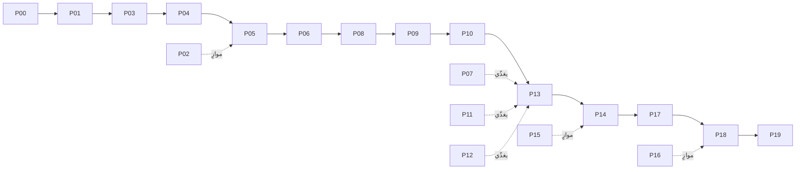

**عناصر حرجة لا يمكن تأجيلها:** `P00` (الحقيقة)، `P01` (إزالة الاتصال المباشر)، `P03` (المعاملات والترحيلات)، `P13` (اعتماد القواعد المالية)، `P17` (إثبات التزامن على جهازين)، `P19` (استعادة نسخة). أي تأخير فيها يؤجل الإطلاق كاملًا.

## N.3 مهام قابلة للتوازي

| المسار المتوازي | يمكن أن يعمل بالتزامن مع | الشرط |
|---|---|---|
| P02 نظام التصميم والمكونات | P01/P03 | عقد DTO و`ThemeTokens` متفق عليه |
| P15 قوالب الطباعة | P05–P12 | `ShopSettings` و`PrintTemplates` معرّفان مبكرًا |
| P16 السمات الثمان | P04–P14 | عقد المكونات ثابت؛ لا منطق مشروط بالسمة |
| توثيق القرارات `OD-FIN-*`مع صاحب العمل | P01–P12 | يُغلق قبل P13 لا بعده |
| كتابة اختبارات الوحدة لكل وحدة | مرحلة الوحدة نفسها | CI جاهز من P01 |
| إعداد بيئة Windows/SQL laboratory | P00–P02 | جهازان + SQL 2016 SP1 فعلي |

---

# القسم O — قائمة الإنجاز النهائية (Final Production-Readiness Checklist)

> تُستخدم هذه القائمة عند بوابة go-live؛ كل بند يجب أن يكون `[x]` بدليل اختبار أو توقيع. المعرّفات تشير إلى القسم D والقسم Q.

## O.1 الحفاظ على القائم والتأسيس

- [x] تدقيق كامل للمستودع موثّق بالأدلة (القسم B) — **منجز في هذا المستند**
- [ ] نظام الدخول الحالي ما زال يعمل بعد كل مرحلة (`R-ARC-*`, Regression Guard)
- [ ] `PasswordHasher` و`dbo.Users` محفوظان دون rehash إجباري (`OD-SEC-02`)
- [ ] لا وصول مباشر من العملاء إلى SQL Server (`R-ARC-15`, `AT-ARC-15`)
- [ ] لا أسرار في Git ولا في حزمة العميل (`RISK-01`, `AT-SEC-12`)
- [ ] كل migrations مُرقّمة وقابلة لإعادة التشغيل (`R-DB-*`)
- [ ] CI على Windows أخضر لكل المشاريع

## O.2 الوحدات الوظيفية

- [ ] M01: المؤشرات السبعة محسوبة بقواعد معتمدة، أجهزة الصيانة، نوافص المخزون، الأرصدة المتعددة، الإحصاءات، البطاقات/الرسوم/الإشعارات/الإجراءات/مرشحات التاريخ/التنقل/الفاتح والداكن (`R-M01-01 … R-M01-29`)
- [ ] M02: فواتير متعددة، مسودات/إتمام/إلغاء، باركود/بحث/كميات، عميل سريع، 3 وسائل + مختلط + تحقق التوزيعات، 3 مستويات أسعار + خصم، التحقق/الإجماليات/الدين/الطباعة/الإلغاء/السجل/الصلاحيات (`R-M02-01 … R-M02-40`)
- [ ] M03: كل حقول المنتج، الفئات الثمانية، IMEI محسوم، كل صلاحيات الإدارة والتاريخ والربحية (`R-M03-*`)
- [ ] M04: عرض/إدارة المخزون، 8 أنواع حركات بحقولها السبعة، قسم الهالك كامل، استبعاد التالف (`R-M04-*`)
- [ ] M05: فاتورة شراء متعددة الأصناف، مورد جديد، دفع جزئي مختلط، رصيد مورد 4000 في المثال، السجل/الطباعة/التعديل/الإلغاء/المخزون (`R-M05-*`)
- [ ] M06: سجل موحّد بـ 5 أنواع، كل التفاصيل، بحث/تصفية، قواعد التعديل/الإلغاء، حفظ تاريخ المرحّل (`R-M06-*`)
- [ ] M07: كل مرشحات البحث، عرض الأصل، إرجاع سليم/تالف، أسباب، مبادلة بالفروق، كل الأثر المالي/المخزني، التتبع (`R-M07-*`)
- [ ] M08: سجلات العملاء/الموردين، ملف الحساب بكل السجلات، كشوف بمرشحات، الديون/الدفع الجزئي/التعديل/التتبع (`R-M08-*`)
- [ ] M09: حسابات متعددة بالحقول التسعة، التحويلان، حقول العملية، حدود يومية/شهرية لكل حساب، السجل/الإجماليات، **التأكيد الخارجي** (`R-M09-*`)
- [ ] M10: استقبال بكل الحقول، باركود فريد وإيصال، 8 حالات + تاريخ، التشخيص/القطع/التكاليف، دفع جزئي، تسليم، سجل العميل، البحث بـ 7 معايير (`R-M10-*`)
- [ ] M11: المستخدمون/الأدوار/الصلاحيات/ال reset/النشاط، الصلاحيات الـ 19، **الفرض خادميًا**، التدقيق (`R-M11-*`)
- [ ] M12: معلومات المحل قابلة للضبط، **الثمان سمات منفصلة** بصفاتها الـ 13، نظام مشترك، الحفظ بعد إعادة التشغيل، الإعدادات العامة (`R-M12-*`)
- [ ] M13: كل التقارير الـ 41 منفذة، والتقارير المالية بالقواعد المعتمدة (`R-M13-*`)
- [ ] M14: 10 أنواع مستندات، A4/حراري/ملصقات، مقاسات/معاينة/اختيار طابعة، عربي RTL، شعار، صيغ الباركود (`R-M14-*`)

## O.3 التكامل المالي والسلامة

- [ ] Ledger-first: لا أرصدة قابلة للتحرير المستقل (`R-XBR-06`, `E.4`)
- [ ] كل معاملة مالية بالحقول الثمانية المطلوبة (`R-XBR-07`)
- [ ] حدود المعاملات واتساق DB موثّقة (`R-XBR-08`)
- [ ] منع الإرسال المكرر والمعالجة المزدوجة (`R-XBR-09`)
- [ ] **الفاتورة المكتملة تُحدّث المخزون مرة واحدة بالضبط**
- [ ] **توزيعات الدفع المختلطة تتطابق مع مبلغ الفاتورة**
- [ ] **إرجاع صنف سليم يعيده للمخزون القابل للبيع؛ وتالف يزيد المخزون التالف**
- [ ] **استهلاك قطع غيار الصيانة يُحدّث المخزون**
- [ ] **الأمر المُسلَّم يحتفظ بكامل تاريخه**
- [ ] **ديون العملاء والموردين تعكس المبيعات/المشتريات والمدفوعات**
- [ ] **الحدود تُفحص قبل تأكيد التحويلات المؤهلة**
- [ ] **المعاملات المتزامنة لا تُفسد المخزون أو الأرصدة**
- [ ] **الصلاحيات لا تُتجاوز باستدعاء API مباشر**

## O.4 LAN والنشر والجودة

- [ ] API يعمل كـ Windows Service ببدء تلقائي وRecovery
- [ ] Firewall: HTTPS فقط من LAN، SQL 1433 مغلق للشبكة
- [ ] CA داخلية وTLS و`TrustServerCertificate=false`
- [ ] العميل بلا SQL Server ولا connection string، مع اختبار اتصال أولي
- [ ] Health checks ومعالجة Offline وإعادة محاولة idempotent
- [ ] نسخ FULL/DIFF/LOG + **استعادة ناجحة مُوثّقة**
- [ ] تحديثات موقّعة + إدارة إصدارات + rollback
- [ ] حزمتا تثبيت Server/Client وتوثيق النشر والاستعادة
- [ ] **السمة المختارة محفوظة بعد إعادة تشغيل التطبيق**
- [ ] **كل قوالب الطباعة تدعم العربية وRTL**
- [ ] **أجهزة العملاء تعمل عبر السيرفر بلا وصول مباشر لقاعدة البيانات**
- [ ] كل أنواع الاختبارات العشرة في القسم L منفذة ومسجلة
- [ ] كل `OD-*` مغلق بتوقيع أو مُرحّل رسميًا؛ كل `RISK-*` بمتبقٍ مقبول
- [ ] `docs/ACCEPTANCE.md` محدّث بنتائج فعلية على Windows/SQL Server لا بمراجعة نصية

---

# القسم P — تقديرات خارطة الطريق (Roadmap Estimation)

## P.1 الافتراضات واللايقين

| الافتراض | القيمة / الأثر |
|---|---|
| حجم الفريق | 2–3 مطورين .NET/WPF + 1 مهندس اختبار + 0.5 مهندس معماري/DBA + صاحب عمل/محاسب بدوام جزئي للقرارات |
| أسبوع العمل | 5 أيام، يوم مطور = 6 ساعات إنتاجية فعّالة |
| البيئة | **غير متوفرة حاليًا**: لا Windows ولا SQL Server 2016 SP1 فعلي في بيئة التدقيق (`docs/ACCEPTANCE.md`)؛ CI على windows-2022 متاح للبناء فقط |
| حالة المصدر | 40 ملفًا، جدول واحد، بلا API؛ لذلك تقديرات P01/P03 تحمل عدم يقين أعلى من تقديرات الوحدات |
| القرارات | 40+ قرارًا مفتوحًا `OD-*`؛ أي تأخير في اعتماد `OD-FIN-*` يؤجل P13/P14 مباشرة |
| نطاق التقدير | **±35%** على المراحل المبكرة (P00–P04, P13, P17, P19) و**±20%** على الوحدات المتكررة (P05–P12, P15, P16) |
| ما لا يشمله التقدير | شراء أجهزة/طابعات، تدريب موسّع، ترحيل بيانات تاريخية من أنظمة خارجية، دعم ما بعد الإطلاق |

> **تمييز إلزامي:** «أيام المطور» = جهد تراكمي (effort) لا مدة تقويمية؛ «الأسابيع التقويمية» تعتمد على حجم الفريق والتوازي والمسار الحرج. لا يُقدَّم أي رقم بوصفه يقينًا.

## P.2 تقدير كل مرحلة (جهد + اختبار + اعتماديات)

| المرحلة | أيام التطوير | أيام الاختبار/التكامل | الاعتماديات | مسار حرج؟ | قابلية التوازي |
|---|---:|---:|---|---|---|
| P00 Audit | 5 | 2 | — | **نعم** | لا |
| P01 Architecture & Foundation | 15 | 5 | P00 | **نعم** | جزئي (مع P02) |
| P02 UI Design System | 18 | 5 | P01 | لا | **نعم** مع P01/P03 |
| P03 Database Foundation | 20 | 8 | P01, OD-ARC-* | **نعم** | جزئي |
| P04 Auth & Authorization | 15 | 6 | P01, P02, P03 | **نعم** | لا |
| P05 Master Data | 20 | 6 | P03, P04, P02 | **نعم** | جزئي (Customers/Suppliers مع Products) |
| P06 Inventory | 18 | 7 | P05, P03 | **نعم** | لا |
| P07 Purchases | 18 | 6 | P05, P06, عقد Posting | لا | **نعم** مع P08 جزئيًا |
| P08 POS | 30 | 10 | P05, P06, P04, P13-contract, P15 | **نعم** | لا |
| P09 Invoice Register | 15 | 5 | P07, P08 | **نعم** | لا |
| P10 Returns & Exchanges | 20 | 8 | P08, P09, P06, OD-FIN-13/16 | **نعم** | لا |
| P11 Money Transfers | 20 | 7 | P05, P13, P04 | لا | **نعم** مع P12 |
| P12 Phone Repair | 30 | 10 | P05, P06, P08, P13, P15 | لا | **نعم** مع P11 |
| P13 Financial Management | 25 | 12 | P03, P04, عقود كل الوحدات, **توقيع OD-FIN-*** | **نعم** | لا (ورشة القرارات نعم) |
| P14 Reports & Dashboard | 25 | 10 | **P13**, P06–P12 | **نعم** | لا |
| P15 Printing & Barcode | 18 | 8 | P07–P14, P16 | لا | **نعم** مبكرًا بعد القوالب |
| P16 Themes & Settings | 22 | 8 | P02, P01 | لا | **نعم** مع P04–P14 |
| P17 LAN Integration | 15 | 10 | P04–P16 | **نعم** | لا |
| P18 Security & QA | 20 | 15 | كل المراحل | **نعم** | جزئي (كتابة اختبارات مبكرًا) |
| P19 Installation & Deployment | 18 | 10 | P17, P18, OD-DEP-* | **نعم** | لا |
| **الإجمالي** | **387 يوم مطور** | **158 يوم اختبار/تكامل** | — | 14 مرحلة حرجة | 6 مسارات متوازية |

**إجمالي الجهد التقديري ≈ 545 يوم عمل (≈109 أسابيع عمل فردية / ≈25 شهرًا من جهد فرد واحد)**، قبل إضافة ±35% عدم يقين على المراحل المبكرة.

## P.3 تقدير المهام الكبرى (Major Implementation Tasks)

| المجموعة | الأيام | ملاحظة |
|---|---:|---|
| إضافة الوسيط المركزي (3 مشاريع + عقود + Middleware + CI) | 15 | P01 |
| المخطط كاملًا (~57 كيانًا + ترحيلات + فهارس + استعادة) | 20 | P03 |
| RBAC + جلسات + تدقيق + نقل الدخول | 15 | P04، يشمل الحفاظ على PBKDF2 |
| محرك المعاملات/الـ Ledger/العكس/Idempotency | 25 | P13، يعتمد على توقيع القواعد |
| POS كامل (تبويبات، باركود، تسعير، دفع مختلط، حجز) | 30 | P08، أعلى وحدة تعقيدًا |
| الصيانة كاملة (استقبال، حالات، قطع، دفع، تسليم، بحث) | 30 | P12، وحدة أعمال مستقلة |
| السمات الثمان + نظام التصميم | 40 | P02 + P16 معًا |
| 41 تقريرًا + لوحة التحكم | 25 | P14، محجوزة بـ P13 |
| 10 قوالب طباعة + 3 أنواع طابعات + باركود | 18 | P15 |
| حزم التثبيت + النسخ + التحديث + الاستعادة | 18 | P19 |
| ورش القرارات المالية والتجارية (`OD-*`) | 8 | مسار موازٍ، **يُغلق قبل P13** |
| بيئة اختبار Windows + جهازان + SQL 2016 SP1 | 6 | P00، شرط لكل اختبارات P17/P18 |

## P.4 الجهد مقابل المدة التقويمية

| السيناريو | الفريق | المدة التقويمية المقدّرة | التفسير |
|---|---|---:|---|
| مطور واحد | 1 FTE | 24–30 شهرًا | 545 يوم عمل ÷ ~20 يوم/شهر، بلا توازٍ |
| فريق صغير (موصى به) | 3 مطورين + 1 QA + 0.5 معماري | **7–9 أشهر (30–38 أسبوعًا)** | 545 ÷ 4.5 FTE ≈ 121 يومًا ≈ 24 أسبوعًا + مسار حرج واعتماد القرارات وبيئة الاختبار |
| فريق موسّع مع توازٍ كامل | 5 مطورين + 2 QA | 5–7 أشهر (22–30 أسبوعًا) | المسار الحرج P00→P01→P03→P04→P06→P08→P09→P10→P13→P14→P17→P18→P19 لا ينضغط أكثر من ذلك |

**المدة التقويمية ≠ مجموع أيام المطور**: التوازي يقلّل التقويم، لكن القرارات `OD-FIN-*`، توفر بيئة Windows/SQL، واختبار جهازين فعليين هي عناصر مسار حرج لا تُضغط بزيادة عدد المطورين.

## P.5 الاختبار والتكامل والنشر ضمن التقدير

| البند | الأيام | التوزيع |
|---|---:|---|
| اختبارات الوحدة/العقود | 45 | موزّعة على كل مرحلة |
| اختبارات التكامل/DB/مالية | 45 | P03, P07–P14 |
| اختبارات API/أمن/صلاحيات | 25 | P04, P18 |
| اختبارات UI/RTL/السمات/الطباعة | 18 | P02, P15, P16 |
| اختبارات تعدد المستخدمين والشبكة | 15 | P17 |
| استعادة النسخ والتثبيت الفعلي | 10 | P19 |
| **الإجمالي** | **158** | مُدرج في جدول P.2 ولا يُضاف مرة أخرى للإجمالي |

## P.6 عناصر المسار الحرج والمسارات المتوازية

- **حرج (لا يُؤجّل):** P00 → P01 → P03 → P04 → P05 → P06 → P08 → P09 → P10 → P13 → P14 → P17 → P18 → P19.
- **اعتماد خفي لكنه حرج:** توقيع `OD-FIN-*` قبل P13؛ توفر جهازي Windows + SQL 2016 SP1 قبل P17؛ CA داخلية قبل P18.
- **متوازٍ:** P02 مع P01/P03؛ P07 مع P08 جزئيًا؛ P11 مع P12؛ P15/P16 مع P04–P14؛ كتابة الاختبارات مع التطوير؛ ورش القرارات مع كل المراحل.
- **عدم يقين صريح:** لا توجد تقديرات موثوقة لترحيل بيانات تاريخية (لا توجد بيانات اليوم)، ولا لتكلفة استبدال SQL Express إن تجاوزت 10GB (`OD-ARC-09`)، ولا لزمن اعتماد القواعد المالية لدى صاحب العمل؛ هذه تُضاف كاحتياط عدم يقين لا كأرقام نهائية.

---

# القسم Q — مصفوفة تتبع المتطلبات (Requirements Traceability Matrix) — إلزامية

## Q.1 وصف المصفوفة

- **مصدر واحد للبيانات:** القسم D وهذا القسم يُولّدان من نفس قائمة المتطلبات، لذلك لا يمكن أن يظهر متطلب في أحدهما دون الآخر.
- **عدد المتطلبات المتتبَّعة: 419** معرّفًا فريدًا `R-XXX-NN`، موزّعة على 14 وحدة وظيفية + 8 نطاقات cross-cutting، ومربوطة بـ **20 مرحلة** (`P00`–`P19`).
- كل صف يربط: `Requirement ID → Feature → Development Phase → Database Components → Backend Components → Desktop Screens → Acceptance Test`.
- رمز الاختبار `AT-XXX-NN` مشتق من معرّف المتطلب واحد لواحد؛ توصيفه التنفيذي في القسم L والقسم F (معايير القبول).
- الأعمدة التي لا تنطبق على متطلب معماري/اختباري تُكتب صراحة «لا شاشة مباشرة / تُستهلك عبر …» بدل تركها فارغة.

## Q.2 المصفوفة الكاملة

| Requirement ID | Feature | Development Phase | Database Components | Backend Components | Desktop Screens | Acceptance Test |
|---|---|---|---|---|---|---|
| `R-M01-01` | إجمالي دخل المبيعات (مؤشر عرض فقط) | `P14` | FinancialTransactions, RepairOrders, Inventory, Customers, Products, SalesInvoices, CashAccounts, WalletAccounts | DashboardService, KpiQueryService, ReportLinkService, NotificationService | DashboardView, KpiCard, RepairStatusWidget, LowStockWidget, BalanceWidget, NotificationCenter | `AT-M01-01` |
| `R-M01-02` | إجمالي دخل الصيانة (مؤشر عرض فقط) | `P14` | FinancialTransactions, RepairOrders, Inventory, Customers, Products, SalesInvoices, CashAccounts, WalletAccounts | DashboardService, KpiQueryService, ReportLinkService, NotificationService | DashboardView, KpiCard, RepairStatusWidget, LowStockWidget, BalanceWidget, NotificationCenter | `AT-M01-02` |
| `R-M01-03` | إجمالي دخل التحويلات (مؤشر عرض فقط) | `P14` | FinancialTransactions, RepairOrders, Inventory, Customers, Products, SalesInvoices, CashAccounts, WalletAccounts | DashboardService, KpiQueryService, ReportLinkService, NotificationService | DashboardView, KpiCard, RepairStatusWidget, LowStockWidget, BalanceWidget, NotificationCenter | `AT-M01-03` |
| `R-M01-04` | إجمالي المصروفات (مؤشر عرض فقط) | `P14` | FinancialTransactions, RepairOrders, Inventory, Customers, Products, SalesInvoices, CashAccounts, WalletAccounts | DashboardService, KpiQueryService, ReportLinkService, NotificationService | DashboardView, KpiCard, RepairStatusWidget, LowStockWidget, BalanceWidget, NotificationCenter | `AT-M01-04` |
| `R-M01-05` | إجمالي المرتجعات (مؤشر عرض فقط) | `P14` | FinancialTransactions, RepairOrders, Inventory, Customers, Products, SalesInvoices, CashAccounts, WalletAccounts | DashboardService, KpiQueryService, ReportLinkService, NotificationService | DashboardView, KpiCard, RepairStatusWidget, LowStockWidget, BalanceWidget, NotificationCenter | `AT-M01-05` |
| `R-M01-06` | إجمالي الأرباح (مؤشر عرض فقط) | `P14` | FinancialTransactions, RepairOrders, Inventory, Customers, Products, SalesInvoices, CashAccounts, WalletAccounts | DashboardService, KpiQueryService, ReportLinkService, NotificationService | DashboardView, KpiCard, RepairStatusWidget, LowStockWidget, BalanceWidget, NotificationCenter | `AT-M01-06` |
| `R-M01-07` | صافي نتيجة اليوم (مؤشر عرض فقط) | `P14` | FinancialTransactions, RepairOrders, Inventory, Customers, Products, SalesInvoices, CashAccounts, WalletAccounts | DashboardService, KpiQueryService, ReportLinkService, NotificationService | DashboardView, KpiCard, RepairStatusWidget, LowStockWidget, BalanceWidget, NotificationCenter | `AT-M01-07` |
| `R-M01-08` | مرحلة مخصصة لتعريف وتنفيذ منطق الحسابات المالية الصحيحة، بلا اختراع معادلات الآن | `P13` | FinancialTransactions, RepairOrders, Inventory, Customers, Products, SalesInvoices, CashAccounts, WalletAccounts | DashboardService, KpiQueryService, ReportLinkService, NotificationService | DashboardView, KpiCard, RepairStatusWidget, LowStockWidget, BalanceWidget, NotificationCenter | `AT-M01-08` |
| `R-M01-09` | الأجهزة قيد الصيانة حاليًا | `P14` | FinancialTransactions, RepairOrders, Inventory, Customers, Products, SalesInvoices, CashAccounts, WalletAccounts | DashboardService, KpiQueryService, ReportLinkService, NotificationService | DashboardView, KpiCard, RepairStatusWidget, LowStockWidget, BalanceWidget, NotificationCenter | `AT-M01-09` |
| `R-M01-10` | الأجهزة الجاهزة لتسليم العميل | `P14` | FinancialTransactions, RepairOrders, Inventory, Customers, Products, SalesInvoices, CashAccounts, WalletAccounts | DashboardService, KpiQueryService, ReportLinkService, NotificationService | DashboardView, KpiCard, RepairStatusWidget, LowStockWidget, BalanceWidget, NotificationCenter | `AT-M01-10` |
| `R-M01-11` | التنقل من مؤشرات الصيانة إلى سجلات الإصلاح ذات الصلة | `P14` | FinancialTransactions, RepairOrders, Inventory, Customers, Products, SalesInvoices, CashAccounts, WalletAccounts | DashboardService, KpiQueryService, ReportLinkService, NotificationService | DashboardView, KpiCard, RepairStatusWidget, LowStockWidget, BalanceWidget, NotificationCenter | `AT-M01-11` |
| `R-M01-12` | إشعارات المنتجات التي بلغت الحد الأدنى للمخزون | `P14` | FinancialTransactions, RepairOrders, Inventory, Customers, Products, SalesInvoices, CashAccounts, WalletAccounts | DashboardService, KpiQueryService, ReportLinkService, NotificationService | DashboardView, KpiCard, RepairStatusWidget, LowStockWidget, BalanceWidget, NotificationCenter | `AT-M01-12` |
| `R-M01-13` | التنقل إلى قائمة نوافص المخزون | `P14` | FinancialTransactions, RepairOrders, Inventory, Customers, Products, SalesInvoices, CashAccounts, WalletAccounts | DashboardService, KpiQueryService, ReportLinkService, NotificationService | DashboardView, KpiCard, RepairStatusWidget, LowStockWidget, BalanceWidget, NotificationCenter | `AT-M01-13` |
| `R-M01-14` | الرصيد الحالي للصندوق النقدي (Cash) | `P14` | FinancialTransactions, RepairOrders, Inventory, Customers, Products, SalesInvoices, CashAccounts, WalletAccounts | DashboardService, KpiQueryService, ReportLinkService, NotificationService | DashboardView, KpiCard, RepairStatusWidget, LowStockWidget, BalanceWidget, NotificationCenter | `AT-M01-14` |
| `R-M01-15` | الأرصدة الحالية لحسابات Vodafone Cash | `P14` | FinancialTransactions, RepairOrders, Inventory, Customers, Products, SalesInvoices, CashAccounts, WalletAccounts | DashboardService, KpiQueryService, ReportLinkService, NotificationService | DashboardView, KpiCard, RepairStatusWidget, LowStockWidget, BalanceWidget, NotificationCenter | `AT-M01-15` |
| `R-M01-16` | الأرصدة الحالية لحسابات InstaPay | `P14` | FinancialTransactions, RepairOrders, Inventory, Customers, Products, SalesInvoices, CashAccounts, WalletAccounts | DashboardService, KpiQueryService, ReportLinkService, NotificationService | DashboardView, KpiCard, RepairStatusWidget, LowStockWidget, BalanceWidget, NotificationCenter | `AT-M01-16` |
| `R-M01-17` | دعم تعدد الحسابات وتعدد أرقام الهواتف لكل خدمة | `P14` | FinancialTransactions, RepairOrders, Inventory, Customers, Products, SalesInvoices, CashAccounts, WalletAccounts | DashboardService, KpiQueryService, ReportLinkService, NotificationService | DashboardView, KpiCard, RepairStatusWidget, LowStockWidget, BalanceWidget, NotificationCenter | `AT-M01-17` |
| `R-M01-18` | البيانات الأولية النموذجية 01012345678=3000 و01098765432=5000 و01100032165=10000 و012985411111=1000 كسجلات بيانات لا إعدادات ثابتة | `P11` | FinancialTransactions, RepairOrders, Inventory, Customers, Products, SalesInvoices, CashAccounts, WalletAccounts | DashboardService, KpiQueryService, ReportLinkService, NotificationService | DashboardView, KpiCard, RepairStatusWidget, LowStockWidget, BalanceWidget, NotificationCenter | `AT-M01-18` |
| `R-M01-19` | إدارة الحسابات والأرصدة ديناميكيًا عبر النظام لا عبر ثوابت الكود | `P11` | FinancialTransactions, RepairOrders, Inventory, Customers, Products, SalesInvoices, CashAccounts, WalletAccounts | DashboardService, KpiQueryService, ReportLinkService, NotificationService | DashboardView, KpiCard, RepairStatusWidget, LowStockWidget, BalanceWidget, NotificationCenter | `AT-M01-19` |
| `R-M01-20` | إجمالي عدد العملاء | `P14` | FinancialTransactions, RepairOrders, Inventory, Customers, Products, SalesInvoices, CashAccounts, WalletAccounts | DashboardService, KpiQueryService, ReportLinkService, NotificationService | DashboardView, KpiCard, RepairStatusWidget, LowStockWidget, BalanceWidget, NotificationCenter | `AT-M01-20` |
| `R-M01-21` | إجمالي عدد المنتجات | `P14` | FinancialTransactions, RepairOrders, Inventory, Customers, Products, SalesInvoices, CashAccounts, WalletAccounts | DashboardService, KpiQueryService, ReportLinkService, NotificationService | DashboardView, KpiCard, RepairStatusWidget, LowStockWidget, BalanceWidget, NotificationCenter | `AT-M01-21` |
| `R-M01-22` | إجمالي عدد الفواتير | `P14` | FinancialTransactions, RepairOrders, Inventory, Customers, Products, SalesInvoices, CashAccounts, WalletAccounts | DashboardService, KpiQueryService, ReportLinkService, NotificationService | DashboardView, KpiCard, RepairStatusWidget, LowStockWidget, BalanceWidget, NotificationCenter | `AT-M01-22` |
| `R-M01-23` | بطاقات معلومات حديثة (Information Cards) | `P14` | FinancialTransactions, RepairOrders, Inventory, Customers, Products, SalesInvoices, CashAccounts, WalletAccounts | DashboardService, KpiQueryService, ReportLinkService, NotificationService | DashboardView, KpiCard, RepairStatusWidget, LowStockWidget, BalanceWidget, NotificationCenter | `AT-M01-23` |
| `R-M01-24` | الرسوم البيانية والإحصاءات (Charts) | `P14` | FinancialTransactions, RepairOrders, Inventory, Customers, Products, SalesInvoices, CashAccounts, WalletAccounts | DashboardService, KpiQueryService, ReportLinkService, NotificationService | DashboardView, KpiCard, RepairStatusWidget, LowStockWidget, BalanceWidget, NotificationCenter | `AT-M01-24` |
| `R-M01-25` | مركز الإشعارات (Notifications) | `P14` | FinancialTransactions, RepairOrders, Inventory, Customers, Products, SalesInvoices, CashAccounts, WalletAccounts | DashboardService, KpiQueryService, ReportLinkService, NotificationService | DashboardView, KpiCard, RepairStatusWidget, LowStockWidget, BalanceWidget, NotificationCenter | `AT-M01-25` |
| `R-M01-26` | الإجراءات السريعة (Quick Actions) | `P14` | FinancialTransactions, RepairOrders, Inventory, Customers, Products, SalesInvoices, CashAccounts, WalletAccounts | DashboardService, KpiQueryService, ReportLinkService, NotificationService | DashboardView, KpiCard, RepairStatusWidget, LowStockWidget, BalanceWidget, NotificationCenter | `AT-M01-26` |
| `R-M01-27` | مرشحات التاريخ (Date Filters) | `P14` | FinancialTransactions, RepairOrders, Inventory, Customers, Products, SalesInvoices, CashAccounts, WalletAccounts | DashboardService, KpiQueryService, ReportLinkService, NotificationService | DashboardView, KpiCard, RepairStatusWidget, LowStockWidget, BalanceWidget, NotificationCenter | `AT-M01-27` |
| `R-M01-28` | التنقل إلى التقارير التفصيلية | `P14` | FinancialTransactions, RepairOrders, Inventory, Customers, Products, SalesInvoices, CashAccounts, WalletAccounts | DashboardService, KpiQueryService, ReportLinkService, NotificationService | DashboardView, KpiCard, RepairStatusWidget, LowStockWidget, BalanceWidget, NotificationCenter | `AT-M01-28` |
| `R-M01-29` | دعم الوضع الفاتح والوضع الداكن | `P16` | FinancialTransactions, RepairOrders, Inventory, Customers, Products, SalesInvoices, CashAccounts, WalletAccounts | DashboardService, KpiQueryService, ReportLinkService, NotificationService | DashboardView, KpiCard, RepairStatusWidget, LowStockWidget, BalanceWidget, NotificationCenter | `AT-M01-29` |
| `R-M02-01` | فتح عدة فواتير بيع في وقت واحد | `P08` | SalesInvoices, SalesInvoiceItems, PaymentTransactions, PaymentAllocations, Inventory, InventoryMovements, Customers, ProductPrices | PosService, PricingService, StockReservationService, InvoicePostingService, CustomerQuickAddService | PosView, InvoiceTabStrip, ProductPicker, CustomerQuickAddDialog, PaymentPanel, InvoicePrintPreview | `AT-M02-01` |
| `R-M02-02` | التبديل بين الفواتير النشطة | `P08` | SalesInvoices, SalesInvoiceItems, PaymentTransactions, PaymentAllocations, Inventory, InventoryMovements, Customers, ProductPrices | PosService, PricingService, StockReservationService, InvoicePostingService, CustomerQuickAddService | PosView, InvoiceTabStrip, ProductPicker, CustomerQuickAddDialog, PaymentPanel, InvoicePrintPreview | `AT-M02-02` |
| `R-M02-03` | إنشاء فاتورة جديدة أثناء وجود فواتير مفتوحة | `P08` | SalesInvoices, SalesInvoiceItems, PaymentTransactions, PaymentAllocations, Inventory, InventoryMovements, Customers, ProductPrices | PosService, PricingService, StockReservationService, InvoicePostingService, CustomerQuickAddService | PosView, InvoiceTabStrip, ProductPicker, CustomerQuickAddDialog, PaymentPanel, InvoicePrintPreview | `AT-M02-03` |
| `R-M02-04` | حفظ الفواتير كمسودات (Drafts) رهن قرار سير العمل OD-FIN-14 | `P08` | SalesInvoices, SalesInvoiceItems, PaymentTransactions, PaymentAllocations, Inventory, InventoryMovements, Customers, ProductPrices | PosService, PricingService, StockReservationService, InvoicePostingService, CustomerQuickAddService | PosView, InvoiceTabStrip, ProductPicker, CustomerQuickAddDialog, PaymentPanel, InvoicePrintPreview | `AT-M02-04` |
| `R-M02-05` | إتمام الفاتورة أو إلغاؤها وفق الصلاحيات | `P08` | SalesInvoices, SalesInvoiceItems, PaymentTransactions, PaymentAllocations, Inventory, InventoryMovements, Customers, ProductPrices | PosService, PricingService, StockReservationService, InvoicePostingService, CustomerQuickAddService | PosView, InvoiceTabStrip, ProductPicker, CustomerQuickAddDialog, PaymentPanel, InvoicePrintPreview | `AT-M02-05` |
| `R-M02-06` | منع الازدواج عند الإتمام أو الإلغاء بIdempotency-Key | `P09` | SalesInvoices, SalesInvoiceItems, PaymentTransactions, PaymentAllocations, Inventory, InventoryMovements, Customers, ProductPrices | PosService, PricingService, StockReservationService, InvoicePostingService, CustomerQuickAddService | PosView, InvoiceTabStrip, ProductPicker, CustomerQuickAddDialog, PaymentPanel, InvoicePrintPreview | `AT-M02-06` |
| `R-M02-07` | اختيار المنتج بمسح الباركود | `P08` | SalesInvoices, SalesInvoiceItems, PaymentTransactions, PaymentAllocations, Inventory, InventoryMovements, Customers, ProductPrices | PosService, PricingService, StockReservationService, InvoicePostingService, CustomerQuickAddService | PosView, InvoiceTabStrip, ProductPicker, CustomerQuickAddDialog, PaymentPanel, InvoicePrintPreview | `AT-M02-07` |
| `R-M02-08` | البحث باسم المنتج | `P08` | SalesInvoices, SalesInvoiceItems, PaymentTransactions, PaymentAllocations, Inventory, InventoryMovements, Customers, ProductPrices | PosService, PricingService, StockReservationService, InvoicePostingService, CustomerQuickAddService | PosView, InvoiceTabStrip, ProductPicker, CustomerQuickAddDialog, PaymentPanel, InvoicePrintPreview | `AT-M02-08` |
| `R-M02-09` | البحث بكود المنتج | `P08` | SalesInvoices, SalesInvoiceItems, PaymentTransactions, PaymentAllocations, Inventory, InventoryMovements, Customers, ProductPrices | PosService, PricingService, StockReservationService, InvoicePostingService, CustomerQuickAddService | PosView, InvoiceTabStrip, ProductPicker, CustomerQuickAddDialog, PaymentPanel, InvoicePrintPreview | `AT-M02-09` |
| `R-M02-10` | اختيار سريع للمنتجات المتكررة | `P08` | SalesInvoices, SalesInvoiceItems, PaymentTransactions, PaymentAllocations, Inventory, InventoryMovements, Customers, ProductPrices | PosService, PricingService, StockReservationService, InvoicePostingService, CustomerQuickAddService | PosView, InvoiceTabStrip, ProductPicker, CustomerQuickAddDialog, PaymentPanel, InvoicePrintPreview | `AT-M02-10` |
| `R-M02-11` | تعديل كميات الأصناف داخل الفاتورة | `P08` | SalesInvoices, SalesInvoiceItems, PaymentTransactions, PaymentAllocations, Inventory, InventoryMovements, Customers, ProductPrices | PosService, PricingService, StockReservationService, InvoicePostingService, CustomerQuickAddService | PosView, InvoiceTabStrip, ProductPicker, CustomerQuickAddDialog, PaymentPanel, InvoicePrintPreview | `AT-M02-11` |
| `R-M02-12` | إزالة أصناف من الفاتورة الحالية | `P08` | SalesInvoices, SalesInvoiceItems, PaymentTransactions, PaymentAllocations, Inventory, InventoryMovements, Customers, ProductPrices | PosService, PricingService, StockReservationService, InvoicePostingService, CustomerQuickAddService | PosView, InvoiceTabStrip, ProductPicker, CustomerQuickAddDialog, PaymentPanel, InvoicePrintPreview | `AT-M02-12` |
| `R-M02-13` | دعم ماسحات الباركود كأجهزة إدخال لوحة مفاتيح (Keyboard Wedge) | `P08` | SalesInvoices, SalesInvoiceItems, PaymentTransactions, PaymentAllocations, Inventory, InventoryMovements, Customers, ProductPrices | PosService, PricingService, StockReservationService, InvoicePostingService, CustomerQuickAddService | PosView, InvoiceTabStrip, ProductPicker, CustomerQuickAddDialog, PaymentPanel, InvoicePrintPreview | `AT-M02-13` |
| `R-M02-14` | اختيار عميل موجود | `P08` | SalesInvoices, SalesInvoiceItems, PaymentTransactions, PaymentAllocations, Inventory, InventoryMovements, Customers, ProductPrices | PosService, PricingService, StockReservationService, InvoicePostingService, CustomerQuickAddService | PosView, InvoiceTabStrip, ProductPicker, CustomerQuickAddDialog, PaymentPanel, InvoicePrintPreview | `AT-M02-14` |
| `R-M02-15` | البحث عن العميل بالاسم أو رقم الهاتف | `P08` | SalesInvoices, SalesInvoiceItems, PaymentTransactions, PaymentAllocations, Inventory, InventoryMovements, Customers, ProductPrices | PosService, PricingService, StockReservationService, InvoicePostingService, CustomerQuickAddService | PosView, InvoiceTabStrip, ProductPicker, CustomerQuickAddDialog, PaymentPanel, InvoicePrintPreview | `AT-M02-15` |
| `R-M02-16` | إضافة عميل جديد دون مغادرة شاشة POS | `P05` | SalesInvoices, SalesInvoiceItems, PaymentTransactions, PaymentAllocations, Inventory, InventoryMovements, Customers, ProductPrices | PosService, PricingService, StockReservationService, InvoicePostingService, CustomerQuickAddService | PosView, InvoiceTabStrip, ProductPicker, CustomerQuickAddDialog, PaymentPanel, InvoicePrintPreview | `AT-M02-16` |
| `R-M02-17` | نافذة/حوار منفصل لإضافة العميل مع العودة التلقائية للفاتورة واختيار العميل الجديد | `P05` | SalesInvoices, SalesInvoiceItems, PaymentTransactions, PaymentAllocations, Inventory, InventoryMovements, Customers, ProductPrices | PosService, PricingService, StockReservationService, InvoicePostingService, CustomerQuickAddService | PosView, InvoiceTabStrip, ProductPicker, CustomerQuickAddDialog, PaymentPanel, InvoicePrintPreview | `AT-M02-17` |
| `R-M02-18` | الدفع نقدًا (Cash) | `P08` | SalesInvoices, SalesInvoiceItems, PaymentTransactions, PaymentAllocations, Inventory, InventoryMovements, Customers, ProductPrices | PosService, PricingService, StockReservationService, InvoicePostingService, CustomerQuickAddService | PosView, InvoiceTabStrip, ProductPicker, CustomerQuickAddDialog, PaymentPanel, InvoicePrintPreview | `AT-M02-18` |
| `R-M02-19` | الدفع عبر Vodafone Cash | `P08` | SalesInvoices, SalesInvoiceItems, PaymentTransactions, PaymentAllocations, Inventory, InventoryMovements, Customers, ProductPrices | PosService, PricingService, StockReservationService, InvoicePostingService, CustomerQuickAddService | PosView, InvoiceTabStrip, ProductPicker, CustomerQuickAddDialog, PaymentPanel, InvoicePrintPreview | `AT-M02-19` |
| `R-M02-20` | الدفع عبر InstaPay | `P08` | SalesInvoices, SalesInvoiceItems, PaymentTransactions, PaymentAllocations, Inventory, InventoryMovements, Customers, ProductPrices | PosService, PricingService, StockReservationService, InvoicePostingService, CustomerQuickAddService | PosView, InvoiceTabStrip, ProductPicker, CustomerQuickAddDialog, PaymentPanel, InvoicePrintPreview | `AT-M02-20` |
| `R-M02-21` | الدفع المختلط داخل نفس الفاتورة (مثال 500 نقدًا + 300 فودافون + 200 إنستاباي) | `P08` | SalesInvoices, SalesInvoiceItems, PaymentTransactions, PaymentAllocations, Inventory, InventoryMovements, Customers, ProductPrices | PosService, PricingService, StockReservationService, InvoicePostingService, CustomerQuickAddService | PosView, InvoiceTabStrip, ProductPicker, CustomerQuickAddDialog, PaymentPanel, InvoicePrintPreview | `AT-M02-21` |
| `R-M02-22` | التحقق من مجموع توزيعات الدفع مقابل مبلغ الفاتورة والرصيد المتبقي المسموح | `P08` | SalesInvoices, SalesInvoiceItems, PaymentTransactions, PaymentAllocations, Inventory, InventoryMovements, Customers, ProductPrices | PosService, PricingService, StockReservationService, InvoicePostingService, CustomerQuickAddService | PosView, InvoiceTabStrip, ProductPicker, CustomerQuickAddDialog, PaymentPanel, InvoicePrintPreview | `AT-M02-22` |
| `R-M02-23` | حفظ تفاصيل كل وسيلة دفع وكل حساب بشكل منفصل في PaymentAllocations | `P13` | SalesInvoices, SalesInvoiceItems, PaymentTransactions, PaymentAllocations, Inventory, InventoryMovements, Customers, ProductPrices | PosService, PricingService, StockReservationService, InvoicePostingService, CustomerQuickAddService | PosView, InvoiceTabStrip, ProductPicker, CustomerQuickAddDialog, PaymentPanel, InvoicePrintPreview | `AT-M02-23` |
| `R-M02-24` | سعر الجملة (Wholesale) لكل منتج | `P08` | SalesInvoices, SalesInvoiceItems, PaymentTransactions, PaymentAllocations, Inventory, InventoryMovements, Customers, ProductPrices | PosService, PricingService, StockReservationService, InvoicePostingService, CustomerQuickAddService | PosView, InvoiceTabStrip, ProductPicker, CustomerQuickAddDialog, PaymentPanel, InvoicePrintPreview | `AT-M02-24` |
| `R-M02-25` | السعر الخاص بالعميل (Special Customer Price) | `P08` | SalesInvoices, SalesInvoiceItems, PaymentTransactions, PaymentAllocations, Inventory, InventoryMovements, Customers, ProductPrices | PosService, PricingService, StockReservationService, InvoicePostingService, CustomerQuickAddService | PosView, InvoiceTabStrip, ProductPicker, CustomerQuickAddDialog, PaymentPanel, InvoicePrintPreview | `AT-M02-25` |
| `R-M02-26` | سعر التجزئة (Retail) | `P08` | SalesInvoices, SalesInvoiceItems, PaymentTransactions, PaymentAllocations, Inventory, InventoryMovements, Customers, ProductPrices | PosService, PricingService, StockReservationService, InvoicePostingService, CustomerQuickAddService | PosView, InvoiceTabStrip, ProductPicker, CustomerQuickAddDialog, PaymentPanel, InvoicePrintPreview | `AT-M02-26` |
| `R-M02-27` | اختيار مستوى السعر للصنف من مستخدم مصرح له فقط | `P08` | SalesInvoices, SalesInvoiceItems, PaymentTransactions, PaymentAllocations, Inventory, InventoryMovements, Customers, ProductPrices | PosService, PricingService, StockReservationService, InvoicePostingService, CustomerQuickAddService | PosView, InvoiceTabStrip, ProductPicker, CustomerQuickAddDialog, PaymentPanel, InvoicePrintPreview | `AT-M02-27` |
| `R-M02-28` | خصم أو تسعير على مستوى الفاتورة حيث ينطبق | `P08` | SalesInvoices, SalesInvoiceItems, PaymentTransactions, PaymentAllocations, Inventory, InventoryMovements, Customers, ProductPrices | PosService, PricingService, StockReservationService, InvoicePostingService, CustomerQuickAddService | PosView, InvoiceTabStrip, ProductPicker, CustomerQuickAddDialog, PaymentPanel, InvoicePrintPreview | `AT-M02-28` |
| `R-M02-29` | تعريف تفاعل خصم الفاتورة مع أسعار الأصناف كقرار مفتوح OD-FIN-08 لا قاعدة مُبتدعة | `P13` | SalesInvoices, SalesInvoiceItems, PaymentTransactions, PaymentAllocations, Inventory, InventoryMovements, Customers, ProductPrices | PosService, PricingService, StockReservationService, InvoicePostingService, CustomerQuickAddService | PosView, InvoiceTabStrip, ProductPicker, CustomerQuickAddDialog, PaymentPanel, InvoicePrintPreview | `AT-M02-29` |
| `R-M02-30` | خصم الفاتورة | `P08` | SalesInvoices, SalesInvoiceItems, PaymentTransactions, PaymentAllocations, Inventory, InventoryMovements, Customers, ProductPrices | PosService, PricingService, StockReservationService, InvoicePostingService, CustomerQuickAddService | PosView, InvoiceTabStrip, ProductPicker, CustomerQuickAddDialog, PaymentPanel, InvoicePrintPreview | `AT-M02-30` |
| `R-M02-31` | التحقق من صحة الكميات | `P08` | SalesInvoices, SalesInvoiceItems, PaymentTransactions, PaymentAllocations, Inventory, InventoryMovements, Customers, ProductPrices | PosService, PricingService, StockReservationService, InvoicePostingService, CustomerQuickAddService | PosView, InvoiceTabStrip, ProductPicker, CustomerQuickAddDialog, PaymentPanel, InvoicePrintPreview | `AT-M02-31` |
| `R-M02-32` | التحقق من توفر المخزون قبل الإتمام | `P08` | SalesInvoices, SalesInvoiceItems, PaymentTransactions, PaymentAllocations, Inventory, InventoryMovements, Customers, ProductPrices | PosService, PricingService, StockReservationService, InvoicePostingService, CustomerQuickAddService | PosView, InvoiceTabStrip, ProductPicker, CustomerQuickAddDialog, PaymentPanel, InvoicePrintPreview | `AT-M02-32` |
| `R-M02-33` | حساب إجمالي الفاتورة | `P08` | SalesInvoices, SalesInvoiceItems, PaymentTransactions, PaymentAllocations, Inventory, InventoryMovements, Customers, ProductPrices | PosService, PricingService, StockReservationService, InvoicePostingService, CustomerQuickAddService | PosView, InvoiceTabStrip, ProductPicker, CustomerQuickAddDialog, PaymentPanel, InvoicePrintPreview | `AT-M02-33` |
| `R-M02-34` | حساب إجمالي المدفوعات | `P08` | SalesInvoices, SalesInvoiceItems, PaymentTransactions, PaymentAllocations, Inventory, InventoryMovements, Customers, ProductPrices | PosService, PricingService, StockReservationService, InvoicePostingService, CustomerQuickAddService | PosView, InvoiceTabStrip, ProductPicker, CustomerQuickAddDialog, PaymentPanel, InvoicePrintPreview | `AT-M02-34` |
| `R-M02-35` | حساب الرصيد المتبقي | `P08` | SalesInvoices, SalesInvoiceItems, PaymentTransactions, PaymentAllocations, Inventory, InventoryMovements, Customers, ProductPrices | PosService, PricingService, StockReservationService, InvoicePostingService, CustomerQuickAddService | PosView, InvoiceTabStrip, ProductPicker, CustomerQuickAddDialog, PaymentPanel, InvoicePrintPreview | `AT-M02-35` |
| `R-M02-36` | إنشاء دين على العميل عند السماح بذلك وفق قرار OD-FIN-06 | `P13` | SalesInvoices, SalesInvoiceItems, PaymentTransactions, PaymentAllocations, Inventory, InventoryMovements, Customers, ProductPrices | PosService, PricingService, StockReservationService, InvoicePostingService, CustomerQuickAddService | PosView, InvoiceTabStrip, ProductPicker, CustomerQuickAddDialog, PaymentPanel, InvoicePrintPreview | `AT-M02-36` |
| `R-M02-37` | طباعة فاتورة البيع | `P15` | SalesInvoices, SalesInvoiceItems, PaymentTransactions, PaymentAllocations, Inventory, InventoryMovements, Customers, ProductPrices | PosService, PricingService, StockReservationService, InvoicePostingService, CustomerQuickAddService | PosView, InvoiceTabStrip, ProductPicker, CustomerQuickAddDialog, PaymentPanel, InvoicePrintPreview | `AT-M02-37` |
| `R-M02-38` | إلغاء الفاتورة مع تتبع تدقيق كامل | `P09` | SalesInvoices, SalesInvoiceItems, PaymentTransactions, PaymentAllocations, Inventory, InventoryMovements, Customers, ProductPrices | PosService, PricingService, StockReservationService, InvoicePostingService, CustomerQuickAddService | PosView, InvoiceTabStrip, ProductPicker, CustomerQuickAddDialog, PaymentPanel, InvoicePrintPreview | `AT-M02-38` |
| `R-M02-39` | سجل تاريخ معاملات البيع | `P09` | SalesInvoices, SalesInvoiceItems, PaymentTransactions, PaymentAllocations, Inventory, InventoryMovements, Customers, ProductPrices | PosService, PricingService, StockReservationService, InvoicePostingService, CustomerQuickAddService | PosView, InvoiceTabStrip, ProductPicker, CustomerQuickAddDialog, PaymentPanel, InvoicePrintPreview | `AT-M02-39` |
| `R-M02-40` | منع تغيير الأسعار أو تجاوز الخصومات دون صلاحية (فرض من الـ backend) | `P04` | SalesInvoices, SalesInvoiceItems, PaymentTransactions, PaymentAllocations, Inventory, InventoryMovements, Customers, ProductPrices | PosService, PricingService, StockReservationService, InvoicePostingService, CustomerQuickAddService | PosView, InvoiceTabStrip, ProductPicker, CustomerQuickAddDialog, PaymentPanel, InvoicePrintPreview | `AT-M02-40` |
| `R-M03-01` | حقول تعريف المنتج: الاسم، الكود الفريد، الباركود، الفئة، العلامة التجارية، الموديل، الوصف | `P05` | Products, ProductBarcodes, Categories, ProductSerialNumbers, ProductPrices | ProductService, BarcodeService, CategoryService, ProductHistoryService | ProductsListView, ProductEditorView, ProductDetailsView, CategoryManagerView, BarcodeManagerView | `AT-M03-01` |
| `R-M03-02` | حقول التسعير: سعر الشراء، سعر الجملة، السعر الخاص، سعر التجزئة | `P05` | Products, ProductBarcodes, Categories, ProductSerialNumbers, ProductPrices | ProductService, BarcodeService, CategoryService, ProductHistoryService | ProductsListView, ProductEditorView, ProductDetailsView, CategoryManagerView, BarcodeManagerView | `AT-M03-02` |
| `R-M03-03` | حقول المخزون والحالة: الحد الأدنى للكمية، الكمية الحالية، وحدة القياس، حالة المنتج، تاريخ الإنشاء | `P05` | Products, ProductBarcodes, Categories, ProductSerialNumbers, ProductPrices | ProductService, BarcodeService, CategoryService, ProductHistoryService | ProductsListView, ProductEditorView, ProductDetailsView, CategoryManagerView, BarcodeManagerView | `AT-M03-03` |
| `R-M03-04` | سمات إضافية قابلة للتوسعة حسب الحاجة دون تعديل المخطط لكل سمة | `P05` | Products, ProductBarcodes, Categories, ProductSerialNumbers, ProductPrices | ProductService, BarcodeService, CategoryService, ProductHistoryService | ProductsListView, ProductEditorView, ProductDetailsView, CategoryManagerView, BarcodeManagerView | `AT-M03-04` |
| `R-M03-05` | فئات المنتجات: هواتف محمولة، إكسسوارات، شواحن، سماعات، شاشات، بطاريات، قطع غيار، وفئات أخرى قابلة للضبط | `P05` | Products, ProductBarcodes, Categories, ProductSerialNumbers, ProductPrices | ProductService, BarcodeService, CategoryService, ProductHistoryService | ProductsListView, ProductEditorView, ProductDetailsView, CategoryManagerView, BarcodeManagerView | `AT-M03-05` |
| `R-M03-06` | تحليل ومستند قرار تتبع IMEI والأرقام التسلسلية للهواتف OD-FIN-17/OD-ARC-11 | `P00` | Products, ProductBarcodes, Categories, ProductSerialNumbers, ProductPrices | ProductService, BarcodeService, CategoryService, ProductHistoryService | ProductsListView, ProductEditorView, ProductDetailsView, CategoryManagerView, BarcodeManagerView | `AT-M03-06` |
| `R-M03-07` | إضافة منتج بصلاحية مناسبة | `P04` | Products, ProductBarcodes, Categories, ProductSerialNumbers, ProductPrices | ProductService, BarcodeService, CategoryService, ProductHistoryService | ProductsListView, ProductEditorView, ProductDetailsView, CategoryManagerView, BarcodeManagerView | `AT-M03-07` |
| `R-M03-08` | تعديل منتج بصلاحية مناسبة | `P04` | Products, ProductBarcodes, Categories, ProductSerialNumbers, ProductPrices | ProductService, BarcodeService, CategoryService, ProductHistoryService | ProductsListView, ProductEditorView, ProductDetailsView, CategoryManagerView, BarcodeManagerView | `AT-M03-08` |
| `R-M03-09` | عرض تفاصيل المنتج | `P05` | Products, ProductBarcodes, Categories, ProductSerialNumbers, ProductPrices | ProductService, BarcodeService, CategoryService, ProductHistoryService | ProductsListView, ProductEditorView, ProductDetailsView, CategoryManagerView, BarcodeManagerView | `AT-M03-09` |
| `R-M03-10` | إدارة باركودات المنتجات | `P05` | Products, ProductBarcodes, Categories, ProductSerialNumbers, ProductPrices | ProductService, BarcodeService, CategoryService, ProductHistoryService | ProductsListView, ProductEditorView, ProductDetailsView, CategoryManagerView, BarcodeManagerView | `AT-M03-10` |
| `R-M03-11` | إدارة فئات المنتجات | `P05` | Products, ProductBarcodes, Categories, ProductSerialNumbers, ProductPrices | ProductService, BarcodeService, CategoryService, ProductHistoryService | ProductsListView, ProductEditorView, ProductDetailsView, CategoryManagerView, BarcodeManagerView | `AT-M03-11` |
| `R-M03-12` | عرض سجل حركات المخزون للمنتج | `P06` | Products, ProductBarcodes, Categories, ProductSerialNumbers, ProductPrices | ProductService, BarcodeService, CategoryService, ProductHistoryService | ProductsListView, ProductEditorView, ProductDetailsView, CategoryManagerView, BarcodeManagerView | `AT-M03-12` |
| `R-M03-13` | عرض سجل مشتريات المنتج | `P07` | Products, ProductBarcodes, Categories, ProductSerialNumbers, ProductPrices | ProductService, BarcodeService, CategoryService, ProductHistoryService | ProductsListView, ProductEditorView, ProductDetailsView, CategoryManagerView, BarcodeManagerView | `AT-M03-13` |
| `R-M03-14` | عرض سجل مبيعات المنتج | `P08` | Products, ProductBarcodes, Categories, ProductSerialNumbers, ProductPrices | ProductService, BarcodeService, CategoryService, ProductHistoryService | ProductsListView, ProductEditorView, ProductDetailsView, CategoryManagerView, BarcodeManagerView | `AT-M03-14` |
| `R-M03-15` | عرض معلومات ربحية المنتج بعد اعتماد قاعدة التكلفة OD-FIN-02 | `P14` | Products, ProductBarcodes, Categories, ProductSerialNumbers, ProductPrices | ProductService, BarcodeService, CategoryService, ProductHistoryService | ProductsListView, ProductEditorView, ProductDetailsView, CategoryManagerView, BarcodeManagerView | `AT-M03-15` |
| `R-M04-01` | عرض كل المنتجات مع المعلومات والباركود والفئة والكمية المتاحة وسعر الشراء وأسعار البيع وحالة المخزون | `P06` | Inventory, InventoryMovements, DamagedInventory, Warehouses, Products | InventoryService, StockMovementService, DamagedStockService, LowStockService | InventoryView, StockMovementHistoryView, DamagedStockView, StockAdjustmentDialog, LowStockView | `AT-M04-01` |
| `R-M04-02` | إضافة وتعديل وعرض المنتجات من شاشة المخزون مع فرض الصلاحيات | `P04` | Inventory, InventoryMovements, DamagedInventory, Warehouses, Products | InventoryService, StockMovementService, DamagedStockService, LowStockService | InventoryView, StockMovementHistoryView, DamagedStockView, StockAdjustmentDialog, LowStockView | `AT-M04-02` |
| `R-M04-03` | الحذف أو الإيقاف (Deactivate) بدل الحذف الفعلي حيث يلزم حفظ التاريخ | `P06` | Inventory, InventoryMovements, DamagedInventory, Warehouses, Products | InventoryService, StockMovementService, DamagedStockService, LowStockService | InventoryView, StockMovementHistoryView, DamagedStockView, StockAdjustmentDialog, LowStockView | `AT-M04-03` |
| `R-M04-04` | البحث والتصفية والفرز والتصدير حيث ينطبق | `P06` | Inventory, InventoryMovements, DamagedInventory, Warehouses, Products | InventoryService, StockMovementService, DamagedStockService, LowStockService | InventoryView, StockMovementHistoryView, DamagedStockView, StockAdjustmentDialog, LowStockView | `AT-M04-04` |
| `R-M04-05` | سجل حركات المخزون الناتجة عن المشتريات | `P06` | Inventory, InventoryMovements, DamagedInventory, Warehouses, Products | InventoryService, StockMovementService, DamagedStockService, LowStockService | InventoryView, StockMovementHistoryView, DamagedStockView, StockAdjustmentDialog, LowStockView | `AT-M04-05` |
| `R-M04-06` | سجل الحركات الناتجة عن المبيعات | `P06` | Inventory, InventoryMovements, DamagedInventory, Warehouses, Products | InventoryService, StockMovementService, DamagedStockService, LowStockService | InventoryView, StockMovementHistoryView, DamagedStockView, StockAdjustmentDialog, LowStockView | `AT-M04-06` |
| `R-M04-07` | سجل الحركات الناتجة عن المرتجعات | `P06` | Inventory, InventoryMovements, DamagedInventory, Warehouses, Products | InventoryService, StockMovementService, DamagedStockService, LowStockService | InventoryView, StockMovementHistoryView, DamagedStockView, StockAdjustmentDialog, LowStockView | `AT-M04-07` |
| `R-M04-08` | سجل الحركات الناتجة عن المبادلات | `P06` | Inventory, InventoryMovements, DamagedInventory, Warehouses, Products | InventoryService, StockMovementService, DamagedStockService, LowStockService | InventoryView, StockMovementHistoryView, DamagedStockView, StockAdjustmentDialog, LowStockView | `AT-M04-08` |
| `R-M04-09` | سجل الحركات الناتجة عن البضاعة التالفة | `P06` | Inventory, InventoryMovements, DamagedInventory, Warehouses, Products | InventoryService, StockMovementService, DamagedStockService, LowStockService | InventoryView, StockMovementHistoryView, DamagedStockView, StockAdjustmentDialog, LowStockView | `AT-M04-09` |
| `R-M04-10` | سجل التسويات اليدوية المصرح بها | `P06` | Inventory, InventoryMovements, DamagedInventory, Warehouses, Products | InventoryService, StockMovementService, DamagedStockService, LowStockService | InventoryView, StockMovementHistoryView, DamagedStockView, StockAdjustmentDialog, LowStockView | `AT-M04-10` |
| `R-M04-11` | سجل استهلاك قطع غيار الصيانة | `P12` | Inventory, InventoryMovements, DamagedInventory, Warehouses, Products | InventoryService, StockMovementService, DamagedStockService, LowStockService | InventoryView, StockMovementHistoryView, DamagedStockView, StockAdjustmentDialog, LowStockView | `AT-M04-11` |
| `R-M04-12` | سجل أي عمليات مخزنية أخرى مصرح بها | `P06` | Inventory, InventoryMovements, DamagedInventory, Warehouses, Products | InventoryService, StockMovementService, DamagedStockService, LowStockService | InventoryView, StockMovementHistoryView, DamagedStockView, StockAdjustmentDialog, LowStockView | `AT-M04-12` |
| `R-M04-13` | حقول كل حركة: المنتج، الكمية، نوع الحركة، التاريخ والوقت، الفاتورة/العملية المرتبطة، المستخدم المسؤول، الملاحظات | `P06` | Inventory, InventoryMovements, DamagedInventory, Warehouses, Products | InventoryService, StockMovementService, DamagedStockService, LowStockService | InventoryView, StockMovementHistoryView, DamagedStockView, StockAdjustmentDialog, LowStockView | `AT-M04-13` |
| `R-M04-14` | قسم مستقل للمخزون التالف: تسجيل المنتجات والكميات التالفة | `P06` | Inventory, InventoryMovements, DamagedInventory, Warehouses, Products | InventoryService, StockMovementService, DamagedStockService, LowStockService | InventoryView, StockMovementHistoryView, DamagedStockView, StockAdjustmentDialog, LowStockView | `AT-M04-14` |
| `R-M04-15` | تسجيل أسباب التلف والتواريخ والمستخدم المسؤول | `P06` | Inventory, InventoryMovements, DamagedInventory, Warehouses, Products | InventoryService, StockMovementService, DamagedStockService, LowStockService | InventoryView, StockMovementHistoryView, DamagedStockView, StockAdjustmentDialog, LowStockView | `AT-M04-15` |
| `R-M04-16` | سجل تاريخ المخزون التالف | `P06` | Inventory, InventoryMovements, DamagedInventory, Warehouses, Products | InventoryService, StockMovementService, DamagedStockService, LowStockService | InventoryView, StockMovementHistoryView, DamagedStockView, StockAdjustmentDialog, LowStockView | `AT-M04-16` |
| `R-M04-17` | تسجيل عمليات التصرف/الإعدام (Disposal/Write-off) بأثر تدقيق | `P06` | Inventory, InventoryMovements, DamagedInventory, Warehouses, Products | InventoryService, StockMovementService, DamagedStockService, LowStockService | InventoryView, StockMovementHistoryView, DamagedStockView, StockAdjustmentDialog, LowStockView | `AT-M04-17` |
| `R-M04-18` | استبعاد الأصناف التالفة من الكمية المتاحة للبيع | `P06` | Inventory, InventoryMovements, DamagedInventory, Warehouses, Products | InventoryService, StockMovementService, DamagedStockService, LowStockService | InventoryView, StockMovementHistoryView, DamagedStockView, StockAdjustmentDialog, LowStockView | `AT-M04-18` |
| `R-M05-01` | إنشاء فاتورة شراء تحتوي عدة أصناف | `P07` | PurchaseInvoices, PurchaseInvoiceItems, Suppliers, PaymentAllocations, InventoryMovements | PurchaseService, SupplierService, GoodsReceiptService, PurchasePaymentService | PurchaseInvoiceEditorView, PurchaseHistoryView, SupplierPaymentsView, PurchasePrintPreview | `AT-M05-01` |
| `R-M05-02` | اختيار منتج موجود لكل سطر فاتورة | `P07` | PurchaseInvoices, PurchaseInvoiceItems, Suppliers, PaymentAllocations, InventoryMovements | PurchaseService, SupplierService, GoodsReceiptService, PurchasePaymentService | PurchaseInvoiceEditorView, PurchaseHistoryView, SupplierPaymentsView, PurchasePrintPreview | `AT-M05-02` |
| `R-M05-03` | لكل سطر: الكمية وسعر الشراء للوحدة وإجمالي السطر وملاحظات إضافية | `P07` | PurchaseInvoices, PurchaseInvoiceItems, Suppliers, PaymentAllocations, InventoryMovements | PurchaseService, SupplierService, GoodsReceiptService, PurchasePaymentService | PurchaseInvoiceEditorView, PurchaseHistoryView, SupplierPaymentsView, PurchasePrintPreview | `AT-M05-03` |
| `R-M05-04` | اختيار المورد | `P07` | PurchaseInvoices, PurchaseInvoiceItems, Suppliers, PaymentAllocations, InventoryMovements | PurchaseService, SupplierService, GoodsReceiptService, PurchasePaymentService | PurchaseInvoiceEditorView, PurchaseHistoryView, SupplierPaymentsView, PurchasePrintPreview | `AT-M05-04` |
| `R-M05-05` | إنشاء مورد جديد عند الحاجة دون مغادرة الفاتورة | `P05` | PurchaseInvoices, PurchaseInvoiceItems, Suppliers, PaymentAllocations, InventoryMovements | PurchaseService, SupplierService, GoodsReceiptService, PurchasePaymentService | PurchaseInvoiceEditorView, PurchaseHistoryView, SupplierPaymentsView, PurchasePrintPreview | `AT-M05-05` |
| `R-M05-06` | الدفع الجزئي نقدًا | `P07` | PurchaseInvoices, PurchaseInvoiceItems, Suppliers, PaymentAllocations, InventoryMovements | PurchaseService, SupplierService, GoodsReceiptService, PurchasePaymentService | PurchaseInvoiceEditorView, PurchaseHistoryView, SupplierPaymentsView, PurchasePrintPreview | `AT-M05-06` |
| `R-M05-07` | الدفع الجزئي عبر Vodafone Cash | `P07` | PurchaseInvoices, PurchaseInvoiceItems, Suppliers, PaymentAllocations, InventoryMovements | PurchaseService, SupplierService, GoodsReceiptService, PurchasePaymentService | PurchaseInvoiceEditorView, PurchaseHistoryView, SupplierPaymentsView, PurchasePrintPreview | `AT-M05-07` |
| `R-M05-08` | الدفع الجزئي عبر InstaPay | `P07` | PurchaseInvoices, PurchaseInvoiceItems, Suppliers, PaymentAllocations, InventoryMovements | PurchaseService, SupplierService, GoodsReceiptService, PurchasePaymentService | PurchaseInvoiceEditorView, PurchaseHistoryView, SupplierPaymentsView, PurchasePrintPreview | `AT-M05-08` |
| `R-M05-09` | الدفع المختلط: فاتورة 10000 = 3000 نقد + 2000 فودافون + 1000 إنستاباي والباقي 4000 | `P07` | PurchaseInvoices, PurchaseInvoiceItems, Suppliers, PaymentAllocations, InventoryMovements | PurchaseService, SupplierService, GoodsReceiptService, PurchasePaymentService | PurchaseInvoiceEditorView, PurchaseHistoryView, SupplierPaymentsView, PurchasePrintPreview | `AT-M05-09` |
| `R-M05-10` | إظهار الرصيد المتبقي في حساب المورد الدائن (Accounts Payable) | `P13` | PurchaseInvoices, PurchaseInvoiceItems, Suppliers, PaymentAllocations, InventoryMovements | PurchaseService, SupplierService, GoodsReceiptService, PurchasePaymentService | PurchaseInvoiceEditorView, PurchaseHistoryView, SupplierPaymentsView, PurchasePrintPreview | `AT-M05-10` |
| `R-M05-11` | سجل فواتير الشراء وتفاصيلها | `P07` | PurchaseInvoices, PurchaseInvoiceItems, Suppliers, PaymentAllocations, InventoryMovements | PurchaseService, SupplierService, GoodsReceiptService, PurchasePaymentService | PurchaseInvoiceEditorView, PurchaseHistoryView, SupplierPaymentsView, PurchasePrintPreview | `AT-M05-11` |
| `R-M05-12` | سجل المورد وسجل المدفوعات والأرصدة المتبقية | `P07` | PurchaseInvoices, PurchaseInvoiceItems, Suppliers, PaymentAllocations, InventoryMovements | PurchaseService, SupplierService, GoodsReceiptService, PurchasePaymentService | PurchaseInvoiceEditorView, PurchaseHistoryView, SupplierPaymentsView, PurchasePrintPreview | `AT-M05-12` |
| `R-M05-13` | طباعة فاتورة الشراء | `P15` | PurchaseInvoices, PurchaseInvoiceItems, Suppliers, PaymentAllocations, InventoryMovements | PurchaseService, SupplierService, GoodsReceiptService, PurchasePaymentService | PurchaseInvoiceEditorView, PurchaseHistoryView, SupplierPaymentsView, PurchasePrintPreview | `AT-M05-13` |
| `R-M05-14` | التعديل والإلغاء المصرح به مع تحديث المخزون وأرصدة الموردين وفق قاعدة OD-FIN-11 | `P09` | PurchaseInvoices, PurchaseInvoiceItems, Suppliers, PaymentAllocations, InventoryMovements | PurchaseService, SupplierService, GoodsReceiptService, PurchasePaymentService | PurchaseInvoiceEditorView, PurchaseHistoryView, SupplierPaymentsView, PurchasePrintPreview | `AT-M05-14` |
| `R-M06-01` | سجل موحّد يضم فواتير البيع والشراء والمرتجعات والمبادلات وسجلات الدفع المرتبطة | `P09` | SalesInvoices, PurchaseInvoices, Returns, Exchanges, PaymentTransactions, AuditLogs | InvoiceRegistryService, InvoiceQueryService, InvoiceCancellationService | InvoiceRegisterView, InvoiceDetailsView, InvoiceAuditView, InvoiceFilterPanel | `AT-M06-01` |
| `R-M06-02` | تفاصيل الفاتورة: الرقم، التاريخ والوقت، العميل أو المورد، الأصناف، الكميات | `P09` | SalesInvoices, PurchaseInvoices, Returns, Exchanges, PaymentTransactions, AuditLogs | InvoiceRegistryService, InvoiceQueryService, InvoiceCancellationService | InvoiceRegisterView, InvoiceDetailsView, InvoiceAuditView, InvoiceFilterPanel | `AT-M06-02` |
| `R-M06-03` | تفاصيل الأسعار والخصومات والمدفوعات والرصيد المتبقي والمستخدم المسؤول والعمليات المرتبطة | `P09` | SalesInvoices, PurchaseInvoices, Returns, Exchanges, PaymentTransactions, AuditLogs | InvoiceRegistryService, InvoiceQueryService, InvoiceCancellationService | InvoiceRegisterView, InvoiceDetailsView, InvoiceAuditView, InvoiceFilterPanel | `AT-M06-03` |
| `R-M06-04` | بحث وتصفية شاملان بالتاريخ والرقم والطرف والمنتج والحالة | `P09` | SalesInvoices, PurchaseInvoices, Returns, Exchanges, PaymentTransactions, AuditLogs | InvoiceRegistryService, InvoiceQueryService, InvoiceCancellationService | InvoiceRegisterView, InvoiceDetailsView, InvoiceAuditView, InvoiceFilterPanel | `AT-M06-04` |
| `R-M06-05` | قواعد صارمة للتعديل والإلغاء وفق الصلاحيات | `P04` | SalesInvoices, PurchaseInvoices, Returns, Exchanges, PaymentTransactions, AuditLogs | InvoiceRegistryService, InvoiceQueryService, InvoiceCancellationService | InvoiceRegisterView, InvoiceDetailsView, InvoiceAuditView, InvoiceFilterPanel | `AT-M06-05` |
| `R-M06-06` | الفواتير المرحّلة ماليًا لا تُعدّل صامتًا ويُحفظ تاريخها كاملًا | `P13` | SalesInvoices, PurchaseInvoices, Returns, Exchanges, PaymentTransactions, AuditLogs | InvoiceRegistryService, InvoiceQueryService, InvoiceCancellationService | InvoiceRegisterView, InvoiceDetailsView, InvoiceAuditView, InvoiceFilterPanel | `AT-M06-06` |
| `R-M06-07` | ربط المرتجعات والمبادلات بالفاتورة الأصلية | `P10` | SalesInvoices, PurchaseInvoices, Returns, Exchanges, PaymentTransactions, AuditLogs | InvoiceRegistryService, InvoiceQueryService, InvoiceCancellationService | InvoiceRegisterView, InvoiceDetailsView, InvoiceAuditView, InvoiceFilterPanel | `AT-M06-07` |
| `R-M06-08` | تدقيق كل تعديل أو إلغاء في AuditLogs | `P04` | SalesInvoices, PurchaseInvoices, Returns, Exchanges, PaymentTransactions, AuditLogs | InvoiceRegistryService, InvoiceQueryService, InvoiceCancellationService | InvoiceRegisterView, InvoiceDetailsView, InvoiceAuditView, InvoiceFilterPanel | `AT-M06-08` |
| `R-M06-09` | طباعة/تصدير تفاصيل الفاتورة وسجلها | `P15` | SalesInvoices, PurchaseInvoices, Returns, Exchanges, PaymentTransactions, AuditLogs | InvoiceRegistryService, InvoiceQueryService, InvoiceCancellationService | InvoiceRegisterView, InvoiceDetailsView, InvoiceAuditView, InvoiceFilterPanel | `AT-M06-09` |
| `R-M06-10` | منع التعديل الصامت لأي فاتورة مُرحّلة | `P09` | SalesInvoices, PurchaseInvoices, Returns, Exchanges, PaymentTransactions, AuditLogs | InvoiceRegistryService, InvoiceQueryService, InvoiceCancellationService | InvoiceRegisterView, InvoiceDetailsView, InvoiceAuditView, InvoiceFilterPanel | `AT-M06-10` |
| `R-M07-01` | البحث في الفواتير باسم العميل | `P10` | Returns, ReturnItems, Exchanges, ExchangeItems, Inventory, DamagedInventory, FinancialTransactions | ReturnService, ExchangeService, RefundService, OriginalInvoiceLookupService | ReturnSearchView, OriginalInvoiceView, ReturnDialog, ExchangeDialog, ReturnPrintPreview | `AT-M07-01` |
| `R-M07-02` | البحث برقم هاتف العميل | `P10` | Returns, ReturnItems, Exchanges, ExchangeItems, Inventory, DamagedInventory, FinancialTransactions | ReturnService, ExchangeService, RefundService, OriginalInvoiceLookupService | ReturnSearchView, OriginalInvoiceView, ReturnDialog, ExchangeDialog, ReturnPrintPreview | `AT-M07-02` |
| `R-M07-03` | البحث برقم الفاتورة | `P10` | Returns, ReturnItems, Exchanges, ExchangeItems, Inventory, DamagedInventory, FinancialTransactions | ReturnService, ExchangeService, RefundService, OriginalInvoiceLookupService | ReturnSearchView, OriginalInvoiceView, ReturnDialog, ExchangeDialog, ReturnPrintPreview | `AT-M07-03` |
| `R-M07-04` | البحث بتاريخ الفاتورة ومرشح «اليوم» | `P10` | Returns, ReturnItems, Exchanges, ExchangeItems, Inventory, DamagedInventory, FinancialTransactions | ReturnService, ExchangeService, RefundService, OriginalInvoiceLookupService | ReturnSearchView, OriginalInvoiceView, ReturnDialog, ExchangeDialog, ReturnPrintPreview | `AT-M07-04` |
| `R-M07-05` | البحث بمدى زمني (Date Range) | `P10` | Returns, ReturnItems, Exchanges, ExchangeItems, Inventory, DamagedInventory, FinancialTransactions | ReturnService, ExchangeService, RefundService, OriginalInvoiceLookupService | ReturnSearchView, OriginalInvoiceView, ReturnDialog, ExchangeDialog, ReturnPrintPreview | `AT-M07-05` |
| `R-M07-06` | البحث بمعلومات المنتج ومرشحات مفيدة أخرى | `P10` | Returns, ReturnItems, Exchanges, ExchangeItems, Inventory, DamagedInventory, FinancialTransactions | ReturnService, ExchangeService, RefundService, OriginalInvoiceLookupService | ReturnSearchView, OriginalInvoiceView, ReturnDialog, ExchangeDialog, ReturnPrintPreview | `AT-M07-06` |
| `R-M07-07` | عرض الفاتورة الأصلية كاملة: الأصناف والكميات والأسعار والخصومات والمدفوعات وبيانات العميل والتفاصيل والتعديلات السابقة والمرتجعات والمبادلات المرتبطة | `P10` | Returns, ReturnItems, Exchanges, ExchangeItems, Inventory, DamagedInventory, FinancialTransactions | ReturnService, ExchangeService, RefundService, OriginalInvoiceLookupService | ReturnSearchView, OriginalInvoiceView, ReturnDialog, ExchangeDialog, ReturnPrintPreview | `AT-M07-07` |
| `R-M07-08` | إرجاع صنف واحد أو أكثر من فاتورة بيع أصلية | `P10` | Returns, ReturnItems, Exchanges, ExchangeItems, Inventory, DamagedInventory, FinancialTransactions | ReturnService, ExchangeService, RefundService, OriginalInvoiceLookupService | ReturnSearchView, OriginalInvoiceView, ReturnDialog, ExchangeDialog, ReturnPrintPreview | `AT-M07-08` |
| `R-M07-09` | تحديد حالة الصنف المرتجع: سليم وصالح للعودة للمخزون العادي | `P10` | Returns, ReturnItems, Exchanges, ExchangeItems, Inventory, DamagedInventory, FinancialTransactions | ReturnService, ExchangeService, RefundService, OriginalInvoiceLookupService | ReturnSearchView, OriginalInvoiceView, ReturnDialog, ExchangeDialog, ReturnPrintPreview | `AT-M07-09` |
| `R-M07-10` | تحديد حالة الصنف المرتجع: تالف ويُحوّل إلى المخزون التالف | `P10` | Returns, ReturnItems, Exchanges, ExchangeItems, Inventory, DamagedInventory, FinancialTransactions | ReturnService, ExchangeService, RefundService, OriginalInvoiceLookupService | ReturnSearchView, OriginalInvoiceView, ReturnDialog, ExchangeDialog, ReturnPrintPreview | `AT-M07-10` |
| `R-M07-11` | تسجيل أسباب الإرجاع | `P10` | Returns, ReturnItems, Exchanges, ExchangeItems, Inventory, DamagedInventory, FinancialTransactions | ReturnService, ExchangeService, RefundService, OriginalInvoiceLookupService | ReturnSearchView, OriginalInvoiceView, ReturnDialog, ExchangeDialog, ReturnPrintPreview | `AT-M07-11` |
| `R-M07-12` | استبدال أصناف مباعة بأصناف أخرى | `P10` | Returns, ReturnItems, Exchanges, ExchangeItems, Inventory, DamagedInventory, FinancialTransactions | ReturnService, ExchangeService, RefundService, OriginalInvoiceLookupService | ReturnSearchView, OriginalInvoiceView, ReturnDialog, ExchangeDialog, ReturnPrintPreview | `AT-M07-12` |
| `R-M07-13` | حساب قيمة المنتج الأصلي وقيمة المنتج البديل | `P10` | Returns, ReturnItems, Exchanges, ExchangeItems, Inventory, DamagedInventory, FinancialTransactions | ReturnService, ExchangeService, RefundService, OriginalInvoiceLookupService | ReturnSearchView, OriginalInvoiceView, ReturnDialog, ExchangeDialog, ReturnPrintPreview | `AT-M07-13` |
| `R-M07-14` | حساب الفرق المستحق تحصيله من العميل | `P10` | Returns, ReturnItems, Exchanges, ExchangeItems, Inventory, DamagedInventory, FinancialTransactions | ReturnService, ExchangeService, RefundService, OriginalInvoiceLookupService | ReturnSearchView, OriginalInvoiceView, ReturnDialog, ExchangeDialog, ReturnPrintPreview | `AT-M07-14` |
| `R-M07-15` | حساب الفرق الواجب ردّه للعميل ووسيلة الدفع الإضافية | `P10` | Returns, ReturnItems, Exchanges, ExchangeItems, Inventory, DamagedInventory, FinancialTransactions | ReturnService, ExchangeService, RefundService, OriginalInvoiceLookupService | ReturnSearchView, OriginalInvoiceView, ReturnDialog, ExchangeDialog, ReturnPrintPreview | `AT-M07-15` |
| `R-M07-16` | تحديث المخزون والمخزون التالف وأرصدة العملاء والصندوق النقدي وحسابات فودافون كاش وInstaPay وتقارير المبيعات وتقارير الأرباح | `P10` | Returns, ReturnItems, Exchanges, ExchangeItems, Inventory, DamagedInventory, FinancialTransactions | ReturnService, ExchangeService, RefundService, OriginalInvoiceLookupService | ReturnSearchView, OriginalInvoiceView, ReturnDialog, ExchangeDialog, ReturnPrintPreview | `AT-M07-16` |
| `R-M07-17` | ربط كل أثر مالي ومخزني بالفاتورة الأصلية مع سجل تدقيق قابل للتتبع | `P13` | Returns, ReturnItems, Exchanges, ExchangeItems, Inventory, DamagedInventory, FinancialTransactions | ReturnService, ExchangeService, RefundService, OriginalInvoiceLookupService | ReturnSearchView, OriginalInvoiceView, ReturnDialog, ExchangeDialog, ReturnPrintPreview | `AT-M07-17` |
| `R-M08-01` | سجل العميل: الاسم وأرقام الهواتف والعنوان والملاحظات وتاريخ التسجيل ومعلومات إضافية | `P05` | Customers, Suppliers, CustomerAccounts, SupplierAccounts, FinancialTransactions, RepairOrders | CustomerService, SupplierService, AccountStatementService, BalanceAdjustmentService | CustomersView, SuppliersView, AccountStatementView, BalanceAdjustmentDialog | `AT-M08-01` |
| `R-M08-02` | سجل المورد: الاسم وأرقام الهواتف والعنوان ومعلومات الشركة والملاحظات وتاريخ التسجيل | `P05` | Customers, Suppliers, CustomerAccounts, SupplierAccounts, FinancialTransactions, RepairOrders | CustomerService, SupplierService, AccountStatementService, BalanceAdjustmentService | CustomersView, SuppliersView, AccountStatementView, BalanceAdjustmentDialog | `AT-M08-02` |
| `R-M08-03` | ملف الحساب: فواتير البيع وفواتير الشراء وأجهزة الصيانة ومدفوعات الصيانة والتحويلات | `P05` | Customers, Suppliers, CustomerAccounts, SupplierAccounts, FinancialTransactions, RepairOrders | CustomerService, SupplierService, AccountStatementService, BalanceAdjustmentService | CustomersView, SuppliersView, AccountStatementView, BalanceAdjustmentDialog | `AT-M08-03` |
| `R-M08-04` | ملف الحساب: المرتجعات والمبادلات والمدفوعات والإيصالات والديون والأرصدة الدائنة والأرصدة المستحقة | `P05` | Customers, Suppliers, CustomerAccounts, SupplierAccounts, FinancialTransactions, RepairOrders | CustomerService, SupplierService, AccountStatementService, BalanceAdjustmentService | CustomersView, SuppliersView, AccountStatementView, BalanceAdjustmentDialog | `AT-M08-04` |
| `R-M08-05` | كشوف حساب كاملة بمرشحات تاريخ | `P05` | Customers, Suppliers, CustomerAccounts, SupplierAccounts, FinancialTransactions, RepairOrders | CustomerService, SupplierService, AccountStatementService, BalanceAdjustmentService | CustomersView, SuppliersView, AccountStatementView, BalanceAdjustmentDialog | `AT-M08-05` |
| `R-M08-06` | المبالغ المستحقة على العملاء (Customer Debts) | `P13` | Customers, Suppliers, CustomerAccounts, SupplierAccounts, FinancialTransactions, RepairOrders | CustomerService, SupplierService, AccountStatementService, BalanceAdjustmentService | CustomersView, SuppliersView, AccountStatementView, BalanceAdjustmentDialog | `AT-M08-06` |
| `R-M08-07` | المبالغ المستحقة للموردين (Supplier Debts) | `P13` | Customers, Suppliers, CustomerAccounts, SupplierAccounts, FinancialTransactions, RepairOrders | CustomerService, SupplierService, AccountStatementService, BalanceAdjustmentService | CustomersView, SuppliersView, AccountStatementView, BalanceAdjustmentDialog | `AT-M08-07` |
| `R-M08-08` | الدفع الجزئي وسجل المدفوعات | `P13` | Customers, Suppliers, CustomerAccounts, SupplierAccounts, FinancialTransactions, RepairOrders | CustomerService, SupplierService, AccountStatementService, BalanceAdjustmentService | CustomersView, SuppliersView, AccountStatementView, BalanceAdjustmentDialog | `AT-M08-08` |
| `R-M08-09` | تعديل الأرصدة بإذن مناسب مع أثر تدقيق | `P13` | Customers, Suppliers, CustomerAccounts, SupplierAccounts, FinancialTransactions, RepairOrders | CustomerService, SupplierService, AccountStatementService, BalanceAdjustmentService | CustomersView, SuppliersView, AccountStatementView, BalanceAdjustmentDialog | `AT-M08-09` |
| `R-M08-10` | القوائم المالية وكشوف الحساب الرسمية | `P14` | Customers, Suppliers, CustomerAccounts, SupplierAccounts, FinancialTransactions, RepairOrders | CustomerService, SupplierService, AccountStatementService, BalanceAdjustmentService | CustomersView, SuppliersView, AccountStatementView, BalanceAdjustmentDialog | `AT-M08-10` |
| `R-M08-11` | سجل مالي قابل للتتبع لكل تغيير في رصيد العميل أو المورد | `P13` | Customers, Suppliers, CustomerAccounts, SupplierAccounts, FinancialTransactions, RepairOrders | CustomerService, SupplierService, AccountStatementService, BalanceAdjustmentService | CustomersView, SuppliersView, AccountStatementView, BalanceAdjustmentDialog | `AT-M08-11` |
| `R-M09-01` | تسجيل عدة حسابات وأرقام هواتف لخدمتي Vodafone Cash وInstaPay | `P11` | WalletAccounts, TransferTransactions, AccountLimits, WalletLimitUsage, FinancialTransactions | WalletAccountService, TransferService, LimitValidationService, ExternalConfirmationService | WalletAccountsView, WalletAccountEditorView, TransferDialog, TransferHistoryView, LimitUsageView | `AT-M09-01` |
| `R-M09-02` | حقول الحساب: نوع الخدمة، رقم الهاتف/المعرّف، اسم الحساب، الرصيد الافتتاحي، الرصيد الحالي، الحد اليومي، الحد الشهري، الحالة، ملاحظات | `P11` | WalletAccounts, TransferTransactions, AccountLimits, WalletLimitUsage, FinancialTransactions | WalletAccountService, TransferService, LimitValidationService, ExternalConfirmationService | WalletAccountsView, WalletAccountEditorView, TransferDialog, TransferHistoryView, LimitUsageView | `AT-M09-02` |
| `R-M09-03` | إضافة وتعديل وتفعيل/إيقاف الحسابات وتعديل الحدود وعرض التفاصيل بصلاحيات | `P04` | WalletAccounts, TransferTransactions, AccountLimits, WalletLimitUsage, FinancialTransactions | WalletAccountService, TransferService, LimitValidationService, ExternalConfirmationService | WalletAccountsView, WalletAccountEditorView, TransferDialog, TransferHistoryView, LimitUsageView | `AT-M09-03` |
| `R-M09-04` | تحويل من حساب المحل إلى حساب العميل | `P11` | WalletAccounts, TransferTransactions, AccountLimits, WalletLimitUsage, FinancialTransactions | WalletAccountService, TransferService, LimitValidationService, ExternalConfirmationService | WalletAccountsView, WalletAccountEditorView, TransferDialog, TransferHistoryView, LimitUsageView | `AT-M09-04` |
| `R-M09-05` | تحويل من حساب العميل إلى حساب المحل | `P11` | WalletAccounts, TransferTransactions, AccountLimits, WalletLimitUsage, FinancialTransactions | WalletAccountService, TransferService, LimitValidationService, ExternalConfirmationService | WalletAccountsView, WalletAccountEditorView, TransferDialog, TransferHistoryView, LimitUsageView | `AT-M09-05` |
| `R-M09-06` | حقول العملية: الحساب المصدر، الحساب الوجهة، المبلغ، نوع الخدمة، التاريخ والوقت، بيانات العميل، مرجع العملية، الرسوم/العمولة، المستخدم المسؤول، الحالة، الملاحظات | `P11` | WalletAccounts, TransferTransactions, AccountLimits, WalletLimitUsage, FinancialTransactions | WalletAccountService, TransferService, LimitValidationService, ExternalConfirmationService | WalletAccountsView, WalletAccountEditorView, TransferDialog, TransferHistoryView, LimitUsageView | `AT-M09-06` |
| `R-M09-07` | حدود معاملات يومية وشهرية قابلة للضبط لكل حساب على حدة | `P11` | WalletAccounts, TransferTransactions, AccountLimits, WalletLimitUsage, FinancialTransactions | WalletAccountService, TransferService, LimitValidationService, ExternalConfirmationService | WalletAccountsView, WalletAccountEditorView, TransferDialog, TransferHistoryView, LimitUsageView | `AT-M09-07` |
| `R-M09-08` | التحقق من الحدود قبل تأكيد العملية | `P11` | WalletAccounts, TransferTransactions, AccountLimits, WalletLimitUsage, FinancialTransactions | WalletAccountService, TransferService, LimitValidationService, ExternalConfirmationService | WalletAccountsView, WalletAccountEditorView, TransferDialog, TransferHistoryView, LimitUsageView | `AT-M09-08` |
| `R-M09-09` | تعريف حساب الحدود: الفترة التقويمية، عكس العمليات، والعمليات الفاشلة كقرار مفتوح OD-FIN-12 | `P13` | WalletAccounts, TransferTransactions, AccountLimits, WalletLimitUsage, FinancialTransactions | WalletAccountService, TransferService, LimitValidationService, ExternalConfirmationService | WalletAccountsView, WalletAccountEditorView, TransferDialog, TransferHistoryView, LimitUsageView | `AT-M09-09` |
| `R-M09-10` | سجل كامل لكل حساب مع البحث والتصفية بالتاريخ | `P11` | WalletAccounts, TransferTransactions, AccountLimits, WalletLimitUsage, FinancialTransactions | WalletAccountService, TransferService, LimitValidationService, ExternalConfirmationService | WalletAccountsView, WalletAccountEditorView, TransferDialog, TransferHistoryView, LimitUsageView | `AT-M09-10` |
| `R-M09-11` | عرض الوارد والصادر وتفاصيل العمليات والإجماليات اليومية والشهرية وتاريخ الرصيد واستخدام الحدود | `P11` | WalletAccounts, TransferTransactions, AccountLimits, WalletLimitUsage, FinancialTransactions | WalletAccountService, TransferService, LimitValidationService, ExternalConfirmationService | WalletAccountsView, WalletAccountEditorView, TransferDialog, TransferHistoryView, LimitUsageView | `AT-M09-11` |
| `R-M09-12` | تحديث أرصدة الحسابات وسجلات العمليات باتساق داخل معاملة واحدة | `P13` | WalletAccounts, TransferTransactions, AccountLimits, WalletLimitUsage, FinancialTransactions | WalletAccountService, TransferService, LimitValidationService, ExternalConfirmationService | WalletAccountsView, WalletAccountEditorView, TransferDialog, TransferHistoryView, LimitUsageView | `AT-M09-12` |
| `R-M09-13` | عدم اعتبار السجل الداخلي إثباتًا لنجاح تحويل بنكي/محفظة خارجي | `P13` | WalletAccounts, TransferTransactions, AccountLimits, WalletLimitUsage, FinancialTransactions | WalletAccountService, TransferService, LimitValidationService, ExternalConfirmationService | WalletAccountsView, WalletAccountEditorView, TransferDialog, TransferHistoryView, LimitUsageView | `AT-M09-13` |
| `R-M09-14` | سير تأكيد مناسب للتحقق الخارجي من التحويل قبل الاعتماد المالي | `P13` | WalletAccounts, TransferTransactions, AccountLimits, WalletLimitUsage, FinancialTransactions | WalletAccountService, TransferService, LimitValidationService, ExternalConfirmationService | WalletAccountsView, WalletAccountEditorView, TransferDialog, TransferHistoryView, LimitUsageView | `AT-M09-14` |
| `R-M10-01` | استقبال الجهاز: العميل ورقم الهاتف ونوع الجهاز والعلامة والموديل وIMEI/الرقم التسلسلي والحالة والأضرار الظاهرة والمشكلة المبلّغة والملحقات المستلمة وتاريخ/وقت الاستقبال وتاريخ التسليم المتوقع والملاحظات الأولية والفني المُسند | `P12` | RepairOrders, RepairStatusHistory, RepairParts, RepairPayments, ProductSerialNumbers, InventoryMovements | RepairService, RepairBarcodeService, RepairStatusService, RepairPaymentService, RepairDeliveryService | RepairReceptionView, RepairBoardView, RepairDetailsView, RepairDeliveryView, RepairSearchView, RepairReceiptPrint | `AT-M10-01` |
| `R-M10-02` | توليد باركود فريد لكل أمر إصلاح واسترجاع سريع للأمر بمسحه | `P15` | RepairOrders, RepairStatusHistory, RepairParts, RepairPayments, ProductSerialNumbers, InventoryMovements | RepairService, RepairBarcodeService, RepairStatusService, RepairPaymentService, RepairDeliveryService | RepairReceptionView, RepairBoardView, RepairDetailsView, RepairDeliveryView, RepairSearchView, RepairReceiptPrint | `AT-M10-02` |
| `R-M10-03` | طباعة إيصال استقبال يتضمن معلومات المحل ورقم الإصلاح والباركود وبيانات العميل والجهاز والمشكلة وتاريخ الاستقبال وتاريخ التسليم المتوقع | `P15` | RepairOrders, RepairStatusHistory, RepairParts, RepairPayments, ProductSerialNumbers, InventoryMovements | RepairService, RepairBarcodeService, RepairStatusService, RepairPaymentService, RepairDeliveryService | RepairReceptionView, RepairBoardView, RepairDetailsView, RepairDeliveryView, RepairSearchView, RepairReceiptPrint | `AT-M10-03` |
| `R-M10-04` | حالات الإصلاح: Received، Under inspection، Awaiting customer approval، Waiting for spare parts، Under repair، Ready for delivery، Delivered، Cancelled | `P12` | RepairOrders, RepairStatusHistory, RepairParts, RepairPayments, ProductSerialNumbers, InventoryMovements | RepairService, RepairBarcodeService, RepairStatusService, RepairPaymentService, RepairDeliveryService | RepairReceptionView, RepairBoardView, RepairDetailsView, RepairDeliveryView, RepairSearchView, RepairReceiptPrint | `AT-M10-04` |
| `R-M10-05` | تحديث حالة الإصلاح من موظف مصرح له فقط | `P04` | RepairOrders, RepairStatusHistory, RepairParts, RepairPayments, ProductSerialNumbers, InventoryMovements | RepairService, RepairBarcodeService, RepairStatusService, RepairPaymentService, RepairDeliveryService | RepairReceptionView, RepairBoardView, RepairDetailsView, RepairDeliveryView, RepairSearchView, RepairReceiptPrint | `AT-M10-05` |
| `R-M10-06` | سجل كامل لتاريخ تغيير الحالات | `P12` | RepairOrders, RepairStatusHistory, RepairParts, RepairPayments, ProductSerialNumbers, InventoryMovements | RepairService, RepairBarcodeService, RepairStatusService, RepairPaymentService, RepairDeliveryService | RepairReceptionView, RepairBoardView, RepairDetailsView, RepairDeliveryView, RepairSearchView, RepairReceiptPrint | `AT-M10-06` |
| `R-M10-07` | تفاصيل الإصلاح: التشخيص الفني والعمل المنفذ والإصلاحات المكتملة وقطع الغيار المستخدمة وأجرة العمل وتكلفة القطع وإجمالي التكلفة وسعر البيع للعميل والفني وملاحظات الإصلاح | `P12` | RepairOrders, RepairStatusHistory, RepairParts, RepairPayments, ProductSerialNumbers, InventoryMovements | RepairService, RepairBarcodeService, RepairStatusService, RepairPaymentService, RepairDeliveryService | RepairReceptionView, RepairBoardView, RepairDetailsView, RepairDeliveryView, RepairSearchView, RepairReceiptPrint | `AT-M10-07` |
| `R-M10-08` | دعم إضافة عدة قطع غيار لأمر الإصلاح الواحد | `P12` | RepairOrders, RepairStatusHistory, RepairParts, RepairPayments, ProductSerialNumbers, InventoryMovements | RepairService, RepairBarcodeService, RepairStatusService, RepairPaymentService, RepairDeliveryService | RepairReceptionView, RepairBoardView, RepairDetailsView, RepairDeliveryView, RepairSearchView, RepairReceiptPrint | `AT-M10-08` |
| `R-M10-09` | استهلاك قطع الغيار يُحدّث المخزون بحركة مخزنية مرتبطة بأمر الإصلاح | `P06` | RepairOrders, RepairStatusHistory, RepairParts, RepairPayments, ProductSerialNumbers, InventoryMovements | RepairService, RepairBarcodeService, RepairStatusService, RepairPaymentService, RepairDeliveryService | RepairReceptionView, RepairBoardView, RepairDetailsView, RepairDeliveryView, RepairSearchView, RepairReceiptPrint | `AT-M10-09` |
| `R-M10-10` | دفع جزئي وكامل للإصلاح بوسائل الدفع المدعومة | `P13` | RepairOrders, RepairStatusHistory, RepairParts, RepairPayments, ProductSerialNumbers, InventoryMovements | RepairService, RepairBarcodeService, RepairStatusService, RepairPaymentService, RepairDeliveryService | RepairReceptionView, RepairBoardView, RepairDetailsView, RepairDeliveryView, RepairSearchView, RepairReceiptPrint | `AT-M10-10` |
| `R-M10-11` | تتبع إجمالي مبلغ الإصلاح والمدفوع والمتبقي ووسيلة الدفع والحساب وسجل المدفوعات | `P13` | RepairOrders, RepairStatusHistory, RepairParts, RepairPayments, ProductSerialNumbers, InventoryMovements | RepairService, RepairBarcodeService, RepairStatusService, RepairPaymentService, RepairDeliveryService | RepairReceptionView, RepairBoardView, RepairDetailsView, RepairDeliveryView, RepairSearchView, RepairReceiptPrint | `AT-M10-11` |
| `R-M10-12` | التسليم: تسجيل تاريخ التسليم والموظف المسؤول وتأكيد المدفوعات المتبقية وطباعة إيصال تسليم وتغيير الحالة إلى Delivered | `P12` | RepairOrders, RepairStatusHistory, RepairParts, RepairPayments, ProductSerialNumbers, InventoryMovements | RepairService, RepairBarcodeService, RepairStatusService, RepairPaymentService, RepairDeliveryService | RepairReceptionView, RepairBoardView, RepairDetailsView, RepairDeliveryView, RepairSearchView, RepairReceiptPrint | `AT-M10-12` |
| `R-M10-13` | سجل صيانة كامل لكل عميل: الأجهزة المستلمة والتواريخ وتفاصيل الجهاز والمشاكل والإصلاحات وقطع الغيار والتكاليف والمدفوعات وتواريخ التسليم وسجل الحالات | `P05` | RepairOrders, RepairStatusHistory, RepairParts, RepairPayments, ProductSerialNumbers, InventoryMovements | RepairService, RepairBarcodeService, RepairStatusService, RepairPaymentService, RepairDeliveryService | RepairReceptionView, RepairBoardView, RepairDetailsView, RepairDeliveryView, RepairSearchView, RepairReceiptPrint | `AT-M10-13` |
| `R-M10-14` | البحث في سجلات الصيانة بالباركود ورقم الإصلاح واسم العميل وهاتف العميل وIMEI وموديل الجهاز والتاريخ | `P12` | RepairOrders, RepairStatusHistory, RepairParts, RepairPayments, ProductSerialNumbers, InventoryMovements | RepairService, RepairBarcodeService, RepairStatusService, RepairPaymentService, RepairDeliveryService | RepairReceptionView, RepairBoardView, RepairDetailsView, RepairDeliveryView, RepairSearchView, RepairReceiptPrint | `AT-M10-14` |
| `R-M11-01` | إضافة المستخدمين وتعديلهم وإيقافهم | `P04` | Users, Roles, Permissions, UserRoles, RolePermissions, AuditLogs, Sessions | AuthService, AuthorizationService, UserAdminService, RoleService, AuditService | UsersView, UserEditorView, RolesView, PermissionMatrixView, PasswordResetDialog, AuditLogView | `AT-M11-01` |
| `R-M11-02` | إدارة الأدوار (Roles) | `P04` | Users, Roles, Permissions, UserRoles, RolePermissions, AuditLogs, Sessions | AuthService, AuthorizationService, UserAdminService, RoleService, AuditService | UsersView, UserEditorView, RolesView, PermissionMatrixView, PasswordResetDialog, AuditLogView | `AT-M11-02` |
| `R-M11-03` | إدارة الصلاحيات (Permissions) | `P04` | Users, Roles, Permissions, UserRoles, RolePermissions, AuditLogs, Sessions | AuthService, AuthorizationService, UserAdminService, RoleService, AuditService | UsersView, UserEditorView, RolesView, PermissionMatrixView, PasswordResetDialog, AuditLogView | `AT-M11-03` |
| `R-M11-04` | إعادة تعيين كلمات المرور | `P04` | Users, Roles, Permissions, UserRoles, RolePermissions, AuditLogs, Sessions | AuthService, AuthorizationService, UserAdminService, RoleService, AuditService | UsersView, UserEditorView, RolesView, PermissionMatrixView, PasswordResetDialog, AuditLogView | `AT-M11-04` |
| `R-M11-05` | تتبع نشاط المستخدمين | `P04` | Users, Roles, Permissions, UserRoles, RolePermissions, AuditLogs, Sessions | AuthService, AuthorizationService, UserAdminService, RoleService, AuditService | UsersView, UserEditorView, RolesView, PermissionMatrixView, PasswordResetDialog, AuditLogView | `AT-M11-05` |
| `R-M11-06` | صلاحية View dashboard / View sales / Create sales invoices / Edit sales invoices / Cancel sales invoices | `P04` | Users, Roles, Permissions, UserRoles, RolePermissions, AuditLogs, Sessions | AuthService, AuthorizationService, UserAdminService, RoleService, AuditService | UsersView, UserEditorView, RolesView, PermissionMatrixView, PasswordResetDialog, AuditLogView | `AT-M11-06` |
| `R-M11-07` | صلاحية Change product prices / Apply discounts / Manage inventory / Record purchases / Approve returns | `P04` | Users, Roles, Permissions, UserRoles, RolePermissions, AuditLogs, Sessions | AuthService, AuthorizationService, UserAdminService, RoleService, AuditService | UsersView, UserEditorView, RolesView, PermissionMatrixView, PasswordResetDialog, AuditLogView | `AT-M11-07` |
| `R-M11-08` | صلاحية Manage transfers / Modify account limits / Manage repairs / View financial reports / View profits | `P04` | Users, Roles, Permissions, UserRoles, RolePermissions, AuditLogs, Sessions | AuthService, AuthorizationService, UserAdminService, RoleService, AuditService | UsersView, UserEditorView, RolesView, PermissionMatrixView, PasswordResetDialog, AuditLogView | `AT-M11-08` |
| `R-M11-09` | صلاحية Manage customers / Manage suppliers / Manage users / Modify settings | `P04` | Users, Roles, Permissions, UserRoles, RolePermissions, AuditLogs, Sessions | AuthService, AuthorizationService, UserAdminService, RoleService, AuditService | UsersView, UserEditorView, RolesView, PermissionMatrixView, PasswordResetDialog, AuditLogView | `AT-M11-09` |
| `R-M11-10` | فرض الصلاحيات في الـ backend لا في واجهة المستخدم فقط، ورفض استدعاء API مباشر غير مصرح | `P18` | Users, Roles, Permissions, UserRoles, RolePermissions, AuditLogs, Sessions | AuthService, AuthorizationService, UserAdminService, RoleService, AuditService | UsersView, UserEditorView, RolesView, PermissionMatrixView, PasswordResetDialog, AuditLogView | `AT-M11-10` |
| `R-M11-11` | تدقيق (Audit Logging) للعمليات الحساسة | `P04` | Users, Roles, Permissions, UserRoles, RolePermissions, AuditLogs, Sessions | AuthService, AuthorizationService, UserAdminService, RoleService, AuditService | UsersView, UserEditorView, RolesView, PermissionMatrixView, PasswordResetDialog, AuditLogView | `AT-M11-11` |
| `R-M12-01` | اسم المحل قابل للضبط وغير مُثبّت في الكود | `P16` | ShopSettings, ThemeSettings, ApplicationSettings, PrintTemplates, InvoiceSequences | SettingsService, ThemeService, SequenceService, BarcodeSettingsService | SettingsView, ShopProfileView, ThemeGalleryView, BarcodeSettingsView, PrintingSettingsView | `AT-M12-01` |
| `R-M12-02` | الشعار (Logo) قابل للضبط | `P16` | ShopSettings, ThemeSettings, ApplicationSettings, PrintTemplates, InvoiceSequences | SettingsService, ThemeService, SequenceService, BarcodeSettingsService | SettingsView, ShopProfileView, ThemeGalleryView, BarcodeSettingsView, PrintingSettingsView | `AT-M12-02` |
| `R-M12-03` | رقم الهاتف والعنوان قابلان للضبط | `P16` | ShopSettings, ThemeSettings, ApplicationSettings, PrintTemplates, InvoiceSequences | SettingsService, ThemeService, SequenceService, BarcodeSettingsService | SettingsView, ShopProfileView, ThemeGalleryView, BarcodeSettingsView, PrintingSettingsView | `AT-M12-03` |
| `R-M12-04` | المعلومات التجارية وتذييل الفاتورة والعملة الافتراضية وتفاصيل العمل الأخرى قابلة للضبط | `P16` | ShopSettings, ThemeSettings, ApplicationSettings, PrintTemplates, InvoiceSequences | SettingsService, ThemeService, SequenceService, BarcodeSettingsService | SettingsView, ShopProfileView, ThemeGalleryView, BarcodeSettingsView, PrintingSettingsView | `AT-M12-04` |
| `R-M12-05` | السمة 1: Glassmorphism — زجاج شفاف (سمة مستقلة ب tokens خاصة) | `P16` | ShopSettings, ThemeSettings, ApplicationSettings, PrintTemplates, InvoiceSequences | SettingsService, ThemeService, SequenceService, BarcodeSettingsService | SettingsView, ShopProfileView, ThemeGalleryView, BarcodeSettingsView, PrintingSettingsView | `AT-M12-05` |
| `R-M12-06` | السمة 2: Liquid Glass — لغة بصرية زجاجية سائلة (سمة مستقلة) | `P16` | ShopSettings, ThemeSettings, ApplicationSettings, PrintTemplates, InvoiceSequences | SettingsService, ThemeService, SequenceService, BarcodeSettingsService | SettingsView, ShopProfileView, ThemeGalleryView, BarcodeSettingsView, PrintingSettingsView | `AT-M12-06` |
| `R-M12-07` | السمة 3: Dark Glass — زجاج داكن (سمة مستقلة) | `P16` | ShopSettings, ThemeSettings, ApplicationSettings, PrintTemplates, InvoiceSequences | SettingsService, ThemeService, SequenceService, BarcodeSettingsService | SettingsView, ShopProfileView, ThemeGalleryView, BarcodeSettingsView, PrintingSettingsView | `AT-M12-07` |
| `R-M12-08` | السمة 4: Aurora UI — تدرجات وإضاءة شفقية (سمة مستقلة) | `P16` | ShopSettings, ThemeSettings, ApplicationSettings, PrintTemplates, InvoiceSequences | SettingsService, ThemeService, SequenceService, BarcodeSettingsService | SettingsView, ShopProfileView, ThemeGalleryView, BarcodeSettingsView, PrintingSettingsView | `AT-M12-08` |
| `R-M12-09` | السمة 5: Holographic UI — تصميم هولوغرافي (سمة مستقلة) | `P16` | ShopSettings, ThemeSettings, ApplicationSettings, PrintTemplates, InvoiceSequences | SettingsService, ThemeService, SequenceService, BarcodeSettingsService | SettingsView, ShopProfileView, ThemeGalleryView, BarcodeSettingsView, PrintingSettingsView | `AT-M12-09` |
| `R-M12-10` | السمة 6: FUI / HUD — واجهة خيال علمي مستقبلية (سمة مستقلة) | `P16` | ShopSettings, ThemeSettings, ApplicationSettings, PrintTemplates, InvoiceSequences | SettingsService, ThemeService, SequenceService, BarcodeSettingsService | SettingsView, ShopProfileView, ThemeGalleryView, BarcodeSettingsView, PrintingSettingsView | `AT-M12-10` |
| `R-M12-11` | السمة 7: Chrome / Liquid Metal — معدن وكروم (سمة مستقلة) | `P16` | ShopSettings, ThemeSettings, ApplicationSettings, PrintTemplates, InvoiceSequences | SettingsService, ThemeService, SequenceService, BarcodeSettingsService | SettingsView, ShopProfileView, ThemeGalleryView, BarcodeSettingsView, PrintingSettingsView | `AT-M12-11` |
| `R-M12-12` | السمة 8: Fluent Design — لغة Microsoft Fluent (سمة مستقلة) | `P16` | ShopSettings, ThemeSettings, ApplicationSettings, PrintTemplates, InvoiceSequences | SettingsService, ThemeService, SequenceService, BarcodeSettingsService | SettingsView, ShopProfileView, ThemeGalleryView, BarcodeSettingsView, PrintingSettingsView | `AT-M12-12` |
| `R-M12-13` | لكل سمة: لوحة الألوان والخلفية ومظهر الأسطح والبطاقات والحدود والظلال والطباعة والأزرار وحقول الإدخال والجداول والتنقل والحوار والإشعارات وحالات التحديد/التمرير | `P16` | ShopSettings, ThemeSettings, ApplicationSettings, PrintTemplates, InvoiceSequences | SettingsService, ThemeService, SequenceService, BarcodeSettingsService | SettingsView, ShopProfileView, ThemeGalleryView, BarcodeSettingsView, PrintingSettingsView | `AT-M12-13` |
| `R-M12-14` | نظام مكونات وتصميم مشترك واحد لكل السمات مع نفس الوظيفة | `P02` | ShopSettings, ThemeSettings, ApplicationSettings, PrintTemplates, InvoiceSequences | SettingsService, ThemeService, SequenceService, BarcodeSettingsService | SettingsView, ShopProfileView, ThemeGalleryView, BarcodeSettingsView, PrintingSettingsView | `AT-M12-14` |
| `R-M12-15` | حفظ السمة المختارة واستعادتها بعد إعادة تشغيل التطبيق | `P16` | ShopSettings, ThemeSettings, ApplicationSettings, PrintTemplates, InvoiceSequences | SettingsService, ThemeService, SequenceService, BarcodeSettingsService | SettingsView, ShopProfileView, ThemeGalleryView, BarcodeSettingsView, PrintingSettingsView | `AT-M12-15` |
| `R-M12-16` | إعدادات الباركود | `P16` | ShopSettings, ThemeSettings, ApplicationSettings, PrintTemplates, InvoiceSequences | SettingsService, ThemeService, SequenceService, BarcodeSettingsService | SettingsView, ShopProfileView, ThemeGalleryView, BarcodeSettingsView, PrintingSettingsView | `AT-M12-16` |
| `R-M12-17` | إعدادات ترقيم الفواتير | `P09` | ShopSettings, ThemeSettings, ApplicationSettings, PrintTemplates, InvoiceSequences | SettingsService, ThemeService, SequenceService, BarcodeSettingsService | SettingsView, ShopProfileView, ThemeGalleryView, BarcodeSettingsView, PrintingSettingsView | `AT-M12-17` |
| `R-M12-18` | إعدادات الطباعة | `P15` | ShopSettings, ThemeSettings, ApplicationSettings, PrintTemplates, InvoiceSequences | SettingsService, ThemeService, SequenceService, BarcodeSettingsService | SettingsView, ShopProfileView, ThemeGalleryView, BarcodeSettingsView, PrintingSettingsView | `AT-M12-18` |
| `R-M12-19` | تنسيق العملة وتنسيق التاريخ | `P16` | ShopSettings, ThemeSettings, ApplicationSettings, PrintTemplates, InvoiceSequences | SettingsService, ThemeService, SequenceService, BarcodeSettingsService | SettingsView, ShopProfileView, ThemeGalleryView, BarcodeSettingsView, PrintingSettingsView | `AT-M12-19` |
| `R-M12-20` | تفضيلات التطبيق وإعدادات النسخ الاحتياطي | `P16` | ShopSettings, ThemeSettings, ApplicationSettings, PrintTemplates, InvoiceSequences | SettingsService, ThemeService, SequenceService, BarcodeSettingsService | SettingsView, ShopProfileView, ThemeGalleryView, BarcodeSettingsView, PrintingSettingsView | `AT-M12-20` |
| `R-M12-21` | إعدادات أخرى خاصة بالمحل قابلة للضبط | `P19` | ShopSettings, ThemeSettings, ApplicationSettings, PrintTemplates, InvoiceSequences | SettingsService, ThemeService, SequenceService, BarcodeSettingsService | SettingsView, ShopProfileView, ThemeGalleryView, BarcodeSettingsView, PrintingSettingsView | `AT-M12-21` |
| `R-M13-01` | تقرير المبيعات اليومية | `P14` | جميع كيانات الفواتير/المخزون/الصيانة/التحويلات/FinancialTransactions + ReportDefinitions | ReportingService, ReportDefinitionService, ReportExportService, FinancialCalculationService | ReportsHubView, ReportParametersView, ReportViewerView, ReportExportView | `AT-M13-01` |
| `R-M13-02` | تقرير المبيعات الشهرية | `P14` | جميع كيانات الفواتير/المخزون/الصيانة/التحويلات/FinancialTransactions + ReportDefinitions | ReportingService, ReportDefinitionService, ReportExportService, FinancialCalculationService | ReportsHubView, ReportParametersView, ReportViewerView, ReportExportView | `AT-M13-02` |
| `R-M13-03` | تقرير المبيعات بمدى تاريخ | `P14` | جميع كيانات الفواتير/المخزون/الصيانة/التحويلات/FinancialTransactions + ReportDefinitions | ReportingService, ReportDefinitionService, ReportExportService, FinancialCalculationService | ReportsHubView, ReportParametersView, ReportViewerView, ReportExportView | `AT-M13-03` |
| `R-M13-04` | تقرير المبيعات حسب الموظف | `P14` | جميع كيانات الفواتير/المخزون/الصيانة/التحويلات/FinancialTransactions + ReportDefinitions | ReportingService, ReportDefinitionService, ReportExportService, FinancialCalculationService | ReportsHubView, ReportParametersView, ReportViewerView, ReportExportView | `AT-M13-04` |
| `R-M13-05` | تقرير المبيعات حسب المنتج | `P14` | جميع كيانات الفواتير/المخزون/الصيانة/التحويلات/FinancialTransactions + ReportDefinitions | ReportingService, ReportDefinitionService, ReportExportService, FinancialCalculationService | ReportsHubView, ReportParametersView, ReportViewerView, ReportExportView | `AT-M13-05` |
| `R-M13-06` | تقرير المبيعات حسب الفئة | `P14` | جميع كيانات الفواتير/المخزون/الصيانة/التحويلات/FinancialTransactions + ReportDefinitions | ReportingService, ReportDefinitionService, ReportExportService, FinancialCalculationService | ReportsHubView, ReportParametersView, ReportViewerView, ReportExportView | `AT-M13-06` |
| `R-M13-07` | تقرير المبيعات حسب العميل | `P14` | جميع كيانات الفواتير/المخزون/الصيانة/التحويلات/FinancialTransactions + ReportDefinitions | ReportingService, ReportDefinitionService, ReportExportService, FinancialCalculationService | ReportsHubView, ReportParametersView, ReportViewerView, ReportExportView | `AT-M13-07` |
| `R-M13-08` | تقرير توزيع وسائل الدفع | `P14` | جميع كيانات الفواتير/المخزون/الصيانة/التحويلات/FinancialTransactions + ReportDefinitions | ReportingService, ReportDefinitionService, ReportExportService, FinancialCalculationService | ReportsHubView, ReportParametersView, ReportViewerView, ReportExportView | `AT-M13-08` |
| `R-M13-09` | تقرير المشتريات اليومية | `P14` | جميع كيانات الفواتير/المخزون/الصيانة/التحويلات/FinancialTransactions + ReportDefinitions | ReportingService, ReportDefinitionService, ReportExportService, FinancialCalculationService | ReportsHubView, ReportParametersView, ReportViewerView, ReportExportView | `AT-M13-09` |
| `R-M13-10` | تقرير المشتريات الشهرية | `P14` | جميع كيانات الفواتير/المخزون/الصيانة/التحويلات/FinancialTransactions + ReportDefinitions | ReportingService, ReportDefinitionService, ReportExportService, FinancialCalculationService | ReportsHubView, ReportParametersView, ReportViewerView, ReportExportView | `AT-M13-10` |
| `R-M13-11` | تقرير المشتريات حسب المورد | `P14` | جميع كيانات الفواتير/المخزون/الصيانة/التحويلات/FinancialTransactions + ReportDefinitions | ReportingService, ReportDefinitionService, ReportExportService, FinancialCalculationService | ReportsHubView, ReportParametersView, ReportViewerView, ReportExportView | `AT-M13-11` |
| `R-M13-12` | تقرير سجل مشتريات المنتج | `P14` | جميع كيانات الفواتير/المخزون/الصيانة/التحويلات/FinancialTransactions + ReportDefinitions | ReportingService, ReportDefinitionService, ReportExportService, FinancialCalculationService | ReportsHubView, ReportParametersView, ReportViewerView, ReportExportView | `AT-M13-12` |
| `R-M13-13` | تقرير أرصدة الموردين المستحقة | `P14` | جميع كيانات الفواتير/المخزون/الصيانة/التحويلات/FinancialTransactions + ReportDefinitions | ReportingService, ReportDefinitionService, ReportExportService, FinancialCalculationService | ReportsHubView, ReportParametersView, ReportViewerView, ReportExportView | `AT-M13-13` |
| `R-M13-14` | تقرير المخزون الحالي | `P14` | جميع كيانات الفواتير/المخزون/الصيانة/التحويلات/FinancialTransactions + ReportDefinitions | ReportingService, ReportDefinitionService, ReportExportService, FinancialCalculationService | ReportsHubView, ReportParametersView, ReportViewerView, ReportExportView | `AT-M13-14` |
| `R-M13-15` | تقرير نوافص المخزون | `P14` | جميع كيانات الفواتير/المخزون/الصيانة/التحويلات/FinancialTransactions + ReportDefinitions | ReportingService, ReportDefinitionService, ReportExportService, FinancialCalculationService | ReportsHubView, ReportParametersView, ReportViewerView, ReportExportView | `AT-M13-15` |
| `R-M13-16` | تقرير تقييم المخزون | `P14` | جميع كيانات الفواتير/المخزون/الصيانة/التحويلات/FinancialTransactions + ReportDefinitions | ReportingService, ReportDefinitionService, ReportExportService, FinancialCalculationService | ReportsHubView, ReportParametersView, ReportViewerView, ReportExportView | `AT-M13-16` |
| `R-M13-17` | تقرير تاريخ حركات المخزون | `P14` | جميع كيانات الفواتير/المخزون/الصيانة/التحويلات/FinancialTransactions + ReportDefinitions | ReportingService, ReportDefinitionService, ReportExportService, FinancialCalculationService | ReportsHubView, ReportParametersView, ReportViewerView, ReportExportView | `AT-M13-17` |
| `R-M13-18` | تقرير المخزون التالف | `P14` | جميع كيانات الفواتير/المخزون/الصيانة/التحويلات/FinancialTransactions + ReportDefinitions | ReportingService, ReportDefinitionService, ReportExportService, FinancialCalculationService | ReportsHubView, ReportParametersView, ReportViewerView, ReportExportView | `AT-M13-18` |
| `R-M13-19` | تقرير ربحية المنتج | `P14` | جميع كيانات الفواتير/المخزون/الصيانة/التحويلات/FinancialTransactions + ReportDefinitions | ReportingService, ReportDefinitionService, ReportExportService, FinancialCalculationService | ReportsHubView, ReportParametersView, ReportViewerView, ReportExportView | `AT-M13-19` |
| `R-M13-20` | تقرير أجهزة الصيانة المستلمة | `P14` | جميع كيانات الفواتير/المخزون/الصيانة/التحويلات/FinancialTransactions + ReportDefinitions | ReportingService, ReportDefinitionService, ReportExportService, FinancialCalculationService | ReportsHubView, ReportParametersView, ReportViewerView, ReportExportView | `AT-M13-20` |
| `R-M13-21` | تقرير الأجهزة قيد الصيانة | `P14` | جميع كيانات الفواتير/المخزون/الصيانة/التحويلات/FinancialTransactions + ReportDefinitions | ReportingService, ReportDefinitionService, ReportExportService, FinancialCalculationService | ReportsHubView, ReportParametersView, ReportViewerView, ReportExportView | `AT-M13-21` |
| `R-M13-22` | تقرير الأجهزة الجاهزة للتسليم | `P14` | جميع كيانات الفواتير/المخزون/الصيانة/التحويلات/FinancialTransactions + ReportDefinitions | ReportingService, ReportDefinitionService, ReportExportService, FinancialCalculationService | ReportsHubView, ReportParametersView, ReportViewerView, ReportExportView | `AT-M13-22` |
| `R-M13-23` | تقرير الأجهزة المُسلَّمة | `P14` | جميع كيانات الفواتير/المخزون/الصيانة/التحويلات/FinancialTransactions + ReportDefinitions | ReportingService, ReportDefinitionService, ReportExportService, FinancialCalculationService | ReportsHubView, ReportParametersView, ReportViewerView, ReportExportView | `AT-M13-23` |
| `R-M13-24` | تقرير دخل الصيانة | `P14` | جميع كيانات الفواتير/المخزون/الصيانة/التحويلات/FinancialTransactions + ReportDefinitions | ReportingService, ReportDefinitionService, ReportExportService, FinancialCalculationService | ReportsHubView, ReportParametersView, ReportViewerView, ReportExportView | `AT-M13-24` |
| `R-M13-25` | تقرير استهلاك قطع الغيار | `P14` | جميع كيانات الفواتير/المخزون/الصيانة/التحويلات/FinancialTransactions + ReportDefinitions | ReportingService, ReportDefinitionService, ReportExportService, FinancialCalculationService | ReportsHubView, ReportParametersView, ReportViewerView, ReportExportView | `AT-M13-25` |
| `R-M13-26` | تقرير أداء الفنيين | `P14` | جميع كيانات الفواتير/المخزون/الصيانة/التحويلات/FinancialTransactions + ReportDefinitions | ReportingService, ReportDefinitionService, ReportExportService, FinancialCalculationService | ReportsHubView, ReportParametersView, ReportViewerView, ReportExportView | `AT-M13-26` |
| `R-M13-27` | تقرير Vodafone Cash | `P14` | جميع كيانات الفواتير/المخزون/الصيانة/التحويلات/FinancialTransactions + ReportDefinitions | ReportingService, ReportDefinitionService, ReportExportService, FinancialCalculationService | ReportsHubView, ReportParametersView, ReportViewerView, ReportExportView | `AT-M13-27` |
| `R-M13-28` | تقرير InstaPay | `P14` | جميع كيانات الفواتير/المخزون/الصيانة/التحويلات/FinancialTransactions + ReportDefinitions | ReportingService, ReportDefinitionService, ReportExportService, FinancialCalculationService | ReportsHubView, ReportParametersView, ReportViewerView, ReportExportView | `AT-M13-28` |
| `R-M13-29` | تقرير التحويلات الواردة | `P14` | جميع كيانات الفواتير/المخزون/الصيانة/التحويلات/FinancialTransactions + ReportDefinitions | ReportingService, ReportDefinitionService, ReportExportService, FinancialCalculationService | ReportsHubView, ReportParametersView, ReportViewerView, ReportExportView | `AT-M13-29` |
| `R-M13-30` | تقرير التحويلات الصادرة | `P14` | جميع كيانات الفواتير/المخزون/الصيانة/التحويلات/FinancialTransactions + ReportDefinitions | ReportingService, ReportDefinitionService, ReportExportService, FinancialCalculationService | ReportsHubView, ReportParametersView, ReportViewerView, ReportExportView | `AT-M13-30` |
| `R-M13-31` | تقرير كشف حساب لكل حساب تحويل | `P14` | جميع كيانات الفواتير/المخزون/الصيانة/التحويلات/FinancialTransactions + ReportDefinitions | ReportingService, ReportDefinitionService, ReportExportService, FinancialCalculationService | ReportsHubView, ReportParametersView, ReportViewerView, ReportExportView | `AT-M13-31` |
| `R-M13-32` | تقرير استخدام الحدود اليومية والشهرية | `P14` | جميع كيانات الفواتير/المخزون/الصيانة/التحويلات/FinancialTransactions + ReportDefinitions | ReportingService, ReportDefinitionService, ReportExportService, FinancialCalculationService | ReportsHubView, ReportParametersView, ReportViewerView, ReportExportView | `AT-M13-32` |
| `R-M13-33` | تقرير حركات الصندوق النقدي | `P14` | جميع كيانات الفواتير/المخزون/الصيانة/التحويلات/FinancialTransactions + ReportDefinitions | ReportingService, ReportDefinitionService, ReportExportService, FinancialCalculationService | ReportsHubView, ReportParametersView, ReportViewerView, ReportExportView | `AT-M13-33` |
| `R-M13-34` | تقرير أرصدة المحافظ | `P14` | جميع كيانات الفواتير/المخزون/الصيانة/التحويلات/FinancialTransactions + ReportDefinitions | ReportingService, ReportDefinitionService, ReportExportService, FinancialCalculationService | ReportsHubView, ReportParametersView, ReportViewerView, ReportExportView | `AT-M13-34` |
| `R-M13-35` | تقرير أرصدة الحسابات | `P14` | جميع كيانات الفواتير/المخزون/الصيانة/التحويلات/FinancialTransactions + ReportDefinitions | ReportingService, ReportDefinitionService, ReportExportService, FinancialCalculationService | ReportsHubView, ReportParametersView, ReportViewerView, ReportExportView | `AT-M13-35` |
| `R-M13-36` | تقرير ديون العملاء | `P14` | جميع كيانات الفواتير/المخزون/الصيانة/التحويلات/FinancialTransactions + ReportDefinitions | ReportingService, ReportDefinitionService, ReportExportService, FinancialCalculationService | ReportsHubView, ReportParametersView, ReportViewerView, ReportExportView | `AT-M13-36` |
| `R-M13-37` | تقرير ديون الموردين | `P14` | جميع كيانات الفواتير/المخزون/الصيانة/التحويلات/FinancialTransactions + ReportDefinitions | ReportingService, ReportDefinitionService, ReportExportService, FinancialCalculationService | ReportsHubView, ReportParametersView, ReportViewerView, ReportExportView | `AT-M13-37` |
| `R-M13-38` | تقرير المصروفات | `P14` | جميع كيانات الفواتير/المخزون/الصيانة/التحويلات/FinancialTransactions + ReportDefinitions | ReportingService, ReportDefinitionService, ReportExportService, FinancialCalculationService | ReportsHubView, ReportParametersView, ReportViewerView, ReportExportView | `AT-M13-38` |
| `R-M13-39` | تقرير الإيرادات | `P14` | جميع كيانات الفواتير/المخزون/الصيانة/التحويلات/FinancialTransactions + ReportDefinitions | ReportingService, ReportDefinitionService, ReportExportService, FinancialCalculationService | ReportsHubView, ReportParametersView, ReportViewerView, ReportExportView | `AT-M13-39` |
| `R-M13-40` | تقرير الأرباح | `P14` | جميع كيانات الفواتير/المخزون/الصيانة/التحويلات/FinancialTransactions + ReportDefinitions | ReportingService, ReportDefinitionService, ReportExportService, FinancialCalculationService | ReportsHubView, ReportParametersView, ReportViewerView, ReportExportView | `AT-M13-40` |
| `R-M13-41` | تقرير الوضع المالي الصافي | `P14` | جميع كيانات الفواتير/المخزون/الصيانة/التحويلات/FinancialTransactions + ReportDefinitions | ReportingService, ReportDefinitionService, ReportExportService, FinancialCalculationService | ReportsHubView, ReportParametersView, ReportViewerView, ReportExportView | `AT-M13-41` |
| `R-M13-42` | كل التقارير المالية تستخدم قواعد حساب مُعرّفة رسميًا ومعتمدة في مرحلة مالية مخصصة لا مُبتدعة هنا | `P13` | جميع كيانات الفواتير/المخزون/الصيانة/التحويلات/FinancialTransactions + ReportDefinitions | ReportingService, ReportDefinitionService, ReportExportService, FinancialCalculationService | ReportsHubView, ReportParametersView, ReportViewerView, ReportExportView | `AT-M13-42` |
| `R-M14-01` | طباعة فواتير البيع | `P15` | PrintTemplates, PrintJobs, BarcodeLabels, ShopSettings, RepairOrders | PrintingService, PrintPreviewService, BarcodeLabelService, PrinterProfileService | PrintPreviewView, PrinterSettingsView, LabelDesignerView, PrintQueueView | `AT-M14-01` |
| `R-M14-02` | طباعة فواتير الشراء | `P15` | PrintTemplates, PrintJobs, BarcodeLabels, ShopSettings, RepairOrders | PrintingService, PrintPreviewService, BarcodeLabelService, PrinterProfileService | PrintPreviewView, PrinterSettingsView, LabelDesignerView, PrintQueueView | `AT-M14-02` |
| `R-M14-03` | طباعة إيصالات المرتجعات | `P15` | PrintTemplates, PrintJobs, BarcodeLabels, ShopSettings, RepairOrders | PrintingService, PrintPreviewService, BarcodeLabelService, PrinterProfileService | PrintPreviewView, PrinterSettingsView, LabelDesignerView, PrintQueueView | `AT-M14-03` |
| `R-M14-04` | طباعة إيصالات المبادلات | `P15` | PrintTemplates, PrintJobs, BarcodeLabels, ShopSettings, RepairOrders | PrintingService, PrintPreviewService, BarcodeLabelService, PrinterProfileService | PrintPreviewView, PrinterSettingsView, LabelDesignerView, PrintQueueView | `AT-M14-04` |
| `R-M14-05` | طباعة إيصالات استقبال الصيانة | `P15` | PrintTemplates, PrintJobs, BarcodeLabels, ShopSettings, RepairOrders | PrintingService, PrintPreviewService, BarcodeLabelService, PrinterProfileService | PrintPreviewView, PrinterSettingsView, LabelDesignerView, PrintQueueView | `AT-M14-05` |
| `R-M14-06` | طباعة إيصالات تسليم الصيانة | `P15` | PrintTemplates, PrintJobs, BarcodeLabels, ShopSettings, RepairOrders | PrintingService, PrintPreviewService, BarcodeLabelService, PrinterProfileService | PrintPreviewView, PrinterSettingsView, LabelDesignerView, PrintQueueView | `AT-M14-06` |
| `R-M14-07` | طباعة كشوف حساب العملاء | `P15` | PrintTemplates, PrintJobs, BarcodeLabels, ShopSettings, RepairOrders | PrintingService, PrintPreviewService, BarcodeLabelService, PrinterProfileService | PrintPreviewView, PrinterSettingsView, LabelDesignerView, PrintQueueView | `AT-M14-07` |
| `R-M14-08` | طباعة كشوف حساب الموردين | `P15` | PrintTemplates, PrintJobs, BarcodeLabels, ShopSettings, RepairOrders | PrintingService, PrintPreviewService, BarcodeLabelService, PrinterProfileService | PrintPreviewView, PrinterSettingsView, LabelDesignerView, PrintQueueView | `AT-M14-08` |
| `R-M14-09` | طباعة إيصالات التحويلات | `P15` | PrintTemplates, PrintJobs, BarcodeLabels, ShopSettings, RepairOrders | PrintingService, PrintPreviewService, BarcodeLabelService, PrinterProfileService | PrintPreviewView, PrinterSettingsView, LabelDesignerView, PrintQueueView | `AT-M14-09` |
| `R-M14-10` | طباعة التقارير | `P15` | PrintTemplates, PrintJobs, BarcodeLabels, ShopSettings, RepairOrders | PrintingService, PrintPreviewService, BarcodeLabelService, PrinterProfileService | PrintPreviewView, PrinterSettingsView, LabelDesignerView, PrintQueueView | `AT-M14-10` |
| `R-M14-11` | دعم طابعات A4 | `P15` | PrintTemplates, PrintJobs, BarcodeLabels, ShopSettings, RepairOrders | PrintingService, PrintPreviewService, BarcodeLabelService, PrinterProfileService | PrintPreviewView, PrinterSettingsView, LabelDesignerView, PrintQueueView | `AT-M14-11` |
| `R-M14-12` | دعم الطابعات الحرارية (Thermal Receipt) | `P15` | PrintTemplates, PrintJobs, BarcodeLabels, ShopSettings, RepairOrders | PrintingService, PrintPreviewService, BarcodeLabelService, PrinterProfileService | PrintPreviewView, PrinterSettingsView, LabelDesignerView, PrintQueueView | `AT-M14-12` |
| `R-M14-13` | دعم طابعات ملصقات الباركود | `P15` | PrintTemplates, PrintJobs, BarcodeLabels, ShopSettings, RepairOrders | PrintingService, PrintPreviewService, BarcodeLabelService, PrinterProfileService | PrintPreviewView, PrinterSettingsView, LabelDesignerView, PrintQueueView | `AT-M14-13` |
| `R-M14-14` | أحجام ورق قابلة للضبط ومعاينة قبل الطباعة واختيار الطابعة | `P15` | PrintTemplates, PrintJobs, BarcodeLabels, ShopSettings, RepairOrders | PrintingService, PrintPreviewService, BarcodeLabelService, PrinterProfileService | PrintPreviewView, PrinterSettingsView, LabelDesignerView, PrintQueueView | `AT-M14-14` |
| `R-M14-15` | النص العربي وتخطيط RTL في كل القوالب مع شعار المحل ومعلوماته | `P15` | PrintTemplates, PrintJobs, BarcodeLabels, ShopSettings, RepairOrders | PrintingService, PrintPreviewService, BarcodeLabelService, PrinterProfileService | PrintPreviewView, PrinterSettingsView, LabelDesignerView, PrintQueueView | `AT-M14-15` |
| `R-M14-16` | تحديد صيغ الباركود المناسبة (Code 128 / EAN-13 / QR لأوامر الإصلاح) ومتطلبات الطباعة | `P15` | PrintTemplates, PrintJobs, BarcodeLabels, ShopSettings, RepairOrders | PrintingService, PrintPreviewService, BarcodeLabelService, PrinterProfileService | PrintPreviewView, PrinterSettingsView, LabelDesignerView, PrintQueueView | `AT-M14-16` |
| `R-XBR-01` | البيع المكتمل يؤثر على المخزون وسجلات البيع وسجلات الدفع وأرصدة النقد/المحافظ ورصيد العميل والتقارير المالية | `P08` | FinancialTransactions, LedgerEntries, PaymentAllocations, InventoryMovements, IdempotencyKeys, AuditLogs | LedgerService, UnitOfWork, TransactionBoundaryService, IdempotencyService, PostingService | لا شاشة مستقلة / تُستهلك من POS وPurchases وReturns وRepairs وTransfers | `AT-XBR-01` |
| `R-XBR-02` | الشراء المكتمل يؤثر على المخزون وحساب المورد وسجل الشراء وسجلات الدفع وأرصدة النقد/المحافظ | `P07` | FinancialTransactions, LedgerEntries, PaymentAllocations, InventoryMovements, IdempotencyKeys, AuditLogs | LedgerService, UnitOfWork, TransactionBoundaryService, IdempotencyService, PostingService | لا شاشة مستقلة / تُستهلك من POS وPurchases وReturns وRepairs وTransfers | `AT-XBR-02` |
| `R-XBR-03` | المرتجع يؤثر على الفاتورة الأصلية والمخزون أو المخزون التالف وأرصدة العملاء وسجلات الدفع/الرد والتقارير المالية | `P10` | FinancialTransactions, LedgerEntries, PaymentAllocations, InventoryMovements, IdempotencyKeys, AuditLogs | LedgerService, UnitOfWork, TransactionBoundaryService, IdempotencyService, PostingService | لا شاشة مستقلة / تُستهلك من POS وPurchases وReturns وRepairs وTransfers | `AT-XBR-03` |
| `R-XBR-04` | الصيانة تؤثر على سجل العميل وسجل الإصلاح والمخزون عند استخدام قطع الغيار ومدفوعات الإصلاح والسجلات المالية | `P12` | FinancialTransactions, LedgerEntries, PaymentAllocations, InventoryMovements, IdempotencyKeys, AuditLogs | LedgerService, UnitOfWork, TransactionBoundaryService, IdempotencyService, PostingService | لا شاشة مستقلة / تُستهلك من POS وPurchases وReturns وRepairs وTransfers | `AT-XBR-04` |
| `R-XBR-05` | التحويل يؤثر على الحساب المصدر والحساب الوجهة والأرصدة والحدود اليومية/الشهرية وسجل التحويلات | `P11` | FinancialTransactions, LedgerEntries, PaymentAllocations, InventoryMovements, IdempotencyKeys, AuditLogs | LedgerService, UnitOfWork, TransactionBoundaryService, IdempotencyService, PostingService | لا شاشة مستقلة / تُستهلك من POS وPurchases وReturns وRepairs وTransfers | `AT-XBR-05` |
| `R-XBR-06` | معمارية معاملات مالية مركزية Ledger-first بدل أرصدة قابلة للتعديل المستقل | `P13` | FinancialTransactions, LedgerEntries, PaymentAllocations, InventoryMovements, IdempotencyKeys, AuditLogs | LedgerService, UnitOfWork, TransactionBoundaryService, IdempotencyService, PostingService | لا شاشة مستقلة / تُستهلك من POS وPurchases وReturns وRepairs وTransfers | `AT-XBR-06` |
| `R-XBR-07` | كل معاملة مالية: معرّف فريد، النوع، المبلغ، الحساب المصدر والوجهة، التاريخ والوقت، المستخدم المسؤول، مرجع العملية الأصلية، تاريخ العكس/الإلغاء | `P13` | FinancialTransactions, LedgerEntries, PaymentAllocations, InventoryMovements, IdempotencyKeys, AuditLogs | LedgerService, UnitOfWork, TransactionBoundaryService, IdempotencyService, PostingService | لا شاشة مستقلة / تُستهلك من POS وPurchases وReturns وRepairs وTransfers | `AT-XBR-07` |
| `R-XBR-08` | تحديد حدود المعاملة (Transaction Boundaries) ومتطلبات اتساق قاعدة البيانات | `P13` | FinancialTransactions, LedgerEntries, PaymentAllocations, InventoryMovements, IdempotencyKeys, AuditLogs | LedgerService, UnitOfWork, TransactionBoundaryService, IdempotencyService, PostingService | لا شاشة مستقلة / تُستهلك من POS وPurchases وReturns وRepairs وTransfers | `AT-XBR-08` |
| `R-XBR-09` | منع الإرسال المكرر والمعالجة المزدوجة العرضية | `P13` | FinancialTransactions, LedgerEntries, PaymentAllocations, InventoryMovements, IdempotencyKeys, AuditLogs | LedgerService, UnitOfWork, TransactionBoundaryService, IdempotencyService, PostingService | لا شاشة مستقلة / تُستهلك من POS وPurchases وReturns وRepairs وTransfers | `AT-XBR-09` |
| `R-XBR-10` | الحفاظ على المعلومات التاريخية للفواتير والعمليات وعدم تعديل الأسعار بعد الترحيل | `P13` | FinancialTransactions, LedgerEntries, PaymentAllocations, InventoryMovements, IdempotencyKeys, AuditLogs | LedgerService, UnitOfWork, TransactionBoundaryService, IdempotencyService, PostingService | لا شاشة مستقلة / تُستهلك من POS وPurchases وReturns وRepairs وTransfers | `AT-XBR-10` |
| `R-XBR-11` | قابلية تتبع كل حركة مخزنية إلى فاتورة أو عملية أصلية | `P13` | FinancialTransactions, LedgerEntries, PaymentAllocations, InventoryMovements, IdempotencyKeys, AuditLogs | LedgerService, UnitOfWork, TransactionBoundaryService, IdempotencyService, PostingService | لا شاشة مستقلة / تُستهلك من POS وPurchases وReturns وRepairs وTransfers | `AT-XBR-11` |
| `R-XBR-12` | منع بيع صنف بأكثر من المتاح عند تزامن عميلين (No Oversell) | `P17` | FinancialTransactions, LedgerEntries, PaymentAllocations, InventoryMovements, IdempotencyKeys, AuditLogs | LedgerService, UnitOfWork, TransactionBoundaryService, IdempotencyService, PostingService | لا شاشة مستقلة / تُستهلك من POS وPurchases وReturns وRepairs وTransfers | `AT-XBR-12` |
| `R-XBR-13` | منع ازدواج أرقام الفواتير عند التزامن | `P09` | FinancialTransactions, LedgerEntries, PaymentAllocations, InventoryMovements, IdempotencyKeys, AuditLogs | LedgerService, UnitOfWork, TransactionBoundaryService, IdempotencyService, PostingService | لا شاشة مستقلة / تُستهلك من POS وPurchases وReturns وRepairs وTransfers | `AT-XBR-13` |
| `R-ARC-01` | وصول مركزي واحد لقاعدة البيانات عبر الـ API فقط | `P01` | جداول الجلسات والتهيئة + كامل المخطط | FitohPhone.Api, AuthMiddleware, HealthChecks, UpdateService, BackupService, ApiClient | LoginWindow (معدّل المصدر فقط), ConnectionTestView, ServerStatusView | `AT-ARC-01` |
| `R-ARC-02` | قناة API بين أجهزة العملاء والجهاز الرئيسي | `P01` | جداول الجلسات والتهيئة + كامل المخطط | FitohPhone.Api, AuthMiddleware, HealthChecks, UpdateService, BackupService, ApiClient | LoginWindow (معدّل المصدر فقط), ConnectionTestView, ServerStatusView | `AT-ARC-02` |
| `R-ARC-03` | المصادقة والتفويض المركزيان | `P04` | جداول الجلسات والتهيئة + كامل المخطط | FitohPhone.Api, AuthMiddleware, HealthChecks, UpdateService, BackupService, ApiClient | LoginWindow (معدّل المصدر فقط), ConnectionTestView, ServerStatusView | `AT-ARC-03` |
| `R-ARC-04` | دعم المعاملات المتزامنة من عدة مستخدمين | `P17` | جداول الجلسات والتهيئة + كامل المخطط | FitohPhone.Api, AuthMiddleware, HealthChecks, UpdateService, BackupService, ApiClient | LoginWindow (معدّل المصدر فقط), ConnectionTestView, ServerStatusView | `AT-ARC-04` |
| `R-ARC-05` | التحديثات المتزامنة للمخزون | `P06` | جداول الجلسات والتهيئة + كامل المخطط | FitohPhone.Api, AuthMiddleware, HealthChecks, UpdateService, BackupService, ApiClient | LoginWindow (معدّل المصدر فقط), ConnectionTestView, ServerStatusView | `AT-ARC-05` |
| `R-ARC-06` | عمليات الفواتير المتزامنة | `P08` | جداول الجلسات والتهيئة + كامل المخطط | FitohPhone.Api, AuthMiddleware, HealthChecks, UpdateService, BackupService, ApiClient | LoginWindow (معدّل المصدر فقط), ConnectionTestView, ServerStatusView | `AT-ARC-06` |
| `R-ARC-07` | معالجة انقطاع الشبكة مع منع الكتابة المحلية | `P17` | جداول الجلسات والتهيئة + كامل المخطط | FitohPhone.Api, AuthMiddleware, HealthChecks, UpdateService, BackupService, ApiClient | LoginWindow (معدّل المصدر فقط), ConnectionTestView, ServerStatusView | `AT-ARC-07` |
| `R-ARC-08` | توفر السيرفر وhealth checks | `P17` | جداول الجلسات والتهيئة + كامل المخطط | FitohPhone.Api, AuthMiddleware, HealthChecks, UpdateService, BackupService, ApiClient | LoginWindow (معدّل المصدر فقط), ConnectionTestView, ServerStatusView | `AT-ARC-08` |
| `R-ARC-09` | بدء تلقائي للخدمة كـ Windows Service | `P19` | جداول الجلسات والتهيئة + كامل المخطط | FitohPhone.Api, AuthMiddleware, HealthChecks, UpdateService, BackupService, ApiClient | LoginWindow (معدّل المصدر فقط), ConnectionTestView, ServerStatusView | `AT-ARC-09` |
| `R-ARC-10` | النسخ الاحتياطي والاستعادة | `P19` | جداول الجلسات والتهيئة + كامل المخطط | FitohPhone.Api, AuthMiddleware, HealthChecks, UpdateService, BackupService, ApiClient | LoginWindow (معدّل المصدر فقط), ConnectionTestView, ServerStatusView | `AT-ARC-10` |
| `R-ARC-11` | تحديثات التطبيق وإدارة الإصدارات | `P19` | جداول الجلسات والتهيئة + كامل المخطط | FitohPhone.Api, AuthMiddleware, HealthChecks, UpdateService, BackupService, ApiClient | LoginWindow (معدّل المصدر فقط), ConnectionTestView, ServerStatusView | `AT-ARC-11` |
| `R-ARC-12` | إعداد العميل بعنوان API فقط بلا connection string | `P19` | جداول الجلسات والتهيئة + كامل المخطط | FitohPhone.Api, AuthMiddleware, HealthChecks, UpdateService, BackupService, ApiClient | LoginWindow (معدّل المصدر فقط), ConnectionTestView, ServerStatusView | `AT-ARC-12` |
| `R-ARC-13` | قواعد Windows Firewall لمنفذ HTTPS واحد فقط | `P17` | جداول الجلسات والتهيئة + كامل المخطط | FitohPhone.Api, AuthMiddleware, HealthChecks, UpdateService, BackupService, ApiClient | LoginWindow (معدّل المصدر فقط), ConnectionTestView, ServerStatusView | `AT-ARC-13` |
| `R-ARC-14` | اتصال آمن داخل LAN بشهادة CA داخلية وTLS | `P18` | جداول الجلسات والتهيئة + كامل المخطط | FitohPhone.Api, AuthMiddleware, HealthChecks, UpdateService, BackupService, ApiClient | LoginWindow (معدّل المصدر فقط), ConnectionTestView, ServerStatusView | `AT-ARC-14` |
| `R-ARC-15` | منع تجاوز العملاء للـ backend والوصول المباشر لقاعدة البيانات | `P01` | جداول الجلسات والتهيئة + كامل المخطط | FitohPhone.Api, AuthMiddleware, HealthChecks, UpdateService, BackupService, ApiClient | LoginWindow (معدّل المصدر فقط), ConnectionTestView, ServerStatusView | `AT-ARC-15` |
| `R-ARC-16` | توثيق البنية الموجودة والبنية الهدف بشكل منفصل | `P01` | جداول الجلسات والتهيئة + كامل المخطط | FitohPhone.Api, AuthMiddleware, HealthChecks, UpdateService, BackupService, ApiClient | LoginWindow (معدّل المصدر فقط), ConnectionTestView, ServerStatusView | `AT-ARC-16` |
| `R-DB-01` | Users — حسابات الدخول (موجود فعليًا ويُحفظ ويُوسّع) | `P03` | الكيان نفسه (انظر القسم E) | SchemaMigrationService, Repository layer, SchemaTests | لا شاشة مباشرة؛ تُستهلك عبر شاشات الوحدات | `AT-DB-01` |
| `R-DB-02` | Roles — تجميع الصلاحيات | `P04` | الكيان نفسه (انظر القسم E) | SchemaMigrationService, Repository layer, SchemaTests | لا شاشة مباشرة؛ تُستهلك عبر شاشات الوحدات | `AT-DB-02` |
| `R-DB-03` | Permissions — تعريف الصلاحيات التفصيلية | `P04` | الكيان نفسه (انظر القسم E) | SchemaMigrationService, Repository layer, SchemaTests | لا شاشة مباشرة؛ تُستهلك عبر شاشات الوحدات | `AT-DB-03` |
| `R-DB-04` | UserRoles — ربط المستخدمين بالأدوار | `P04` | الكيان نفسه (انظر القسم E) | SchemaMigrationService, Repository layer, SchemaTests | لا شاشة مباشرة؛ تُستهلك عبر شاشات الوحدات | `AT-DB-04` |
| `R-DB-05` | RolePermissions — ربط الأدوار بالصلاحيات | `P04` | الكيان نفسه (انظر القسم E) | SchemaMigrationService, Repository layer, SchemaTests | لا شاشة مباشرة؛ تُستهلك عبر شاشات الوحدات | `AT-DB-05` |
| `R-DB-06` | Customers — بيانات العملاء | `P05` | الكيان نفسه (انظر القسم E) | SchemaMigrationService, Repository layer, SchemaTests | لا شاشة مباشرة؛ تُستهلك عبر شاشات الوحدات | `AT-DB-06` |
| `R-DB-07` | Suppliers — بيانات الموردين | `P05` | الكيان نفسه (انظر القسم E) | SchemaMigrationService, Repository layer, SchemaTests | لا شاشة مباشرة؛ تُستهلك عبر شاشات الوحدات | `AT-DB-07` |
| `R-DB-08` | Products — تعريف المنتجات والأسعار والحد الأدنى | `P05` | الكيان نفسه (انظر القسم E) | SchemaMigrationService, Repository layer, SchemaTests | لا شاشة مباشرة؛ تُستهلك عبر شاشات الوحدات | `AT-DB-08` |
| `R-DB-09` | Categories — شجرة فئات المنتجات | `P05` | الكيان نفسه (انظر القسم E) | SchemaMigrationService, Repository layer, SchemaTests | لا شاشة مباشرة؛ تُستهلك عبر شاشات الوحدات | `AT-DB-09` |
| `R-DB-10` | ProductBarcodes — باركودات متعددة للمنتج | `P05` | الكيان نفسه (انظر القسم E) | SchemaMigrationService, Repository layer, SchemaTests | لا شاشة مباشرة؛ تُستهلك عبر شاشات الوحدات | `AT-DB-10` |
| `R-DB-11` | ProductSerialNumbers / IMEI — تتبع الأجهزة الفردية (رهن OD-ARC-11) | `P05` | الكيان نفسه (انظر القسم E) | SchemaMigrationService, Repository layer, SchemaTests | لا شاشة مباشرة؛ تُستهلك عبر شاشات الوحدات | `AT-DB-11` |
| `R-DB-12` | Warehouses — المخازن إن لزم (قرار OD-ARC-10) | `P06` | الكيان نفسه (انظر القسم E) | SchemaMigrationService, Repository layer, SchemaTests | لا شاشة مباشرة؛ تُستهلك عبر شاشات الوحدات | `AT-DB-12` |
| `R-DB-13` | Inventory — الكمية المتاحة لكل منتج/مخزن مع rowversion | `P06` | الكيان نفسه (انظر القسم E) | SchemaMigrationService, Repository layer, SchemaTests | لا شاشة مباشرة؛ تُستهلك عبر شاشات الوحدات | `AT-DB-13` |
| `R-DB-14` | InventoryMovements — سجل كل حركة مخزنية | `P06` | الكيان نفسه (انظر القسم E) | SchemaMigrationService, Repository layer, SchemaTests | لا شاشة مباشرة؛ تُستهلك عبر شاشات الوحدات | `AT-DB-14` |
| `R-DB-15` | DamagedInventory — المخزون التالف وأسبابه والتصرف فيه | `P06` | الكيان نفسه (انظر القسم E) | SchemaMigrationService, Repository layer, SchemaTests | لا شاشة مباشرة؛ تُستهلك عبر شاشات الوحدات | `AT-DB-15` |
| `R-DB-16` | SalesInvoices — رأس فاتورة البيع | `P08` | الكيان نفسه (انظر القسم E) | SchemaMigrationService, Repository layer, SchemaTests | لا شاشة مباشرة؛ تُستهلك عبر شاشات الوحدات | `AT-DB-16` |
| `R-DB-17` | SalesInvoiceItems — أصناف فاتورة البيع بأسعار snapshot | `P08` | الكيان نفسه (انظر القسم E) | SchemaMigrationService, Repository layer, SchemaTests | لا شاشة مباشرة؛ تُستهلك عبر شاشات الوحدات | `AT-DB-17` |
| `R-DB-18` | PurchaseInvoices — رأس فاتورة الشراء | `P07` | الكيان نفسه (انظر القسم E) | SchemaMigrationService, Repository layer, SchemaTests | لا شاشة مباشرة؛ تُستهلك عبر شاشات الوحدات | `AT-DB-18` |
| `R-DB-19` | PurchaseInvoiceItems — أصناف فاتورة الشراء | `P07` | الكيان نفسه (انظر القسم E) | SchemaMigrationService, Repository layer, SchemaTests | لا شاشة مباشرة؛ تُستهلك عبر شاشات الوحدات | `AT-DB-19` |
| `R-DB-20` | Returns — رأس المرتجع | `P10` | الكيان نفسه (انظر القسم E) | SchemaMigrationService, Repository layer, SchemaTests | لا شاشة مباشرة؛ تُستهلك عبر شاشات الوحدات | `AT-DB-20` |
| `R-DB-21` | ReturnItems — أصناف المرتجع وحالتها سليم/تالف | `P10` | الكيان نفسه (انظر القسم E) | SchemaMigrationService, Repository layer, SchemaTests | لا شاشة مباشرة؛ تُستهلك عبر شاشات الوحدات | `AT-DB-21` |
| `R-DB-22` | Exchanges — رأس المبادلة | `P10` | الكيان نفسه (انظر القسم E) | SchemaMigrationService, Repository layer, SchemaTests | لا شاشة مباشرة؛ تُستهلك عبر شاشات الوحدات | `AT-DB-22` |
| `R-DB-23` | ExchangeItems — أصناف المبادلة والفروق | `P10` | الكيان نفسه (انظر القسم E) | SchemaMigrationService, Repository layer, SchemaTests | لا شاشة مباشرة؛ تُستهلك عبر شاشات الوحدات | `AT-DB-23` |
| `R-DB-24` | RepairOrders — أوامر الصيانة والباركود والتكاليف | `P12` | الكيان نفسه (انظر القسم E) | SchemaMigrationService, Repository layer, SchemaTests | لا شاشة مباشرة؛ تُستهلك عبر شاشات الوحدات | `AT-DB-24` |
| `R-DB-25` | RepairStatusHistory — تاريخ حالات الإصلاح | `P12` | الكيان نفسه (انظر القسم E) | SchemaMigrationService, Repository layer, SchemaTests | لا شاشة مباشرة؛ تُستهلك عبر شاشات الوحدات | `AT-DB-25` |
| `R-DB-26` | RepairParts — قطع الغيار المستهلكة في الإصلاح | `P12` | الكيان نفسه (انظر القسم E) | SchemaMigrationService, Repository layer, SchemaTests | لا شاشة مباشرة؛ تُستهلك عبر شاشات الوحدات | `AT-DB-26` |
| `R-DB-27` | RepairPayments — مدفوعات الإصلاح | `P12` | الكيان نفسه (انظر القسم E) | SchemaMigrationService, Repository layer, SchemaTests | لا شاشة مباشرة؛ تُستهلك عبر شاشات الوحدات | `AT-DB-27` |
| `R-DB-28` | PaymentTransactions — رأس عملية الدفع/التحصيل | `P13` | الكيان نفسه (انظر القسم E) | SchemaMigrationService, Repository layer, SchemaTests | لا شاشة مباشرة؛ تُستهلك عبر شاشات الوحدات | `AT-DB-28` |
| `R-DB-29` | PaymentAllocations — توزيع المبلغ على وسائل الدفع والحسابات | `P13` | الكيان نفسه (انظر القسم E) | SchemaMigrationService, Repository layer, SchemaTests | لا شاشة مباشرة؛ تُستهلك عبر شاشات الوحدات | `AT-DB-29` |
| `R-DB-30` | CashAccounts — الصناديق النقدية | `P13` | الكيان نفسه (انظر القسم E) | SchemaMigrationService, Repository layer, SchemaTests | لا شاشة مباشرة؛ تُستهلك عبر شاشات الوحدات | `AT-DB-30` |
| `R-DB-31` | WalletAccounts — حسابات Vodafone Cash وInstaPay | `P11` | الكيان نفسه (انظر القسم E) | SchemaMigrationService, Repository layer, SchemaTests | لا شاشة مباشرة؛ تُستهلك عبر شاشات الوحدات | `AT-DB-31` |
| `R-DB-32` | TransferTransactions — عمليات التحويل ومراجعها الخارجية | `P11` | الكيان نفسه (انظر القسم E) | SchemaMigrationService, Repository layer, SchemaTests | لا شاشة مباشرة؛ تُستهلك عبر شاشات الوحدات | `AT-DB-32` |
| `R-DB-33` | AccountLimits — الحدود اليومية والشهرية لكل حساب | `P11` | الكيان نفسه (انظر القسم E) | SchemaMigrationService, Repository layer, SchemaTests | لا شاشة مباشرة؛ تُستهلك عبر شاشات الوحدات | `AT-DB-33` |
| `R-DB-34` | WalletLimitUsage — استخدام الحدود محسوبًا من الحركات | `P11` | الكيان نفسه (انظر القسم E) | SchemaMigrationService, Repository layer, SchemaTests | لا شاشة مباشرة؛ تُستهلك عبر شاشات الوحدات | `AT-DB-34` |
| `R-DB-35` | CustomerAccounts — حركات مدين/دائن للعملاء | `P13` | الكيان نفسه (انظر القسم E) | SchemaMigrationService, Repository layer, SchemaTests | لا شاشة مباشرة؛ تُستهلك عبر شاشات الوحدات | `AT-DB-35` |
| `R-DB-36` | SupplierAccounts — حركات مدين/دائن للموردين | `P13` | الكيان نفسه (انظر القسم E) | SchemaMigrationService, Repository layer, SchemaTests | لا شاشة مباشرة؛ تُستهلك عبر شاشات الوحدات | `AT-DB-36` |
| `R-DB-37` | Expenses — المصروفات وتصنيفها | `P13` | الكيان نفسه (انظر القسم E) | SchemaMigrationService, Repository layer, SchemaTests | لا شاشة مباشرة؛ تُستهلك عبر شاشات الوحدات | `AT-DB-37` |
| `R-DB-38` | FinancialTransactions — رأس المعاملة المالية | `P13` | الكيان نفسه (انظر القسم E) | SchemaMigrationService, Repository layer, SchemaTests | لا شاشة مباشرة؛ تُستهلك عبر شاشات الوحدات | `AT-DB-38` |
| `R-DB-39` | LedgerEntries — طرفا القيد المالي (قواعدها OD-FIN-*) | `P13` | الكيان نفسه (انظر القسم E) | SchemaMigrationService, Repository layer, SchemaTests | لا شاشة مباشرة؛ تُستهلك عبر شاشات الوحدات | `AT-DB-39` |
| `R-DB-40` | AuditLogs — سجل التدقيق للعمليات الحساسة | `P04` | الكيان نفسه (انظر القسم E) | SchemaMigrationService, Repository layer, SchemaTests | لا شاشة مباشرة؛ تُستهلك عبر شاشات الوحدات | `AT-DB-40` |
| `R-DB-41` | ShopSettings — معلومات المحل والعملة والتذييل | `P16` | الكيان نفسه (انظر القسم E) | SchemaMigrationService, Repository layer, SchemaTests | لا شاشة مباشرة؛ تُستهلك عبر شاشات الوحدات | `AT-DB-41` |
| `R-DB-42` | ThemeSettings — السمة المختارة وtokens | `P16` | الكيان نفسه (انظر القسم E) | SchemaMigrationService, Repository layer, SchemaTests | لا شاشة مباشرة؛ تُستهلك عبر شاشات الوحدات | `AT-DB-42` |
| `R-DB-43` | ApplicationSettings — الترقيم والتنسيق والتفضيلات | `P16` | الكيان نفسه (انظر القسم E) | SchemaMigrationService, Repository layer, SchemaTests | لا شاشة مباشرة؛ تُستهلك عبر شاشات الوحدات | `AT-DB-43` |
| `R-DB-44` | InvoiceSequences — توليد أرقام الفواتير بأمان تزامني | `P03` | الكيان نفسه (انظر القسم E) | SchemaMigrationService, Repository layer, SchemaTests | لا شاشة مباشرة؛ تُستهلك عبر شاشات الوحدات | `AT-DB-44` |
| `R-DB-45` | IdempotencyKeys — منع المعالجة المزدوجة | `P03` | الكيان نفسه (انظر القسم E) | SchemaMigrationService, Repository layer, SchemaTests | لا شاشة مباشرة؛ تُستهلك عبر شاشات الوحدات | `AT-DB-45` |
| `R-DB-46` | Sessions — الجلسات المركزية والإبطال | `P03` | الكيان نفسه (انظر القسم E) | SchemaMigrationService, Repository layer, SchemaTests | لا شاشة مباشرة؛ تُستهلك عبر شاشات الوحدات | `AT-DB-46` |
| `R-DB-47` | SchemaVersions — سجل ترحيلات المخطط | `P03` | الكيان نفسه (انظر القسم E) | SchemaMigrationService, Repository layer, SchemaTests | لا شاشة مباشرة؛ تُستهلك عبر شاشات الوحدات | `AT-DB-47` |
| `R-DB-48` | PrintTemplates / PrintJobs / BarcodeLabels — قوالب ومهام الطباعة والملصقات | `P15` | الكيان نفسه (انظر القسم E) | SchemaMigrationService, Repository layer, SchemaTests | لا شاشة مباشرة؛ تُستهلك عبر شاشات الوحدات | `AT-DB-48` |
| `R-DB-49` | StockReservations — حجز مؤقت لأصناف فواتير POS المفتوحة | `P03` | الكيان نفسه (انظر القسم E) | SchemaMigrationService, Repository layer, SchemaTests | لا شاشة مباشرة؛ تُستهلك عبر شاشات الوحدات | `AT-DB-49` |
| `R-DB-50` | NotificationEvents — أحداث التنبيهات ونوافص المخزون | `P03` | الكيان نفسه (انظر القسم E) | SchemaMigrationService, Repository layer, SchemaTests | لا شاشة مباشرة؛ تُستهلك عبر شاشات الوحدات | `AT-DB-50` |
| `R-DB-51` | BackupJobs / AppVersions — النسخ الاحتياطي وإصدارات العملاء | `P19` | الكيان نفسه (انظر القسم E) | SchemaMigrationService, Repository layer, SchemaTests | لا شاشة مباشرة؛ تُستهلك عبر شاشات الوحدات | `AT-DB-51` |
| `R-DB-52` | ExpenseCategories / PriceTiers — تصنيف المصروفات ومستويات الأسعار | `P03` | الكيان نفسه (انظر القسم E) | SchemaMigrationService, Repository layer, SchemaTests | لا شاشة مباشرة؛ تُستهلك عبر شاشات الوحدات | `AT-DB-52` |
| `R-UI-01` | هيكل التطبيق الرئيسي AppShell مع Sidebar وTopBar | `P02` | ThemeSettings, ApplicationSettings | ThemeService, NavigationService, ComponentLibrary | AppShell, Sidebar, TopBar, DataGrid, DialogHost, ToastHost, EmptyState, ErrorState | `AT-UI-01` |
| `R-UI-02` | التنقل الجانبي والعلوي لكل الوحدات | `P02` | ThemeSettings, ApplicationSettings | ThemeService, NavigationService, ComponentLibrary | AppShell, Sidebar, TopBar, DataGrid, DialogHost, ToastHost, EmptyState, ErrorState | `AT-UI-02` |
| `R-UI-03` | مكتبة مكونات قابلة لإعادة الاستخدام (DataGrid، بحث، تصفية متقدمة، حوارات، Toast، تأكيد) | `P02` | ThemeSettings, ApplicationSettings | ThemeService, NavigationService, ComponentLibrary | AppShell, Sidebar, TopBar, DataGrid, DialogHost, ToastHost, EmptyState, ErrorState | `AT-UI-03` |
| `R-UI-04` | حالات التحميل والفراغ والخطأ وحالات التأكيد | `P02` | ThemeSettings, ApplicationSettings | ThemeService, NavigationService, ComponentLibrary | AppShell, Sidebar, TopBar, DataGrid, DialogHost, ToastHost, EmptyState, ErrorState | `AT-UI-04` |
| `R-UI-05` | اختصارات لوحة المفاتيح وسير عمل مسح الباركود | `P02` | ThemeSettings, ApplicationSettings | ThemeService, NavigationService, ComponentLibrary | AppShell, Sidebar, TopBar, DataGrid, DialogHost, ToastHost, EmptyState, ErrorState | `AT-UI-05` |
| `R-UI-06` | تخطيطات سطح مكتب متجاوبة مع DPI وأحجام نوافذ | `P02` | ThemeSettings, ApplicationSettings | ThemeService, NavigationService, ComponentLibrary | AppShell, Sidebar, TopBar, DataGrid, DialogHost, ToastHost, EmptyState, ErrorState | `AT-UI-06` |
| `R-UI-07` | دعم اللغة العربية وتخطيط RTL الشامل للجداول والأرقام والتقارير | `P02` | ThemeSettings, ApplicationSettings | ThemeService, NavigationService, ComponentLibrary | AppShell, Sidebar, TopBar, DataGrid, DialogHost, ToastHost, EmptyState, ErrorState | `AT-UI-07` |
| `R-UI-08` | تبديل السمات دون تغيير الوظيفة | `P16` | ThemeSettings, ApplicationSettings | ThemeService, NavigationService, ComponentLibrary | AppShell, Sidebar, TopBar, DataGrid, DialogHost, ToastHost, EmptyState, ErrorState | `AT-UI-08` |
| `R-UI-09` | واجهة POS تُعطي الأولوية للإنتاجية وسرعة العمليات اليومية على المؤثرات البصرية | `P08` | ThemeSettings, ApplicationSettings | ThemeService, NavigationService, ComponentLibrary | AppShell, Sidebar, TopBar, DataGrid, DialogHost, ToastHost, EmptyState, ErrorState | `AT-UI-09` |
| `R-SEC-01` | مصادقة آمنة مع الحفاظ على PBKDF2 الحالي | `P04` | Users, Roles, Permissions, AuditLogs, Sessions, IdempotencyKeys | AuthService, AuthorizationMiddleware, AuditService, RateLimiter, InputValidator | LoginWindow, PermissionMatrixView, AuditLogView | `AT-SEC-01` |
| `R-SEC-02` | تجزئة كلمات المرور وسياساتها وتغيير الكلمة الافتراضية | `P04` | Users, Roles, Permissions, AuditLogs, Sessions, IdempotencyKeys | AuthService, AuthorizationMiddleware, AuditService, RateLimiter, InputValidator | LoginWindow, PermissionMatrixView, AuditLogView | `AT-SEC-02` |
| `R-SEC-03` | التفويض والتحقق من الصلاحيات في الـ backend | `P04` | Users, Roles, Permissions, AuditLogs, Sessions, IdempotencyKeys | AuthService, AuthorizationMiddleware, AuditService, RateLimiter, InputValidator | LoginWindow, PermissionMatrixView, AuditLogView | `AT-SEC-03` |
| `R-SEC-04` | إدارة الجلسات والإبطال المركزي | `P04` | Users, Roles, Permissions, AuditLogs, Sessions, IdempotencyKeys | AuthService, AuthorizationMiddleware, AuditService, RateLimiter, InputValidator | LoginWindow, PermissionMatrixView, AuditLogView | `AT-SEC-04` |
| `R-SEC-05` | تدقيق العمليات الحساسة AuditLogs | `P04` | Users, Roles, Permissions, AuditLogs, Sessions, IdempotencyKeys | AuthService, AuthorizationMiddleware, AuditService, RateLimiter, InputValidator | LoginWindow, PermissionMatrixView, AuditLogView | `AT-SEC-05` |
| `R-SEC-06` | إعداد API آمن (HTTPS، CORS/Host filtering، rate limiting) | `P01` | Users, Roles, Permissions, AuditLogs, Sessions, IdempotencyKeys | AuthService, AuthorizationMiddleware, AuditService, RateLimiter, InputValidator | LoginWindow, PermissionMatrixView, AuditLogView | `AT-SEC-06` |
| `R-SEC-07` | تأمين اتصال LAN بشهادة داخلية | `P17` | Users, Roles, Permissions, AuditLogs, Sessions, IdempotencyKeys | AuthService, AuthorizationMiddleware, AuditService, RateLimiter, InputValidator | LoginWindow, PermissionMatrixView, AuditLogView | `AT-SEC-07` |
| `R-SEC-08` | تأمين الوصول لقاعدة البيانات بأقل صلاحية وحساب خدمة واحد | `P01` | Users, Roles, Permissions, AuditLogs, Sessions, IdempotencyKeys | AuthService, AuthorizationMiddleware, AuditService, RateLimiter, InputValidator | LoginWindow, PermissionMatrixView, AuditLogView | `AT-SEC-08` |
| `R-SEC-09` | التحقق من المدخلات ومنع SQL injection بالاستعلامات المُعامَلة | `P01` | Users, Roles, Permissions, AuditLogs, Sessions, IdempotencyKeys | AuthService, AuthorizationMiddleware, AuditService, RateLimiter, InputValidator | LoginWindow, PermissionMatrixView, AuditLogView | `AT-SEC-09` |
| `R-SEC-10` | معالجة الأخطاء دون كشف أسرار + Structured Logging | `P18` | Users, Roles, Permissions, AuditLogs, Sessions, IdempotencyKeys | AuthService, AuthorizationMiddleware, AuditService, RateLimiter, InputValidator | LoginWindow, PermissionMatrixView, AuditLogView | `AT-SEC-10` |
| `R-SEC-11` | النسخ الاحتياطي والاستعادة المُختبرة | `P19` | Users, Roles, Permissions, AuditLogs, Sessions, IdempotencyKeys | AuthService, AuthorizationMiddleware, AuditService, RateLimiter, InputValidator | LoginWindow, PermissionMatrixView, AuditLogView | `AT-SEC-11` |
| `R-SEC-12` | معاملات قاعدة البيانات وضبط التزامن | `P03` | Users, Roles, Permissions, AuditLogs, Sessions, IdempotencyKeys | AuthService, AuthorizationMiddleware, AuditService, RateLimiter, InputValidator | LoginWindow, PermissionMatrixView, AuditLogView | `AT-SEC-12` |
| `R-SEC-13` | منع العمليات المكررة بIdempotency-Key | `P13` | Users, Roles, Permissions, AuditLogs, Sessions, IdempotencyKeys | AuthService, AuthorizationMiddleware, AuditService, RateLimiter, InputValidator | LoginWindow, PermissionMatrixView, AuditLogView | `AT-SEC-13` |
| `R-SEC-14` | سلامة البيانات وقيود FK/CHECK/UNIQUE | `P03` | Users, Roles, Permissions, AuditLogs, Sessions, IdempotencyKeys | AuthService, AuthorizationMiddleware, AuditService, RateLimiter, InputValidator | LoginWindow, PermissionMatrixView, AuditLogView | `AT-SEC-14` |
| `R-SEC-15` | استعادة التطبيق بعد الأعطال Crash Recovery | `P18` | Users, Roles, Permissions, AuditLogs, Sessions, IdempotencyKeys | AuthService, AuthorizationMiddleware, AuditService, RateLimiter, InputValidator | LoginWindow, PermissionMatrixView, AuditLogView | `AT-SEC-15` |
| `R-SEC-16` | بدء وإيقاف الخدمة بشكل آمن | `P19` | Users, Roles, Permissions, AuditLogs, Sessions, IdempotencyKeys | AuthService, AuthorizationMiddleware, AuditService, RateLimiter, InputValidator | LoginWindow, PermissionMatrixView, AuditLogView | `AT-SEC-16` |
| `R-SEC-17` | معالجة أعطال الشبكة وإعادة المحاولة الآمنة | `P17` | Users, Roles, Permissions, AuditLogs, Sessions, IdempotencyKeys | AuthService, AuthorizationMiddleware, AuditService, RateLimiter, InputValidator | LoginWindow, PermissionMatrixView, AuditLogView | `AT-SEC-17` |
| `R-SEC-18` | اختبار مستخدمين متزامنين ينشئون فواتير ويحدّثون المخزون | `P17` | Users, Roles, Permissions, AuditLogs, Sessions, IdempotencyKeys | AuthService, AuthorizationMiddleware, AuditService, RateLimiter, InputValidator | LoginWindow, PermissionMatrixView, AuditLogView | `AT-SEC-18` |
| `R-DEP-01` | تثبيت السيرفر: API + قاعدة البيانات + الخدمات + النسخ + السجلات + الشبكة | `P19` | SchemaVersions, BackupJobs, AppVersions | BackupService, UpdateService, WindowsServiceHost | Installer wizards, ServerSetupWizard, ClientSetupWizard, ConnectionTestView | `AT-DEP-01` |
| `R-DEP-02` | تشغيل الـ API كـ Windows Service ببدء تلقائي | `P19` | SchemaVersions, BackupJobs, AppVersions | BackupService, UpdateService, WindowsServiceHost | Installer wizards, ServerSetupWizard, ClientSetupWizard, ConnectionTestView | `AT-DEP-02` |
| `R-DEP-03` | تثبيت العميل: تطبيق WPF + التبعيات + عنوان السيرفر + اختبار الاتصال الأولي | `P19` | SchemaVersions, BackupJobs, AppVersions | BackupService, UpdateService, WindowsServiceHost | Installer wizards, ServerSetupWizard, ClientSetupWizard, ConnectionTestView | `AT-DEP-03` |
| `R-DEP-04` | عدم طلب SQL Server على أجهزة العملاء | `P19` | SchemaVersions, BackupJobs, AppVersions | BackupService, UpdateService, WindowsServiceHost | Installer wizards, ServerSetupWizard, ClientSetupWizard, ConnectionTestView | `AT-DEP-04` |
| `R-DEP-05` | إعداد السيرفر وإعداد العميل وإدارة الإعدادات | `P19` | SchemaVersions, BackupJobs, AppVersions | BackupService, UpdateService, WindowsServiceHost | Installer wizards, ServerSetupWizard, ClientSetupWizard, ConnectionTestView | `AT-DEP-05` |
| `R-DEP-06` | قواعد Firewall وفتح منفذ HTTPS فقط | `P17` | SchemaVersions, BackupJobs, AppVersions | BackupService, UpdateService, WindowsServiceHost | Installer wizards, ServerSetupWizard, ClientSetupWizard, ConnectionTestView | `AT-DEP-06` |
| `R-DEP-07` | تهيئة قاعدة البيانات وترحيلاتها وإدارة الإصدارات | `P03` | SchemaVersions, BackupJobs, AppVersions | BackupService, UpdateService, WindowsServiceHost | Installer wizards, ServerSetupWizard, ClientSetupWizard, ConnectionTestView | `AT-DEP-07` |
| `R-DEP-08` | إدارة التحديثات والرجوع لإصدار سابق | `P19` | SchemaVersions, BackupJobs, AppVersions | BackupService, UpdateService, WindowsServiceHost | Installer wizards, ServerSetupWizard, ClientSetupWizard, ConnectionTestView | `AT-DEP-08` |
| `R-DEP-09` | إجراءات النسخ الاحتياطي والاستعادة الموثقة | `P19` | SchemaVersions, BackupJobs, AppVersions | BackupService, UpdateService, WindowsServiceHost | Installer wizards, ServerSetupWizard, ClientSetupWizard, ConnectionTestView | `AT-DEP-09` |
| `R-DEP-10` | حزم تثبيت (Installer) للنمطين مع توثيق النشر | `P19` | SchemaVersions, BackupJobs, AppVersions | BackupService, UpdateService, WindowsServiceHost | Installer wizards, ServerSetupWizard, ClientSetupWizard, ConnectionTestView | `AT-DEP-10` |
| `R-TST-01` | اختبارات الوحدة Unit Testing | `P18` | قاعدة اختبار معزولة + بيانات أولية | Test harness, ApiTestFixture, ConcurrencyTestHarness | شاشات subject تحت الاختبار | `AT-TST-01` |
| `R-TST-02` | اختبارات التكامل Integration Testing | `P18` | قاعدة اختبار معزولة + بيانات أولية | Test harness, ApiTestFixture, ConcurrencyTestHarness | شاشات subject تحت الاختبار | `AT-TST-02` |
| `R-TST-03` | اختبارات API | `P18` | قاعدة اختبار معزولة + بيانات أولية | Test harness, ApiTestFixture, ConcurrencyTestHarness | شاشات subject تحت الاختبار | `AT-TST-03` |
| `R-TST-04` | اختبارات قاعدة البيانات | `P18` | قاعدة اختبار معزولة + بيانات أولية | Test harness, ApiTestFixture, ConcurrencyTestHarness | شاشات subject تحت الاختبار | `AT-TST-04` |
| `R-TST-05` | اختبارات واجهة المستخدم UI | `P18` | قاعدة اختبار معزولة + بيانات أولية | Test harness, ApiTestFixture, ConcurrencyTestHarness | شاشات subject تحت الاختبار | `AT-TST-05` |
| `R-TST-06` | اختبارات الحسابات المالية Financial Calculation Testing | `P18` | قاعدة اختبار معزولة + بيانات أولية | Test harness, ApiTestFixture, ConcurrencyTestHarness | شاشات subject تحت الاختبار | `AT-TST-06` |
| `R-TST-07` | اختبارات تعدد المستخدمين Multi-User Testing | `P17` | قاعدة اختبار معزولة + بيانات أولية | Test harness, ApiTestFixture, ConcurrencyTestHarness | شاشات subject تحت الاختبار | `AT-TST-07` |
| `R-TST-08` | اختبارات انقطاع الشبكة Network Interruption Testing | `P17` | قاعدة اختبار معزولة + بيانات أولية | Test harness, ApiTestFixture, ConcurrencyTestHarness | شاشات subject تحت الاختبار | `AT-TST-08` |
| `R-TST-09` | اختبارات النسخ الاحتياطي والاستعادة | `P19` | قاعدة اختبار معزولة + بيانات أولية | Test harness, ApiTestFixture, ConcurrencyTestHarness | شاشات subject تحت الاختبار | `AT-TST-09` |
| `R-TST-10` | اختبارات الطباعة | `P15` | قاعدة اختبار معزولة + بيانات أولية | Test harness, ApiTestFixture, ConcurrencyTestHarness | شاشات subject تحت الاختبار | `AT-TST-10` |
| `R-FIN-01` | تعريف الإيراد Revenue ووقت الاعتراف به (قرار مفتوح OD-FIN-01) | `P13` | FinancialTransactions, LedgerEntries, Expenses, PaymentAllocations | FinancialCalculationService (مؤجّل حتى اعتماد القرارات) | DashboardView (مؤشرات عرض فقط), FinancialReportsView (مؤجّلة) | `AT-FIN-01` |
| `R-FIN-02` | تعريف الربح Profit وطريقة التكلفة (قرار مفتوح OD-FIN-02) | `P13` | FinancialTransactions, LedgerEntries, Expenses, PaymentAllocations | FinancialCalculationService (مؤجّل حتى اعتماد القرارات) | DashboardView (مؤشرات عرض فقط), FinancialReportsView (مؤجّلة) | `AT-FIN-02` |
| `R-FIN-03` | تعريف صافي النتيجة Net Result (قرار مفتوح OD-FIN-03) | `P13` | FinancialTransactions, LedgerEntries, Expenses, PaymentAllocations | FinancialCalculationService (مؤجّل حتى اعتماد القرارات) | DashboardView (مؤشرات عرض فقط), FinancialReportsView (مؤجّلة) | `AT-FIN-03` |
| `R-FIN-04` | تصنيف المصروفات Expenses (قرار مفتوح OD-FIN-04) | `P13` | FinancialTransactions, LedgerEntries, Expenses, PaymentAllocations | FinancialCalculationService (مؤجّل حتى اعتماد القرارات) | DashboardView (مؤشرات عرض فقط), FinancialReportsView (مؤجّلة) | `AT-FIN-04` |
| `R-FIN-05` | ديون العملاء Customer Debts وآلية السداد الجزئي (OD-FIN-06) | `P13` | FinancialTransactions, LedgerEntries, Expenses, PaymentAllocations | FinancialCalculationService (مؤجّل حتى اعتماد القرارات) | DashboardView (مؤشرات عرض فقط), FinancialReportsView (مؤجّلة) | `AT-FIN-05` |
| `R-FIN-06` | ديون الموردين Supplier Debts وآلية السداد (OD-FIN-07) | `P13` | FinancialTransactions, LedgerEntries, Expenses, PaymentAllocations | FinancialCalculationService (مؤجّل حتى اعتماد القرارات) | DashboardView (مؤشرات عرض فقط), FinancialReportsView (مؤجّلة) | `AT-FIN-06` |
| `R-FIN-07` | أرصدة الصندوق النقدي Cash Balances (OD-FIN-09) | `P13` | FinancialTransactions, LedgerEntries, Expenses, PaymentAllocations | FinancialCalculationService (مؤجّل حتى اعتماد القرارات) | DashboardView (مؤشرات عرض فقط), FinancialReportsView (مؤجّلة) | `AT-FIN-07` |
| `R-FIN-08` | أرصدة المحافظ Wallet Balances (OD-FIN-10) | `P13` | FinancialTransactions, LedgerEntries, Expenses, PaymentAllocations | FinancialCalculationService (مؤجّل حتى اعتماد القرارات) | DashboardView (مؤشرات عرض فقط), FinancialReportsView (مؤجّلة) | `AT-FIN-08` |
| `R-FIN-09` | توزيعات الدفع Payment Allocations والدفع المختلط (OD-FIN-05) | `P13` | FinancialTransactions, LedgerEntries, Expenses, PaymentAllocations | FinancialCalculationService (مؤجّل حتى اعتماد القرارات) | DashboardView (مؤشرات عرض فقط), FinancialReportsView (مؤجّلة) | `AT-FIN-09` |
| `R-FIN-10` | المرتجعات والمردودات Refunds وقيمتها (OD-FIN-13) | `P13` | FinancialTransactions, LedgerEntries, Expenses, PaymentAllocations | FinancialCalculationService (مؤجّل حتى اعتماد القرارات) | DashboardView (مؤشرات عرض فقط), FinancialReportsView (مؤجّلة) | `AT-FIN-10` |
| `R-FIN-11` | عمولات التحويلات Transfer Commissions: دخل أم تمرير؟ (OD-FIN-15) | `P13` | FinancialTransactions, LedgerEntries, Expenses, PaymentAllocations | FinancialCalculationService (مؤجّل حتى اعتماد القرارات) | DashboardView (مؤشرات عرض فقط), FinancialReportsView (مؤجّلة) | `AT-FIN-11` |
| `R-FIN-12` | تسوية الفروق في المبادلات (OD-FIN-16) | `P13` | FinancialTransactions, LedgerEntries, Expenses, PaymentAllocations | FinancialCalculationService (مؤجّل حتى اعتماد القرارات) | DashboardView (مؤشرات عرض فقط), FinancialReportsView (مؤجّلة) | `AT-FIN-12` |
| `R-FIN-13` | معالجة الهالك Write-off محاسبيًا (OD-FIN-18) | `P13` | FinancialTransactions, LedgerEntries, Expenses, PaymentAllocations | FinancialCalculationService (مؤجّل حتى اعتماد القرارات) | DashboardView (مؤشرات عرض فقط), FinancialReportsView (مؤجّلة) | `AT-FIN-13` |
| `R-FIN-14` | الإقفال اليومي/الشهري وقفل الفترات (OD-FIN-19) | `P13` | FinancialTransactions, LedgerEntries, Expenses, PaymentAllocations | FinancialCalculationService (مؤجّل حتى اعتماد القرارات) | DashboardView (مؤشرات عرض فقط), FinancialReportsView (مؤجّلة) | `AT-FIN-14` |
| `R-FIN-15` | الأرصدة الافتتاحية وترحيلها (OD-FIN-20) | `P13` | FinancialTransactions, LedgerEntries, Expenses, PaymentAllocations | FinancialCalculationService (مؤجّل حتى اعتماد القرارات) | DashboardView (مؤشرات عرض فقط), FinancialReportsView (مؤجّلة) | `AT-FIN-15` |
| `R-FIN-16` | التقريب والعملة والضريبة إن طُبّقت (OD-FIN-21) | `P13` | FinancialTransactions, LedgerEntries, Expenses, PaymentAllocations | FinancialCalculationService (مؤجّل حتى اعتماد القرارات) | DashboardView (مؤشرات عرض فقط), FinancialReportsView (مؤجّلة) | `AT-FIN-16` |
| `R-FIN-17` | الاعتراف بدخل الصيانة عند التسليم أم عند الدفع (OD-FIN-22) | `P13` | FinancialTransactions, LedgerEntries, Expenses, PaymentAllocations | FinancialCalculationService (مؤجّل حتى اعتماد القرارات) | DashboardView (مؤشرات عرض فقط), FinancialReportsView (مؤجّلة) | `AT-FIN-17` |
| `R-FIN-18` | سياسة عكس القيود Reversals وتصحيح الأخطاء (OD-FIN-23) | `P13` | FinancialTransactions, LedgerEntries, Expenses, PaymentAllocations | FinancialCalculationService (مؤجّل حتى اعتماد القرارات) | DashboardView (مؤشرات عرض فقط), FinancialReportsView (مؤجّلة) | `AT-FIN-18` |
| `R-FIN-19` | مرحلة مخصصة لتعريف واعتماد كل القواعد قبل كتابة أي معادلة | `P13` | FinancialTransactions, LedgerEntries, Expenses, PaymentAllocations | FinancialCalculationService (مؤجّل حتى اعتماد القرارات) | DashboardView (مؤشرات عرض فقط), FinancialReportsView (مؤجّلة) | `AT-FIN-19` |

## Q.3 ملخص التغطية حسب الوحدة / النطاق

| الوحدة / النطاق | عدد المتطلبات | المرحلة الافتراضية |
|---|---:|---|
| M01 — لوحة التحكم الرئيسية (Main Dashboard) | 29 | `P14` |
| M02 — نقطة البيع (POS) | 40 | `P08` |
| M03 — إدارة المنتجات (Product Management) | 15 | `P05` |
| M04 — إدارة المخزون (Inventory) | 18 | `P06` |
| M05 — فواتير الشراء (Purchase Invoices) | 14 | `P07` |
| M06 — سجل الفواتير (Invoice Register) | 10 | `P09` |
| M07 — المرتجعات والمبادلات (Returns & Exchanges) | 17 | `P10` |
| M08 — العملاء والموردون (Customers & Suppliers) | 11 | `P05` |
| M09 — التحويلات المالية (Money Transfers) | 14 | `P11` |
| M10 — صيانة الهواتف (Phone Repair) | 14 | `P12` |
| M11 — المستخدمون والصلاحيات (Users & Permissions) | 11 | `P04` |
| M12 — الإعدادات (Settings) | 21 | `P16` |
| M13 — التقارير (Reports) | 42 | `P14` |
| M14 — الطباعة والباركود (Printing & Barcode) | 16 | `P15` |
| XBR — القواعد العابرة للوحدات (Cross-Module Business Rules) | 13 | `P13` |
| ARC — المعمارية ونشر LAN (Architecture & LAN) | 16 | `P01` |
| DB — كيانات قاعدة البيانات (Database Entities) | 52 | `P03` |
| UI — واجهة المستخدم وتجربة الاستخدام (UI/UX) | 9 | `P02` |
| SEC — الأمن وسلامة البيانات (Security & Integrity) | 18 | `P04` |
| DEP — التثبيت والنشر الإنتاجي (Installation & Deployment) | 10 | `P19` |
| TST — استراتيجية الاختبار (Testing Strategy) | 10 | `P18` |
| FIN — القواعد المالية غير المحسومة (Financial Open Decisions) | 19 | `P13` |
| **الإجمالي** | **419** | P00–P19 |

## Q.4 قراءة سريعة للتحقق من عدم الإغفال

| ما يجب التحقق منه | مكانه في المصفوفة |
|---|---|
| مؤشرات Dashboard السبعة + مرحلة الحسابات | `R-M01-01 … R-M01-08` → P14/P13 |
| أرصدة VF/InstaPay والأمثلة الأربعة كبيانات لا ثوابت | `R-M01-14 … R-M01-19` → P14/P11 |
| الدفع المختلط 500/300/200 والتحقق | `R-M02-21 … R-M02-26` → P08/P13 |
| مستويات الأسعار الثلاثة + تفاعل الخصم (قرار مفتوح) | `R-M02-27 … R-M02-32` → P08/P13 |
| حقول المنتج والفئات الثمانية وIMEI | `R-M03-01 … R-M03-06` → P05/P00 |
| أنواع حركات المخزون الثمانية والهالك | `R-M04-05 … R-M04-18` → P06 |
| مثال الشراء 10000/3000/2000/1000/4000 | `R-M05-05 … R-M05-10` → P07/P13 |
| مرتجع سليم/تالف وأثره الكامل | `R-M07-09 … R-M07-17` → P10 |
| ديون العملاء والموردين | `R-M08-06 … R-M08-11` + `R-FIN-05 … R-FIN-07` → P13 |
| حدود التحويلات والتأكيد الخارجي | `R-M09-07 … R-M09-14` → P11/P13 |
| باركود الإصلاح وسجل عميل الصيانة والبحث | `R-M10-02`, `R-M10-15`, `R-M10-16` → P12 |
| الصلاحيات الـ 19 والفرض خادميًا | `R-M11-06 … R-M11-11` → P04/P18 |
| **الثمان سمات منفصلة** + الصفات الـ 13 + الحفظ | `R-M12-05 … R-M12-17` → P16/P02 |
| التقارير الـ 41 | `R-M13-01 … R-M13-42` → P14/P13 |
| أنواع المستندات العشرة + الطابعات + RTL | `R-M14-01 … R-M14-16` → P15 |
| القواعد العابرة للوحدات والـ Ledger | `R-XBR-01 … R-XBR-13` → P08/P13/P17 |
| بنود LAN الـ 14 | `R-ARC-01 … R-ARC-16` → P01/P17/P19 |
| كيانات قاعدة البيانات (القائمة الأصلية + المكتشفة) | `R-DB-01 … R-DB-52` → P03 |
| الأمن، النشر، الاختبارات، القرارات المالية | `R-SEC-*`, `R-DEP-*`, `R-TST-*`, `R-FIN-*` |

---

# القسم R — التحقق النهائي قبل التسليم (Final Validation)

## R.1 فحص بنود §14 من الطلب واحدًا واحدًا

| # | بند التحقق المطلوب | نتيجة التحقق | الدليل في المستند |
|---|---|---|---|
| 1 | إعادة قراءة المواصفة كاملة ومقارنة كل متطلب | ✅ تمت | هذا القسم + D + Q |
| 2 | مقارنة كل متطلب مقابل الخطة | ✅ **419/419** متطلبًا له صف في المصفوفة | Q.2 |
| 3 | التحقق من إدراج كل وحدة | ✅ 14 وحدة (M01–M14) + 8 نطاقات cross-cutting | D.0, Q.3 |
| 4 | الثمان سمات مذكورة منفصلة | ✅ 8 تعريفات مستقلة + جدولا صفات | I.7, `R-M12-05 … R-M12-12` |
| 5 | الحفاظ على نظام الدخول الحالي | ✅ قرار حفظ صريح + مخطط سير + تحسينات فقط | B.7, C.7, F/P04 |
| 6 | معمارية السيرفر الرئيسي / عدة عملاء LAN | ✅ مخططان + 14 بندًا + خطتا تثبيت | C.2, J |
| 7 | كل وسائل الدفع وسيناريوهات الدفع المختلط | ✅ نقدي/فودافون/InstaPay + 500/300/200 + 3000/2000/1000/4000 | `R-M02-*`, `R-M05-*`, G.1 |
| 8 | ديون العملاء والموردين | ✅ كيانات + شاشات + قرارات مفتوحة | `R-M08-*`, `R-FIN-*`, E.2.6, H |
| 9 | الأثر المالي والمخزني لكل العمليات | ✅ مصفوفة أثر + مخططات + حدود المعاملة | G, K.4 |
| 10 | باركود الصيانة وسجل صيانة العميل | ✅ باركود فريد + إيصال + سجل العميل + البحث | `R-M10-*`, P12 |
| 11 | الطباعة | ✅ 10 مستندات + 3 أنواع طابعات + RTL + صيغ باركود | `R-M14-*`, I.5, P15 |
| 12 | التقارير | ✅ 41 تقريرًا + القواعد الرسمية | `R-M13-*`, P14 |
| 13 | التثبيت والنشر | ✅ Server/Client installers + Firewall + نسخ + تحديثات | J, P19, `R-DEP-*` |
| 14 | معايير قبول قابلة للقياس لكل مرحلة | ✅ **20 مرحلة × 15 بندًا**، لكل منها بند 13 بمعايير مُقاسة | F |
| 15 | عدم إغفال أي ميزة صامتًا | ✅ لا متطلب بلا `R-*`، ولا `R-*` بلا مرحلة/كيان/backend/شاشة/اختبار | Q.2, Q.4 |

## R.2 تغطية الأقسام المطلوبة (§11)

| القسم المطلوب | مكانه | الحالة |
|---|---|---|
| A — Executive Summary | القسم A | ✅ |
| B — Existing Project Audit | القسم B (B.1–B.12) | ✅ بأدلة `file:line` |
| C — Final Recommended Architecture | القسم C (C.1–C.8) + Mermaid | ✅ يفصل الحالي عن الهدف |
| D — Complete Functional Module Inventory | القسم D (419 بندًا) | ✅ |
| E — Proposed Database Architecture | القسم E (E.1–E.6 + 4 ER Diagrams) | ✅ |
| F — Detailed Development Phases | القسم F (P00–P19 × 15 بندًا) | ✅ |
| G — Cross-Module Dependencies | القسم G | ✅ |
| H — Financial Rules & Calculations | القسم H (37 قرارًا مفتوحًا، بلا معادلات مُبتدعة) | ✅ |
| I — UI/UX Implementation Plan | القسم I (shell، شاشات، مكونات، 8 سمات) | ✅ |
| J — LAN Deployment Plan | القسم J | ✅ |
| K — Security & Data Integrity | القسم K | ✅ |
| L — Testing Strategy | القسم L (10 أنواع) | ✅ |
| M — Risk Register | القسم M (25 خطرًا بالخطورة/الاحتمال/التخفيف) | ✅ |
| N — Implementation Priority | القسم N (5 فئات + مسار حرج + توازٍ) | ✅ |
| O — Final Completion Checklist | القسم O | ✅ |
| إضافات مطلوبة أخرى | P التقديرات، Q المصفوفة الإلزامية، R التحقق، الملحق | ✅ |

## R.3 قياسات موضوعية للملف

| المؤشر | القيمة |
|---|---|
| المتطلبات المتتبَّعة | **419** معرّفًا فريدًا، 419 صفًا في Q، 419 بندًا في D، تطابق تام بين المجموعتين |
| المراحل | **20** (`P00`–`P19`) |
| بنود كل مرحلة | **15** بندًا بالضبط لكل مرحلة |
| السمات | **8** تعريفات مستقلة + جدولا الصفات الـ 13 |
| التقارير | **41** تقريرًا + بند القواعد الرسمية |
| أنواع المستندات المطبوعة | **10** |
| كيانات قاعدة البيانات | **57** كيانًا موصوفًا + 18 كيانًا مكتشفًا موثّقًا |
| القرارات المفتوحة | **37** (`OD-FIN`, `OD-ARC`, `OD-SEC`, `OD-DEP`) |
| المخاطر | **25** بندًا |
| أنواع الاختبارات | **10** |
| مخططات Mermaid | **16** مخططًا (معمارية، تسلسل، ER، تدفق) |
| ملفات المصدر المُعدَّلة | **0** — أُضيف مستند Markdown واحد فقط |

## R.4 إثبات الالتزام بـ «لا تبدأ التنفيذ»

| المطلوب عدم فعله | الحالة |
|---|---|
| كتابة كود تطبيقي | ❌ لم يُكتب |
| تعديل ملفات المصدر | ❌ لم يُعدّل أي ملف قائم |
| حذف ملفات | ❌ لم يُحذف شيء |
| تغيير مخطط قاعدة البيانات / تنفيذ سكربتات | ❌ لم يُنفَّذ أي DDL/DML |
| استبدال مكونات أو تقنيات | ❌ لم يُستبدل؛ الإضافة مقترحة على الورق فقط |
| بدء تنفيذ وحدات | ❌ لم يبدأ |
| توليد شاشات ناقصة Placeholder داخل التطبيق | ❌ لم يُولّد شيء خارج هذا المستند |
| اختراع معادلات مالية | ❌ مُسجّلة كقرارات مفتوحة |
| اعتبار ميزة «منفذة» بلا دليل | ❌ كل بند B.4 بدليل `file:line` |

## R.5 ما هو غير محسوم صراحةً (لا يُخفى)

1. **القواعد المالية كاملة** (`OD-FIN-01 … OD-FIN-23`) — تحتاج توقيع صاحب العمل/المحاسب قبل P13.
2. **اختيار ORM** (`OD-ARC-04`) و**تعدد المخازن** (`OD-ARC-10`) و**تتبع IMEI** (`OD-ARC-11`) و**ترقية SQL Express** (`OD-ARC-09`).
3. **شكل الجلسة والشهادات** (`OD-SEC-01/02/03`) و**نمط التثبيت والتحديثات** (`OD-DEP-01 … 05`).
4. **الفجوة بين الفرع و`origin/main`**: PR #34 أضاف إعدادات LAN على `main` بعد commit الأساس؛ يجب دمجه ومراجعته في P00/P01 قبل أي تنفيذ (`TN-17`, `RISK-22`).
5. **غياب بيئة Windows/SQL Server 2016 SP1 فعلية**: كل اختبارات التشغيل في `docs/ACCEPTANCE.md` ما زالت «لم يُختبر»؛ هذا المستند لا يدّعي تنفيذًا فعليًا.

---

# الملحق — مسرد سريع ومراجع التدقيق

## الملحق 1 — مصطلحات

| المصطلح | المعنى في هذا المستند |
|---|---|
| `FitohPhone.Api` | Backend مركزي مقترح (ASP.NET Core) يعمل كـ Windows Service — **غير موجود حاليًا** |
| `UnitOfWork` | حد المعاملة الواحد الذي يضم الفاتورة والمخزون والدفع والقيود والتدقيق |
| `Ledger-first` | الأرصدة مشتقة من حركات غير قابلة للتعديل، لا أعمدة تُحرّر مستقلًا |
| `Idempotency-Key` | مفتاح فريد لكل أمر كتابة يمنع المعالجة المزدوجة بعد إعادة الإرسال |
| `Posted` | فاتورة/قيد مُرحّل ماليًا؛ لا يُعدّل صامتًا، يُعكس بقيد جديد |
| `Strangler` | انتقال تدريجي من SqlClient المباشر إلى API دون إيقاف الدخول |
| `Snapshot` | حفظ سعر/اسم الصنف لحظة البيع لحماية التاريخ |
| `OD-*` | قرار مفتوح لا يُبتدع له حكم |
| `AT-*` | اختبار قبول مرتبط بمتطلب في مصفوفة Q |

## الملحق 2 — أوامر إعادة إنتاج التدقيق

```bash
git status -sb && git log --oneline -6
git ls-tree -r --name-only HEAD
git ls-tree -r -l HEAD | awk '{print $4, $5}'
cat -n src/FitohPhone/App.xaml.cs src/FitohPhone/Services/PasswordHasher.cs
cat -n sql/01_CreateDatabase.sql sql/02_SeedAdmin.sql
git ls-remote origin refs/heads/main
gh pr list --state all
gh pr view 34 --json files,mergeCommit
python3 tools/static_checks.py
```

## الملحق 3 — مراجع داخلية

| المرجع | المحتوى |
|---|---|
| `README.md` | التقنية الحالية وإغلاق التطبيق المُصلح |
| `docs/ACCEPTANCE.md` | 17 اختبارًا كلها «لم يُختبر» |
| `docs/SERVER.md` | إعداد SQL Server 2016 SP1، TLS، حدود الاتصال المباشر |
| `docs/CLIENTS.md` | نشر العملاء وتغيير الخادم |
| `docs/STATIC-CHECKS.txt` | مخرجات الفحوص البنيوية الحالية |
| `tools/static_checks.py` | فحوص XML/JSON/hash/جدول واحد/الإغلاق |
| `.github/workflows/windows-build.yml` | CI على windows-2022 |

## الملحق 4 — خاتمة

هذا المستند هو **المرجع التقني والوظيفي الرسمي** لتحويل المشروع من تطبيق تسجيل دخول عامل إلى نظام ERP تجاري متكامل على Windows LAN. نقطة البداية موثّقة بالأدلة، ونظام الدخول محمي صراحةً، والتقنية الحالية لم تُستبدل، وكل متطلب من متطلبات الطلب مُرقّم ومُربوط بمرحلة وكيان وخدمة وشاشة واختبار قبول. **لا يُبدأ أي تنفيذ قبل اعتماد القرارات المفتوحة وتوفّر بيئة Windows/SQL Server فعلية للاختبار.**

---
